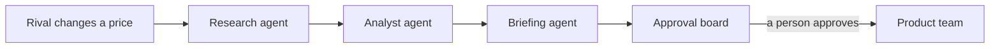

# Build AI teammates you can trust

You can build an agent demo. This course teaches the hard part. You put AI teammates on real work. Then you prove what they do, what they cost and what they must never do.

The course is for engineers, tech leads and PMs (product managers). PMs have a full path too. Their steps ask for files, not code.

## Two tracks

The instructor builds one big agent live. You build a second one yourself.

- **Instructor track.** A medical affairs team at a drug company asks questions about labels and sales. The instructor builds the agent for them, one module at a time.
- **Your track.** Mission Control is a product team at a software company. Three agents do market research, product analysis and weekly briefings. They work behind an approval board. You build it in four labs.

For example, a rival raises its price from USD 49 to USD 79. The research agent spots it. The analyst agent checks what it means for churn. The briefing agent drafts a note. A person approves the note before anyone sees it.



## Move through the course

Every module and lab has a checkpoint. A checkpoint is a branch with the repo as it stands at that point. Pick one and jump to it.

```bash
bun run goto foundation
```

Expect: a list of the TODO items for that checkpoint, and your own lab files kept as they were.

If your tree has changes, goto stops and tells you to commit them first. Nothing you wrote is lost.

The course gets fixes. Run `bun run goto` with the same name again to pick up the newest checkpoint.

## The modules and labs

| Name                          | The job                                                          |
| ----------------------------- | ---------------------------------------------------------------- |
| foundation                    | See why a plain chatbot fails a medical affairs team             |
| gateway-tracing               | Show the team why an answer came out and what it cost            |
| documents-freshness           | Make sure the agent quotes the current label, never the old one  |
| intent-routing                | Send trivia and off-label requests down cheap, safe paths        |
| grounded-answer               | Give medical reviewers answers they can check line by line       |
| analytics-mcp                 | Answer territory sales questions without leaking prescriber data |
| surfaces                      | Let the team reach the agent where they already work             |
| access-control                | Keep each pharma tenant and each role inside its own lane        |
| approvals-memory              | Route an adverse event report to the safety officer for approval |
| guardrails-workers            | Watch for label changes overnight and survive a crash            |
| release-gate                  | Stop a one line change from bringing back the old label          |
| research-knowledge (lab)      | Tell the product lead when a rival changes its price             |
| product-intelligence-bi (lab) | Spot churn risk in the product funnel                            |
| tenancy-and-memory (lab)      | Stop Core Growth from reading the Titan memo                     |
| always-on-teammates (lab)     | Publish the Monday briefing after a person approves it           |

## Check your work

```bash
bun run check
```

Expect: every check prints a line, and the command ends with no error.

The two case studies in `case-studies/` explain the real systems this course is modelled on. Read `STANDARD.md` for the rules every page and every line of code follows.
