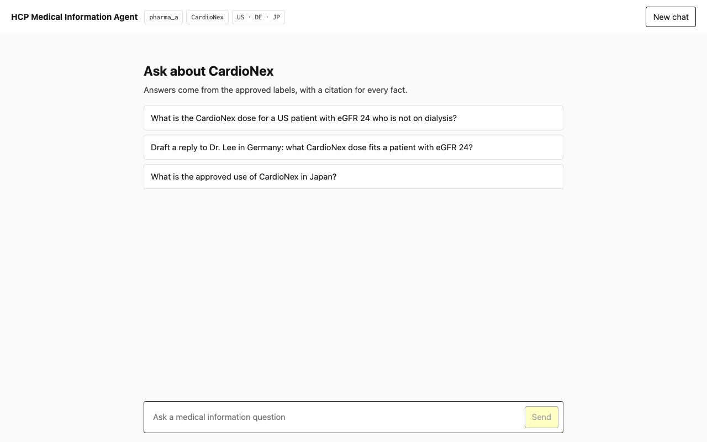

# Agentic AI Buildcamp: the AI engineering loop with Langfuse

You build one small agent and run the whole loop on it: tracing, prompt management, monitoring, datasets, experiments and evaluation. Every step runs on your own laptop. Langfuse runs locally in Docker, and the model runs on OpenRouter.

The agent is the HCP Medical Information Agent. Doctors and pharmacists ask a medical information desk about five invented medicines. The agent answers from a label library and names the label it used. Under the hood it is a plain OpenAI SDK tool-calling loop with two local tools.




## Run it

You need Docker with about 6 GB of memory, Node `>=22.18.0`, and an OpenRouter key with a few dollars of credit.

```bash
docker compose -f langfuse/docker-compose.yml -f langfuse/workshop.override.yml up -d
cp .env.example .env      # then set OPENAI_API_KEY to your OpenRouter key
npm ci
npm run dev
```

Open the app at [http://localhost:3333](http://localhost:3333) and Langfuse at [http://localhost:5174](http://localhost:5174). Sign in to Langfuse as `learner@workshop.local` with the password `workshop-password`.

## Lessons

Each lesson names the checkpoint tag to check out, what to change, and how to check that it worked.

| Step | Lesson | Checkpoint | What you do |
| --- | --- | --- | --- |
| 00 | [Setup](./docs/learner/00-setup.md) | `checkpoint/00-setup` | Start Langfuse, add your keys, run the app. |
| 01 | [Base app](./docs/learner/01-base-app.md) | `checkpoint/01-base-app` | Tour the running app. Nothing to build. |
| 02 | [Tracing](./docs/learner/02-tracing.md) | `checkpoint/02-tracing` | Trace every agent step: generations, the agent root and tool calls. |
| 03 | [Prompt management](./docs/learner/03-prompt-management.md) | `checkpoint/03-prompt-management` | Move the system prompt into Langfuse and link it to every generation. |
| 04 | [Monitoring](./docs/learner/04-monitoring.md) | `checkpoint/04-monitoring` | Read production traces: error analysis and live signals. |
| 05 | [Build eval datasets](./docs/learner/05-dataset.md) | `checkpoint/05-dataset` | Turn the failures from error analysis into a dataset. |
| 06 | [Experiments](./docs/learner/06-experiments.md) | `checkpoint/06-experiments` | Run the agent on the dataset and score every item. |
| 07 | [Evaluate a change](./docs/learner/07-evaluation.md) | `checkpoint/07-evaluation` | Change the prompt, rerun the dataset, compare the two runs. |
| 08 | [Wrap-up](./docs/learner/08-wrap-up.md) | `checkpoint/08-wrap-up` | Apply the loop to your own app. |

Helper commands used by the lessons:

```bash
npm run prompt:publish                  # lesson 03: publish the agent prompt
npm run langfuse:seed:error-analysis    # lesson 04: 20 traces for error analysis
npm run dataset:seed                    # lesson 05: the 27-item eval dataset
npm run dataset:run                     # lessons 06 and 07: one scored experiment run
```

## How the checkpoints work

`main` holds the finished app. For hands-on work, check out the tag named at the top of the lesson, make the change it asks for, and check the result before you move on.

`checkpoint/00-setup` and `checkpoint/01-base-app` hold the same untraced app. Setup uses it to check keys, install and ports. Base app uses it for the tour. Tracing starts in `checkpoint/02-tracing`.

The server and the npm scripts read the repository `.env` first, so a stray shell export from another project does not win. Change keys, the Langfuse host, prompt labels and dataset names in that file.

## Repository layout

- [`docs/learner/`](./docs/learner/) holds the lessons.
- [`docs/images/`](./docs/images/) holds the screenshots and diagrams, one folder per lesson.
- [`langfuse/`](./langfuse/) holds the local Langfuse stack.
- [`src/`](./src/) holds the sample app.
- [`scripts/`](./scripts/) holds the prompt, seed and dataset scripts.
- [`data/`](./data/) holds the eval dataset.

## Where to go next

- Start at [`docs/learner/00-setup.md`](./docs/learner/00-setup.md) and walk the lessons in order.
- Or jump to the lesson that matches what you want to learn. Each one starts from its own checkpoint.
- Install the [Langfuse skill](https://github.com/langfuse/skills) (`/langfuse`) to apply the same patterns to your own codebase.
- For the bigger picture behind each lesson, read the [Langfuse Academy](https://langfuse.com/academy).
- To see where this loop goes in a real company, read the two case studies: [an enterprise HCP system](./case-studies/enterprise-agentic-hcp-system.md) and [autonomous AI teammates](./case-studies/autonomous-ai-teammates.md).

## Credits and license

This buildcamp is adapted from the Langfuse workshop. MIT, see [LICENSE](LICENSE).
