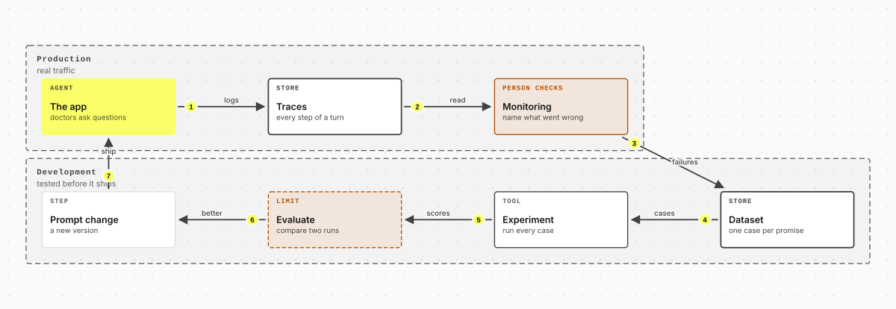

# Agentic AI Buildcamp: build a medical desk agent you can prove is safe

Doctors ask a drug company's medical desk about its medicines. In this course you build an AI agent that answers them in seconds. It answers only from approved label text, and it names the label it used. For example, a dose answer cites the label section that holds the dose. A risky question waits for a person.

You build it one part at a time. You prove each part with real tests on a real model. Every part runs on your own laptop.




## Run it

You need three things:

- Docker with about 6 GB of memory.
- Node `>=22.18.0`.
- An OpenRouter key with a few dollars of credit.

```bash
npm ci
npm run setup    # the first run makes .env; put your OpenRouter key in OPENAI_API_KEY and run it again
npm run dev
```

`npm run setup` checks Node and Docker, then starts Langfuse, Postgres, Keycloak, OpenFGA and Docling. It adds the demo users and reads the label PDFs. It loads the sales data, publishes the prompt and seeds the dataset. Last, it sends one model call through the gateway to prove it all works.

Run it again at any time. Each step skips what is already done, and it never prints a key or a password.

The two gateway keys are made by hand in Langfuse. So the first run stops once with a short list of clicks. Lesson 10 shows each screen. Lesson 00 walks the same setup one step at a time.

The app runs at [http://localhost:3333](http://localhost:3333). Langfuse, which keeps the traces, runs at [http://localhost:5174](http://localhost:5174). Sign in to it with the details below.

```text
email:    learner@workshop.local
password: workshop-password
```

## Lessons

Each lesson starts from a checkpoint tag. It shows the problem, how the part works, how to build it and how to prove it. [The walkthrough](./docs/walkthrough.md) shows the whole system on one page, with every new word defined once.

| Step | Lesson | Checkpoint | The question it answers |
| --- | --- | --- | --- |
| 00 | [Run the whole course on your own laptop](./docs/learner/00-setup.md) | `checkpoint/00-setup` | Can I run the whole system on my laptop? |
| 01 | [Follow one chat turn through an agent](./docs/learner/01-base-app.md) | `checkpoint/01-base-app` | What does the desk do before we measure it? |
| 02 | [See every step an agent takes](./docs/learner/02-tracing.md) | `checkpoint/02-tracing` | What did the agent read and do for one answer? |
| 03 | [Change an agent's behavior without a deploy](./docs/learner/03-prompt-management.md) | `checkpoint/03-prompt-management` | How do we change the instructions without a deploy? |
| 04 | [Find what goes wrong in production](./docs/learner/04-monitoring.md) | `checkpoint/04-monitoring` | Which failures happen most in real answers? |
| 05 | [Write down what your agent must get right](./docs/learner/05-dataset.md) | `checkpoint/05-dataset` | Which questions prove the desk works? |
| 06 | [Score your agent on every case](./docs/learner/06-experiments.md) | `checkpoint/06-experiments` | How good is the desk today, in numbers? |
| 07 | [Compare two runs to see if a change helped](./docs/learner/07-evaluation.md) | `checkpoint/07-evaluation` | Did the fix help, and did it break anything? |
| 08 | [Read your scoreboard as one improvement loop](./docs/learner/08-midpoint.md) | `checkpoint/08-midpoint` | How do the first parts fit together? |
| 09 | [Check a judge against people before you trust it](./docs/learner/09-advanced-evals.md) | `checkpoint/09-advanced-evals` | Can a model grade what code cannot check? |
| 10 | [Put every model call behind one door with a daily budget](./docs/learner/10-ai-gateway.md) | `checkpoint/10-ai-gateway` | How do we keep model calls safe and paid for? |
| 11 | [Check who is asking and what they may read before the model sees anything](./docs/learner/11-sign-in-and-permissions.md) | `checkpoint/11-sign-in` | How does each person see only their own company's data? |
| 12 | [Open a second door with the same walls and run untrusted code in a sandbox](./docs/learner/12-mcp-and-sandbox.md) | `checkpoint/12-mcp-sandbox` | How do outside tools use the desk safely? |
| 13 | [Route each request by risk and keep approvals when the server restarts](./docs/learner/13-durable-state-and-review.md) | `checkpoint/13-durable-review` | Which answers need a person, and how do they wait? |
| 14 | [Check every sales email against approved claims](./docs/learner/14-fact-checker-and-outreach.md) | `checkpoint/14-content-agents` | How do staff agents stay inside the rules? |
| 15 | [Hand work between agents without losing who asked](./docs/learner/15-agents-hand-off-over-a2a.md) | `checkpoint/15-a2a` | How do agents hand work to each other? |
| 16 | [Start agents from events and handle each one once](./docs/learner/16-event-driven-agents.md) | `checkpoint/16-events` | How do agents start from events without double work? |
| 17 | [Let an agent work alone inside limits code enforces](./docs/learner/17-autonomous-agent.md) | `checkpoint/17-autonomy` | How does an agent run with nobody watching? |
| 18 | [Block a bad change before it ships](./docs/learner/18-release-gate.md) | `checkpoint/18-release-gate` | How do we stop a bad prompt before it ships? |
| 19 | [Ask and review from the terminal with the same permissions](./docs/learner/19-cli.md) | `checkpoint/19-cli` | How does a terminal client sign in and stream? |
| 20 | [Find the right label section by meaning from the PDFs](./docs/learner/20-rag.md) | `checkpoint/20-rag` | How does the desk search the real label PDFs? |
| 21 | [Check every citation before the answer is sent](./docs/learner/21-citations.md) | `checkpoint/21-citations` | How do we check every citation before it is sent? |
| 22 | [Let an agent write SQL without reading other companies' data](./docs/learner/22-insights.md) | `checkpoint/22-insights` | How can an agent write SQL without reading another company's rows? |

The commands the lessons use:

```bash
npm run prompt:publish                  # lesson 03: publish the agent prompt
npm run langfuse:seed:error-analysis    # lesson 04: 20 traces for error analysis
npm run dataset:seed                    # lesson 05: the eval dataset, one case per promise
npm run dataset:run                     # lessons 06 and 07: one scored experiment run
npm run dataset:run -- --chapter 07 --change "..."  # the same run, plus one row in my-scoreboard.md
```

## How the checkpoints work

`main` holds the finished app. Each lesson names a tag at its top. Check out that tag, make the change the lesson asks for, and check the result.

`checkpoint/00-setup` and `checkpoint/01-base-app` hold the same app, with no tracing yet. Setup uses it to check keys and ports. Tracing starts in `checkpoint/02-tracing`.

The server and the scripts read the repository's `.env` file first. So a key set in your shell for another project does not win. Change keys, hosts, prompt labels and dataset names in that file.

## Repository layout

- [`docs/learner/`](./docs/learner/) holds the lessons, and [`docs/walkthrough.md`](./docs/walkthrough.md) the whole system.
- [`docs/images/`](./docs/images/) holds the screenshots and diagrams, one folder per lesson.
- [`langfuse/`](./langfuse/) holds the local trace store.
- [`src/`](./src/) holds the app.
- [`scripts/`](./scripts/) holds the prompt, seed, dataset and page check scripts.
- [`data/hcp/`](./data/hcp/) is a pinned copy of the dataset repo. It has the labels, the desk rules and the eval cases. [`docs/coverage.md`](./docs/coverage.md) maps each case to the promise it tests.

## Where to go next

- Start at the first lesson and walk them in order.
- Or jump to the lesson you need. Each one starts from its own checkpoint.
- Install the [Langfuse skill](https://github.com/langfuse/skills) (`/langfuse`) to use the same patterns on your own code.
- For more on each idea, read the [Langfuse Academy](https://langfuse.com/academy).
- To see where this goes in a real company, read the two case studies. One is [an enterprise HCP system](./case-studies/enterprise-agentic-hcp-system.md). The other is [autonomous AI teammates](./case-studies/autonomous-ai-teammates.md).

## Credits and license

This buildcamp is adapted from the Langfuse workshop. MIT, see [LICENSE](LICENSE).
