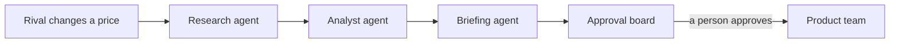

# Build AI teammates you can trust

You can build an agent demo. This course teaches the hard part. You put AI teammates on real work. Then you prove what they do, what they cost and what they must never do.

The course is for engineers, tech leads and PMs (product managers). PMs have a full path too. Their steps ask for files, not code.

## See the problem first

A plain chatbot sounds sure of itself. A medical affairs team cannot use that. It may quote an old drug label, answer in the wrong country or leak a private record.

For example, ask the naive agent for the OncoX dose. It may give the dose from a label that expired last year. Nothing tells you why, and nobody can check it.

Each module fixes one failure like this. You see it fail first. Then you build the fix and run a check that turns green.

## Follow the one-day workshop

The workshop runs in one line, from the first module to the last lab. Each step builds on the one before it. You never jump ahead.

Every step has a checkpoint. A checkpoint is a branch with the repo as it stands at that step. If you fall behind, jump to the checkpoint and carry on.

## Pick your track

- **Instructor track.** A medical affairs team at a drug company asks questions about labels and sales. The instructor builds the HCP showcase agent live. HCP means health care professional. There is one module for each step.
- **Participant track.** Mission Control is a product team at a software company. Three agents do market research, product analysis and weekly briefings. They work behind an approval board. You build it in four labs.

For example, a rival raises its price from USD 49 to USD 79. The research agent spots it. The analyst agent checks what it means for churn. The briefing agent drafts a note. A person approves the note before anyone sees it.



## Reach the agent on three surfaces

One agent answers on three surfaces. The answer is the same on each one.

- **Web.** The Agent Chat UI shows the answer and its chart in a browser.
- **Command line.** `bun run chat` shows the same answer in your terminal.
- **MCP.** MCP is a shared way for chat tools to call your tools. You try it with the MCP Inspector and with Goose.

The surfaces module builds all three. Until you reach it, start the web door and ask one question.

```bash
bun run serve
```

Expect: a line that says the team is on a local address.

```bash
bun run ask --question "Which territory led OncoX new prescriptions from July to September?"
```

Expect: one line with a territory and a total. It needs a model key, or a recorded reply.

## Move between checkpoints

Every module and lab is named by a short slug. A slug is the name in the list that follows. Pick a slug and jump to it.

```bash
bun run goto foundation
```

Expect: a list of the TODO items for that checkpoint, and your own lab files kept as they were.

If your tree has changes, goto stops and tells you to commit them first. Nothing you wrote is lost.

The course gets fixes. Run `bun run goto` with the same slug again to pick up the newest checkpoint.

To prove a step is done, run its check by slug.

```bash
bun run verify foundation
```

Expect: green badges and the line "Every check passed."

## Read the module and lab list

The list comes from `src/workshop.ts`. The number in front is the page number.

| Number | Slug                    | The job                                                          |
| ------ | ----------------------- | ---------------------------------------------------------------- |
| 00     | foundation              | See why a plain chatbot fails a medical affairs team             |
| 01     | gateway-tracing         | Show the team why an answer came out and what it cost            |
| 02     | documents-freshness     | Make sure the agent quotes the current label, never the old one  |
| 03     | intent-routing          | Send trivia and off-label requests down cheap, safe paths        |
| 04     | grounded-answer         | Give medical reviewers answers they can check line by line       |
| 05     | agent-loop              | Answer a question that needs three lookups, and stop a loop      |
| 06     | langgraph-agent         | Finish a half-done answer after the server dies                  |
| 07     | analytics-mcp           | Answer territory sales questions without leaking prescriber data |
| 08     | surfaces                | Let the team reach the agent where they already work             |
| 09     | access-control          | Keep each pharma tenant and each role inside its own lane        |
| 10     | approvals-memory        | Route an adverse event report to the safety officer for approval |
| 11     | guardrails-workers      | Watch for label changes overnight and survive a crash            |
| 12     | release-gate            | Stop a one line change from bringing back the old label          |
| Lab 01 | research-knowledge      | Tell the product lead when a rival changes its price             |
| Lab 02 | product-intelligence-bi | Spot churn risk in the product funnel                            |
| Lab 03 | tenancy-and-memory      | Stop Core Growth from reading the Titan memo                     |
| Lab 04 | always-on-teammates     | Publish the Monday briefing after a person approves it           |

Modules 05 and 06 are still being written. Their pages arrive with their code.

## Set up a workshop repo

Only the course team does this. A workshop repo gets one branch for each module and lab. Every branch starts from a release tag, never from another checkpoint. A tag never moves, so every workshop starts from the same place.

Look first with a dry run. It changes nothing.

```bash
bun scripts/branch-workshop.ts v1.0.0 --dry
```

Expect: one WOULD MAKE line for each branch, or a message that the name is not a release tag.

## Check your work

```bash
bun run check
```

Expect: every check prints a line, and the command ends with no error.

The two case studies in `case-studies/` explain the real systems this course is modelled on. Read `STANDARD.md` for the rules every page and every line of code follows.
