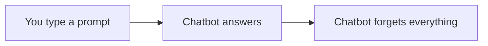
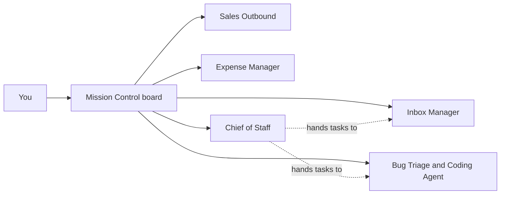

# Case Study 2: Autonomous AI Teammates

## The problem

Most teams lose hours every day on repeat digital jobs. Inboxes fill up. Sales leads go cold. Expense receipts pile up. Software bugs wait, and nobody fixes them.

Normal AI chatbots cannot fix this. They work only when you type a prompt. They forget everything when you close the tab. They cannot take real action in your company apps.

## Project goals

- **Hire digital coworkers:** Make special AI teammates. Each one owns a whole job, from start to finish. They work day and night.
- **Work in real tools:** Connect the bots to email, chat, code and documents. They do real work, not only talk.
- **Stay in control and safe:** People control the big actions. The bots run on your own servers, with the AI models you choose.

## What the system does

We build Mission Control. It is a team of AI bots. They work next to you, like employees.

For example, the Inbox Manager sorts your emails every morning. It archives spam. It holds an important draft for you to read. You stay in charge of what gets sent.

Each bot has one job:

- **Inbox Manager:** Sorts unread emails. Archives spam. Replies to routine meeting emails. Holds important drafts for you.
- **Sales Outbound:** Finds new leads. Tracks prospects who went quiet. Prepares follow-up emails.
- **Expense Manager:** Matches receipts to bank payments. Files expense reports.
- **Bug Triage and Coding Agent:** Repeats reported bugs. Writes the steps in GitHub issues. Makes code changes.
- **Talent Scout:** Reads job applications. Picks the best candidates.
- **Account Manager and Paid Media:** Tracks customer renewals. Checks daily ad spend changes.
- **Chief of Staff:** Writes a daily summary. Coordinates the other bots.

The system has these main features:

- **Works in your apps (MCP):** Bots connect to Gmail, GitHub, Notion and custom tools. MCP is a standard way for AI to use apps. A bot can also use a computer screen to click and type.
- **Message them anywhere:** Talk to your bots in Slack, Microsoft Teams, iMessage, SMS, WhatsApp, Telegram or a phone app.
- **Wakes up on its own:** Bots run on a schedule, like every weekday morning. They also start when a webhook fires or a new GitHub issue opens. This works even when your computer is off.
- **Learns by watching:** You record yourself doing a task once. The bot saves those exact steps as a skill it can reuse.
- **Remembers and shares:** Bots remember rules, like "keep replies short". They share this memory across the team.
- **Hands off work:** Bots pass tasks to each other. Groups of bots finish big jobs together. This is called agent-to-agent (A2A) handoff.
- **Strict limits and voice calls:** You choose which actions a bot can take alone. Other actions need you to click **Approve** or **Deny**. If a bot faces an urgent choice, it calls you in the app.
- **Self-hosted and model choice:** Run everything on your own computer or private cloud. Pick a different AI brain for each bot. You can use Claude, ChatGPT, Grok, or private models with Ollama and LM Studio.

## What you will build in this project

1. **Mission Control board:** A main dashboard. You assign jobs here, track progress, and approve or deny risky bot actions.
2. **Multi-agent team:** At least two bots, such as an Inbox Manager and a Chief of Staff. They wake on triggers, use real app tools, hand tasks to each other, and save memory safely.
