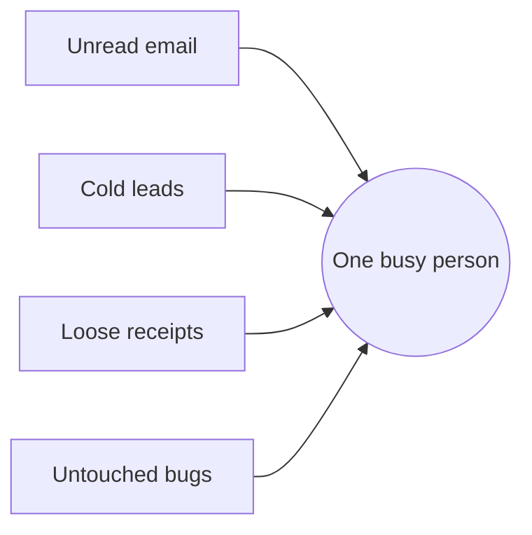

# Case study 2: Autonomous AI Teammates

A KaaS.team case study. You get a real business problem. You design the answer. Then you build one slice of it.

## How to use this brief

1. Read the whole brief once.
2. Do Part A. Design the system and write down your choices.
3. Do Part B. Pick one idea and build it.
4. Hand in both. See "What to hand in" at the end.

There is no single right answer. We care how you think through a messy problem and what you trade off.

## The situation

Most teams lose hours every day to repeat chores on a screen. Inboxes overflow. Sales leads go cold. Expense receipts pile up. Software bugs sit untouched.

An ordinary AI chatbot does not fix this. It has three limits:

- It only works when you type a prompt.
- It forgets everything when you close the tab.
- It cannot take real action inside your company apps.

For example, Mia runs a small sales team. Each morning she spends the first part of her day sorting email, chasing quiet leads and matching receipts. A chatbot can write one reply for her. It cannot sort the inbox, remember that Acme renews in March, or file the expense report.

## Goals

- **Hire digital coworkers.** Build specialized AI teammates. Each one owns a whole job from start to finish, around the clock.
- **Work in real tools.** Connect each teammate to email, chat, code and documents. They do real work, not just talk.
- **Total ownership and safety.** Keep humans in control of big actions. Run on your own servers and with the AI models you choose.

## What the company wants built

A **Mission Control** system. A team of specialized AI bots works beside you like human employees.

**Give each bot one job.**

- **Inbox manager.** Sorts unread email, archives spam and replies to routine scheduling threads. Holds important drafts for you to read.
- **Sales outbound.** Researches new leads, tracks quiet prospects and queues follow-up emails.
- **Expense manager.** Matches receipts to bank payments and files expense reports.
- **Bug triage and coding agent.** Reproduces reported bugs, writes the steps in a GitHub issue and makes code edits.
- **Talent scout.** Reads job applications and shortlists the best people.
- **Account manager and paid media.** Tracks customer renewals and checks daily ad spend changes.
- **Chief of staff.** Prepares the daily briefing and coordinates the other bots.

**What every bot can do.**

- **Work inside your apps.** Bots connect to Gmail, GitHub, Notion and custom tools through MCP. They can even use a computer screen to click and type.
- **Take messages anywhere.** You chat with a bot in Slack, Microsoft Teams, iMessage, SMS, WhatsApp, Telegram or a mobile app.
- **Wake up on their own.** Bots run on a schedule, such as every weekday morning. They also wake up when a webhook fires or a new GitHub issue opens, even while your computer is off.
- **Learn by watching.** You record yourself doing a task once. The bot saves those steps as a skill it can reuse.
- **Remember and share.** Bots keep rules such as "keep replies short" or "Acme renews in March". They share that memory across the team.
- **Hand off tasks.** Bots pass work to each other. They team up in groups to finish big jobs. This is called agent-to-agent, or A2A, handoff.
- **Respect approval limits.** You decide which actions a bot may take alone. Other actions wait for you to click Approve or Deny. If a bot meets an urgent decision, it calls you in the app to talk it through.
- **Run where you choose.** You can run everything on your own machine or private cloud. You pick a different AI model for each bot. That can be a hosted model or a local private one.

## Part A: Design the system

Write your answers in any format you like. A document, slides, a board or clear sketches all work. Cover each group below.

### 1. The problem in your words

- State the problem more clearly than this brief does. Keep it short and scoped.
- List the riskiest guesses you made. Say which you would test first.

### 2. The system

- What are the main pieces? How do they connect? What trade-offs did you weigh?
- How does a bot reach real apps and tools safely?
- What wakes a bot up? How does a job survive a crash or a restart?
- Where does memory live? Which memory is private to a bot, and which is shared by the team?
- How do bots hand work to each other without looping or losing the task?
- How do people reach a bot, from chat, the dashboard and voice?

### 3. Bots and people

- Which actions may a bot take alone? Which need an Approve click? Which must a bot never take?
- How do you set and change those limits for each bot?
- How is every step recorded, so you can see what a bot did and why?

### 4. Safety and ownership

- How do you stop a bot that goes wrong?
- How do you keep keys and private data inside your own servers?
- How do you let each bot use a different AI model, and what changes when you swap one?

### 5. Running it

- What engineering rules would your team follow?
- How do you know a release is safe to ship? How do you keep checking once it is live?
- How do you watch cost per bot?

### 6. Scope and success

- What goes in the first release? What waits?
- How would you measure that it works?

## Part B: Build one slice

Pick one idea. Build a narrow slice that a business reader can click through or run, and understand at once. Tell us why you picked it.

**Idea 1: Mission Control board.** A dashboard and task queue. You assign jobs, follow progress and approve or deny sensitive bot actions.

**Idea 2: Two bots that work together.** At least two bots, such as an inbox manager and a chief of staff. They wake up on triggers and use real app tools. They hand tasks to each other and save memory safely.

**Idea 3: A bot that wakes on its own.** One bot that starts from a schedule or a webhook. It does a real job with a real tool, asks for approval on one risky step and remembers a rule for next time.

Your Part A design must show how your slice would work in production, even if your slice is a demo.

## Rules

- **Humans hold the big actions.** A bot never sends money, deletes data or messages a customer without an approval you set.
- **Show the "no" moments.** Show what happens when a bot should not act, when you deny it, and when it cannot reach a tool.
- **Show why a step is safe.** Anyone must be able to see what the bot did, which tool it used and who approved it.
- **Use test accounts and made-up data.** While you build, use fake inboxes, fake receipts and fake customers. Never use real accounts or real people.
- **Keep it yours.** Your design must run on your own machine or private cloud. It must work with more than one AI model.

## What good looks like

- Your problem statement is clearer than ours, and you test the riskiest guesses first.
- Your design holds up when a technical reader asks hard questions.
- Safety and approval limits are built in from the start.
- You draw a clear line on how much freedom each bot gets, and where people stay in control.
- Your slice makes sense to a business reader at a glance.
- Your first release is small, and you can say how you would know it works.
- Your write-up works for two readers: a busy team lead and an engineer who will run it.

## What to hand in

1. Your design from Part A, in any format.
2. Your slice from Part B, as a link or files we can open.
3. A short list of edge cases and open questions you did not solve.

Use AI tools freely to design, code and write. The thinking and the judgment must be yours.
