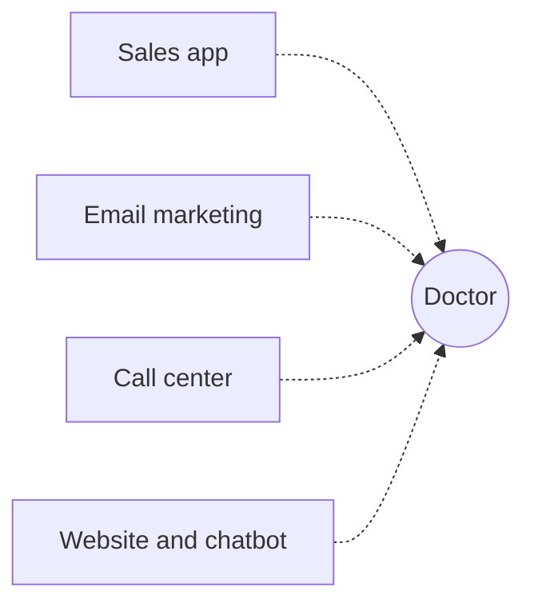

# Case study 1: Enterprise Agentic HCP System

A KaaS.team case study. You get a real business problem. You design the answer. Then you build one slice of it.

## How to use this brief

1. Read the whole brief once.
2. Do Part A. Design the system and write down your choices.
3. Do Part B. Pick one idea and build it.
4. Hand in both. See "What to hand in" at the end.

There is no single right answer. We care how you think through a messy problem and what you trade off.

## The situation

A global medicine company talks to doctors, nurses and pharmacists every day. The company calls them Healthcare Professionals, or HCPs.

Four separate computer systems touch each HCP. They do not talk to each other.

| System            | What it does                                                                |
| ----------------- | --------------------------------------------------------------------------- |
| Sales app (CRM)   | Sales reps write meeting notes, sample requests and follow-ups              |
| Email marketing   | Sends newsletters and training programs                                     |
| Call center       | Doctors call with questions about medicine safety and doses                 |
| Website and chatbots | Doctors look up drug facts on their own                                  |

Each arrow is a team acting alone. No team can see what the others did.

For example, Dr. Rao asks the call center about a dose on Monday. On Tuesday the email tool sends her a newsletter about the same medicine. On Wednesday a rep calls to repeat it. Nobody knows the doctor already has an answer.

## What goes wrong today

1. **Spamming doctors.** A doctor gets three identical emails from different teams, then a phone call that repeats them.
2. **Slow answers.** A simple medical question takes days. Medical and legal teams check it by hand.
3. **Lost notes.** Helpful notes from reps and call center staff stay trapped in separate apps. Nobody else can use them.
4. **Compliance risk.** Every message must use current, legally approved medical facts. Nobody can easily prove that it does.

## Goals

- **One shared profile.** Join all notes, emails and call records into one view of each doctor.
- **Fast, safe answers.** Answer doctor questions in minutes. Use only approved medical documents.
- **Proof and control.** Keep humans in charge of risky decisions. Record every step so legal teams can check it.

## What the company wants built

The company wants an AI system on the cloud (AWS). It connects all four tools. It uses agents to help staff work safely.

- **Medical question helper.** A doctor asks a question from any channel. An agent searches approved medical files and drafts a reply. If the question is tricky, or no approved answer exists, the agent stops. It hands the case to a human medical reviewer.
- **Smart outreach planner.** Before a rep or marketer contacts a doctor, an agent checks what the doctor already got or asked. It suggests the best next step. The human rep approves it.
- **Content fact-checker.** A marketer builds a new email. An agent checks every medical claim against approved source files. If a sentence was changed or is not approved, the agent flags it for a human.
- **Full audit trail.** Every draft shows the source file it came from, why it is safe and which human approved it.

## Part A: Design the system

Write your answers in any format you like. A document, slides, a board or clear sketches all work. Cover each group below.

### 1. The problem in your words

- State the problem more clearly than this brief does. Keep it short and scoped.
- List the riskiest guesses you made. Say which you would test first.

### 2. The system

- How does data from the four tools come together into one view of each doctor?
- What are the main pieces? How do they connect? What trade-offs did you weigh?
- How does the system know which content is approved right now? What happens when approval changes or is withdrawn?
- How does it work across countries, where approved content and data rules differ?
- How does it run on AWS? Why did you pick those services?

### 3. Agents and people

- Where may an agent act on its own? Where must a person approve? Where do you keep AI out completely?
- How does work move between agents, systems and people? How is each step recorded?
- How does every output trace back to approved source content?

### 4. Safety and proof

- How do you keep the system safe?
- How would you prove it to a legal and compliance team?

### 5. Running it

- What engineering rules would your team follow?
- How do you know a release is safe to ship? How do you keep checking once it is live?
- How would the team use AI tools to build and run it?

### 6. Scope and success

- What goes in the first release? What waits?
- How would you measure that it works?

## Part B: Build one slice

Pick one idea. Build a narrow slice that a business reader can click through or run, and understand at once. Tell us why you picked it.

**Idea 1: Medical question helper.** A question arrives from any channel. The agent finds an approved answer and drafts the reply. When it cannot answer from approved files, it hands the case to a medical reviewer. The reviewer sees what the agent did and why before anything goes out.

**Idea 2: Smart outreach planner.** Before any team contacts a doctor, the agent checks what that doctor already received and asked. It proposes the next step. A rep or marketer approves. Each suggestion points back to the source records.

**Idea 3: Content fact-checker.** The agent builds a draft email from approved content blocks. It checks each claim against its source. It sends anything changed or unapproved to the right reviewer.

Your Part A design must show how your slice would work in production, even if your slice is a demo.

## Rules

- **Know when to stop.** If the system cannot find an approved answer, it refuses to guess. It hands the task to a human.
- **Country rules.** The system checks local laws. A doctor in one country only sees content approved for that country.
- **Made-up data only.** While you build and test, use invented drug names and synthetic doctor profiles. Never use real product labels or real people.
- **Show the "no" moments.** Show what happens when the system should not answer or act. We care about these as much as the main flow.
- **Show why it is safe.** A compliance reviewer must see why each answer is safe to use, and where a person stays in control.

## What good looks like

- Your problem statement is clearer than ours, and you test the riskiest guesses first.
- Your design holds up when a technical reader asks hard questions.
- Safety is built in from the start, not added at the end.
- You draw a clear line on how much freedom agents get, and where people stay in control.
- Your slice makes sense to a business reader at a glance.
- Your first release is small, and you can say how you would know it works.
- Your write-up works for three readers: a technology lead, a medical lead and a compliance lead.

## What to hand in

1. Your design from Part A, in any format.
2. Your slice from Part B, as a link or files we can open.
3. A short list of edge cases and open questions you did not solve.

Use AI tools freely to design, code and write. The thinking and the judgment must be yours.
