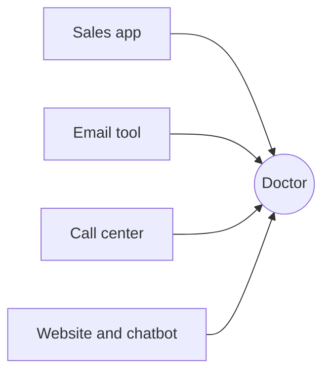
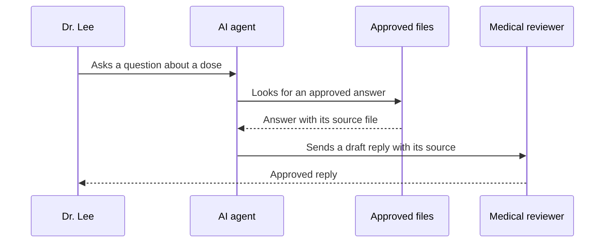

# Case Study 1: Enterprise Agentic HCP System

## The problem

A global medicine company talks to doctors, nurses and pharmacists every day. We call them HCPs. HCP means healthcare professional.

The company uses four computer systems. These systems do not talk to each other.

- **Sales app (CRM):** Sales reps write meeting notes here. They also send sample requests here.
- **Email tool:** It sends newsletters and training programs.
- **Call center:** Doctors call here with questions about medicine safety and doses.
- **Website and chatbots:** Doctors look up medicine facts here on their own.

Each system sends its own messages. None of them knows what the others sent.

Because the four systems are apart, four big problems happen:

1. **Too many emails:** A doctor gets three of the same emails from different teams. Then a phone call says the same thing again.
2. **Slow answers:** A simple medical question can take days. Medical and legal teams check each answer by hand.
3. **Lost notes:** Good notes from reps and call centers stay in one app. Other teams never see them.
4. **Risk to the company:** Every message must use medical facts that are up to date and approved. It is hard to prove that each message does.

## Project goals

- **One shared profile:** Put all notes, emails and call records in one place for each doctor.
- **Fast, safe answers:** Answer doctor questions in minutes. Use only approved medical files.
- **Proof and control:** People make the risky choices. The system records each step, so the legal team can check it.

## What the system does

We build an AI system on AWS, a cloud service from Amazon. It connects all four tools. AI helpers, called agents, help the staff in a safe way.

Meet Dr. Lee. Dr. Lee asks a question about the dose of a medicine. Here is what happens next.

If there is no approved answer, the agent stops. It does not guess. The reviewer answers instead.

For example, the agent finds an approved file for the dose. It writes a draft. A human reviewer checks the draft before Dr. Lee gets it.

The system has four main helpers:

- **Medical question helper:** It searches approved medical files for each question. It writes a draft reply. If the question is hard, it sends the question to a human medical reviewer.
- **Smart outreach planner:** Before a rep contacts a doctor, an agent checks what the doctor already got. It suggests the next step. A human rep approves it.
- **Content fact-checker:** When a new email is made, an agent checks each medical claim. It compares each claim with approved files. If a sentence is not approved, it flags it for a human.
- **Full audit trail:** Each draft shows its source file. It shows why it is safe. It shows which human approved it.

## Safety rules

- **Knows when to stop:** If no approved answer exists, the system does not guess. It gives the task to a human.
- **Country rules:** The system checks local laws. A doctor in one country sees only content approved for that country.
- **Fake test data only:** While we build and test, we use only made-up drug names and made-up doctor profiles.

## What you will build in this project

1. **The system blueprint:** A clear diagram. It shows how data moves from the four apps into one place. It shows who has permission. It shows where humans approve tasks.
2. **The working agent pipeline:** Code that takes a doctor's question. It checks approved documents. It traces each source. It waits for human approval before it sends anything.

## A worked example

Our reference build answers this same case study. Read its [system blueprint](https://github.com/learnwithparam/enterprise-agentic-architecture/blob/main/docs/blueprint.md) first. It has four diagrams, and each one has a legend. It shows how data moves in from the four apps. It shows which role sees which data. It lists every place a human decides.

Then read its [common mistakes](https://github.com/learnwithparam/enterprise-agentic-architecture/blob/main/docs/common-mistakes.md). Each mistake names the test that catches it. Check your own blueprint against that list before you submit.
