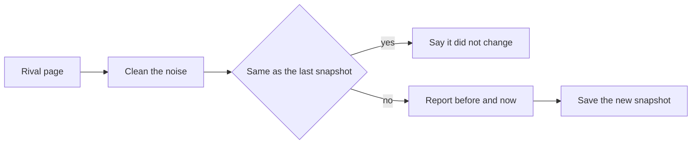

# Research rival pricing pages

Job: Tell the product lead when a rival changes its price.

## The story in one picture



## Why this matters

Brightloop is a software company. Its product lead, Priya, wants to know when a rival changes a price. She cannot read four websites each morning.

Your research teammate reads the pages for her. It keeps a **snapshot** of each page. The next day it compares the new page with the snapshot and says what moved.

A rival page is messy. It has a cookie banner, a script and a tab that stays closed. This **page noise** must not reach the report. The text in the closed tab must.

## What you will have at the end

- A page reader that drops the noise and keeps the closed tab.
- A snapshot for each rival, saved only when the page changes.
- A report with the old text and the new text.
- A reply for any question outside the job.

## See it fail first

How does the product lead learn that a rival raised its price? Right now she does not. Nobody reads the pages, and a guess from memory is a stale price.

For example, Pulsedesk charged 49 dollars last week. Today it charges 79 dollars and adds a free plan. A guess still says 49.

## Start from the lab checkpoint

This lab starts from the finished grounded agent. The rival pages come from a small local website, so the lab never reads the open web.

```bash
bun run goto research-knowledge
```

Expect: a message that you are now on the research-knowledge checkpoint, with a list of things to do.

## Step 1: read the page without the noise

The reader cuts scripts, styles and the cookie banner. Then it strips the tags. Text inside a closed tab stays.

### apps/product-teammates/src/research.ts

```ts
const NOISE = [
  /<script[\s\S]*?<\/script>/gi,
  /<style[\s\S]*?<\/style>/gi,
  /<div id="cookie-banner">[\s\S]*?<\/div>/gi,
];

// Keeps the words a person would read. A closed tab still counts, a cookie banner does not.
export function readPage(html: string): string {
  let text = html;
  for (const noise of NOISE) text = text.replace(noise, " ");
  text = text.replace(/<[^>]+>/g, " ");
  return text.replace(/\s+/g, " ").trim();
}
```

## Step 2: compare the page with the last snapshot

The first look saves a snapshot. A page with the same hash is left alone. A changed page is saved and returned with its old text.

### apps/product-teammates/src/research.ts

```ts
export async function watchRival(rival: string, html: string): Promise<Watch> {
  const after = readPage(html);
  const last = await lastSnapshot(rival);
  if (last === undefined) {
    await saveSnapshot(rival, after);
    return { rival, status: "first", before: "", after };
  }
  const hash = createHash("sha256").update(after).digest("hex");
  if (hash === last.hash) return { rival, status: "unchanged", before: last.text, after };
  await saveSnapshot(rival, after);
  return { rival, status: "changed", before: last.text, after };
}
```

## Step 3: write the report

A first look, an unchanged page and a change each get one plain sentence. A change shows the old text and the new text.

### apps/product-teammates/src/research.ts

```ts
export function reportOn(watch: Watch): string {
  if (watch.status === "first") return `${watch.rival}: first look saved. It says: ${watch.after}`;
  if (watch.status === "unchanged") return `${watch.rival} did not change.`;
  return `${watch.rival} changed. Before: ${watch.before} Now: ${watch.after}`;
}
```

## Verify the lab

```bash
bun run verify research-knowledge
```

Expect: six green badges and the line "Every check passed."

## Try it yourself

Break the new price on purpose and watch the check catch it. The seed command puts the page back afterwards.

```bash
sed -i '' 's/79 dollars/89 dollars/' .data/competitors/pulsedesk-after.html && bun run verify research-knowledge
```

Expect: a red badge on the price check with the line "The report lacks the new price."

```bash
bun run seed
```

Expect: the line "Seeded 16 documents and the data files" and a clean verify next time.

## Stuck?

| You see                                 | Why                                               | Fix                                                                        |
| --------------------------------------- | ------------------------------------------------- | -------------------------------------------------------------------------- |
| The report lacks the old price.         | watchRival does not keep the last snapshot text.  | In watchRival, return the saved text as before.                            |
| The cookie banner is in the report.     | readPage does not cut the banner.                 | In readPage, cut the banner, scripts and styles before you strip the tags. |
| The yearly price in the tab is missing. | readPage dropped the closed tab.                  | Strip tags only. Keep the text inside hidden sections.                     |
| The same page was saved twice.          | watchRival saves a snapshot when nothing changed. | Save a snapshot only when the hash differs from the last one.              |

If you are still stuck, start from a clean copy of this lab.

```bash
bun run goto research-knowledge
```

Expect: a message that you are now on the research-knowledge checkpoint, with a list of things to do.

## New words

- **snapshot**: A saved copy of a page as it looked on one day.
- **page noise**: Text on a page that is not the content, like a cookie banner or a script.
