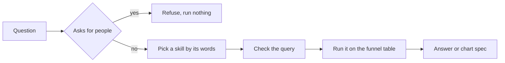

# Answer funnel questions with a second agent

Job: Tell the product lead which week activation fell and which plan churned.

## The story in one picture



## Why this matters

Priya, the product lead at Brightloop, asks for numbers every day. She wants to know where sign-ups are lost and which plan is leaving.

Your analyst teammate answers from a **funnel** table. It never writes its own query. It picks a **skill**. A skill is a small file. It holds the words that wake it and one query.

Code checks each query before it runs. A question for an email list gets a refusal. No query runs at all.

## What you will have at the end

- A skill file for churn that you write yourself.
- A picker that matches a question to a skill by its words.
- A runner that checks the query before it touches the database.
- A refusal for any question that asks for people.
- A chart spec for a question that says draw.

## See it fail first

Why did sign-ups turn into active users so rarely in one August week? Right now nobody can say. The teammate has no skill for numbers, so it replies that the question is outside its job.

For example, in one weak week the free plan activated only 32 in every 100 sign-ups. A guess cannot find that week. A query can.

## Start from the lab checkpoint

This lab starts from lab 01. The funnel table holds twenty weeks for the free, team and business plans.

```bash
bun run goto product-intelligence-bi
```

Expect: a message that you are now on the product-intelligence-bi checkpoint, with a list of things to do.

## Step 1: write the churn skill

A skill file holds a name, the words that wake it and one select query. This query shows every plan in the week with the highest churn.

### apps/product-teammates/skills/churn-risk-watch.ts

```ts
// The churn rate of every plan in the week where one plan churned the most.
export const skill: Skill = {
  name: "churn-risk-watch",
  when: ["churn"],
  sql: `SELECT plan, week_start::text AS week,
    round(churned::numeric / signups, 3) AS churn_rate
    FROM analytics.product_funnel
    WHERE week_start = (
      SELECT week_start FROM analytics.product_funnel
      ORDER BY churned::numeric / signups DESC LIMIT 1)
    ORDER BY churn_rate DESC`,
};
```

## Step 2: pick a skill and run it

The picker matches a question to a skill by its words. The runner checks the query first. A bad query throws before it reaches the database.

### apps/product-teammates/src/analyst.ts

```ts
const PERSONAL = ["email", "phone", "address"];

export function asksForPersonalData(question: string): boolean {
  const text = question.toLowerCase();
  return PERSONAL.some((word) => text.includes(word));
}

export function pickSkill(question: string, skills: Skill[]): Skill | undefined {
  const text = question.toLowerCase();
  return skills.find((skill) => skill.when.some((word) => text.includes(word)));
}

// The query is checked by code before it runs. A bad query never reaches the database.
export async function runSkill(skill: Skill, tags: Tags): Promise<Row[]> {
  const problem = guardQuery(skill.sql, OWNER);
  if (problem !== undefined) throw new Error(`Skill ${skill.name} cannot run: ${problem}.`);
  return traced("analyst.skill", tags, async (setAttributes) => {
    const found = await rows<Row>(skill.sql);
    setAttributes({ skill: skill.name, sql: skill.sql, row_count: found.length });
    return found;
  });
}
```

## Step 3: report numbers, refuse people and draw charts

The analyst refuses a question about people before any skill runs. A skill that draws returns a line spec. Every other skill returns plain numbers.

### apps/product-teammates/src/analyst.ts

```ts
function describe(found: Row[]): string {
  const lines = found.map((row) => {
    const pairs = Object.entries(row).map(([name, value]) => `${name}: ${value}`);
    return pairs.join(", ");
  });
  return lines.join("\n");
}

// A chart is a plain line spec. The first column is the x axis and the second is the y axis.
function lineSpec(skill: Skill, found: Row[]): string {
  const [xName, yName] = Object.keys(found[0]);
  const points = found.map((row) => [row[xName], row[yName]]);
  return JSON.stringify({ type: "line", title: skill.name, x: xName, y: yName, points });
}

export async function answerAnalysis(
  question: string,
  tags: Tags,
  skills: Skill[],
): Promise<AgentResult | undefined> {
  if (asksForPersonalData(question)) {
    const text = "I only report totals. I never list people or their contact details.";
    return { route: "refuse", text, citations: [] };
  }
  const skill = pickSkill(question, skills);
  if (skill === undefined) return undefined;
  const found = await runSkill(skill, tags);
  let text = describe(found);
  if (skill.chart === true && found.length > 0) text = `chart: ${lineSpec(skill, found)}`;
  return { route: "answer", text, citations: [skill.name] };
}
```

## Verify the lab

```bash
bun run verify product-intelligence-bi
```

Expect: seven green badges and the line "Every check passed."

## Try it yourself

Make the churn skill unsafe on purpose and watch the runner refuse it.

```bash
sed -i '' 's/FROM analytics.product_funnel/FROM pharma_a.territory_rx_weekly/' apps/product-teammates/skills/activation-dip.ts && bun run verify product-intelligence-bi
```

Expect: a red badge on the activation check, because the runner refuses a table from another workspace.

```bash
git checkout apps/product-teammates/skills/activation-dip.ts
```

Expect: no output, and the skill file is back to normal.

## Stuck?

| You see                                     | Why                                                                     | Fix                                                                 |
| ------------------------------------------- | ----------------------------------------------------------------------- | ------------------------------------------------------------------- |
| The Business rate                           | The skill returns only the worst plan, so no other plan sits beside it. | Remove the limit and filter on the worst week, so every plan shows. |
| The churn-risk-watch skill file is missing. | The file is not in the skills folder.                                   | Save the file as apps/product-teammates/skills/churn-risk-watch.ts. |
| was allowed to run                          | runSkill does not check the query first.                                | In runSkill, call guardQuery and throw when it names a problem.     |
| An email address reached a span.            | The question for emails ran a query.                                    | Refuse a personal question before any skill runs.                   |

If you are still stuck, start from a clean copy of this lab.

```bash
bun run goto product-intelligence-bi
```

Expect: a message that you are now on the product-intelligence-bi checkpoint, with a list of things to do.

## New words

- **skill**: A small file with the words that wake it and one query to run.
- **funnel**: The steps from a new sign-up to an active user, with the people lost at each step.
