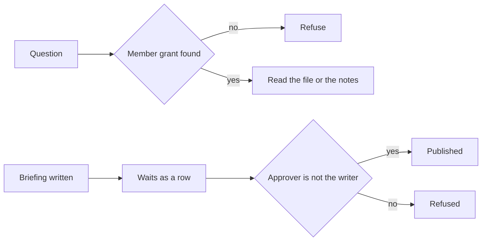

# Keep two workspaces apart

Job: Keep a secret deal away from the team that must not see it.

## The story in one picture



## Why this matters

Brightloop has two teams in one app. Core Growth works on sign-ups and pricing. Enterprise Stealth works on a deal that nobody else may know about.

Each team has its own **workspace**. A person may read a workspace only when a **member grant** says they belong to it. The agent checks the grant first, before it opens any file.

Notes follow the same rule. Priya tells the agent how she likes a briefing written. That note stays with Priya, inside her own workspace.

A briefing is different again. It needs a second person to approve it. The writer can never be that person.

## What you will have at the end

- A wall that hides the secret memo from people outside the workspace.
- Tone notes kept for one person in one workspace.
- A briefing that waits as a row until an approver decides.
- A rule that a writer cannot approve their own briefing.

## See it fail first

Can Priya read the memo of a secret deal by asking nicely? Right now the answer depends on luck. Nothing in the teammate looks at who is asking.

For example, Priya asks what is in the Titan memo. A teammate with no wall reads the file and hands her the deal size. Marcus works on that deal, so he should see it. Priya should not.

## Start from the lab checkpoint

This lab starts from lab 02. The grants table already says who belongs to which workspace, and who may approve briefings.

```bash
bun run goto tenancy-and-memory
```

Expect: a message that you are now on the tenancy-and-memory checkpoint, with a list of things to do.

## Step 1: check the member grant before you read

A person is a member when one row in the grants table says so. The memo file opens only for a member.

### apps/product-teammates/src/workspace.ts

```ts
export async function isMember(person: string, workspace: string): Promise<boolean> {
  const found = await rows(
    "SELECT 1 FROM grants WHERE person = $1 AND relation = 'member' AND object = $2",
    [person, workspace],
  );
  return found.length > 0;
}

export async function homeWorkspace(person: string): Promise<string> {
  const found = await rows<{ object: string }>(
    "SELECT object FROM grants WHERE person = $1 AND relation = 'member' ORDER BY object LIMIT 1",
    [person],
  );
  if (found.length === 0) throw new Error(`${person} belongs to no workspace.`);
  return found[0].object;
}

// The wall comes first. A person outside the workspace never reaches the file.
export async function readMemo(person: string, workspace: string): Promise<string | undefined> {
  if (!(await isMember(person, workspace))) return undefined;
  const file = Bun.file(join(ROOT, ".data", "workspaces", `${workspace}-memo.txt`));
  if (!(await file.exists())) return undefined;
  return (await file.text()).trim();
}
```

## Step 2: keep tone notes in one workspace

A note belongs to a person and a workspace. The query filters on both, so a note never crosses over.

### apps/product-teammates/src/workspace.ts

```ts
export async function rememberTone(person: string, workspace: string, note: string): Promise<void> {
  await setupWorkspace();
  await rows("INSERT INTO tone_notes (workspace, person, note) VALUES ($1, $2, $3)", [
    workspace,
    person,
    note,
  ]);
}

export async function recallTone(person: string, workspace: string): Promise<string | undefined> {
  await setupWorkspace();
  const found = await rows<{ note: string }>(
    `SELECT note FROM tone_notes WHERE person = $1 AND workspace = $2
     ORDER BY id DESC LIMIT 1`,
    [person, workspace],
  );
  if (found.length === 0) return undefined;
  return found[0].note;
}
```

## Step 3: hold a briefing until an approver decides

A briefing is a row with a status. The approver must hold the approves grant, and must not be the writer. A decision happens once.

### apps/product-teammates/src/workspace.ts

```ts
export async function submitBriefing(writer: string, workspace: string, body: string) {
  await setupWorkspace();
  const [row] = await rows<{ id: number }>(
    "INSERT INTO briefings (writer, workspace, body) VALUES ($1, $2, $3) RETURNING id",
    [writer, workspace, body],
  );
  return row.id;
}

// One decision, once. The writer can never be the approver.
export async function approveBriefing(id: number, approver: string): Promise<void> {
  await inTransaction(async (run) => {
    const found = await run("SELECT * FROM briefings WHERE id = $1 AND status = 'pending'", [id]);
    if (found.rows.length === 0) throw new Error(`Briefing ${id} is not waiting.`);
    const briefing = found.rows[0] as { writer: string; workspace: string };
    if (briefing.writer === approver)
      throw new Error("A writer cannot approve their own briefing.");
    const grant =
      "SELECT 1 FROM grants WHERE person = $1 AND relation = 'approves' AND object = $2";
    const allowed = await run(grant, [approver, "briefings"]);
    if (allowed.rows.length === 0) throw new Error(`${approver} may not approve briefings.`);
    const update = "UPDATE briefings SET status = 'published', approved_by = $2 WHERE id = $1";
    await run(update, [id, approver]);
  });
}

export async function publishedIn(workspace: string): Promise<string[]> {
  await setupWorkspace();
  const found = await rows<{ body: string }>(
    "SELECT body FROM briefings WHERE workspace = $1 AND status = 'published' ORDER BY id",
    [workspace],
  );
  return found.map((item) => item.body);
}
```

## Step 4: answer in the right way

Each question word leads to one answer. A memo question goes through the wall. A tone question reads the note. A publish question waits for an approver.

### apps/product-teammates/src/workspace.ts

```ts
async function memoAnswer(person: string): Promise<AgentResult> {
  const workspace = "enterprise-stealth";
  const memo = await readMemo(person, workspace);
  if (memo === undefined) return refuse("You do not have access to that workspace.");
  return { route: "answer", text: memo, citations: [workspace] };
}

async function toneAnswer(person: string): Promise<AgentResult> {
  const workspace = await homeWorkspace(person);
  const note = await recallTone(person, workspace);
  const text = `I have no tone saved for you in ${workspace}.`;
  if (note === undefined) return { route: "answer", text, citations: [workspace] };
  const said = `Using your tone in ${workspace}: ${note}`;
  return { route: "answer", text: said, citations: [workspace] };
}

async function publishAnswer(person: string): Promise<AgentResult> {
  const workspace = await homeWorkspace(person);
  const id = await submitBriefing(person, workspace, "The Monday briefing");
  const text = `The briefing waits for an approver. Approval ${id} is waiting.`;
  return { route: "approve", text, citations: [workspace] };
}

async function ownApprovalAnswer(person: string): Promise<AgentResult> {
  await setupWorkspace();
  const waiting = await rows<{ id: number }>(
    "SELECT id FROM briefings WHERE writer = $1 AND status = 'pending' ORDER BY id DESC LIMIT 1",
    [person],
  );
  if (waiting.length === 0) return refuse("You have no briefing waiting.");
  try {
    await approveBriefing(waiting[0].id, person);
  } catch (problem) {
    return refuse((problem as Error).message);
  }
  return { route: "answer", text: "The briefing is published.", citations: [] };
}

export async function answerWorkspace(
  question: string,
  person: string,
): Promise<AgentResult | undefined> {
  const text = question.toLowerCase();
  if (text.includes("memo")) return memoAnswer(person);
  if (text.includes("tone")) return toneAnswer(person);
  if (text.includes("approve my own")) return ownApprovalAnswer(person);
  if (text.includes("publish")) return publishAnswer(person);
  return undefined;
}
```

## Verify the lab

```bash
bun run verify tenancy-and-memory
```

Expect: five green badges and the line "Every check passed."

## Try it yourself

Give Priya a member grant for the secret workspace and watch the wall check fail. Then remove it.

```bash
bun run verify tenancy-and-memory
```

Expect: five green badges and the line "Every check passed." This confirms you start from a clean state.

## Stuck?

| You see                                     | Why                                                            | Fix                                                         |
| ------------------------------------------- | -------------------------------------------------------------- | ----------------------------------------------------------- |
| The deal size reached a person outside.     | readMemo does not look for a member grant.                     | In readMemo, return nothing unless isMember is true.        |
| Another person's tone reached Priya.        | recallTone does not filter on the person.                      | Add the person to the where clause of the tone query.       |
| A tone from another workspace reached Lena. | recallTone does not filter on the workspace.                   | Add the workspace to the where clause of the tone query.    |
| The writer approved it.                     | approveBriefing does not compare the writer with the approver. | Throw when the writer and the approver are the same person. |

If you are still stuck, start from a clean copy of this lab.

```bash
bun run goto tenancy-and-memory
```

Expect: a message that you are now on the tenancy-and-memory checkpoint, with a list of things to do.

## New words

- **workspace**: A space for one team. Its files and notes stay inside it.
- **member grant**: A saved fact that says a person belongs to a workspace.
