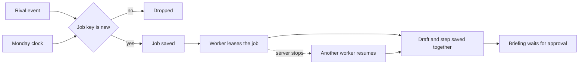

# Run the teammates on events and a schedule

Job: Notice a rival move at night, work once and wait for a human.

## The story in one picture



## Why this matters

So far the teammates only answer when someone asks. A real team also works at night and on Monday morning.

Two things wake them up. A rival event says a price changed. The Monday clock says it is time for the weekly briefing.

Each wake up becomes one **job**. The job has a **job key**. A key that already exists is ignored, so a crowd of the same event starts one run. We call this **debounce**.

A job can also stop halfway when a server dies. Another worker must finish it, and it must not draft the briefing twice.

## What you will have at the end

- One research run for a rival event.
- One run for ten events of the same kind.
- One draft briefing each Monday that waits for an approver.
- A job that resumes after the server is killed.

## See it fail first

What happens at 8 am on Monday when nobody is at the keyboard? Today, nothing happens at all.

For example, a rival changes its price at night. Ten alerts arrive in one minute. A teammate with no job key starts ten runs and sends ten briefings.

## Start from the lab checkpoint

This lab starts from lab 03. Workspaces and the approval rule already work, and the job queue from the guardrails module is ready.

```bash
bun run goto always-on-teammates
```

Expect: a message that you are now on the always-on-teammates checkpoint, with a list of things to do.

## Step 1: turn each wake up into one job

The key holds the event name, the rival and a five minute window. Ten alerts share one key, so they make one job.

### apps/product-teammates/src/always-on.ts

```ts
export function mondayOf(day: Date): string {
  const copy = new Date(day.getTime());
  const daysBack = (copy.getUTCDay() + 6) % 7;
  copy.setUTCDate(copy.getUTCDate() - daysBack);
  return copy.toISOString().slice(0, 10);
}

// Events of one kind, for one rival, in one five minute window share a key.
export async function onEvent(name: string, rival: string, moment: Date): Promise<boolean> {
  const bucket = Math.floor(moment.getTime() / WINDOW_MS);
  const key = [name, rival, String(bucket)].join(":");
  const payload: JobPayload = { kind: "research", rival, workspace: "" };
  return enqueueJob(key, payload);
}

export async function scheduleMonday(day: Date, workspace: string): Promise<boolean> {
  const key = ["briefing", mondayOf(day)].join(":");
  const payload: JobPayload = { kind: "briefing", rival: "", workspace };
  return enqueueJob(key, payload);
}
```

## Step 2: draft once, even after a crash

The draft and the saved step land in one transaction. A new worker sees the step and does not draft again.

### apps/product-teammates/src/always-on.ts

```ts
async function enqueueJob(key: string, payload: JobPayload): Promise<boolean> {
  return enqueue(key, JSON.stringify(payload));
}

export async function rivalsSeen(): Promise<string[]> {
  await setupAlwaysOn();
  const found = await rows<{ rival: string }>(
    "SELECT DISTINCT rival FROM runs WHERE kind = 'research' ORDER BY rival",
  );
  return found.map((item) => item.rival);
}

async function recordRun(job: Job, payload: JobPayload): Promise<void> {
  await setupAlwaysOn();
  await rows("INSERT INTO runs VALUES ($1, 'research', $2) ON CONFLICT (job_key) DO NOTHING", [
    job.key,
    payload.rival,
  ]);
}

// The draft and the saved step land in one transaction, so a crash can never draft twice.
async function draftBriefing(
  job: Job,
  payload: JobPayload,
  afterDraft?: () => void,
): Promise<void> {
  if (job.step >= 1) return;
  await setupWorkspace();
  const seen = await rivalsSeen();
  let body = "Weekly briefing. No rival changed this week.";
  if (seen.length > 0) body = `Weekly briefing. Rival changes seen: ${seen.join(", ")}.`;
  await inTransaction(async (run) => {
    const add = "INSERT INTO briefings (writer, workspace, body) VALUES ($1, $2, $3)";
    await run(add, [BRIEFING_WRITER, payload.workspace, body]);
    await run("UPDATE jobs SET step = 1 WHERE id = $1", [job.id]);
  });
  if (afterDraft !== undefined) afterDraft();
}

export async function handleJob(job: Job, afterDraft?: () => void): Promise<void> {
  const payload = JSON.parse(job.payload) as JobPayload;
  if (payload.kind === "research") return recordRun(job, payload);
  return draftBriefing(job, payload, afterDraft);
}

// Runs each job that is ready. A job left by a dead worker counts too.
export async function drain(): Promise<number> {
  let count = 0;
  while (await runNext((job) => handleJob(job))) count += 1;
  return count;
}
```

## Step 3: answer in the right way

Each question word leads to one answer. Only an approver can publish the waiting briefing.

### apps/product-teammates/src/always-on.ts

```ts
async function eventAnswer(): Promise<AgentResult> {
  await onEvent(PRICE_EVENT, PRICE_RIVAL, new Date());
  const count = await drain();
  const text = `The research run finished for ${PRICE_RIVAL}. Runs started: ${count}.`;
  return { route: "answer", text, citations: [PRICE_EVENT] };
}

async function burstAnswer(): Promise<AgentResult> {
  const arrived = new Date();
  for (let sent = 0; sent < BURST_SIZE; sent += 1) {
    await onEvent(PRICE_EVENT, PRICE_RIVAL, arrived);
  }
  const count = await drain();
  const text = `${BURST_SIZE} events arrived. Runs started: ${count}.`;
  return { route: "answer", text, citations: [PRICE_EVENT] };
}

async function mondayAnswer(person: string): Promise<AgentResult> {
  const workspace = await homeWorkspace(person);
  await scheduleMonday(new Date(), workspace);
  await drain();
  const text = "The weekly briefing is drafted. It waits for an approver.";
  return { route: "answer", text, citations: [workspace] };
}

async function resumeAnswer(): Promise<AgentResult> {
  const count = await drain();
  const text = `Stopped jobs picked up and finished: ${count}.`;
  return { route: "answer", text, citations: [] };
}

async function approveAnswer(person: string): Promise<AgentResult> {
  const workspace = await homeWorkspace(person);
  const waiting = await rows<{ id: number }>(
    "SELECT id FROM briefings WHERE workspace = $1 AND status = 'pending' ORDER BY id LIMIT 1",
    [workspace],
  );
  if (waiting.length === 0) return refuse("No briefing is waiting.");
  try {
    await approveBriefing(waiting[0].id, person);
  } catch (problem) {
    return refuse((problem as Error).message);
  }
  return { route: "approve", text: "The briefing is published to the team.", citations: [] };
}

export async function answerAlwaysOn(
  question: string,
  person: string,
): Promise<AgentResult | undefined> {
  const text = question.toLowerCase();
  if (text.includes("research run")) return eventAnswer();
  if (text.includes("price events")) return burstAnswer();
  if (text.includes("monday")) return mondayAnswer(person);
  if (text.includes("stops halfway")) return resumeAnswer();
  if (text.includes("approve the") && text.includes("briefing")) return approveAnswer(person);
  return undefined;
}
```

## Verify the lab

```bash
bun run verify always-on-teammates
```

Expect: five green badges and the line "Every check passed."

## Try it yourself

Change the window from five minutes to one hour and watch which check fails. Then change it back.

```bash
bun run verify always-on-teammates
```

Expect: five green badges and the line "Every check passed." This confirms you start from a clean state.

## Stuck?

| You see                          | Why                                        | Fix                                                       |
| -------------------------------- | ------------------------------------------ | --------------------------------------------------------- |
| Each rival must get its own run. | The job key leaves out the rival.          | Put the rival name in the job key.                        |
| A later window got no new run.   | The job key ignores the time window.       | Add the window number to the job key.                     |
| The same week was drafted twice. | The Monday job key does not hold the date. | Build the key from the word briefing and the Monday date. |
| A briefing was drafted twice.    | The draft ran again after the restart.     | Return early when the saved step is 1.                    |

If you are still stuck, start from a clean copy of this lab.

```bash
bun run goto always-on-teammates
```

Expect: a message that you are now on the always-on-teammates checkpoint, with a list of things to do.

## New words

- **debounce**: Turn a crowd of the same event into one piece of work.
- **job key**: A name for one piece of work. The same name never runs twice.
