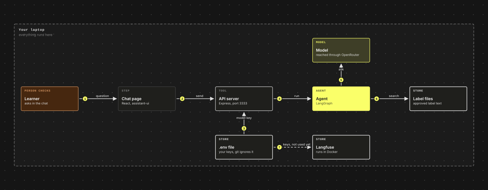
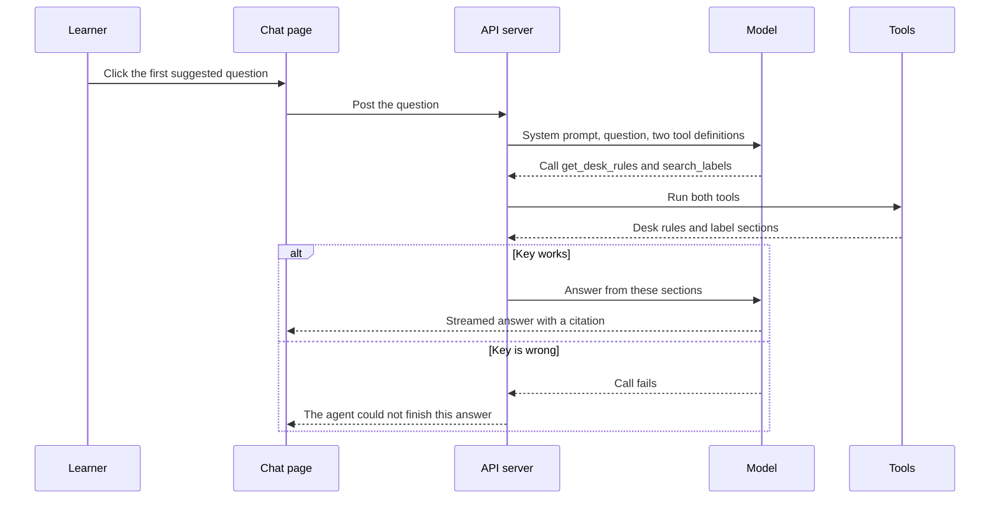
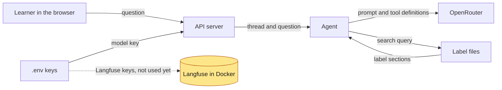
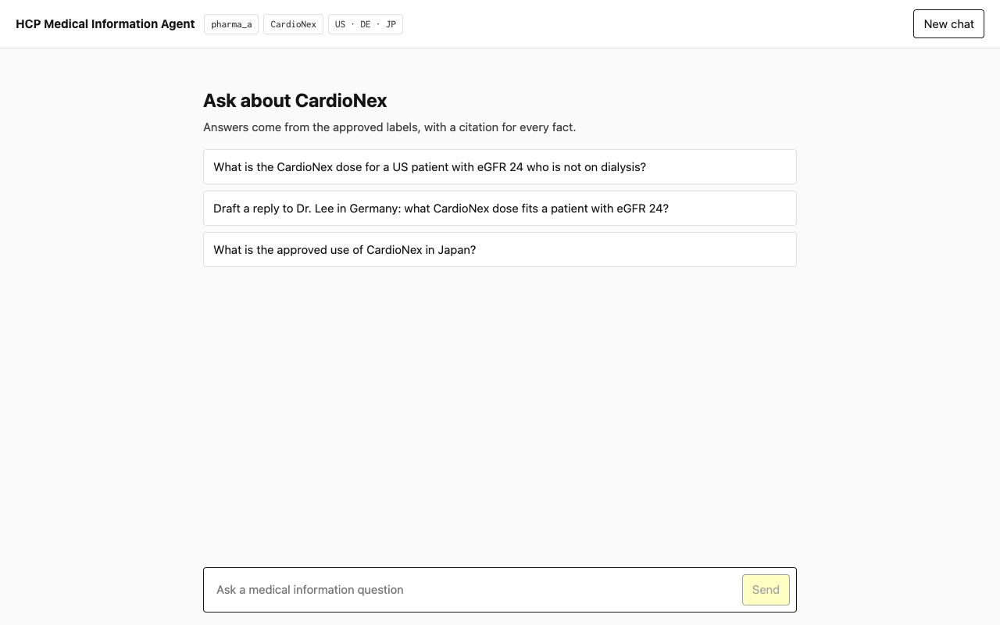

# 00 Run the whole course on your own laptop

## The problem

A learner clones the workshop and runs `npm install`. It prints no error. Later, `npm run dev` cannot start the web page server.

The cause is the Node version. The course needs Node.js `>=22.18.0`. On an older Node, npm skips one file the page server needs. It does this without a warning. So the failure shows up one step too late, and it looks like a bug in the course.

Two more things go wrong in the first hour. For example, a learner pastes a real key into a shared chat. Another has a key from a different project in their shell, and the course uses it by mistake.

Every later lesson builds on this one. So we start with a check that proves your laptop, your keys and your ports work.

## What you build

- **A local stack,** which is all the services on your own machine. Langfuse, which keeps every trace, runs in Docker from files in `langfuse/`. You need no cloud account.
- **One `.env` file,** which holds your keys. The app reads it and nothing else.
- **A model key,** from OpenRouter, which routes the app's model calls.
- **Two helpers,** the Langfuse command line tool and the Langfuse skill. Later lessons use them through a coding agent.
- **A running desk,** the medical information chat on port 3333.

| Case | What breaks | How the system holds |
| --- | --- | --- |
| Node is too old | `npm install` looks fine, then the page server fails | This page names the version, and `npm run check` fails if it drifts from `package.json` |
| A key from another project is in your shell | The app calls the wrong account | The app always loads this repo's `.env`, and `.env` wins |
| A real key lands in shared notes | The key leaks | Keys live only in `.env`, which git ignores |
| You skip a start check | You find a broken port in lesson 02 | The checkpoint holds the same app as lesson 01, so you test it now |

## How it works

Everything runs on your laptop. The chat page talks to a small API server. The server runs the agent, and the agent calls a model through OpenRouter. Langfuse starts in Docker now, but the app does not send it anything yet. You connect them in lesson 02.



Step through it one part at a time in the [live drawing](https://canvas.learnwithparam.com/case.html#buildcamp/4).

### The flow

This follows the first suggested question in the chat. The second path shows a bad model key.



The server catches a failed model call and sends one short message. The chat shows it, not a stack trace. So a wrong key shows up as a plain line in the chat. Check `.env` first when you see it.

### Where it sits

At this checkpoint the app runs alone. Langfuse is up, but nothing points at it yet.



### Concepts

- [Checkpoint](../walkthrough.md#c-checkpoint)
- [Local stack](../walkthrough.md#c-local-stack)

## Build it

Clone the workshop repository, enter it, then check out the setup checkpoint. A checkpoint is a saved state of the code. You can jump to any lesson by checking out its checkpoint.

```bash
git clone https://github.com/learnwithparam/agentic-ai-buildcamp.git
cd agentic-ai-buildcamp
git checkout checkpoint/00-setup
```

This checkpoint holds the same untraced app as `checkpoint/01-base-app`. Use it to confirm your keys, packages and ports work. The Langfuse keys are set now, but traces start only when you add tracing in lesson 02.

You need three things before Step 1:

- **Node.js `>=22.18.0`.** Check with `node -v`. If you are below it, upgrade first. Use `nvm`, `asdf`, `fnm` or `volta`. If you upgrade after `npm install`, run `npm ci` again so npm fetches the skipped file.
- **Docker Desktop,** or another Docker engine, with about 6 GB of memory free.
- **An OpenRouter key.** The app uses the official OpenAI SDK, pointed at OpenRouter. The model is `openai/gpt-6-luna`.

### Step 1: Start the trace store and get the keys

1. **Langfuse:** start it on your machine.

   ```bash
   docker compose -f langfuse/docker-compose.yml -f langfuse/workshop.override.yml up -d
   ```

   The first start downloads the images and takes a few minutes. Then open [http://localhost:5174](http://localhost:5174) and sign in as `learner@workshop.local` with the password `workshop-password`. The override file creates that user, the `HCP MedInfo` project, and its keys `pk-lf-workshop` and `sk-lf-workshop`. There is nothing to click.
2. **OpenRouter:** go to [openrouter.ai](https://openrouter.ai), open Keys, and create one. Copy the `sk-or-...` value. You paste it into `.env` in Step 3.

### Step 2: Install the two helpers

Later lessons drive Langfuse through a coding agent. It needs the `langfuse` skill and the Langfuse CLI.

Paste this into your coding agent to install both:

> "Please install the `langfuse` skill from `https://github.com/langfuse/skills/tree/main/skills/langfuse`, and install the Langfuse CLI with `npm install -g langfuse-cli`."

Prefer to install them yourself:

```bash
npm install -g langfuse-cli
npx skills add langfuse/skills --skill "langfuse"
```

### Step 3: Configure `.env`

```bash
cp .env.example .env
```

Fill in your OpenRouter key:

```bash
OPENAI_API_KEY=sk-or-...
```

The other values already point at OpenRouter and your local Langfuse:

```bash
OPENAI_BASE_URL=https://openrouter.ai/api/v1
OPENAI_MODEL=openai/gpt-6-luna
LANGFUSE_PUBLIC_KEY=pk-lf-workshop
LANGFUSE_SECRET_KEY=sk-lf-workshop
LANGFUSE_BASE_URL=http://localhost:5174
```

Leave the rest of the defaults as they are.

The server and the helper scripts always load this repository's `.env`. Say you exported `LANGFUSE_*`, `OPENAI_*` or `DATASET_NAME` in your shell for another project. Those values do not override this file. To change the setup, edit `.env`.

Keep these values in your local `.env` only. Do not paste real keys into shared notes, transcripts, screenshots or chat messages.

### Step 4: Install and run

```bash
npm install
npm run dev
```

Leave `npm run dev` running while you edit. Client changes reload in the browser. Server code and `.env` changes restart the API on their own.

Open [http://127.0.0.1:3333](http://127.0.0.1:3333) to see the chat.

### Step 5: Confirm what you see

You should see the **HCP Medical Information Agent** chat:

- the agent title, with the desk it answers for: `pharma_a`, `CardioNex`, and the countries US, DE and JP
- the heading **Ask about CardioNex**
- three suggested questions below it
- the message box at the bottom



## Prove it

| Case | Why it matters | Before | After |
| --- | --- | --- | --- |
| The page loads | The page server started, so Node is new enough | `npm run dev` could fail late | The heading **Ask about CardioNex** shows |
| The first suggested question | The model key, the tools and the stream all work | Nothing is checked | Two tool cards show, then an answer that ends with the label it used |
| Langfuse is up | Lesson 02 needs it | Not started | You sign in at port 5174 |

Two checks hold this in code. `scripts/check-repo.ts` fails when this page names a different Node version than `package.json`. `npm run check` runs it with the rest.

```bash
npm run check
```

Break it on purpose. Change `>=22.18.0` to another number everywhere on this page, and run `npm run check`. It names this page as the problem.

## Stuck points

A correct run has the chat on port 3333 and Langfuse on port 5174. After the first question, two tool cards show: `get_desk_rules` and `search_labels`.

| What you see | Why | What to do |
| --- | --- | --- |
| `npm run dev` cannot start the page server | Node is older than `>=22.18.0`, and npm skipped a file | Upgrade Node, then run `npm ci` |
| The chat shows "The agent could not finish this answer" | The model call failed, often a wrong or empty key | Check `OPENAI_API_KEY` in `.env`, and restart `npm run dev` |
| Port 5174 does not open | Docker is not running, or the first start is still going | Start Docker, then run `docker compose ... up -d` again |
| Your shell key seems to win | It does not, `.env` wins | Edit `.env`, not your shell |

For anything else, run `npm run doctor`. It names each problem and links its fix in [the troubleshooting page](./troubleshooting.md).

[The demo users](../../README.md#demo-users) lists who you can sign in as and what each one sees. Two guides sit beside the lessons. [The data behind the desk](./data.md) says what each folder in `data/hcp` holds and who reads it. [Eval cases](./evals.md) shows how to read a test case and how it becomes a score.

## What to watch for

- **A silent install.** A tool that skips a file without a warning fails later, far from the cause. Our hold is a version named on this page and tested against `package.json`.
- **Keys in the wrong place.** A key in a transcript or a screenshot is a leaked key. Our hold is that `.env` is the only place the app reads, and git ignores it.
- **A stack that needs the cloud.** A hosted account would stop a learner from working offline. Our hold is that every service runs in Docker on your machine.

## Results

This lesson has no scoreboard row, because no test case runs yet. The proof is what you see. The chat loads, the first question shows two tool cards, and the answer cites a label.

The first scoreboard row comes in lesson 06. It scores the agent on 28 cases.

## Where to go next

- Skim lesson 01 to see one chat turn. Then check out `checkpoint/02-tracing` for the first code changes.
- Read `langfuse/workshop.override.yml` to see what the override file creates for you.
- Read `src/server/env.ts` to see every setting the app reads.
