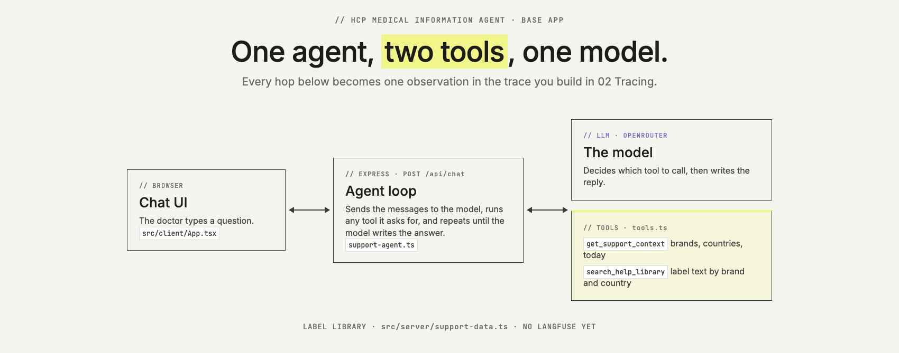

# 01 Base App

> You already cloned the repo and checked out the workshop app in `00-setup`. The base app is in that same checkout (`checkpoint/00-setup` holds the same code as `checkpoint/01-base-app`), so there is nothing to build in this chapter, just orient yourself before tracing starts in `02-tracing`.

## What the running app does

- A doctor or pharmacist is the user. The agent answers their questions about our medicines from the label library.
- One OpenAI tool-calling loop. Two local tools (`get_support_context`, `search_help_library`).
- The system prompt is rendered locally from `src/server/support-agent.ts`. No Langfuse yet.

## Where to look in the code

- `src/client/App.tsx`: chat UI + side panel
- `src/server/index.ts`: Express routes
- `src/server/support-agent.ts`: the tool-calling loop you'll instrument in `02-tracing`
- `src/server/tools.ts`: tool definitions and `executeTool(...)`
- `src/server/support-data.ts`: the fixed desk context + label library
- `src/server/support-agent.ts`: system-prompt template

## Bonus

You can add a label article to `GUIDE_LIBRARY` in `src/server/support-data.ts`, for example a new country for an existing medicine, and ask about it in the chat.

## End state

You are ready to start `02-tracing`.
