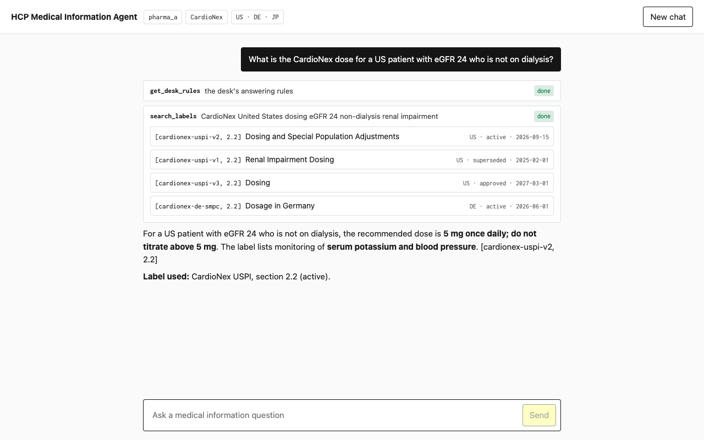

# 01 Base App

> You already cloned the repo and started the app in `00-setup`. `checkpoint/00-setup` holds the same code as `checkpoint/01-base-app`, so there is nothing to build in this chapter. You learn how the app works before you trace it in `02-tracing`.

## Goal

Know what happens in one chat turn: which code runs, which tools it calls, and where a drafted reply stops for a human.

## The job

Doctors and pharmacists ask the medical information desk of `pharma_a` about CardioNex, in the US, Germany and Japan. Two promises matter from the first day:

1. **Every answer comes from approved label text and names the label it used.** The agent never answers from what the model remembers.
2. **A reply drafted for a doctor waits for a medical reviewer.** Nothing is sent until a human approves it.

## Try it

With `npm run dev` running, open [http://127.0.0.1:3333](http://127.0.0.1:3333).

**1. Ask a question.** Click **What is the CardioNex dose for a US patient with eGFR 24 who is not on dialysis?**

You see the agent work as it goes:

- a `get_desk_rules` card: the agent read the desk's rules first
- a `search_labels` card with what it searched for and each label section it found, with country, status and date
- the answer, with a citation like `[cardionex-uspi-v2, 2.2]` and the label it used

Look at the search results. The search found the active label (`v2`), a superseded one (`v1`) and one not yet in force (`v3`). The agent picked the active one this time. Nothing in the code makes it do that yet. Lesson 07 makes it a rule you can test.

**2. Ask for a draft.** Click **New chat**, then **Draft a reply to Dr. Lee in Germany: what CardioNex dose fits a patient with eGFR 24?**

The agent searches and writes the draft, then the turn stops. A yellow **Waiting for a medical reviewer** card shows the draft with two buttons. A **Thinking** block may show above the answer. It holds a summary of the model's thinking, when the model sends one.

Click **Approve and send**. The chat adds "A reviewer approved this draft. It is ready to send." Click **Reject** on another draft, and the chat adds "A reviewer rejected this draft. Nothing was sent." instead.

## How one turn works

1. **The chat sends the question.** The client in `src/client/` uses assistant-ui. It posts the question to the API server and reads the reply as a stream.
2. **The server runs the graph.** `src/server/routes.ts` follows the LangGraph thread API, so assistant-ui's LangGraph runtime can talk to it: one thread per chat, one streamed run per turn.
3. **The agent node asks the model.** It sends the system prompt, the chat so far and the two tool definitions. The model answers with tool calls or with text.
4. **The tools node runs the tools.** `get_desk_rules` returns the desk: company, medicine, countries, today's date and the citation rule. `search_labels` searches the label library and returns each matching section.
5. **The loop ends with an answer.** Once `search_labels` has run, the next model call has the tools switched off, so the model must answer from what the tools found.
6. **The review node checks the question.** If it asks to draft or write a reply, email or letter, the graph pauses with LangGraph's `interrupt()`. The chat shows the approval card. The reviewer's click resumes the graph with the decision.

The graph keeps each thread in memory (`MemorySaver`), so a restart forgets every chat. Chapter 13 stores it in Postgres.

## Where to look in the code

| File | What it does |
|---|---|
| `src/server/graph.ts` | The agent graph: the `agent`, `tools` and `review` nodes, the edges between them, and `runGraph`, which turns one run into the events the chat reads |
| `src/server/medinfo-agent.ts` | The system prompt, the OpenAI client and the graph built from the three nodes. You trace this file in `02-tracing` |
| `src/server/tools.ts` | The desk, the two tool definitions the model sees, and `executeTool`, which runs them |
| `src/server/labels.ts` | Reads the label files and splits each one into sections; `searchLabels` finds the sections that match a query |
| `src/server/stream-model.ts` | Calls the model as a stream, so the reply and the thinking appear as they arrive |
| `src/server/routes.ts` | The thread routes the chat calls |
| `src/client/chat/` | The assistant-ui thread, the tool cards, the thinking block and the approval card |
| `data/hcp/docs/` | The label library: approved label files for each country, copied from the dataset repo |

## How to verify you are done

- The dose question shows the `get_desk_rules` and `search_labels` cards, then an answer with a `[doc_id, section]` citation.
- The draft question stops on the **Waiting for a medical reviewer** card.
- **Approve and send** adds the approved message under the draft.

## Bonus

The review rule is one line, `DRAFT_REQUEST` in `src/server/graph.ts`. Ask **Prepare a note for Dr. Sato about the approved use in Japan** and see that it is answered without review. Add `prepare` and `note` to the rule, ask again, and the approval card shows.

## End state

You know the path of one chat turn. Next, in `02-tracing`, you make every step of it visible in Langfuse.
