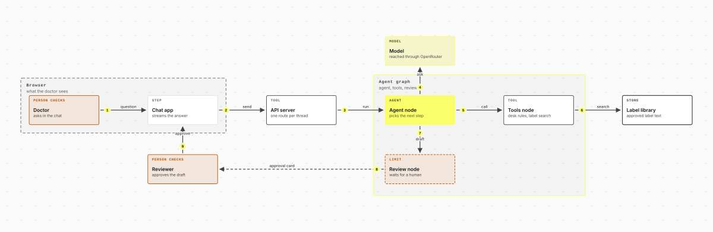
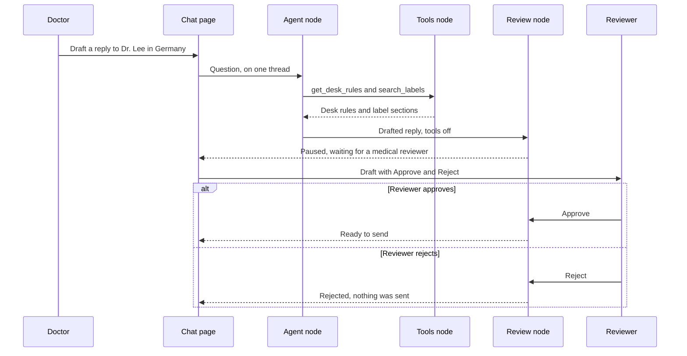
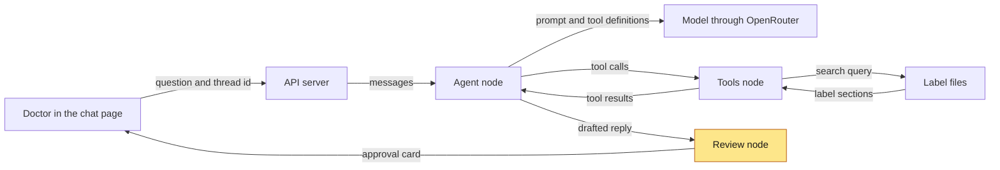
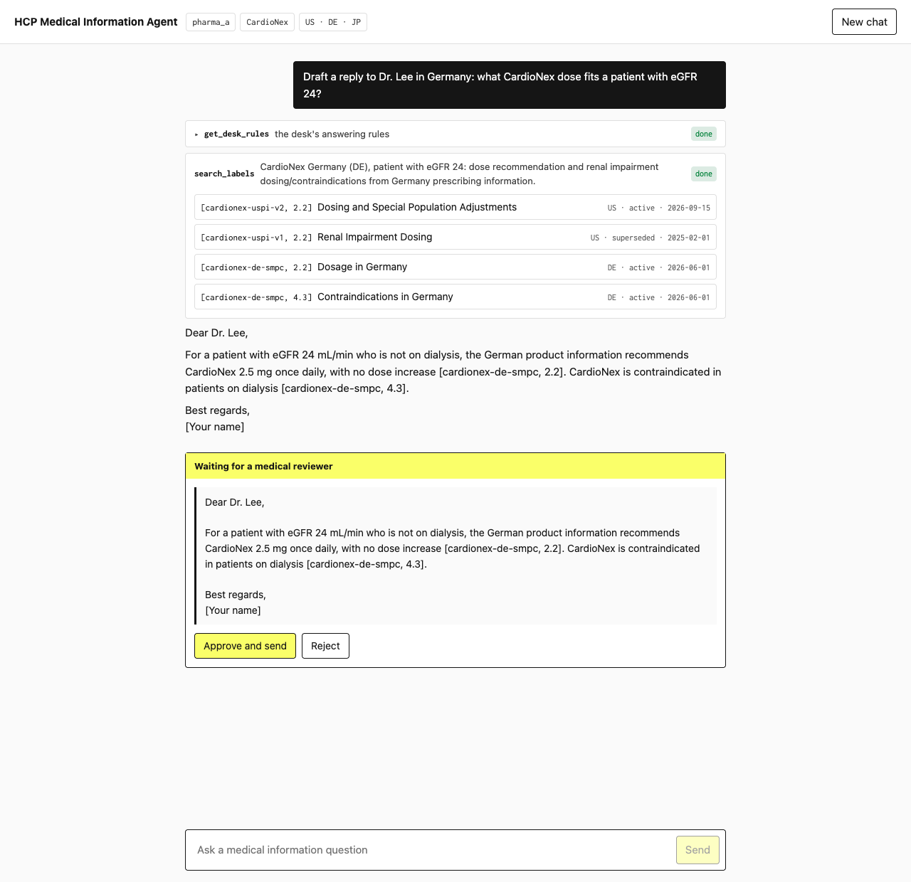

# Follow one chat turn through an agent

## The problem

A doctor asks the desk for the CardioNex dose for a US patient. The label library holds three US labels for that one drug. One is in force. One is old and replaced. One is not in force until next year.

If the agent answers from memory, or picks the wrong label, the dose can be wrong. It will still read as sure as a right one. For example, a dose from the replaced label looks the same as the dose in force.

A second case is worse. A doctor asks the desk to draft a reply to Dr. Lee in Germany. If the draft goes out at once, a medical reviewer never reads it.

So two promises hold from the first day. Every answer comes from approved label text and names the label it used. A drafted reply waits for a person to approve it.

## What you build

Nothing in this lesson. You already started the app in lesson 00. This lesson is a tour of it, so you can follow one turn before you trace it.

- **A chat page,** built with assistant-ui, which shows a streamed answer and a card for each tool call.
- **An API server,** which keeps one thread per chat and streams one run per turn.
- **An agent,** which asks the model, and calls tools until it has an answer.
- **Two tools.** `get_desk_rules` reads the desk's rules. `search_labels` finds label sections.
- **A review pause,** which stops a drafted reply until a person approves or rejects it.

| Case | What breaks | How the system holds |
| --- | --- | --- |
| A dose question with three US labels | The agent cites the old or future label | The desk rules name today's date and the citation rule. Nothing forces the pick yet |
| A request to draft a reply | An unreviewed draft reaches a doctor | The review node pauses the run until a reviewer clicks |
| The model keeps calling tools | The turn never ends | After `search_labels` runs, or after 5 rounds, tools switch off |
| A server restart | Every chat is forgotten | Not held yet. Lesson 13 moves chats into a database |

## How it works

One chat turn is one trip around a small graph. The agent node asks the model. If the model asks for tools, the tools node runs them and the agent asks again. When the model answers, the review node checks if this was a draft request. If so, the run pauses.



### The flow

This follows a draft request from the doctor to the reviewer. The last part shows both ways it can end.



The step people doubt is the pause. The review node does not wait for the model to ask for review. It reads the doctor's own words. One line, `DRAFT_REQUEST` in `src/server/graph.ts`, matches words like "draft" and "reply". On a match, the node calls `interrupt()`, and the graph saves its place by thread id.

### Where it sits

This is the whole app at this checkpoint. Nothing is traced yet.



The review node is marked because it is the one part that can stop a turn.

### Concepts

- [Agent](../walkthrough.md#c-agent)
- [Tool](../walkthrough.md#c-tool)
- [Label](../walkthrough.md#c-label)

## Build it

You cloned the repo and started the app in lesson 00. `checkpoint/00-setup` holds the same code as this checkpoint. So there is nothing to type here, only things to try.

```bash
git checkout checkpoint/01-base-app
npm run dev
```

### Step 1: Ask a question

Open [http://127.0.0.1:3333](http://127.0.0.1:3333). Click **What is the CardioNex dose for a US patient with eGFR 24 who is not on dialysis?**

You see the agent work as it goes:

- a `get_desk_rules` card, because the agent read the desk's rules first
- a `search_labels` card with the search and each label section found, with country, status and date
- the answer, with a citation like `[cardionex-uspi-v2, 2.2]` and the label it used


Look at the search results. The search found the active label (`v2`), a replaced one (`v1`) and one not yet in force (`v3`). The agent picked the active one this time. Nothing in the code makes it do that yet. Lesson 07 makes it a rule you can test.

### Step 2: Ask for a draft

Click **New chat**, then **Draft a reply to Dr. Lee in Germany: what CardioNex dose fits a patient with eGFR 24?**

The agent searches and writes the draft, then the turn stops. A yellow **Waiting for a medical reviewer** card shows the draft with two buttons. A **▸ Thinking** card may show above the answer. Click it to open a summary of the model's thinking. Cards with a ▸, like `get_desk_rules`, open the same way.



Click **Approve and send**. The chat adds "A reviewer approved this draft. It is ready to send."

Click **Reject** on another draft. The chat adds "A reviewer rejected this draft. Nothing was sent." instead.

### Step 3: Follow the turn in the code

1. **The chat sends the question.** The client in `src/client/` posts it to the API server. It reads the reply as a stream.
2. **The server runs the graph.** `src/server/routes.ts` follows the LangGraph thread API, so assistant-ui can talk to it. There is one thread per chat and one streamed run per turn.
3. **The agent node** asks the model. It sends the prompt, the chat so far and the two tool definitions. The model replies with tool calls or text.
4. **The tools node runs the tools.** `get_desk_rules` returns the desk and the citation rule. `search_labels` returns each matching section.
5. **The loop ends with an answer.** Once `search_labels` has run, the next model call has tools switched off. So the model must answer from what the tools found.
6. **The review node checks the question.** A draft request makes the graph pause with `interrupt()`.

The graph keeps each thread in memory (`MemorySaver`), so a restart forgets every chat. Lesson 13 stores it in Postgres.

| File | What it does |
| --- | --- |
| `src/server/graph.ts` | The three nodes, the edges between them, and `runGraph`, which turns a run into chat events |
| `src/server/medinfo-agent.ts` | The system prompt, the model client and the graph built from the three nodes. You trace this file in lesson 02 |
| `src/server/tools.ts` | The desk, the two tool definitions the model sees, and `executeTool`, which runs them |
| `src/server/labels.ts` | Reads the label files, splits each into sections, and finds the sections that match a query |
| `src/server/stream-model.ts` | Calls the model as a stream, so the reply and the thinking appear as they arrive |
| `src/server/routes.ts` | The thread routes the chat calls |
| `src/client/chat/` | The thread, the tool cards, the thinking block and the approval card |
| `data/hcp/docs/` | The label library: approved label files for each country |

### Step 4: Change the review rule

The review rule is one line, `DRAFT_REQUEST` in `src/server/graph.ts`. Ask **Prepare a note for Dr. Sato about the approved use in Japan**. It is answered without review. Add `prepare` and `note` to the rule, ask again, and the approval card shows.

## Prove it

| Case | Why it matters | Before | After |
| --- | --- | --- | --- |
| The dose question | The answer must name the label it used | No desk, no citation | A `[doc_id, section]` citation on the answer |
| The draft request | A person must read a draft first | A draft would go out | The run stops at **Waiting for a medical reviewer** |
| **Approve and send** | The decision must resume the same run | A paused run | "A reviewer approved this draft" under the draft |

One test holds the pause. It runs the graph with a fake agent and no model call:

```bash
npx tsx --test src/server/graph.test.ts
```

The test asks for a draft. It checks that the run waits for approval and still returns the drafted messages.

Break it on purpose. Change `DRAFT_REQUEST` in `src/server/graph.ts` to a pattern that never matches, such as `/never-matches/`. The review node then returns without pausing, and the test fails on `waitingForApproval`. Put the line back.

## Stuck points

A correct run shows two tool cards and a cited answer for the dose question. The draft question stops on a yellow card.

| What you see | Why | What to do |
| --- | --- | --- |
| No tool cards, only an error line | The model call failed | Check the key in `.env`, as in lesson 00 |
| The dose answer cites `v1` or `v3` | The model picked a label that is not in force | This is the known gap. Lesson 02 shows why, and lesson 07 tests it |
| A draft question gets no approval card | Your words did not match `DRAFT_REQUEST` | Use "draft" or "write" and "reply", "email" or "letter" |
| An old chat is gone after a restart | Threads live in memory | Start a new chat |

## What to watch for

- **A pick the code does not check.** Today the model chooses which label to cite. It chose well here, but nothing proves it will next time. Lesson 07 turns this into a test.
- **A rule that reads words.** `DRAFT_REQUEST` is a pattern on the doctor's text. A draft request in other words slips past it. Lesson 13 adds a router that sorts each question by risk first.
- **A pause that outlives the server.** A paused draft lives in memory. A restart loses it. Lesson 13 keeps pauses in a database.

## Results

This lesson has no scoreboard row, because no test case runs yet. The proof is the three checks above. The dose question shows tool cards and a citation. The draft question waits. **Approve and send** adds the approved message.

Lesson 06 writes the first row. It shows how often the agent gets the cases right.

## Where to go next

- Read `src/server/graph.ts`, then `src/server/tools.ts`, in that order.
- Read about [interrupts in LangGraph](https://langchain-ai.github.io/langgraphjs/concepts/human_in_the_loop/) and the [assistant-ui LangGraph runtime](https://www.assistant-ui.com/docs/runtimes/langgraph).
- Lesson 02 makes every step of this turn visible.
