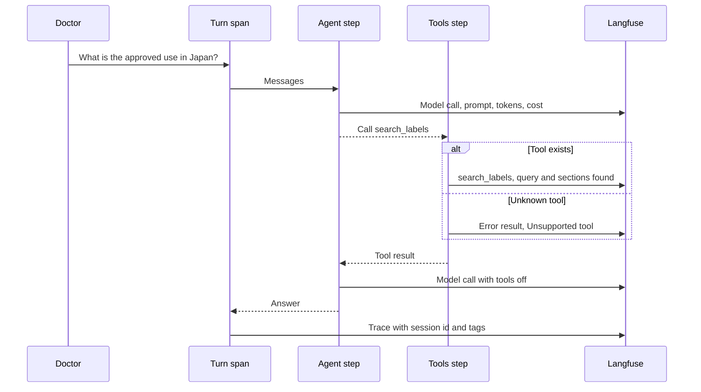
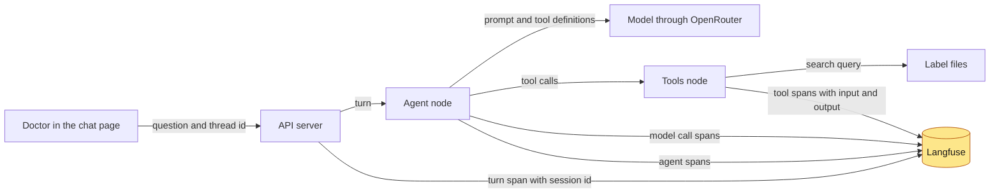
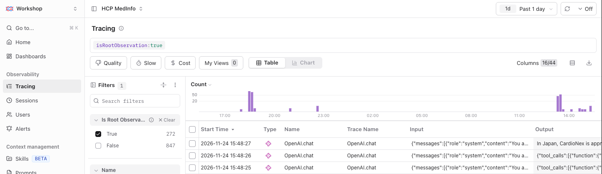
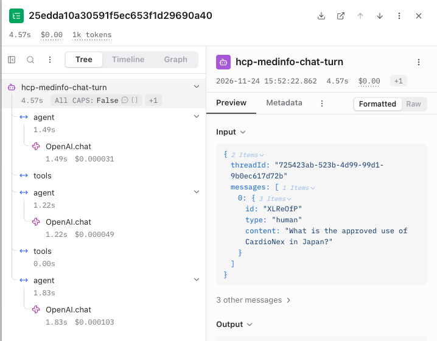

# See every step an agent takes

## The problem

A doctor asks the desk, "What is the approved use of CardioNex in Japan?" The answer looks fine. Behind it, the agent called the model three times and ran two tools. You can see none of it.

Now take the US dose question. The label library holds three US labels for that drug. One is in force, one is replaced and one is not in force yet. Say the agent cites the replaced label. The chat shows the answer and a search card.

It does not show what the model was sent. It does not show the cost or the time of each step.

When an answer is wrong, you cannot point at the step that went wrong. And the chat forgets everything when you close the tab. You cannot fix what you cannot see.

## What you build

- **A span processor,** which sends every step to Langfuse, the store that keeps every trace.
- **A wrapped model client,** which logs each model call with its prompt, reply, tokens, cost and time.
- **A wrapped turn and wrapped nodes,** so all the calls of one question land in one trace.
- **Wrapped tools,** so each tool call shows its input and its output.
- **A session id and two tags,** so every turn of one chat is grouped.

| Case | What breaks | How the system holds |
| --- | --- | --- |
| The Japan question | One question makes three loose model calls | The turn is wrapped, so all of them nest in one trace |
| The US dose question | You cannot see which labels the search found | The `search_labels` step holds the query and every section it found |
| A tool the model invents | The failure hides inside the answer | `executeTool` returns an error result, and the tool step shows it |
| A server restart | The last trace is lost | `shutdown` flushes the processor before the process exits |
| A long chat | Each turn stands alone | The thread id becomes the session id |

## How it works

A trace is the record of one request. A span is one step inside it. You wrap each function once with `observe(...)`. After that, every call writes a span with its input, output and time.

Spans nest, so the trace has the shape of the code. A turn holds agent and tools steps. Each agent step holds its model call.


### The flow

This follows the Japan question. One branch shows an unknown tool.



The step people doubt is the model wrap. In Step 1 you wrap the client once. In Step 2 you move the wrap inside the agent node. It then runs on every call, which suits lesson 03.

The wrap also nests the model call under the agent step.

### Where it sits

Langfuse is the only new part. Three kinds of spans flow to it, and the app answers the same as before.



### Concepts

- [Trace](../walkthrough.md#c-trace)
- [Span](../walkthrough.md#c-span)

## Build it

```bash
git checkout checkpoint/02-tracing
```

This is the same code as `checkpoint/01-base-app`, with no Langfuse wiring yet. The Langfuse packages are already in `package.json`. Run `npm install` if you have not. Make sure `.env` has your `OPENAI_API_KEY` and the Langfuse keys from lesson 00.

You edit three files: `src/server/index.ts`, `src/server/medinfo-agent.ts` and `src/server/tools.ts`. Keep `npm run dev` running. The server restarts on each save.

### Step 1: Log each model call

In `src/server/index.ts`, start the Langfuse span processor at the top of the file, after the imports:

```ts
import { NodeSDK } from "@opentelemetry/sdk-node";
import { LangfuseSpanProcessor } from "@langfuse/otel";

const langfuseSpanProcessor = new LangfuseSpanProcessor();
const sdk = new NodeSDK({ spanProcessors: [langfuseSpanProcessor] });
sdk.start();
```

The processor reads `LANGFUSE_PUBLIC_KEY`, `LANGFUSE_SECRET_KEY` and `LANGFUSE_BASE_URL`. The server loads the repository `.env` before this runs, so edit `.env`, not your shell.

Let the health route say whether tracing is set up. Change the `env` import and the route:

```ts
import { env, isLangfuseConfigured } from "./env";
```

```ts
response.json({ ok: true, tracingConfigured: isLangfuseConfigured() });
```

At the bottom, the `shutdown` function closes the server. Make it send the last traces before the process exits:

```ts
async function shutdown() {
  server.close();
  await langfuseSpanProcessor.forceFlush();
  await sdk.shutdown();
}
```

Without this, the last trace before a restart can go missing.

In `src/server/medinfo-agent.ts`, add the import:

```ts
import { observeOpenAI } from "@langfuse/openai";
```

Then wrap the OpenAI client where it is created:

```ts
const openai = observeOpenAI(new OpenAI({ apiKey: env.openaiApiKey }));
```

That is the whole step. `observeOpenAI` logs every call made through the client.

**Verify:** run `curl -s http://127.0.0.1:8787/api/health` and see `"tracingConfigured":true`. Ask the Japan question, then open **Tracing** in Langfuse. Each model call is its own `OpenAI.chat` trace. It shows the prompt, reply, tokens, cost and time. One question made three separate traces.

Nothing says they belong together.



### Step 2: Nest the calls in one turn

Three loose calls do not show which question they answered. Wrap the turn, so everything inside it lands in one trace. Wrap each graph node, so you see the agent and tools steps.

In `src/server/medinfo-agent.ts`, add the import:

```ts
import { observe } from "@langfuse/tracing";
```

Replace the client line from Step 1 and the graph with this:

```ts
const client = new OpenAI({ apiKey: env.openaiApiKey });

const graph = buildGraph({
  agent: observe(
    (state, config) => agentStep(observeOpenAI(client), SYSTEM_PROMPT, state, config),
    { name: "agent", asType: "span" }
  ),
  tools: observe((state) => toolsStep(state, executeTool), { name: "tools", asType: "span" }),
  review: reviewStep
});
```

The client is now wrapped inside the agent node. So the wrap runs on every call.

Then wrap the turn. Replace the `runMedinfoTurn` line with:

```ts
export const runMedinfoTurn = observe(
  (turn: Turn, emit: (event: StreamEvent) => void) => runGraph(graph, turn, emit),
  { name: "hcp-medinfo-chat-turn", asType: "agent" }
);
```

`observe(...)` logs the function's argument as the input and its return value as the output. `routes.ts` still calls `runMedinfoTurn` the same way.

**Verify:** ask the Japan question again. Langfuse shows one new `hcp-medinfo-chat-turn` trace. Open it. The turn holds `agent`, `tools`, `agent`, `tools`, `agent`. Each `agent` holds its `OpenAI.chat` call.

The `tools` steps are empty. You see that a tool ran. You do not see which one or what it found.



### Step 3: Log the tools and the session

In `src/server/tools.ts`, add the import, wrap the two tool functions above `executeTool`, and call the wrapped ones:

```ts
import { observe } from "@langfuse/tracing";
```

```ts
const getDeskRulesTool = observe(deskRules, { name: "get_desk_rules", asType: "tool" });
const searchLabelsTool = observe(labelSearch, { name: "search_labels", asType: "tool" });

export async function executeTool(name: string, input: Record<string, unknown>): Promise<ToolResult> {
  switch (name) {
    case "get_desk_rules":
      return getDeskRulesTool();
    case "search_labels":
      return searchLabelsTool({ query: String(input.query ?? "") });
    default:
      return { ok: false, error: `Unsupported tool: ${name}` };
  }
}
```

Each chat has a thread id. Pass it to Langfuse as the session id, so every turn of one chat is grouped. In `src/server/medinfo-agent.ts`, change the import:

```ts
import { observe, propagateAttributes } from "@langfuse/tracing";
```

Then run the graph inside `propagateAttributes`:

```ts
export const runMedinfoTurn = observe(
  (turn: Turn, emit: (event: StreamEvent) => void) =>
    propagateAttributes(
      {
        sessionId: turn.threadId,
        traceName: "hcp-medinfo-chat-turn",
        tags: ["langfuse-workshop", "hcp-medinfo"]
      },
      () => runGraph(graph, turn, emit)
    ),
  { name: "hcp-medinfo-chat-turn", asType: "agent" }
);
```

Everything inside the block, the model calls and tool calls included, gets the session id and the tags.

**Verify:** ask the Japan question again and open the new trace. `get_desk_rules` and `search_labels` sit inside their `tools` steps. Click `search_labels`. The input is the query the model wrote. The output is every label section it found.

The top shows a **session** link and two tags. Ask a second question in the same chat. **Sessions** in Langfuse shows both turns together.


### Step 4: Use it on the dose question

Ask the dose question from lesson 01. Open its trace and click `search_labels`. The results usually hold three US labels: `cardionex-uspi-v2` (active), `cardionex-uspi-v1` (superseded) and `cardionex-uspi-v3` (not in force until 2027).

The right answer depends on the model picking `v2`. When it picks the wrong one, the trace shows why. Lesson 07 turns that into a test.

Compare your code with the finished version:

```bash
git diff checkpoint/03-prompt-management -- src/server
```

Only comments and the order of imports should differ.

## Prove it

| Case | Why it matters | Before | After |
| --- | --- | --- | --- |
| The Japan question | One question must be one record | Three loose `OpenAI.chat` traces | One `hcp-medinfo-chat-turn` trace |
| The US dose question | You must see which labels the model had | Only a search card | `search_labels` shows the query and all three labels |
| Two questions in one chat | A chat is one story | Separate traces | One session with both turns |
| A restart | The last trace must survive | Could go missing | `shutdown` flushes first |

No unit test covers this lesson. Two checks hold it. The health route says `"tracingConfigured":true`, and the trace has the shape above.

Break it on purpose. Comment out `sdk.start()` in `src/server/index.ts`. The health route still says `true`, because it only checks that the keys are set. But no new trace shows up in Langfuse. Put the line back.

## Stuck points

A correct run gives one trace per chat turn, named `hcp-medinfo-chat-turn`. Each `agent` step holds a model call, and each `tools` step holds its tool.

| What you see | Why | What to do |
| --- | --- | --- |
| The health route says `true` but no trace shows | The keys are set, but `sdk.start()` did not run | Check `index.ts`, then restart `npm run dev` |
| Three loose `OpenAI.chat` traces | Step 2 is not in yet | Wrap the turn and the nodes |
| `tools` steps are empty | The tool functions are not wrapped | Do Step 3 |
| The last trace is missing after a restart | The processor was not flushed | Add `forceFlush()` to `shutdown` |
| Turns of one chat are not grouped | `propagateAttributes` is missing | Pass `turn.threadId` as the session id |

## What to watch for

- **Missing traces.** A trace that never arrives looks like a quiet system. Our hold is the flush on shutdown. In production, also watch the count of traces per hour.
- **Private data in a trace.** A trace holds the full prompt and the full answer. Treat the trace store like the data it copies. Later lessons add sign-in and permissions.
- **Cost of the record.** Every span adds data. Our hold is that we wrap only the turn, the nodes, the tools and the model calls. We do not wrap each helper.

## Results

This lesson has no scoreboard row, because no test case runs yet. The proof is a trace you can open. It has one root and the agent and tools steps. It also shows the model calls, the tool inputs and outputs, and a session.

The traced app is the starting point for lessons 03 and 04. The first scoreboard row comes in lesson 06.

## Where to go next

- Read `src/server/medinfo-agent.ts` to see each `observe` call, then `src/server/tools.ts` for the tool wraps.
- The [Langfuse skill](https://github.com/langfuse/skills) (`/langfuse`) applies these patterns to a codebase for you. This lesson shows what it does.
- Read [AI observability and application tracing](https://langfuse.com/docs/observability/overview) and [what a good trace looks like](https://langfuse.com/docs/observability/best-practices).
- See [Sessions](https://langfuse.com/docs/observability/features/sessions) and [Users](https://langfuse.com/docs/observability/features/users) for more ways to group traces.
- The [integrations catalogue](https://langfuse.com/integrations) lists a wrapper for each other SDK.
