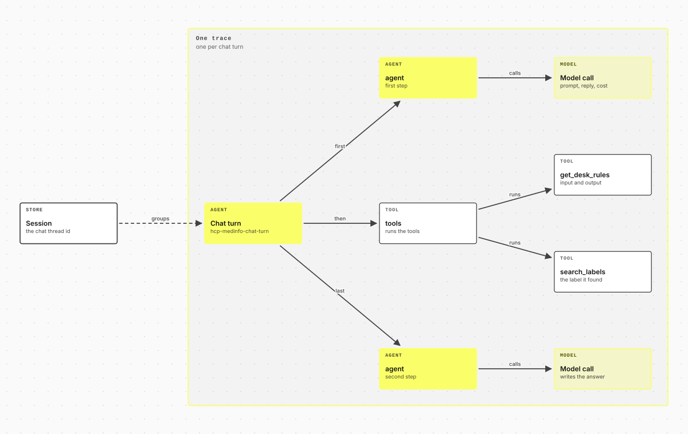
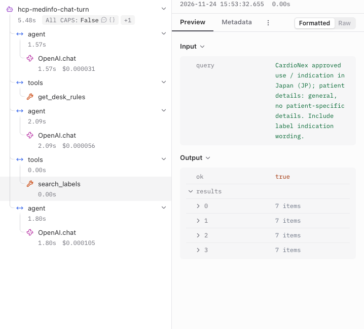

# 02 Tracing

## Why we trace

Tracing logs every step your agent takes: every model call, every tool call, what went in and what came back, in order. When an answer is wrong, you open the trace and point at the step where it went wrong.

Complementary materials:

- Docs: [AI Observability and application tracing](https://langfuse.com/docs/observability/overview). SDK options, OpenTelemetry setup, and span attributes.
- Docs: [What does a good trace look like?](https://langfuse.com/docs/observability/best-practices)
- Academy: [Tracing](https://langfuse.com/academy/tracing). Why tracing sits at the start of the AI engineering loop.

## Goal

One chat turn becomes one trace in Langfuse, with every model call, every graph node and every tool call inside it.

## Before

Ask **What is the approved use of CardioNex in Japan?** The answer looks fine. Behind it, the agent called the model three times and ran two tools, and you can see none of it. The `search_labels` card in the chat shows what was found, but not what the model was sent, what it cost, or how long each step took. And the chat forgets all of it when you close the tab.



You build that trace in three steps:

1. **Log each model call.**
2. **Nest the calls in one turn.**
3. **Log the tools and the session.**

## Starting point

```bash
git checkout checkpoint/02-tracing
```

This is the same code as `checkpoint/01-base-app`, with no Langfuse wiring yet. The Langfuse packages are already in `package.json`. Run `npm install` if you haven't. Make sure `.env` has your `OPENAI_API_KEY` and the Langfuse keys from `00-setup`.

You edit three files: `src/server/index.ts`, `src/server/medinfo-agent.ts` and `src/server/tools.ts`. Keep `npm run dev` running; the server restarts on each save.

## Step 1: Log each model call

### `src/server/index.ts`

Start the Langfuse span processor at the top of the file, after the imports:

```ts
import { NodeSDK } from "@opentelemetry/sdk-node";
import { LangfuseSpanProcessor } from "@langfuse/otel";

const langfuseSpanProcessor = new LangfuseSpanProcessor();
const sdk = new NodeSDK({ spanProcessors: [langfuseSpanProcessor] });
sdk.start();
```

The processor reads `LANGFUSE_PUBLIC_KEY`, `LANGFUSE_SECRET_KEY` and `LANGFUSE_BASE_URL`. The server loads the repository `.env` before this runs, so edit `.env`, not your shell.

Let the health route say whether tracing is set up. Change the `env` import and the route:

```ts
import { env, isLangfuseConfigured } from "./env";
```

```ts
response.json({ ok: true, tracingConfigured: isLangfuseConfigured() });
```

At the bottom, the existing `shutdown` function closes the server. Make it send the last traces before the process exits:

```ts
async function shutdown() {
  server.close();
  await langfuseSpanProcessor.forceFlush();
  await sdk.shutdown();
}
```

Without this, the last trace before a restart can go missing.

### `src/server/medinfo-agent.ts`

Add the import:

```ts
import { observeOpenAI } from "@langfuse/openai";
```

Then wrap the OpenAI client where it is created:

```ts
const openai = observeOpenAI(new OpenAI({ apiKey: env.openaiApiKey }));
```

That is the whole step. `observeOpenAI` logs every call made through the client.

**Verify:** run `curl -s http://127.0.0.1:8787/api/health` and see `"tracingConfigured":true`. Ask the Japan question, then open **Tracing** in Langfuse. Each model call is its own `OpenAI.chat` trace, with the prompt, the reply, the tokens, the cost and the time. One question made three separate traces. Nothing says they belong together.


## Step 2: Nest the calls in one turn

Three loose calls do not show which question they answered. Wrap the turn, so everything inside it lands in one trace, and wrap each graph node, so you see the agent and tools steps.

### `src/server/medinfo-agent.ts`

Add the import:

```ts
import { observe } from "@langfuse/tracing";
```

Replace the client line from Step 1 and the graph with this:

```ts
const client = new OpenAI({ apiKey: env.openaiApiKey });

const graph = buildGraph({
  agent: observe(
    (state, config) => agentStep(observeOpenAI(client), SYSTEM_PROMPT, state, config),
    { name: "agent", asType: "span" }
  ),
  tools: observe((state) => toolsStep(state, executeTool), { name: "tools", asType: "span" }),
  review: reviewStep
});
```

The client is now wrapped inside the agent node. In `03-prompt-management`, each call passes the prompt it fetched from Langfuse, so the wrap has to happen per call.

Then wrap the turn. Replace the `runMedinfoTurn` line with:

```ts
export const runMedinfoTurn = observe(
  (turn: Turn, emit: (event: StreamEvent) => void) => runGraph(graph, turn, emit),
  { name: "hcp-medinfo-chat-turn", asType: "agent" }
);
```

`observe(...)` logs the function's argument as the input and its return value as the output. `routes.ts` still calls `runMedinfoTurn` the same way.

**Verify:** ask the Japan question again. Langfuse shows one new `hcp-medinfo-chat-turn` trace. Open it: the turn holds `agent`, `tools`, `agent`, `tools`, `agent`, and each `agent` holds its `OpenAI.chat` call. The input is the chat thread and the question.

The `tools` steps are empty. You can see that a tool ran, but not which one, what it was given, or what it found.


## Step 3: Log the tools and the session

### `src/server/tools.ts`

Add the import, wrap the two tool functions above `executeTool`, and call the wrapped ones:

```ts
import { observe } from "@langfuse/tracing";
```

```ts
const getDeskRulesTool = observe(deskRules, { name: "get_desk_rules", asType: "tool" });
const searchLabelsTool = observe(labelSearch, { name: "search_labels", asType: "tool" });

export async function executeTool(name: string, input: Record<string, unknown>): Promise<ToolResult> {
  switch (name) {
    case "get_desk_rules":
      return getDeskRulesTool();
    case "search_labels":
      return searchLabelsTool({ query: String(input.query ?? "") });
    default:
      return { ok: false, error: `Unsupported tool: ${name}` };
  }
}
```

### `src/server/medinfo-agent.ts`

Each chat has a thread id. Pass it to Langfuse as the session id, so every turn of one chat is grouped. Change the import:

```ts
import { observe, propagateAttributes } from "@langfuse/tracing";
```

and run the graph inside `propagateAttributes`:

```ts
export const runMedinfoTurn = observe(
  (turn: Turn, emit: (event: StreamEvent) => void) =>
    propagateAttributes(
      {
        sessionId: turn.threadId,
        traceName: "hcp-medinfo-chat-turn",
        tags: ["langfuse-workshop", "hcp-medinfo"]
      },
      () => runGraph(graph, turn, emit)
    ),
  { name: "hcp-medinfo-chat-turn", asType: "agent" }
);
```

Everything inside the block, the model calls and tool calls included, gets the session id and the tags.

**Verify:** ask the Japan question again and open the new trace. `get_desk_rules` and `search_labels` sit inside their `tools` steps. Click `search_labels`: the input is the query the model wrote, and the output is every label section it found. The top of the trace shows a **session** link and the two tags. Ask a second question in the same chat, and **Sessions** in Langfuse shows both turns under one session.



## Use it

Ask the dose question from `01-base-app`: **What is the CardioNex dose for a US patient with eGFR 24 who is not on dialysis?** Open its trace and click `search_labels`. The results usually hold three US labels: `cardionex-uspi-v2` (active), `cardionex-uspi-v1` (superseded) and `cardionex-uspi-v3` (not in force until 2027). The right answer depends on the model picking `v2`. When it picks the wrong one, this is the step that shows why. Lesson 07 turns that into a test.

## How to verify you are done

- One chat turn creates one trace in Langfuse.
- The root is `hcp-medinfo-chat-turn`, of type agent, with the chat thread as input.
- Each `agent` step holds an `OpenAI.chat` generation with prompt, reply, tokens, cost and time.
- Each `tools` step holds `get_desk_rules` or `search_labels`, with its input and output.
- The trace has a session and the tags `langfuse-workshop` and `hcp-medinfo`.

Compare your code with the finished version:

```bash
git diff checkpoint/03-prompt-management -- src/server
```

Only comments and the order of imports should differ.

## Wrap-up

One pattern does all of it: `observe(fn, { name, asType })` wraps a function and logs a step with that name and type. `observeOpenAI(client)` is the same idea, built for the OpenAI SDK.

The [**Langfuse skill**](https://github.com/langfuse/skills) (`/langfuse`) applies these patterns to a codebase for you. This walkthrough shows what it does under the hood.

`observeOpenAI` is the Langfuse [auto-instrumentation for OpenAI JS](https://langfuse.com/integrations/model-providers/openai-js). For another SDK, the [integrations catalogue](https://langfuse.com/integrations) has the matching wrapper. See [Sessions](https://langfuse.com/docs/observability/features/sessions) and [Users](https://langfuse.com/docs/observability/features/users) for more ways to group traces.

## End state

The traced app is the starting point for `03-prompt-management` and `04-monitoring`.
