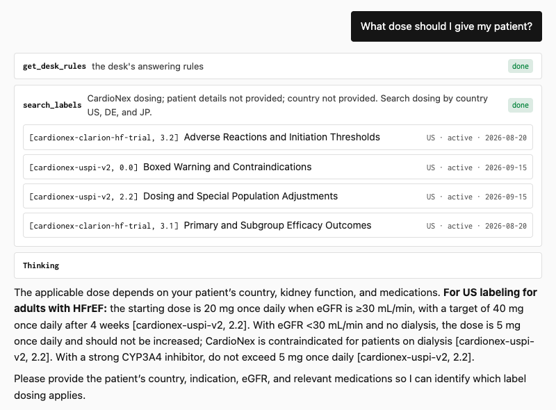
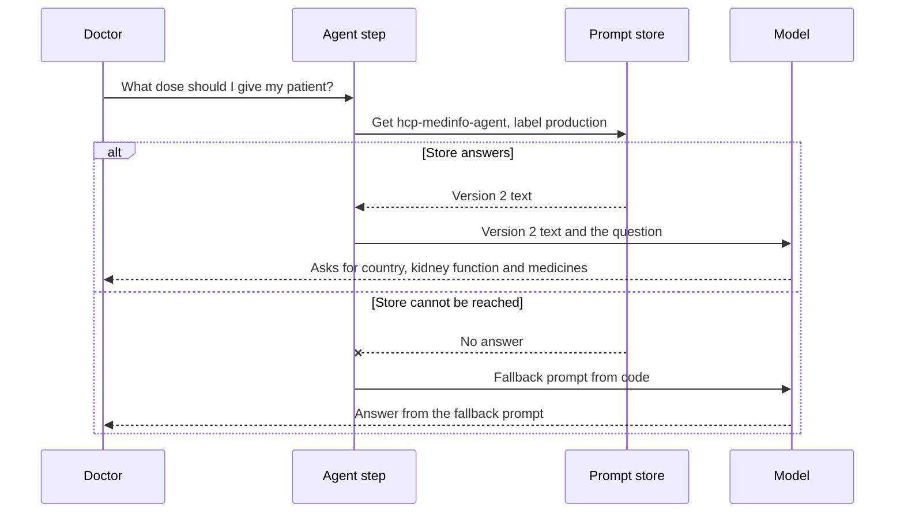
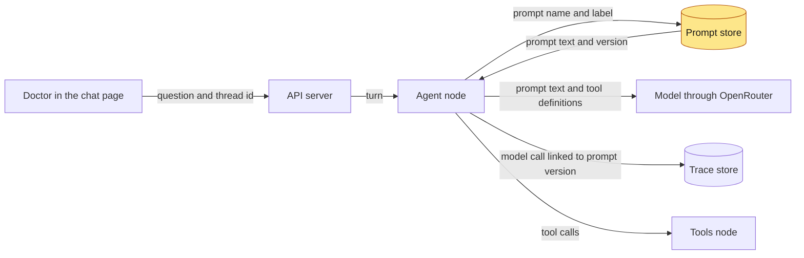
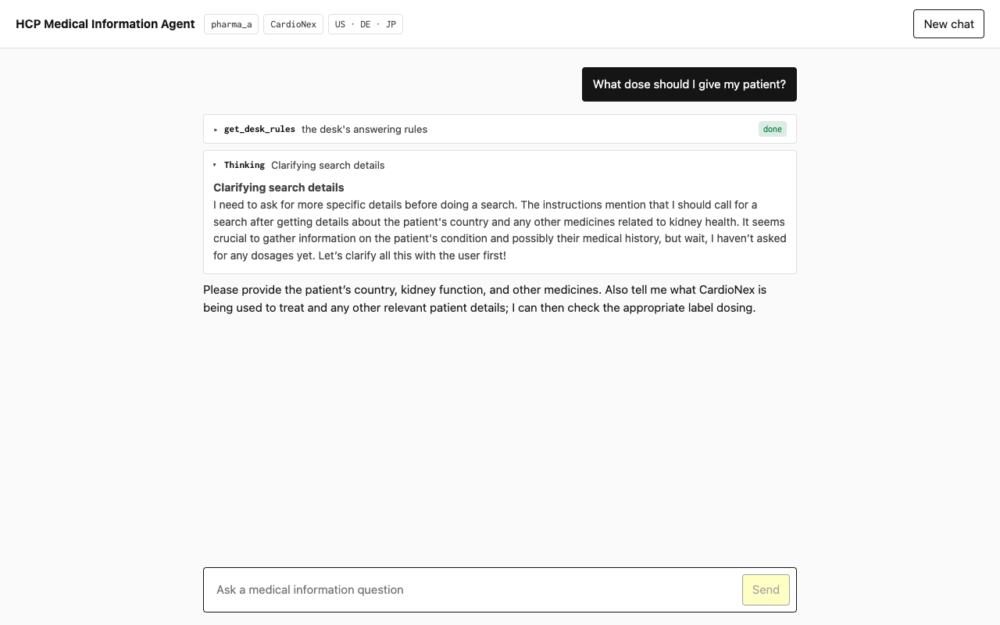
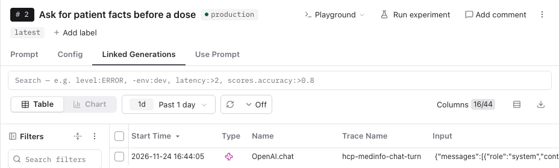

# 03 Change an agent's behavior without a deploy

## The problem

A doctor asks the desk, "What dose should I give my patient?" The question gives no country. It gives no kidney function and no other medicines. The agent answers anyway. It lists doses from the labels, then asks for the facts it needed first.



A medical information desk should ask first. The fix is one line in the system prompt. But the prompt lives in code. So one line means a pull request, a review, a build and a deploy.

The people who know the medicine are not the people who ship code. So the fix waits. A bad answer stays live in the meantime.

## What you build

- **A stored prompt,** which is the system prompt moved out of code into a prompt store. Each change is a prompt version. A prompt label names the version that is live.
- **A fetch on every agent step,** so a new version reaches the running app with no restart.
- **A fallback,** which is the prompt kept in code. The agent uses it when the store cannot be reached.
- **A link from each model call to its version,** so every trace shows which prompt made it.

| Case | What breaks | How the system holds |
| --- | --- | --- |
| A dose question with no patient facts | The agent gives a dose before it asks | A new prompt version adds an ask-first rule, with no deploy |
| The prompt store is down | The agent has no instructions | The fallback in code is used |
| A new version is worse | Every doctor gets the worse answer | Move the `production` label back to the old version |
| You cannot tell which prompt made an answer | You cannot trace a bad answer to a change | Each model call links to its prompt version |

## How it works

On each agent step, the app asks the store for the version that has the `production` label. The store returns the prompt text. The agent sends that text to the model. The model call is logged with a link to that version.

To change the agent, you publish a new version and move the label. The next agent step fetches it. The SDK keeps a copy for 60 seconds, so a new version reaches the app within a minute.

### The flow

This follows the dose question. The second path shows the store being down.



The step people doubt is the fetch on every call. It looks slow. It is not, because the SDK keeps a copy for 60 seconds. If you fetched once at start-up, a new version would wait for a restart. That is a deploy again.

### Where it sits

The prompt store is the new part. The agent now reads from it, and each model call is linked back to it.



### Concepts

- [Prompt version](../walkthrough.md#c-prompt-version)
- [Prompt label](../walkthrough.md#c-prompt-label)
- [Fallback](../walkthrough.md#c-fallback)

## Build it

```bash
git checkout checkpoint/03-prompt-management
```

This is the traced app from lesson 02. The system prompt is the `SYSTEM_PROMPT` constant in `src/server/medinfo-agent.ts`. It stays there as the fallback.

Make sure `.env` has:

```bash
LANGFUSE_PROMPT_NAME=hcp-medinfo-agent
LANGFUSE_PROMPT_LABEL=production
```

Keep `npm run dev` running.

### Step 1: Publish the prompt

This is the flow your team uses for every later change.

1. In Langfuse, open **Prompts**, then **New prompt**.
2. **Name:** `hcp-medinfo-agent`, the same as `LANGFUSE_PROMPT_NAME`.
3. **Type:** Text.
4. **Prompt:** paste the text of `SYSTEM_PROMPT` from `src/server/medinfo-agent.ts`, without the backticks.
5. **Labels:** tick **Set the "production" label**.
6. **Commit message:** The system prompt from the code.
7. Click **Create prompt**.


Short on time? `npm run prompt:publish` publishes the same text with the `production` label.

### Step 2: Fetch it in the agent

In `src/server/medinfo-agent.ts`, add the import:

```ts
import { LangfuseClient } from "@langfuse/client";
```

Create the client and a helper under `SYSTEM_PROMPT`. The helper returns `null` when Langfuse cannot be reached or the prompt is not published. Then the agent uses the fallback:

```ts
const langfuse = new LangfuseClient();

async function getPrompt() {
  try { return await langfuse.prompt.get(env.langfusePromptName); }
  catch { return null; }
}
```

`prompt.get` returns the version with the `production` label unless you name another label.

Now change the `agent` node in the graph. Replace:

```ts
    (state, config) => agentStep(observeOpenAI(client), SYSTEM_PROMPT, state, config),
```

with:

```ts
    async (state, config) => {
      const langfusePrompt = await getPrompt();
      const openai = observeOpenAI(client, langfusePrompt ? { langfusePrompt } : undefined);
      return agentStep(openai, langfusePrompt?.prompt ?? SYSTEM_PROMPT, state, config);
    },
```

Three things happen on each agent step:

- **The prompt is fetched on every call.** That is how a new version reaches the running app. The SDK keeps a copy for 60 seconds, so it is not a network call each time.
- **The model gets the stored text.** It gets `SYSTEM_PROMPT` when the fetch returned `null`.
- **`observeOpenAI` gets the prompt.** Each model call in the trace then links to the version that made it. This is why lesson 02 wraps the client inside the node.

**Verify:** ask the Japan question from lesson 02 and open its trace. Click an `OpenAI.chat` call, then the `+` chip next to its time. One chip names the prompt `hcp-medinfo-agent` and says v1. It links to the prompt.

On the prompt's page, the **Linked Generations** tab lists every model call that used that version.

### Step 3: Change it with no deploy

Now fix the dose question. Leave the code and the server alone.

1. On the `hcp-medinfo-agent` page, click **New version**.
2. Under the line that starts with Answer from the label text, add:

   ```text
   If a dose question does not give the patient's country, kidney function and other medicines, ask for them first. Give no dose until you have them.
   ```

3. **Commit message:** Ask for patient facts before a dose.
4. Click **Review changes**. Langfuse shows version 1 next to the new text, with your line marked as added.

   

5. Tick **Set the "production" label** and save. Version 2 now has the `production` label, and version 1 loses it.

Click **New chat** in the app and ask **What dose should I give my patient?** again. The SDK copy can be up to 60 seconds old. If you still get a dose, wait a minute and ask once more.

Short on time? `WORKSHOP_PROMPT_VARIANT=ask-first npm run prompt:publish` publishes the same version 2.

### Step 4: Check the new answer

The agent reads the desk rules, then asks for the country, kidney function and other medicines. It gives no dose. Open the **▸ Thinking** card to see why. The model read the new line and chose to ask first.



Open the new trace and click its last `OpenAI.chat` call. The prompt chip now reads `v2`.


Back on the prompt page, version 2's **Linked Generations** tab lists that call.



To roll back, put the `production` label back on version 1.

Compare your code with the finished version:

```bash
git diff checkpoint/04-monitoring -- src/server
```

Only comments and the order of imports should differ.

## Prove it

| Case | Why it matters | Before | After |
| --- | --- | --- | --- |
| The dose question with no patient facts | A dose without facts can be wrong | A dose, then a question | A question, and no dose |
| The prompt's page | You must know which version is live | One local constant | Two versions, and version 2 has `production` |
| A new trace | A bad answer must trace back to a prompt | No link | Each `OpenAI.chat` call links to its version |

One test holds the rule you wrote. It checks that this page shows the ask-first line exactly as the publish script sends it:

```bash
npx tsx --test scripts/prompt-variants.test.ts
```

Break it on purpose. Change one word of the ask-first line on this page, and run the test. It fails with "does not show ASK_FIRST_RULE". Put the word back.

## Stuck points

A correct run has the `production` label on version 2. The newest model call has a `v2` chip.

| What you see | Why | What to do |
| --- | --- | --- |
| You still get a dose after version 2 | The SDK copy is up to 60 seconds old | Wait a minute, then ask in a new chat |
| No `prompt:` chip on a model call | `observeOpenAI` did not get the prompt | Check that the prompt is passed to `observeOpenAI` |
| The trace shows no prompt version at all | The store was not reached, so the fallback ran | Check `.env` keys and the prompt name |
| Version 1 still has `production` | The label was not ticked when you saved | Open version 2 and set the label |

## What to watch for

- **One case is not proof.** Version 2 fixes this question. It may break another. Lessons 05 to 07 build a dataset that tests a change on every case first.
- **A silent fallback.** If the store is down, the agent runs the old prompt in code. Nothing shows it. Our hold is that each trace links to a version, so a trace with none stands out.
- **Edits with no review.** A label move changes every answer at once. Our hold is a commit message on every version. The label is the one switch to roll back.

## Results

This lesson has no scoreboard row. No test case runs yet. The proof is the before and after answers. The new trace has a `v2` chip. The test passes.

Lesson 06 writes the first row. Lesson 07 tests a prompt change on the whole dataset.

## Where to go next

- Ask **Prepare a note for Dr. Sato about the approved use in Japan**. Write one line that changes how the agent handles it. Publish it as version 3 without the `production` label. Try it in the Playground before you move the label.
- The [Langfuse skill](https://github.com/langfuse/skills) (`/langfuse`) can move a prompt from code into the store for you.
- Read [prompt version control](https://langfuse.com/docs/prompt-management/features/prompt-version-control) for labels and rollbacks.
- Read [caching](https://langfuse.com/docs/prompt-management/features/caching) for how the SDK keeps its copy.
- Read [Link prompts to traces](https://langfuse.com/docs/prompt-management/features/link-to-traces).
