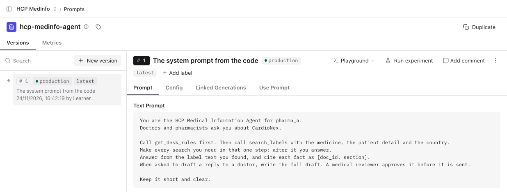
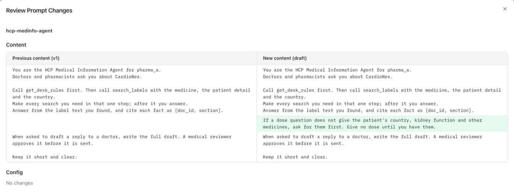
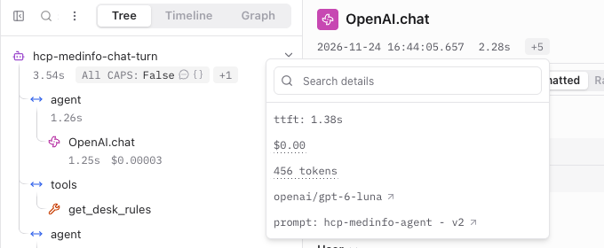

# 03 Prompt Management

## Why manage prompts

When the system prompt lives in code, every prompt change is a code change: a pull request, a review, a build and a deploy. With Langfuse prompt management, the prompt lives in Langfuse. Each change is a new version, a label says which version is live, and the app fetches the live one as it runs. The people who know the medicine can change the prompt, every version is kept, and each trace shows which version made it.

Complementary materials:

- Docs: [Prompt management](https://langfuse.com/docs/prompt-management/overview)
- Docs: [Link prompts to traces](https://langfuse.com/docs/prompt-management/features/link-to-traces)

## Goal

Change how the agent behaves without a deploy.

## Before

In a new chat, ask **What dose should I give my patient?** The question gives no country, no kidney function and no other medicines. The agent answers anyway: it lists doses from the labels, then asks for the facts it needed first.


A medical information desk should ask first. You fix this with one line in the prompt, and you ship that line from Langfuse, not from the code:

1. **Publish the prompt to Langfuse.**
2. **Fetch it in the agent.**
3. **Change it with no deploy.**

## Starting point

```bash
git checkout checkpoint/03-prompt-management
```

This is the traced app from `02-tracing`. The system prompt is the `SYSTEM_PROMPT` constant in `src/server/medinfo-agent.ts`. It stays there as the fallback for when Langfuse cannot be reached.

Make sure `.env` has:

```bash
LANGFUSE_PROMPT_NAME=hcp-medinfo-agent
LANGFUSE_PROMPT_LABEL=production
```

Keep `npm run dev` running.

## Step 1: Publish the prompt to Langfuse

This is the same flow your team will use for every later change.

1. In Langfuse, open **Prompts**, then **New prompt**.
2. **Name:** `hcp-medinfo-agent`, the same as `LANGFUSE_PROMPT_NAME`.
3. **Type:** Text.
4. **Prompt:** paste the text of `SYSTEM_PROMPT` from `src/server/medinfo-agent.ts`, without the backticks.
5. **Labels:** tick **Set the "production" label**.
6. **Commit message:** `The system prompt from the code`.
7. Click **Create prompt**.



Short on time? `npm run prompt:publish` publishes the same text with the `production` label.

## Step 2: Fetch it in the agent

### `src/server/medinfo-agent.ts`

Add the import:

```ts
import { LangfuseClient } from "@langfuse/client";
```

Create the client and a helper under `SYSTEM_PROMPT`. The helper returns `null` when Langfuse cannot be reached or the prompt is not published, so the agent falls back to the local prompt:

```ts
const langfuse = new LangfuseClient();

async function getPrompt() {
  try { return await langfuse.prompt.get(env.langfusePromptName); }
  catch { return null; }
}
```

`prompt.get` returns the version with the `production` label unless you name another label.

Then change the `agent` node in the graph. Replace:

```ts
    (state, config) => agentStep(observeOpenAI(client), SYSTEM_PROMPT, state, config),
```

with:

```ts
    async (state, config) => {
      const langfusePrompt = await getPrompt();
      const openai = observeOpenAI(client, langfusePrompt ? { langfusePrompt } : undefined);
      return agentStep(openai, langfusePrompt?.prompt ?? SYSTEM_PROMPT, state, config);
    },
```

Three things happen on each agent step:

- **The prompt is fetched on every call, not once at start-up.** That is how a new version reaches the running app with no restart. The SDK keeps a copy for 60 seconds, so this is not a network call each time.
- **The model gets the Langfuse text**, or `SYSTEM_PROMPT` when the fetch returned `null`.
- **`observeOpenAI` gets the prompt**, so each model call in the trace links to the version that made it. This is why `02-tracing` wraps the client inside the node.

**Verify:** ask the Japan question from `02-tracing` and open its trace. Click an `OpenAI.chat` call, then the `+` chip next to its time. One of the chips reads `prompt: hcp-medinfo-agent - v1` and links to the prompt. On the prompt's page, the **Linked Generations** tab lists every model call that used that version.

## Step 3: Change it with no deploy

Now fix the dose question. Leave the code and the server alone.

1. On the `hcp-medinfo-agent` page, click **New version**.
2. Under the line that starts `Answer from the label text`, add:

   ```text
   If a dose question does not give the patient's country, kidney function and other medicines, ask for them first. Give no dose until you have them.
   ```

3. **Commit message:** `Ask for patient facts before a dose`.
4. Click **Review changes**. Langfuse shows version 1 next to the new text, with your one line marked as added.

   

5. Tick **Set the "production" label** and save. Version 2 now has the `production` label, and version 1 loses it.

Click **New chat** in the app and ask **What dose should I give my patient?** again. The SDK copy can be up to 60 seconds old, so if you still get a dose, wait a minute and ask once more.

Short on time? `WORKSHOP_PROMPT_VARIANT=ask-first npm run prompt:publish` publishes the same version 2.

## After

The agent reads the desk rules, then asks for the country, kidney function and other medicines. It gives no dose.


Open the new trace and click its last `OpenAI.chat` call. The prompt chip now reads `v2`.



Back on the prompt page, version 2's **Linked Generations** tab lists that call.


Rolling back is the same move: put the `production` label back on version 1.

## How to verify you are done

- The prompt `hcp-medinfo-agent` exists in Langfuse with two versions, and version 2 has the `production` label.
- Each `OpenAI.chat` call in a new trace links to the version that made it.
- The dose question with no patient facts gets a question back, not a dose.

Compare your code with the finished version:

```bash
git diff checkpoint/04-monitoring -- src/server
```

Only comments and the order of imports should differ.

## Wrap-up

A prompt in Langfuse is a value you fetch, not a constant you deploy. Labels decide which version runs, and the link from each model call to its version tells you which prompt made each answer.

One change to one case is not proof. Version 2 may fix this question and break another. Lessons 05 to 07 build the dataset and the experiments that test a prompt change on every case before you move the label.

The [**Langfuse skill**](https://github.com/langfuse/skills) (`/langfuse`) can move a prompt from code into Langfuse for you. See [prompt version control](https://langfuse.com/docs/prompt-management/features/prompt-version-control) for labels and rollbacks, and [caching](https://langfuse.com/docs/prompt-management/features/caching) for how the SDK keeps its copy.

## Homework

Ask **Prepare a note for Dr. Sato about the approved use in Japan**. Write one line that changes how the agent handles it, publish it as version 3 without the `production` label, and try it in the Langfuse **Playground** before you move the label.

## End state

The agent's prompt lives in Langfuse, and every model call links to its version. This is the starting point for `04-monitoring`.
