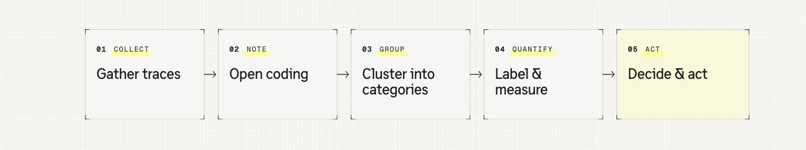
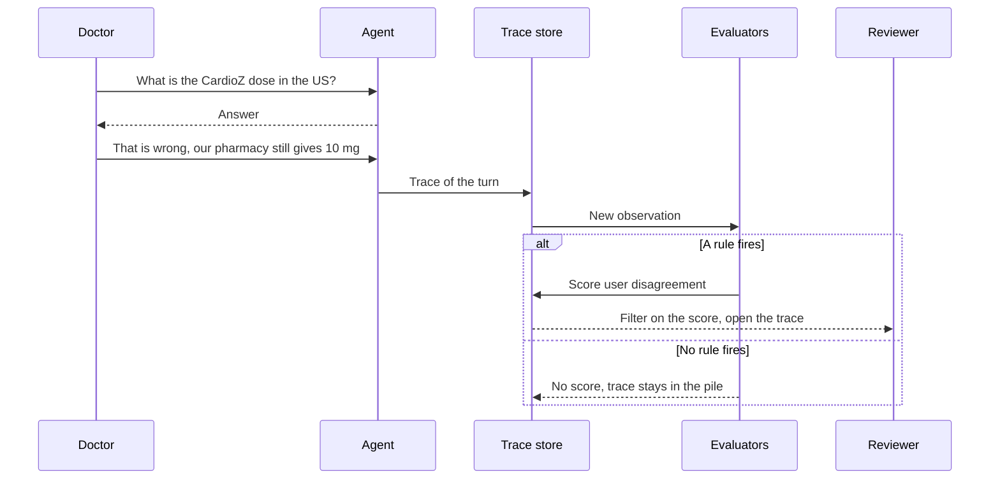
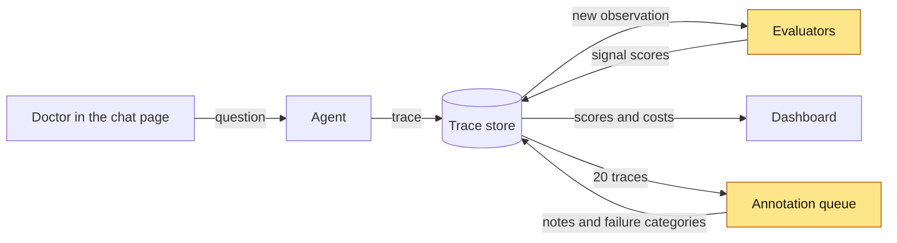
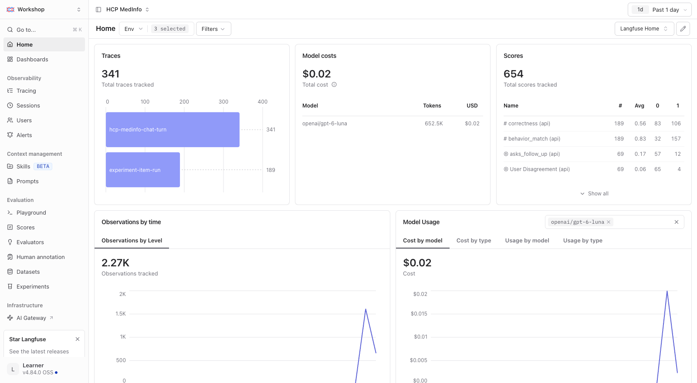
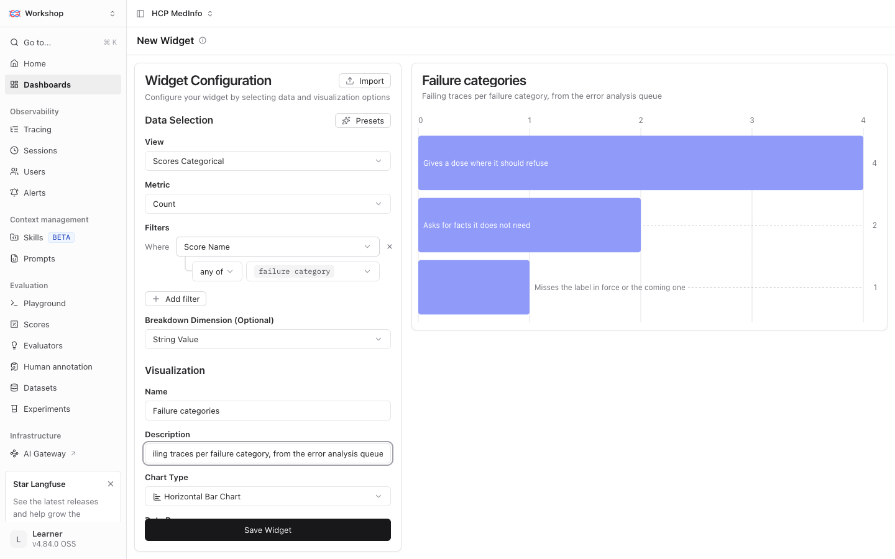
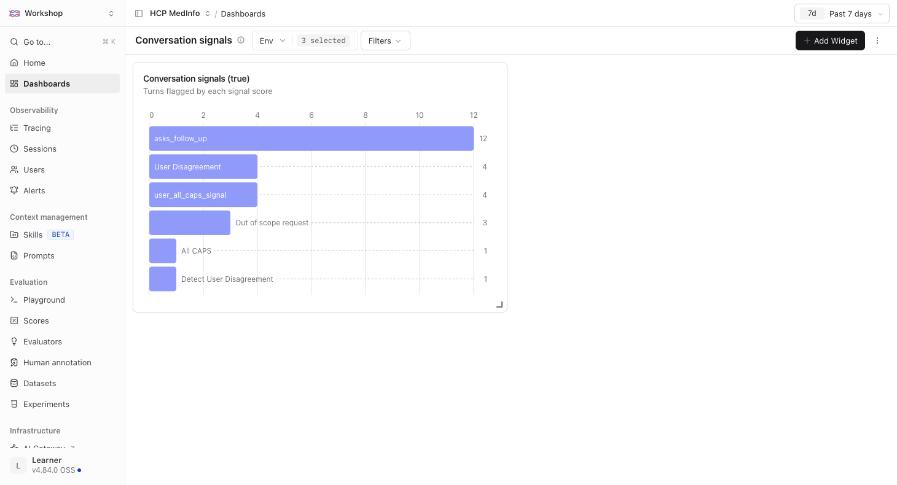

# 04 Find what goes wrong in production

## The problem

Lesson 02 gave the desk a trace for every turn. After a week of real use, there are thousands. Nobody can open each one.

A doctor pushes back on a dose. Another types in capital letters. A third gets a refusal that cited a label it did not need. These turns sit in the pile, and the team does not know they exist.

So the same failures repeat. A prompt change from lesson 03 fixes one case. Nobody knows what else is broken, or how often.

## What you build

- **A dashboard,** which shows cost, time and scores across all traces.
- **An error analysis,** which is the reading of 20 real answers by hand. Each bad one gets a short note, called open coding.
- **Three failure categories,** which are the named groups the notes fall into. A score tags each failing trace, and a chart counts them.
- **Two signals,** which are scores that mark turns worth reading. One finds a clinician who disagrees. One finds a message in capital letters.

| Case | What breaks | How the system holds |
| --- | --- | --- |
| Thousands of traces | You cannot read them all | A dashboard shows the trend, and signals pick out single turns |
| A failure nobody named | The same bad answer repeats | Error analysis names it and counts it |
| A clinician pushes back | The agent may have quoted the wrong label | A judge scores disagreement on each new turn |
| A message in capital letters | The conversation may be going wrong | A code rule scores it with no model call |

## How it works

Monitoring has two halves. One looks at all traces at once. The other picks out single traces to read.

The first half is the dashboard and the error analysis. You read 20 traces by hand and write a note on each failure. You group the notes into failure categories and count them. The longest bar is what to fix first.

The second half is the signals. A signal is a score on a trace, set when the turn looks wrong. It tells you which traces to open.



### The flow

This follows one doctor who disagrees. The second path shows a turn that no rule flags.



The step people doubt is the signal itself. A capital-letter score is a hint, not proof. It does not say the clinician is angry. It says this turn is worth a look.

### Where it sits

Evaluators read each new trace from the trace store. They write scores back. The dashboard and the annotation queue read those scores.



### Concepts

- [Error analysis](../walkthrough.md#c-error-analysis)
- [Open coding](../walkthrough.md#c-open-coding)
- [Failure category](../walkthrough.md#c-failure-category)

## Build it

```bash
git checkout checkpoint/04-monitoring
```

This lesson has two hands-on parts. Each has its own page. Do error analysis first, then signals.

### Step 1: Look at cost, time and quality

Cost and time are logged on every trace. In Langfuse, open **Home**. You see the volume of traces, the model cost, and the scores. With [dashboards](https://langfuse.com/docs/metrics/features/custom-dashboards) you can chart spend per model and the most used tools. You can also chart the tools that fail most.



### Step 2: Do structured error analysis

Error analysis is run by people, often the domain experts. Repeat it as the app changes. Follow [section 4.1 Error analysis](./04-monitoring/error-analysis.md). You replay 20 traces, note what went wrong on each, and group the notes. Then you chart how often each failure category appears.



### Step 3: Capture signals

A signal is something the user does or says that shows how the turn went. It is stored on the trace as a score. Follow [section 4.2 Capturing signals](./04-monitoring/capturing-signals.md). You start with two signals: the clinician disagrees, and the clinician writes in capital letters.



## Prove it

| Case | Why it matters | Before | After |
| --- | --- | --- | --- |
| 20 recorded answers | Nobody has said which are wrong | No notes | A note and a pass or fail on each |
| The failing traces | You need to know the most common failure | No names | Three failure categories, one bar each |
| A turn where the doctor disagrees | It must stand out | Lost in the pile | A disagreement score you can filter on |
| A message in capital letters | It must stand out | Lost in the pile | A frustration score you can filter on |

No unit test covers this lesson. The proof is on the screen. The chart has one bar per failure category. The filter on a signal score shows the turn you sent.

Break it on purpose. Skip the step that adds the `failure category` score to the queue. The chart then has no bars. Put the step back.

## Stuck points

A correct run has a chart with three bars. The signals page shows a score on your two test turns.

| What you see | Why | What to do |
| --- | --- | --- |
| The chart has no bars | The score is not on the queue | Add the `failure category` score to the annotation panel |
| A signal score never shows | The evaluator was not run | Click Execute, then send a new turn |
| The judge cannot pick a model | The project has no model connection | Add one in the project settings, as in section 4.2 |
| A rerun of the seed doubled the traces | The seed is not idempotent | Run it once, and filter on its tag |

## What to watch for

- **Reading too few.** Twenty traces start the habit. A real product needs 50 to 100. Our hold is that the page says so.
- **Signals taken as proof.** A capital-letter score is a clue. Our hold is that both signals only pick traces to read.
- **A stale list of failures.** Usage changes, and so do the failure categories. Repeat the error analysis when usage changes.

## Results

This lesson has no scoreboard row, because no test case runs yet. The proof is what you see. The chart counts each failure category, and two signal scores mark the turns to read.

The failing traces are the best source for lesson 05. They become test cases there.

## Where to go next

- Read [section 4.1 Error analysis](./04-monitoring/error-analysis.md), then [section 4.2 Capturing signals](./04-monitoring/capturing-signals.md).
- Read the Academy page on [error analysis](https://langfuse.com/academy/monitoring/error-analysis).
- Read the Academy page on [capturing signals](https://langfuse.com/academy/monitoring/capturing-signals).
- Lesson 05 turns the traces you caught into [eval datasets](./05-dataset.md).
