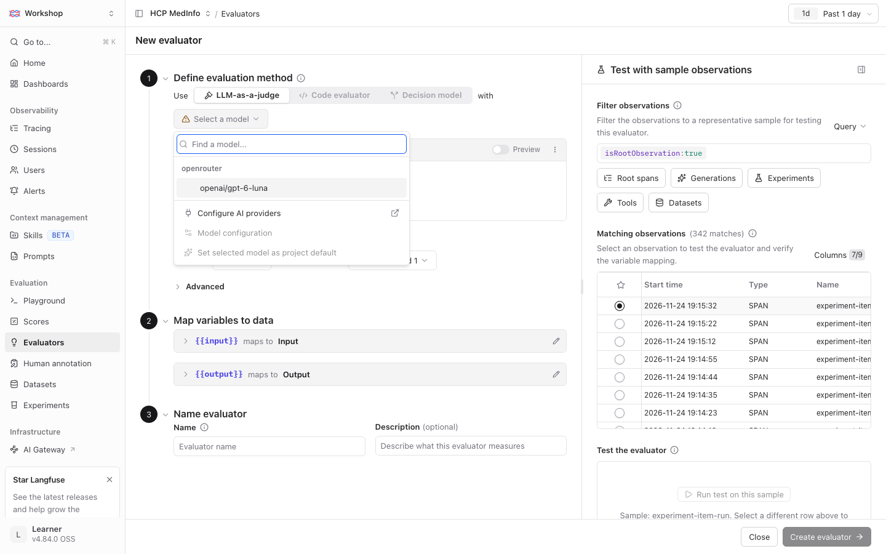
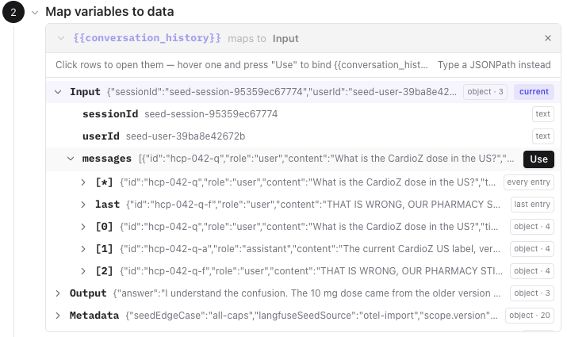
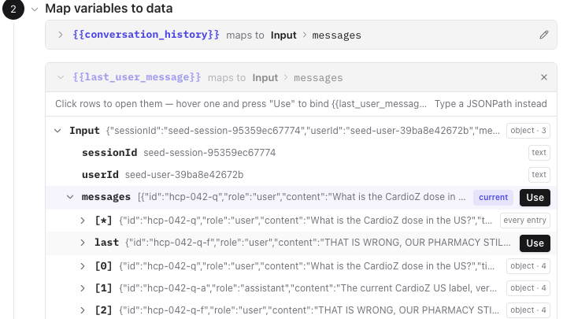
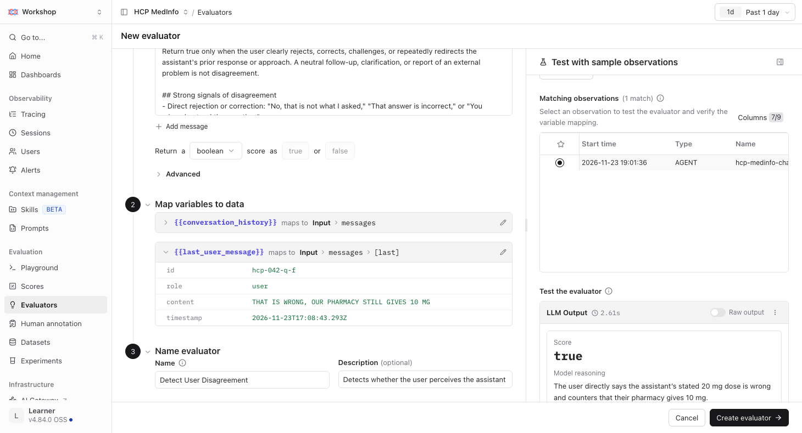
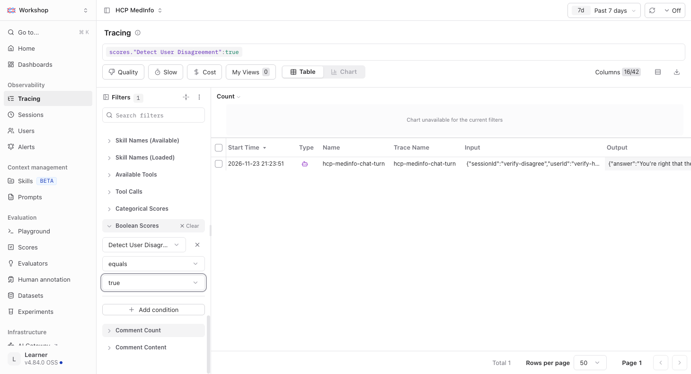
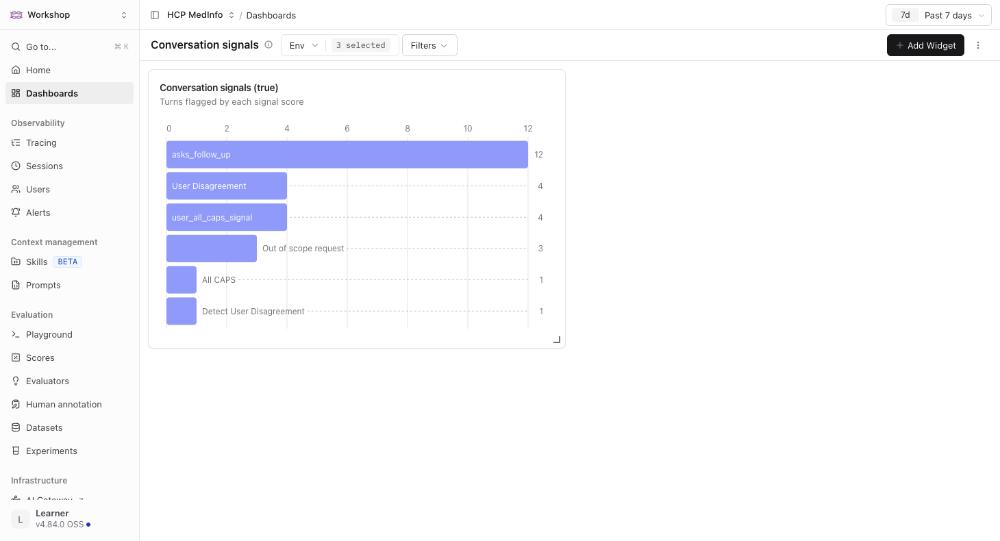

# Capturing signals

## Why capture signals

Once traces come in, you want a verdict on each one without opening it. A production signal is something the user does or says. It shows whether a turn went well. Examples are a correction, a retry, a request for a human, or a thank-you.

Store it as a score on the trace. It then points you to the rows worth reading. Start with the negative ones. A user rarely corrects an answer they liked.

Complementary materials:

- Docs: [Evaluate production traffic](https://langfuse.com/docs/evaluation/get-started/online)
- Academy: [Capturing signals](https://langfuse.com/academy/monitoring/capturing-signals)

## Goal

Capture two conversation signals for the agent. Then you can find these turns without opening every trace.

- **User disagreement:** the clinician pushes back, like "That is wrong, our pharmacy still gives 10 mg". Either the agent quoted the wrong label, or the label library has a gap.
- **All-caps frustration:** the clinician writes "I NEED THE ONCOX DOSE RIGHT NOW". A long run of capital letters is a cheap rule-based clue that the chat needs a look. It is a hint, not proof of anger.

## Starting point

```bash
git checkout checkpoint/04-monitoring
```

## Step 0: Set up the evaluator model

The disagreement judge needs a model connection on the project. The keys in `.env` do not fill that list.

1. In Langfuse, open **Project Settings → LLM Connections**.
2. Click **Add LLM Connection**.
3. Choose OpenAI and name the connection `openrouter`. Paste your OpenRouter key into the secret field. Set the base URL to `https://openrouter.ai/api/v1`. Add `openai/gpt-6-luna` as a custom model.
4. Save the connection.

If a connection is already there, keep it and continue.

Keep the API key in the Langfuse secret field only. Do not paste it into workshop transcripts or shared notes.

When the evaluator wizard in Step 1 asks for a model, choose this connection and `openai/gpt-6-luna`.



## Step 1: Wire the judge-based monitor

Langfuse ships a published **Detect User Disagreement** template. It is an LLM-as-a-judge evaluator that reads variables from observations.

It maps `{{conversation_history}}` to every input message. It maps `{{last_user_message}}` to the last input message. Target the root `hcp-medinfo-chat-turn` agent observation.

1. In Langfuse, open **Evaluators → New Evaluator**. Pick **Detect User Disagreement** from the **Template Gallery**.
2. On the right, select the trace root as a sample observation. The panel already filters on `isRootObservation:true`. So pick an `hcp-medinfo-chat-turn` row of type **AGENT**. That is the root, where the whole trace input and output is logged.

   **Hint**: hover a filter chip to see what it hides.

   

3. Under **Map variables to data**, bind each variable from the live observation tree. Open a row, hover the field, and press **Use**. Do not use **Type a JSONPath instead**.

   - `{{conversation_history}}`: open **Input**, hover **messages**, and press **Use**. The binding reads **Input → messages** (every message).
   - `{{last_user_message}}`: open **Input → messages**, hover **last**, and press **Use**. The binding reads **Input → messages → last**.

   

   

4. In the right panel, test run your evaluator on a sample observation.

   

5. Click **Create evaluator**. The next screen shows which observations it scores, a sampling rate and a weekly cost estimate.

   Locally the estimate can read **Unavailable**. Leave **Run evaluator on past observations** off. Click **Execute**, and your first evaluator is running.

   

The rule scores observations that arrive after you execute it. The seeded batch is already in the project. It is the sample for mapping and testing. New turns get the live score. You can run the same evaluator on old observations with [batch evaluation](https://langfuse.com/docs/evaluation/get-started/online).

## Step 2: Add a code evaluator for all-caps frustration

The monitor above is an LLM judge, because it needs meaning. This one does not. We want a cheap check for a message with a long run of capital letters. It hints that a user may be upset.

A code evaluator fits well. It needs no model call and no prompt. It is a simple rule that runs on live observations.

1. In Langfuse, open **Evaluators → New Evaluator**. Pick **Detect User Frustration (ALL CAPS)**. It is a ready-made code evaluator.

   It reads the Input of an observation. It checks whether more than 70% of a message is capital letters.
2. Target the same root agent observation as the disagreement monitor:

   

3. Run a test on the evaluator.
4. Click **Create Evaluator**, then execute.

This evaluator runs as TypeScript. So it does not use the OpenRouter connection. Langfuse Cloud runs it in a sandbox. The local Langfuse runs it inside its worker.

`langfuse/workshop.override.yml` turns that on with `LANGFUSE_CODE_EVAL_DISPATCHER: insecure-local`. Without that line, saving shows "Code evaluations are not enabled for this deployment".

That worker also holds Langfuse's own secrets, and an evaluator can read them. Lesson 12 moves code evaluators into a sandbox of their own.

## Step 3: Verify the monitors

```bash
npm run dev
```

Send two turns. Each should light up one monitor. They must be new turns, sent after both evaluators are running:

1. **Disagreement:** ask "What is the CardioZ dose in the US?". Then reply "That is wrong, our pharmacy still gives 10 mg".
2. **All caps:** send "I NEED THE ONCOX DOSE FOR GERMANY RIGHT NOW".

In Langfuse, wait a few seconds for the evaluators to run, then refresh. Filter for traces with the matching evaluator score:

1. Open **Tracing**.
2. Open the **Filters** sidebar.
3. Find the score type. For example, All CAPS is under **Boolean Scores**. Pick the evaluator name and set the operator to `equals`. Choose the value you want (`true` or `false`).
4. The table now shows only matching traces.



To watch the signals over time, put them on a dashboard:

1. Open **Dashboards → Widgets → New widget**.
2. Pick the **Scores Boolean** view. Add the filter **Boolean Value** `=` `true`. Break it down by **Name**.
3. Name it `Conversation signals (true)`. Choose **Horizontal Bar Chart** and save.
4. Open **Dashboards → New dashboard** and name it `Conversation signals`. Choose **Add Widget** and pick the widget. Set the range to the past 7 days.



The seeded traffic already carries signal scores. So the bars are not empty before your own two turns.

User disagreement is a strong event. When a user pushes back on an answer, something almost surely went wrong. It may be a wrong tool result, missing context, or a label for the wrong country. Read these traces first. They are good candidates for dataset items in [05 Build eval datasets](../05-dataset.md).

The all-caps signal is a rougher clue that a chat may be going wrong. Paired with the disagreement judge, it makes a good review-first monitor.

Open a few traces already in the project. Compare them with the two turns you just scored. As more production turns arrive, the same evaluators score them.

## Bonus: Conversation signals with decision models

A [decision model](https://langfuse.com/docs/evaluation/evaluation-methods/decision-models) gives a typed answer to each question, not free text. It is the cheaper evaluator when you do not need written reasons. With it you can capture many signals in one call.

1. Open **Evaluators → New Evaluator** and choose **Decision model**.
2. Add one question per signal. Ask yes or no, like "Does the user disagree?" Or ask for a score. Try "How upset is the clinician?"
3. Test it on one or two root observations and save.

Decision models need a direct OpenAI, Google AI Studio or TypeSafe connection. The OpenRouter connection from this lab does not show there. Skip this bonus unless you have one of those keys.

## Wrap-up

The scores tell you which traces to open. [Error analysis](./error-analysis.md) helps you pick which signals to add next. You read what goes wrong and name it. [Dashboards](https://langfuse.com/docs/metrics/features/custom-dashboards) turn a score into a trend over time.

The traces these monitors catch are real examples of behavior to lock in or fix. They are the best source for [05 Build eval datasets](../05-dataset.md).

## End state

This is the starting point for [05 Build eval datasets](../05-dataset.md).
