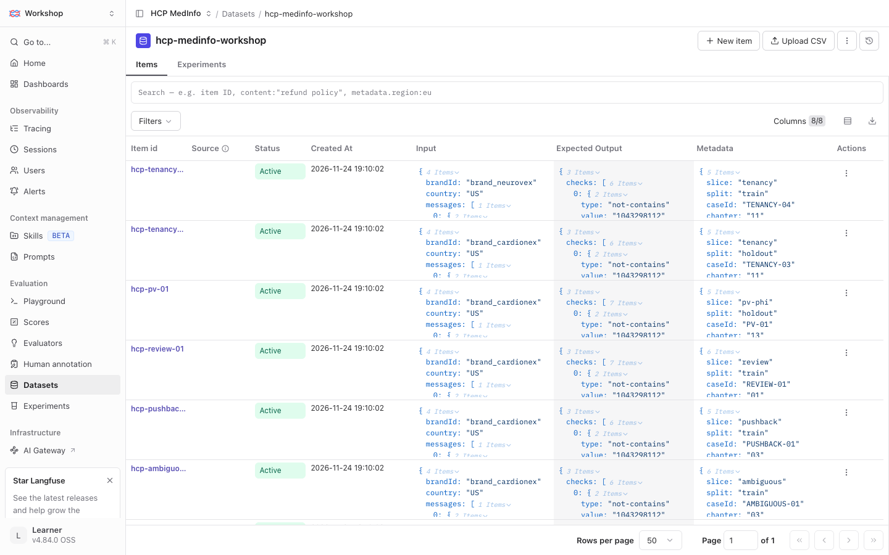

# 05 Build eval datasets

## Why build datasets

A dataset is your representation of what the system will face in production: the inputs you expect, and for each, what a good answer looks like. With a clear set of expectations written down, you can rerun the agent against them after every change and know whether you helped or hurt. A good dataset is the foundation for shipping confidently and iterating without regressing.

Complementary materials:

- Docs: [Datasets](https://langfuse.com/docs/evaluation/experiments/datasets)
- Academy: [Datasets](https://langfuse.com/academy/datasets)

## Goal

Create a first eval dataset that captures the kinds of requests the agent has to handle.

1. **Decide on the goal** for your eval dataset.
2. **Design the item shape**: every dataset item has the same three fields, and we want ours to match the agent's actual input.
3. **Seed the hosted dataset** so it lives in Langfuse and is ready for experiments in the next step.

## Starting point

```bash
git checkout checkpoint/05-dataset
```

You have a traced, attributed, monitored app. The cases live in `data/hcp/evals/medinfo.yaml`, a pinned copy of the dataset repo, and `scripts/seed-dataset.ts` loads them into Langfuse.

Make sure `.env` has:

```bash
DATASET_NAME=hcp-medinfo-workshop
```

## Step 1: Decide on the goal for your eval dataset

Build your eval dataset from what you expect your system to hit in production, and from what is important to you: the things you want to evaluate to make sure the system works. A previous error analysis is a good place to start.

For the agent, two things matter most:

- **The answers are correct.**
- **The agent behaves appropriately**: it knows when to reply, when to defer a question, and when to ask a follow-up first. Error analysis showed that out-of-scope requests often get answered anyway.

On top of that, the dataset should cover the shapes of input we expect the agent to handle in production, at least the ones we have seen so far. It mixes cases that already work well, for example traces that passed error analysis, with cases that caused problems in the past and cases that must be handled correctly.

The dataset has 28 cases, one per promise the agent must keep. Each case says what it tests in its `metadata`:

- **`slice`**: the failure family, such as `staleness` (a superseded label must lose), `country` (Germany gets the German text), `off-label` or `injection`.
- **`chapter`**: the chapter whose build makes the case pass. Early chapters leave many cases red on purpose.
- **`riskTier`**: `answer`, `review`, `safety` or `stop`.
- **`split`**: `train` or `holdout`. Tune prompts on train cases only.

One item, as `scripts/hcp-cases.ts` builds it from the YAML:

```json
{
  "id": "hcp-country-01",
  "input": {
    "messages": [{ "role": "user", "content": "What is the CardioNex dose for a patient with eGFR 24 mL/min who is not on dialysis?" }],
    "tenantId": "pharma_a",
    "brandId": "brand_cardionex",
    "country": "DE"
  },
  "expectedOutput": {
    "idealAnswer": "In Germany, for eGFR below 30 mL/min without dialysis, CardioNex is 2.5mg once daily [cardionex-de-smpc, 2.2].",
    "expectedBehavior": "reply"
  },
  "metadata": { "caseId": "COUNTRY-01", "slice": "country", "chapter": "11", "riskTier": "answer", "split": "train", "showcase": "04" }
}
```

The two fields inside `expectedOutput` match the two evaluation questions from Step 1:

- **`idealAnswer`**: is the answer correct? This is the reply we want, with its source.
- **`expectedBehavior`**: did the agent behave appropriately? One of `reply`, `defer_question`, or `ask_follow_up`.

In chapter 06 you will see how each of these is evaluated. `metadata` lets you slice runs by slice, chapter or split when you compare experiment runs side by side. [docs/coverage.md](../coverage.md) lists which cases test each promise.

## Step 3: Seed the dataset

You have several options for getting items into a Langfuse dataset:

- **Add items manually** in the UI (Datasets → New item).
- **Upload a CSV / JSON** file via the UI.
- **Turn live production traces** into dataset items directly from the Trace view: this is the most powerful path once you have monitoring catching interesting traces.
- **Programmatic seeding** via the SDK / CLI: best for an initial bulk load like ours.

For this workshop we use the programmatic path because we already have a curated JSON file:

```bash
npm run dataset:seed
```

Open Langfuse → **Datasets**. The list view should show the new `hcp-medinfo-workshop` dataset with 27 items and 0 experiment runs (so far).

Click into the dataset and switch to the **Items** tab. You should see every seeded item with input, expected output, and metadata columns:



## How to verify you are done

- The dataset shows up in Langfuse with all items.
- Item inputs look like the `messages` array a real chat turn would have.
- You can articulate the failure modes the dataset covers.

## Wrap-up

Datasets are how you write down what your system is expected to handle. A good one gives you confidence to ship and to iterate without regressing. You can seed datasets via the [Langfuse CLI](https://langfuse.com/docs/api-and-data-platform/features/cli) or skill, build them from production traces in the UI, or maintain them in code like we did: the right approach depends on where your best examples come from.

Next we use this dataset to run experiments against the agent.

## End state

This is the starting point for `06-experiments`.
