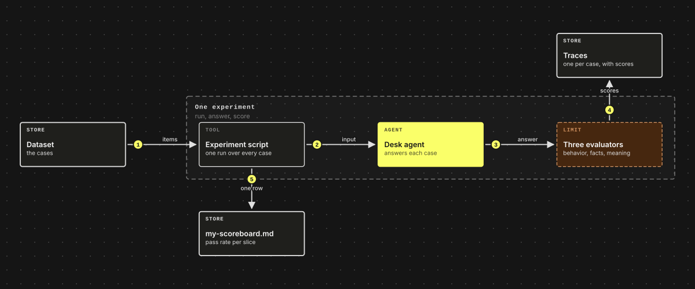
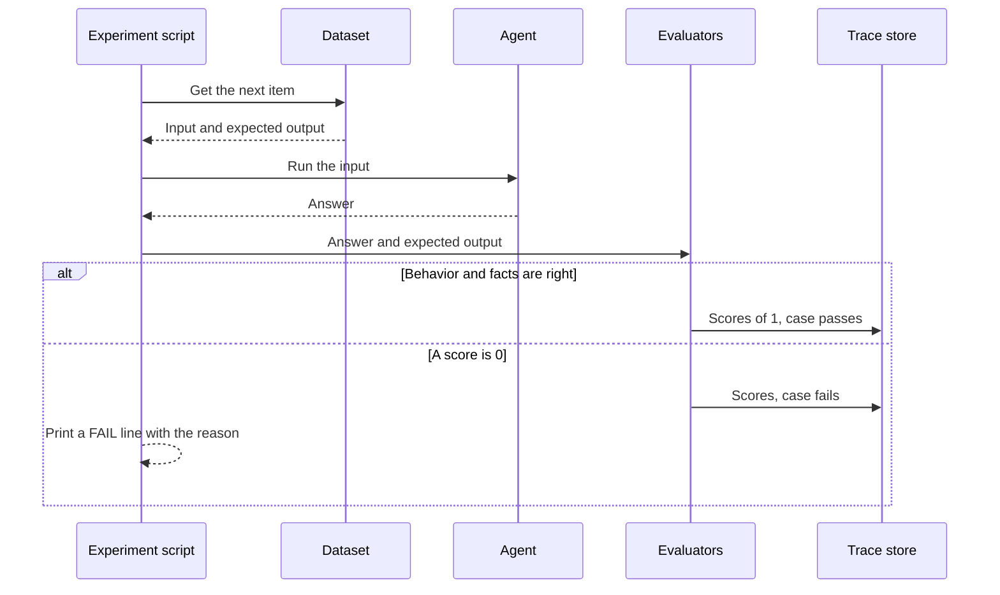
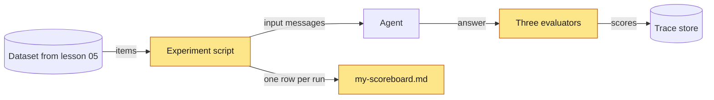

# Score your agent on every case

## The problem

The dataset from lesson 05 holds the cases. Nobody has run them. So nobody knows how many the agent gets right.

Lesson 04 showed that some answers are wrong. It did not say how many, or in which slices. A prompt change from lesson 03 may have fixed one case and broken three.

A doctor in Germany gets a dose for another country. A superseded label gets cited. These fail again and again, but a hand test on a few questions cannot show it.

## What you build

- **An experiment,** which is one run of the agent over every dataset item. Each item gets a trace, like a live turn.
- **Three evaluators,** which score each answer. One checks the behavior. One checks the facts. One compares the meaning.
- **A pass rule.** A case passes when the behavior and the facts are both right.
- **A scoreboard row,** which is the pass rate for each slice and overall. It is the baseline every later lesson must beat.

| Case | What breaks | How the system holds |
| --- | --- | --- |
| A prompt change helps one case | It hurts another, and nobody sees | Every change runs on all cases |
| An answer is right but wrong in kind | The agent asks when it should reply | `behavior_match` compares the move with the expected one |
| An answer cites an old dose | A wrong fact reaches a doctor | `label_checks` looks for words that must not appear |
| The same answer is worded differently | A strict match fails a good answer | `correctness` asks a judge if the meaning matches |

## How it works

The script reads each item from the dataset. It runs the same agent code the web app uses. So every trace has the shape of a production trace. Then each evaluator scores the answer, and the score lands on that trace.



Step through it one part at a time in the [live drawing](https://canvas.learnwithparam.com/case.html#buildcamp/8).

A case passes when `behavior_match` and `label_checks` are both 1. The `correctness` score is there to read. A judge can change its mind on the same answer. So it is not part of the pass.

### The flow

This follows one case. The second path shows an answer that fails.



The step people doubt is the behavior check. A decision model labels the answer. It never sees the expected label. So it cannot copy the answer from the key.

### Where it sits

The experiment script reads the dataset and calls the agent. The scores are written back to the traces.



### Concepts

- [Experiment](../walkthrough.md#c-experiment)
- [Evaluator](../walkthrough.md#c-evaluator)
- [Scoreboard](../walkthrough.md#c-scoreboard)
- [Baseline](../walkthrough.md#c-baseline)

## Build it

```bash
git checkout checkpoint/06-experiments
```

The dataset is seeded in Langfuse. The `production` prompt is version 2 from lesson 03, the one with the ask-first rule.

### Step 1: Read the evaluators

Open `scripts/run-dataset.ts`. Its numbered comments let you read it in order. The whole run is one call to `runExperiment`:

```ts
await dataset.runExperiment({
  name: "HCP Medical Information Agent experiment",
  runName,           // a new label per run
  maxConcurrency: 1, // one item at a time

  task: async ({ input }) => answerConversation(input.messages),

  evaluators: [
    /* behavior_match */,
    /* label_checks */,
    /* correctness */
  ]
});
```

Each evaluator is a callback. It runs right after `task` returns. It attaches a score to the trace of that item. So every score is in Langfuse when the script ends.

| Evaluator | Question | How |
| --- | --- | --- |
| `behavior_match` | Did the agent reply, defer or ask a follow-up as it should? | A decision model labels the answer. The script compares the label with `expectedBehavior`. |
| `label_checks` | Does the answer hold the right facts and none of the wrong ones? | Text checks from the dataset, such as `2.5mg` or `OFF_LABEL_REFUSAL`. No model runs. |
| `correctness` | Does the answer mean what the ideal answer means? | A judge model compares them. A paraphrase passes. A wrong fact fails. |

The decision model is the [OpenRouter Decisions API](https://openrouter.ai/docs/guides/features/decisions). It labels each answer `reply`, `defer_question` or `ask_follow_up`.

### Step 2: Run the dataset

```bash
npm run dataset:run -- --chapter 06 --change "The agent as lesson 03 left it"
```

The run takes about ten minutes. It prints the average scores. Then it prints two lines for each failing case:

```text
FAIL STALENESS-01: behavior_match: Expected reply, got ask_follow_up (confidence 0.97). | label_checks: Failed: contains 5mg
     answer: Please provide the country (US, Germany, or Japan) and the patient's full medication list, including whether they take a strong CYP3A4 inhibitor. ...
```

Then it adds one row to `my-scoreboard.md` at the repo root. The first run creates the file. Git ignores it, so it stays when you check out the next tag. Our own row is in [docs/scoreboard.md](../scoreboard.md).

| Chapter | Change | Passed | staleness | footnote | multi-hop | off-label | tenancy | pv-phi | guardrail | country | future-label | injection | multi-turn | ambiguous | pushback | review |
| --- | --- | --- | --- | --- | --- | --- | --- | --- | --- | --- | --- | --- | --- | --- | --- | --- |
| 06 | The agent as lesson 03 left it | 5/28 | 0/3 | 1/3 | 1/1 | 0/3 | 1/4 | 0/2 | 0/1 | 0/4 | 1/1 | 1/2 | 0/1 | 0/1 | 0/1 | 0/1 |

Our row ran when the dataset had 28 cases. Later lessons added more, so your run scores all 38 and has more columns. Your numbers can also differ by a case or two. The model does not answer the same way every time.

### Step 3: Read why it fails

The low score is expected. Read the FAIL lines and group them, as you did in error analysis. The baseline fails for three reasons:

- **The ask-first rule fires on every dose question.** The agent asks for country, kidney function and medicines. It does so even when the question gives them.
- **No reason code.** Each refusal, deferral and escalation case fails `label_checks`. The prompt never asks for `OFF_LABEL_REFUSAL` or `PV_ESCALATION`.
- **Old labels.** Asked if a regimen was ever approved, the agent cites the expired 2024 draft. It says the draft is old, but a label not in force must not be cited at all.

Some cases cannot pass yet, whatever the prompt says. The `tenancy` and `country` cases need a signed-in user with a company and a country. That arrives in lesson 11. The `chapter` field of each case says which lesson makes it pass.

### Step 4: Inspect the run

Open **Datasets**, then `hcp-medinfo-workshop`, then **Experiments**. Click the run. If Langfuse adds an older run under **Compare**, click its **x** to see this run alone.


- Every item has a trace and three scores.
- **All CAPS** and **Detect User Disagreement** are the live evaluators from lesson 04. They score these traces too.
- Click a red `label_checks` cell to read which check failed.
- Open a trace. It has the same `hcp-medinfo-chat-turn` tree as a trace from the web app.

## Prove it

| Case | Why it matters | Before | After |
| --- | --- | --- | --- |
| The whole dataset | You need one number for the agent | No count of right answers | One run, with three scores on every item |
| Each failing case | You need to know why it failed | A hunch | A FAIL line with the reason |
| The baseline | Later changes need a number to beat | No row | A row 06 in `my-scoreboard.md` |

The scoreboard has a shape test. It fails when a row has the wrong number of cells. It also fails when a `--cases` list names a case that does not exist.

```bash
npx tsx --test scripts/scoreboard.test.ts
```

Break it on purpose. Delete one cell from a row of `docs/scoreboard.md`, and run `npx tsx scripts/check-repo.ts`. It says the row has the wrong number of cells. Put the cell back.

## Stuck points

A correct run adds a 06 row, and the run shows three scores on every item.

| What you see | Why | What to do |
| --- | --- | --- |
| The run ends with an error about keys | The Langfuse or OpenRouter keys are missing | Fill in `.env`, as in lesson 00 |
| A score is missing on an item | The evaluator call failed | Rerun, and read the console |
| The row differs from ours by a case or two | The model varies | This is expected |
| A run you did not start shows under Compare | Langfuse adds the older run | Click its x |

## What to watch for

- **A judge you cannot trust.** A judge can change its mind. Our hold is that `correctness` is not part of the pass. Lesson 09 measures how far the judge can be trusted.
- **Scores with no baseline.** A number means little alone. Our hold is the 06 row, which every later row is read against.
- **A key the model can see.** A judge that sees the expected label can copy it. Our hold is that the decision model never gets it.

## Results

This lesson writes the first row of the scoreboard.

| Chapter | Passed | Reading |
| --- | --- | --- |
| 06 | 5/28 | The agent as lesson 03 left it. Most cases fail on purpose, and the FAIL lines say why. |

This is our reference row from docs/scoreboard.md. Yours can differ by a case or two.

## Where to go next

- Read the FAIL lines again, and group them in your own words. Compare with the three reasons above.
- Read [Run experiments with the SDK](https://langfuse.com/docs/evaluation/experiments/experiments-via-sdk) in the Langfuse docs.
- Read the Academy pages on [experiments](https://langfuse.com/academy/experiments) and [evaluate](https://langfuse.com/academy/evaluate).
- The [Langfuse skill](https://github.com/langfuse/skills) (`/langfuse`) knows the recommended evaluator shapes. This lesson shows what it does under the hood.
- Lesson 07 measures a prompt change against this baseline.
