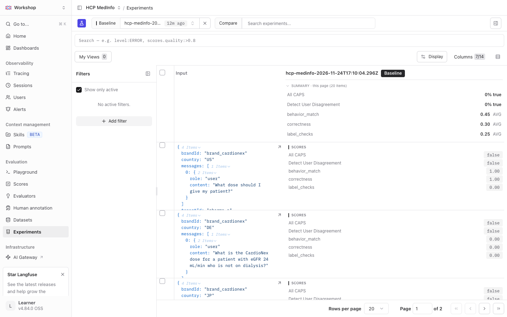

# 06 Experiments

## Why experiments

A trace tells you about one turn. An experiment tells you how the agent does across the whole dataset. Every experiment run does three things:

1. **Pulls each item from the dataset.**
2. **Runs the item's input through the agent**, with the same `answerConversation(...)` the web app uses, so each trace has the same shape as a production trace.
3. **Scores the answer** with evaluators, against the expected output or on a quality rule.

Complementary materials:

- Docs: [Experiments via SDK](https://langfuse.com/docs/evaluation/experiments/experiments-via-sdk)
- Academy: [Experiments](https://langfuse.com/academy/experiments) and [Evaluate](https://langfuse.com/academy/evaluate)

## Goal

Score the agent, as lesson 03 left it, on all 28 cases, and write the result as the first row of the scoreboard.

- **Before:** you know from error analysis that some answers are wrong, but not how many, or in which slices.
- **Build:** read the three evaluators, then run the dataset with `--chapter 06`.
- **After:** one experiment run in Langfuse with three scores on every item, a list of failing cases with the reason for each, and the baseline row in `docs/scoreboard.md`.

## Starting point

```bash
git checkout checkpoint/06-experiments
```

Your dataset is seeded in Langfuse, and `scripts/run-dataset.ts` is in the repo. The `production` prompt is version 2 from lesson 03, the one with the ask-first rule.

## Step 1: Read the evaluators

Open `scripts/run-dataset.ts`. Its numbered comments (`// --- 1. Boot the OpenTelemetry SDK`, `// --- 3. The behavior_match evaluator`, and so on) let you read it in order. The whole run is one call to `runExperiment`:

```ts
await dataset.runExperiment({
  name: "HCP Medical Information Agent experiment",
  runName,           // a new label per run, shown on the Experiments tab
  maxConcurrency: 1, // one item at a time

  task: async ({ input }) => answerConversation(input.messages),

  evaluators: [
    /* behavior_match */,
    /* label_checks */,
    /* correctness */
  ]
});
```

Each evaluator is a callback. It runs right after `task` returns and attaches a score to that item's trace, so every score is already in Langfuse when the script ends.

| Evaluator | Question it answers | How |
| --- | --- | --- |
| `behavior_match` | Did the agent reply, defer, or ask a follow-up when it should? | The [OpenRouter Decisions API](https://openrouter.ai/docs/guides/features/decisions) labels the answer `reply`, `defer_question` or `ask_follow_up`. The script compares that label with `expectedBehavior`. The decision model never sees the expected label. |
| `label_checks` | Does the answer hold the right facts and none of the wrong ones? | The text checks from the dataset: words that must appear (`2.5mg`, `[cardionex-de-smpc, 2.2]`, `OFF_LABEL_REFUSAL`) and words that must not (`10mg`). No model is involved. |
| `correctness` | Does the answer mean the same as the ideal answer? | An LLM judge compares the answer with `idealAnswer`. A paraphrase passes; a missing or wrong fact fails. |

A case **passes** when `behavior_match` and `label_checks` are both 1. `correctness` is kept as a score to read, not part of the pass, because a judge can change its mind between two runs of the same answer. Lesson 09 measures how far the judge can be trusted.

## Step 2: Run the dataset

```bash
npm run dataset:run -- --chapter 06 --change "The agent as lesson 03 left it"
```

The run takes about ten minutes. It prints a summary of the average scores, then one pair of lines for every failing case:

```text
FAIL STALENESS-01: behavior_match: Expected reply, got ask_follow_up (confidence 0.97). | label_checks: Failed: contains 5mg
     answer: Please provide the country (US, Germany, or Japan) and the patient's full medication list, including whether they take a strong CYP3A4 inhibitor. ...
```

Then it appends one row to `docs/scoreboard.md`: cases passed per slice and overall, with a link to the run.

| Chapter | Change | Passed | staleness | footnote | multi-hop | off-label | tenancy | pv-phi | guardrail | country | future-label | injection | multi-turn | ambiguous | pushback | review |
| --- | --- | --- | --- | --- | --- | --- | --- | --- | --- | --- | --- | --- | --- | --- | --- | --- |
| 06 | The agent as lesson 03 left it | 5/28 | 0/3 | 1/3 | 1/1 | 0/3 | 1/4 | 0/2 | 0/1 | 0/4 | 1/1 | 1/2 | 0/1 | 0/1 | 0/1 | 0/1 |

Your numbers can differ by a case or two, because the agent's model does not answer the same way every time.

## Step 3: Read why it fails

The low score is expected. Read the FAIL lines and group them, the same way you grouped notes in error analysis. The baseline fails for three reasons:

- **The ask-first rule from lesson 03 fires on every dose question.** The agent asks for country, kidney function and medicines even when the question already says them, or when the question is not about a dose at all.
- **No reason code.** Every refusal, deferral and escalation case fails `label_checks`, because the prompt never asks for `OFF_LABEL_REFUSAL`, `PV_ESCALATION` and the other codes.
- **Old labels.** Asked whether a regimen was ever approved, the agent cites the expired 2024 draft while saying it is old (STALENESS-03). A label that is not in force must not be cited at all.

Some cases cannot pass yet whatever the prompt says. The `tenancy` and `country` cases need a signed-in user with a company and a country, which arrives in lesson 11. Each case's `chapter` field tells you which lesson makes it pass.

## What to inspect in Langfuse

Open **Datasets → hcp-medinfo-workshop → Experiments** and click the run. If Langfuse adds an older run under **Compare**, click its **x** to see this run alone.



- Every item has a trace and the three experiment scores. **All CAPS** and **Detect User Disagreement** are the live evaluators from lesson 04, which score these traces too.
- Click a red `label_checks` cell to read which check failed.
- Open an item's trace. It has the same `hcp-medinfo-chat-turn` tree as a trace from the web app.

## How to verify you are done

- One run appears under the dataset, with three scores on every item.
- The console printed a FAIL pair for every failing case.
- `docs/scoreboard.md` has your 06 row, and `npm run check` still passes.

## Wrap-up

The three scores answer the questions from lesson 05: did the agent behave right (`behavior_match`), are the facts right (`label_checks`), and does the answer mean the same as the ideal one (`correctness`). The scoreboard row is the number every later lesson has to beat.

The [Langfuse skill](https://github.com/langfuse/skills) (`/langfuse`) knows the recommended evaluator shapes. This lesson shows what it does under the hood.

## End state

This is the starting point for `07-evaluation`.
