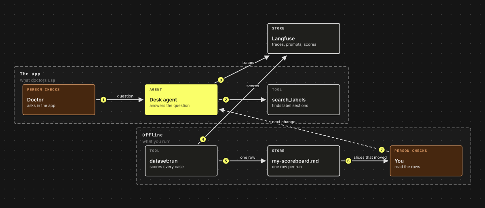
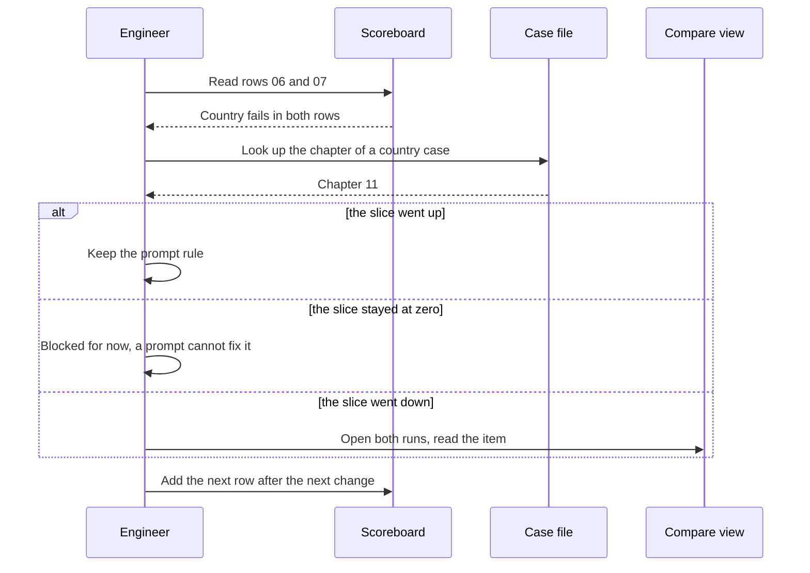
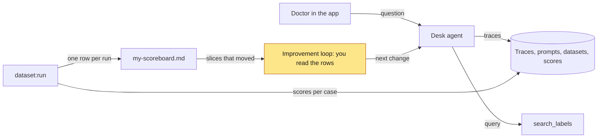

# Read your scoreboard as one improvement loop

## The problem

A team ran the desk once and got 5<!-- from: docs/runs/scoreboard-06.json#passed --> of 28<!-- from: docs/runs/scoreboard-06.json#total -->. They changed the prompt and got 22<!-- from: docs/runs/scoreboard-07.json#passed --> of 28<!-- from: docs/runs/scoreboard-07.json#total -->. The manager asks, "What do we do about the other six?" Nobody can say. Some need sign-in, and some may be a new bug.

The team has five tools by now, and each has its own screen. They have no single story that joins them, so the next change is a guess. For example, they might tune the prompt for a week. It cannot fix four country cases.

A loop fixes this. You trace a request, find the failures, add cases, change one thing, measure, and ship. The scoreboard is where the loop shows its result. This lesson reads it, so you can run the loop on your own app.

## What you build

- **A reading of your scoreboard.** You read the 06 and 07 rows slice by slice. You name the lesson that fixes each failure left.
- **Three cases of your own.** One is answered, one is refused, and one needs a follow-up.
- **A plan for your own app.** Five steps, in order, with the keys it needs.
- **A baseline run** of those cases, before you change anything.

| Case | What breaks | How the system holds |
| --- | --- | --- |
| A slice went up | You do not know which rule did it | Each failure category from error analysis maps to a rule |
| A slice stayed at zero | You keep tuning a prompt that cannot fix it | The `chapter` field names the lesson that makes it pass |
| A slice went down | A fix hid a regression | The compare view shows both answers before you trust the change |
| Your own app has no cases | You cannot measure anything | You write three cases and run them once for a baseline |

## How it works

The **improvement loop** has six moves. Trace, find failures, add cases, change one thing, measure, then ship. Each turn makes the agent a bit better. The scoreboard keeps one row for each turn.



Step through it one part at a time in the [live drawing](https://canvas.learnwithparam.com/case.html#buildcamp/10).

You read the **scoreboard** one column at a time. A column is a slice of cases that share a failure. If it went up, a rule helped. If it stayed at zero, the fix is not a prompt. If it went down, you read both answers first.

### The flow

This follows one reader through the scoreboard, from a row to a decision.



The step people doubt is leaving a failing slice alone. It feels lazy. It is not. The `chapter` field in `data/hcp/evals/medinfo.yaml` says when a case becomes fixable. Four country cases are tagged chapter 11, because the agent cannot know the doctor's country before sign-in.

### Where it sits

Nothing new runs in the app at this lesson. The new part is how you read what it already produces.



### Concepts

- [Improvement loop](../walkthrough.md#c-improvement-loop)
- [Scoreboard](../walkthrough.md#c-scoreboard)

## Build it

```bash
git checkout checkpoint/08-midpoint
```

There is no new code. This lesson is about reading and planning.

### Step 1: Read your scoreboard

Open `my-scoreboard.md`. It has your two rows: the baseline from lesson 06 and the error-analysis prompt from lesson 07. [docs/scoreboard.md](../scoreboard.md) has ours, if you want a second opinion. Read them slice by slice.

- A slice that went up is a failure category from error analysis that the new prompt answers.
- A slice that stayed at zero needs more than a prompt. The `chapter` field of each case in `data/hcp/evals/medinfo.yaml` names the lesson that makes it pass. The `tenancy` cases, for example, need the signed-in user from lesson 11.
- A slice that went down is a regression. Open both runs in the Langfuse compare view and read the item before you trust the new prompt.

### Step 2: Say what you can do now

By now you can do six things:

- Trace an LLM app from end to end, and read the result as a debugging surface.
- Connect prompts to traces, so a prompt change has a measurable effect on the next trace.
- Read a pile of production traces, and find disagreement and all-caps frustration automatically.
- Decide what to evaluate, and build a dataset from error analysis and the cases that must work.
- Run experiments on the same agent code, with no second copy of it.
- Compare runs after a change, by score and by reading single outputs.

Langfuse here is a shared surface, and not only a way to watch the app. It shows how the agent behaves. It collects real examples, so production seeds datasets. It keeps a baseline for every change. And the loop closes back on itself.

### Step 3: Plan the loop for your own app

When you go back to your own code, do this in order.

1. **Install the [Langfuse skill](https://github.com/langfuse/skills) and the [Langfuse CLI](https://langfuse.com/docs/api-and-data-platform/features/cli).** Keep your project keys in the app's local `.env`. The CLI uses the same keys as the SDKs.

   ```dotenv
   LANGFUSE_PUBLIC_KEY=pk-lf-...
   LANGFUSE_SECRET_KEY=sk-lf-...
   LANGFUSE_BASE_URL=http://localhost:5174
   ```

   ```bash
   npx skills add langfuse/skills --skill "langfuse"
   npm install -g langfuse-cli
   ```

2. **Ask your coding agent to use the skill to add tracing** to your app. Start with the smallest part that uses a model, and get one trace before you do anything else.
3. **Run realistic cases through your app,** so you have traces to read for error analysis.
4. **Build your first dataset.** Decide what to evaluate. Fill it with traces from error analysis and the cases your app must handle.
5. **Measure and iterate.** Change one thing, rerun, and compare.

### Step 4: Write your first three cases

Write the first three cases of a dataset for your own app. Use the same shape as `data/hcp/evals/medinfo.yaml`.

- One case that must be answered.
- One case that must be refused.
- One case that needs a follow-up question.

Give each an `expectedBehavior` and at least one text check. Run them once before you change anything. That run is your baseline.

## Prove it

This lesson has no new code, so its proof is in the rows you already have.

| Case | Why it matters | Before | After |
| --- | --- | --- | --- |
| Staleness cases | The prompt fixed a failure category | 0/3 | 3/3 |
| Country cases | A prompt cannot know the doctor's country | 0/4 | 0/4, chapter 11 fixes it |
| TENANCY-04 | A gain can hide a regression | Pass, by luck | Fail, chapter 11 fixes it |
| Your three cases | You need a baseline before a change | No cases | One run, one row |

One test keeps the lesson pages honest:

```bash
npx tsx --test scripts/scoreboard.test.ts
```

It reads every `--cases` list on every lesson page. It fails when one names a case that does not exist. Break it on purpose. Add a made-up case id to a `--cases` list on any page, and the test names it.

## Stuck points

In a correct run, `my-scoreboard.md` holds a 06 row and a 07 row. You can name the lesson for each slice that is not green.

| What you see | Why | What to do |
| --- | --- | --- |
| `my-scoreboard.md` has one row | You skipped the 07 run | Go back to lesson 07 and run it |
| Your rows differ from ours by a case or two | The agent's answers vary between runs | Read the slices, not the totals |
| You cannot tell which lesson fixes a slice | You have not read the `chapter` field | Open `data/hcp/evals/medinfo.yaml` and search for the case id |
| Your own app has no traces to read | It does not send any yet | Do step 2 of the plan first |

## What to watch for

- **A loop with no baseline.** A score on its own says little. Compare every run with the last one on the same cases. Our scoreboard keeps one row for each run, so there is always a row to beat.
- **Tuning what a prompt cannot fix.** The four country cases stay at zero in any prompt. Each case carries a `chapter` tag, so you see this before you spend a week on it.
- **A dataset that never grows.** A new failure that has no case will come back. Add the case first, then rerun the baseline.
- **Reading only the totals.** A total can rise while one slice falls. Read each slice, and open the compare view for any that went down.

## Results

This lesson has no dataset run, so it adds no scoreboard row. Two things prove it instead. The 06 and 07 rows are in your `my-scoreboard.md`. The scoreboard test above passes.

When we ran lesson 07, the rows were these. They are also in [docs/scoreboard.md](../scoreboard.md).

| Chapter | Change | Passed |
| --- | --- | --- |
| 06 | The agent as lesson 03 left it | 5/28 | <!-- from-row: docs/runs/scoreboard-06.json -->
| 07 | The error-analysis prompt | 22/28 | <!-- from-row: docs/runs/scoreboard-07.json -->

Read them like this. The prompt took the desk from 5<!-- from: docs/runs/scoreboard-06.json#passed --> to 22<!-- from: docs/runs/scoreboard-07.json#passed -->. The six that fail are chapter 11 cases. So the next lessons add code, not prompt text.

## Where to go next

- Read `data/hcp/evals/medinfo.yaml` and find the `chapter` field on a case.
- Read the [Langfuse docs](https://langfuse.com/docs) and the Academy course on [the AI engineering loop](https://langfuse.com/academy/ai-engineering-loop).
- Go deeper on each move: [tracing](https://langfuse.com/academy/tracing), [monitoring](https://langfuse.com/academy/monitoring), [error analysis](https://langfuse.com/academy/monitoring/error-analysis), [capturing signals](https://langfuse.com/academy/monitoring/capturing-signals), [datasets](https://langfuse.com/academy/datasets), [experiments](https://langfuse.com/academy/experiments) and [evaluate](https://langfuse.com/academy/evaluate).
- Lesson 09 starts from this checkpoint.
