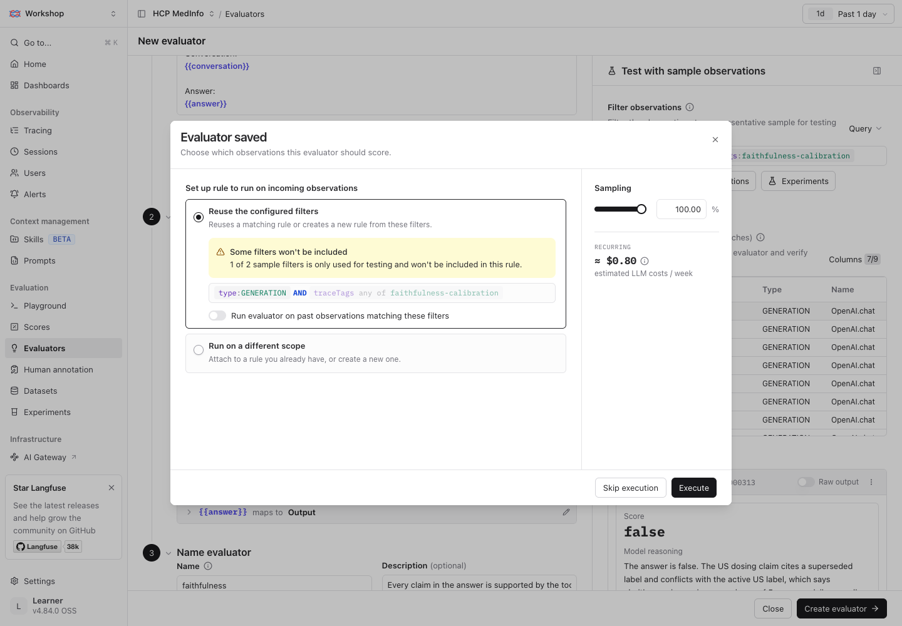
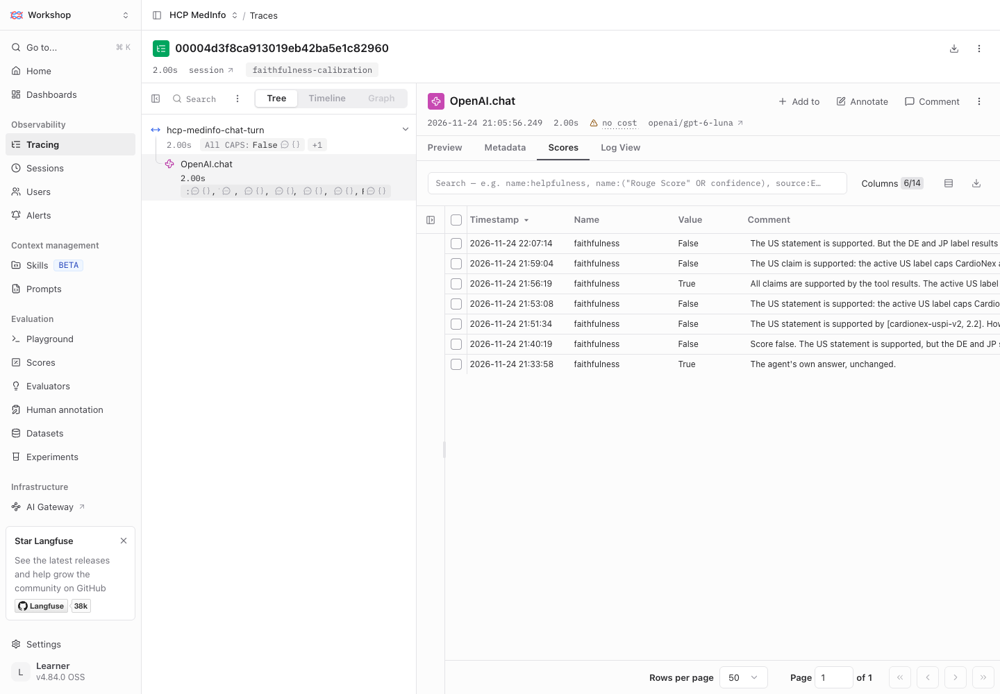
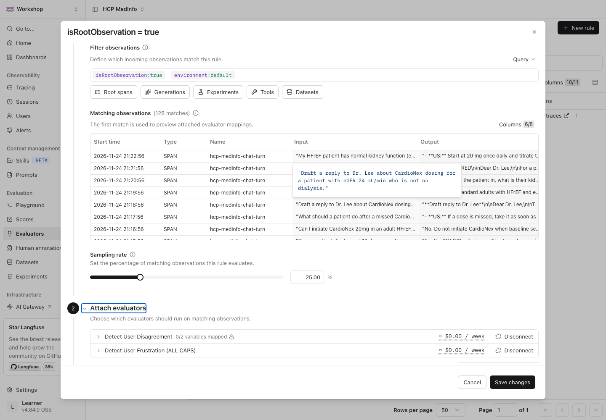

# 09 Calibrate a judge

## Why measure a judge

An LLM judge is a prompt someone wrote. Until you know how often it agrees with a person, its score is an opinion, and it costs a model call on every case it scores.

The text checks from lesson 06 can see a dose or a citation. They cannot see whether the sentence around the citation says what the cited section says. An answer can carry `[cardionex-payer-formulary-2026, 4.1]` and still add a rule that section does not hold. That property is called **faithfulness**: every claim in the answer is supported by the tool results the agent read. Only a judge can check it, so the judge has to be measured first.

The method:

1. Label a small set of answers by hand.
2. Run the judge on the same answers.
3. Measure the agreement with Cohen's kappa and a confusion matrix.
4. Read each disagreement and tighten the rubric.
5. Trust the judge only above a bar you set before the first measurement.

**Why kappa and not plain agreement.** If 80% of the answers are faithful, a judge that says "faithful" to everything agrees with you 80% of the time and catches nothing. Kappa measures agreement beyond what chance would give with the same rates, so that judge scores 0. This lesson uses a bar of 0.6, which is "substantial" on the usual scale.

Complementary materials:

- Docs: [LLM-as-a-Judge](https://langfuse.com/docs/evaluation/evaluation-methods/llm-as-a-judge)
- Docs: [Score Analytics](https://langfuse.com/docs/evaluation/scores/score-analytics)
- Guide: [Calibrate an LLM judge](https://langfuse.com/guides/llm-as-a-judge-calibration-skill)

## Goal

Build a faithfulness judge you can trust, and pay for it only where a text check cannot see.

- **Before:** the 07 row. The text checks decide every case, and nothing checks that a cited sentence says what its section says.
- **Build:** a faithfulness judge in Langfuse, a labelled calibration set, the kappa measurement, and the judge in `dataset:run` on three slices only.
- **After:** a 09 row where the multi-hop, footnote and review cases must also pass the judge, and a live evaluator that no longer scores every dataset run.

## Starting point

```bash
git checkout checkpoint/09-advanced-evals
```

The checkpoint adds:

- `scripts/judge/faithfulness.ts`: the rubric, the kappa maths and the bar.
- `data/calibration/faithfulness-set.json`: the answers you will label.
- `scripts/seed-faithfulness-calibration.ts` and `scripts/judge-calibrate.ts`: seed the set, then measure the judge against your labels.

## Step 1: Seed the calibration set

You will see 21 answers appear in Langfuse, each one a trace with one generation, and an annotation queue that holds them.

```bash
npm run langfuse:seed:calibration
```

Where the answers come from:

- **Eleven are the agent's own answers** from the 06, 07 and 09 runs, unchanged. Each generation keeps the messages the agent read, tool results included.
- **Ten are copies with one edit each:** a wrong dose, a claim no source makes, a citation of the wrong section. Every stored answer we read was faithful, and a judge you can only test on faithful answers cannot show you its kappa. The file says what each edit changed.

Each seeded generation has the same shape as the agent's final generation: the input is `{"messages": [...]}` and the output is the answer. So the evaluator you build on these answers works on live traffic unchanged.

The script is safe to run again. It reuses the answers already in Langfuse and seeds only the ones added to the file since.

## Step 2: Label the answers yourself

Open **Human annotation → faithfulness calibration → Process queue**. For each answer, read the tool results in the conversation, then the answer, and pick **True** if every claim is supported, **False** if any is not.


Label before you look at the judge. A label you give after reading the judge's reasoning is the judge's label.

## Step 3: Write the judge in Langfuse

1. Open **Evaluators → New evaluator**, and create a custom evaluator named `faithfulness` with a boolean score.
2. Paste `FAITHFULNESS_RUBRIC` from `scripts/judge/faithfulness.ts` as the prompt.
3. Target observations, with the filters `type` is `GENERATION` and trace tags any of `faithfulness-calibration`.
4. Map the two variables:
   - `{{conversation}}` to the observation **Input**, with the JSONPath `$.messages`. The judge needs the tool results, and they live inside that list.
   - `{{answer}}` to the observation **Output**.
5. Save. In the **Evaluator saved** dialog, click **Skip execution**.



Skip execution matters. Execute would create a rule that scores every new generation, and so would charge you for an unmeasured judge on every chat turn.

## Step 4: Run the judge on the same answers

Batch evaluation scores stored observations without running the agent again.

1. Open **Tracing**, and filter on `type` is `GENERATION` and trace tags any of `faithfulness-calibration`. You see 21 rows.
2. Select them all, click **Evaluate**, pick `faithfulness`, and check it says **2/2 variables mapped**.
3. Click **Run Evaluation**.


It costs about one US cent for the whole set.

## Step 5: Measure the agreement

```bash
npm run judge:calibrate
```

It reads your labels and the judge's scores from Langfuse, then prints the confusion matrix, Cohen's kappa and a link to each answer you disagree on. It makes no model calls. It exits 1 when kappa is below the bar.

Our final measurement:

```text
21 answers with a label and a judge score.

                     judge: faithful   judge: unfaithful
you: faithful                     10                   2
you: unfaithful                    0                   9

Agreement 19/21, Cohen's kappa 0.81 (bar 0.6).
```

Langfuse shows the same comparison in **Scores → Analytics**: pick `faithfulness` from the annotation source and `faithfulness` from the eval source.


Score Analytics pools every batch in its time range. After two or more batches, its kappa mixes old rubrics with the new one, so trust the script's number for the latest batch.

## Step 6: Read each disagreement and tighten the rubric

Open the link the script prints for each disagreement, then the **Scores** tab of the generation. Each judge score keeps its reasoning as the comment.



Change one rule at a time, then run the batch evaluation again (step 4) and measure only the new batch:

```bash
npm run judge:calibrate -- --since 15m
```

Each batch adds a judge score and keeps the old one. Deleting scores in Langfuse is queued and can take an hour, so `--since` picks the newest batch by time instead.

Our six batches:

| Batch | Rubric | Kappa | Agreement | Answers the judge got wrong |
| --- | --- | --- | --- | --- |
| 1 | v1 | 0.80 | 18/20 | edit-superseded-titration, real-clarithromycin-cap |
| 2 | v2 | 0.61 | 16/20 | real-pediatric-question, real-review-draft, real-clarithromycin-cap, real-lisinopril-washout |
| 3 | v3 | 0.80 | 18/20 | real-pediatric-question, real-clarithromycin-cap |
| 4 | v3 | 0.80 | 18/20 | real-pediatric-question, real-multi-hop-waiver |
| 5 | v3 | 0.90 | 19/20 | real-clarithromycin-cap |
| 6 | v4, one answer added | 0.81 | 19/21 | real-pediatric-question, real-clarithromycin-cap |

The rubric in `scripts/judge/faithfulness.ts` is v4. Its list of "not faithfulness failures" is where the fixes went.

What the table teaches:

- **A rubric change can make the judge worse.** v2 flagged four faithful answers, and kappa fell to 0.61, just over the bar. Measure every change; do not assume a tighter rule helps.
- **The same rubric moves between runs.** Batches 3, 4 and 5 used the same v3 text and scored 0.80, 0.80 and 0.90, wrong on different answers each time. One batch is one sample, so leave room above the bar.
- **The judge never called an unfaithful answer faithful,** in any batch. Every miss was a false alarm on a faithful answer. That is the safe direction for a check in the pass: it costs a rerun, never a wrong dose shipped.

Batch 6 came from the reference run in step 7. The judge flagged a REVIEW-01 draft for the sentence "A medical reviewer must approve this draft before it is sent." No tool result says that, but it is how the desk works, not a claim about the medicine. The calibration set had no answer like it. So the fix was in this order:

1. Add that answer to the calibration set, labelled faithful.
2. Add one rule to the rubric for it.
3. Seed, run the batch, and measure again.
4. Only then rerun the reference.

Never change the rubric to pass one case without measuring it again on the whole set. That is how a judge drifts away from your labels.

## Step 7: Let the judge into the pass

The judge joins `dataset:run` only on the slices whose text checks cannot see faithfulness:

- **multi-hop:** an answer that joins two facts from one section.
- **footnote:** a fact that sits in a footnote.
- **review:** a drafted reply to a doctor.

On those slices a case passes only when `behavior_match`, `label_checks` and `faithfulness` are all 1. Every other slice gets no judge call. The `correctness` judge from lesson 06, which ran on every case and was never part of the pass, is gone.

The runner sends the judge the same rubric, with the question and the tool results the agent read as the conversation. `npm run check` fails when the rubric in `scripts/judge/faithfulness.ts` is not the one `data/calibration/faithfulness.json` was measured with, or when that measurement is below the bar. So you cannot change the rubric without measuring it again.

Run the judged cases and a guard set of cases the change could break:

```bash
npm run dataset:run -- --cases POSITIVE-01,POSITIVE-02,POSITIVE-03,POSITIVE-04,REVIEW-01,STALENESS-01,NEGATIVE-01,INJECTION-01,MULTITURN-01 --chapter 09 --change "The calibrated faithfulness judge on the judged slices"
```

Nine cases, not 28: a change to the judge cannot move a slice it does not score. This run cost about one US cent.

## Step 8: Stop paying for what you do not use

The lesson 04 live rule runs "Detect User Disagreement" and "All CAPS" on every root observation, including each dataset run. In one day each of them scored 368 traces, most of them from experiments.

Open **Evaluators**, edit the rule, and set:

- a filter `environment` any of `default`. Dataset runs are traced in the `sdk-experiment` environment, so they no longer match. The app's own chat turns are in `default`.
- sampling 25%. A trend needs a sample, not every trace.



The matches dropped from 691 to 128 in the preview, and three in four of those are skipped.

## Results

When we ran step 7, the rows were (also in [docs/scoreboard.md](../scoreboard.md)):

| Chapter | Change | Passed | staleness | footnote | multi-hop | off-label | injection | multi-turn | review |
| --- | --- | --- | --- | --- | --- | --- | --- | --- | --- |
| 07 | The error-analysis prompt | 22/28 | 3/3 | 3/3 | 1/1 | 3/3 | 2/2 | 1/1 | 1/1 |
| 09 | The calibrated faithfulness judge on the judged slices | 9/9 | 1/1 | 3/3 | 1/1 | 1/1 | 1/1 | 1/1 | 1/1 |

The 09 row shows `-` in every slice it did not run. Read it like this:

- **What stayed.** Every case that passed in 07 still passes with a stricter pass. The judge found no unfaithful answer in this run.
- **What the first run showed.** Our first 09 run passed 7 of 9. REVIEW-01 failed on the false alarm that became batch 6. POSITIVE-02 failed for real: the agent said the label gives no potassium threshold, when it says do not start above 5.0 mEq/L. All three checks caught it, the judge included. It passed in the rerun, because the agent's answers vary between runs.
- **What one case means.** Most slices here hold one case. A 1/1 is a smoke test that the slice still works, not a rate. A rate needs many cases per slice, and lesson 19 runs them all once.

## How to verify you are done

- `npm run judge:calibrate` prints a kappa of 0.6 or more for your latest batch.
- The `faithfulness` evaluator is saved, and no live rule runs it.
- Your 09 row is in `my-scoreboard.md`, and `npm run check` passes.
- The lesson 04 rule shows the environment filter and 25% sampling.

## Wrap-up

A judge is a measuring instrument, and you calibrate an instrument before you read it. Label first, measure with kappa, fix the rubric where it disagrees, and keep the measurement in the repo so a rubric change cannot slip in unmeasured.

When the judge meets a new kind of answer, add that answer to the calibration set before you change the rubric.

## Homework

Pick one disagreement from your own batches. Write the rule you would add for it, run the batch again, and see whether kappa went up or another answer flipped.

## End state

This is the starting point for `10-ai-gateway`.
