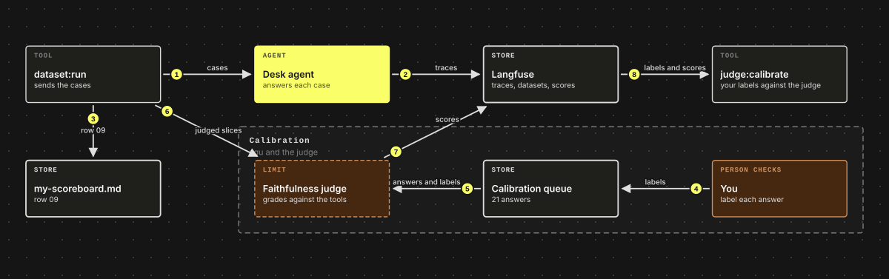
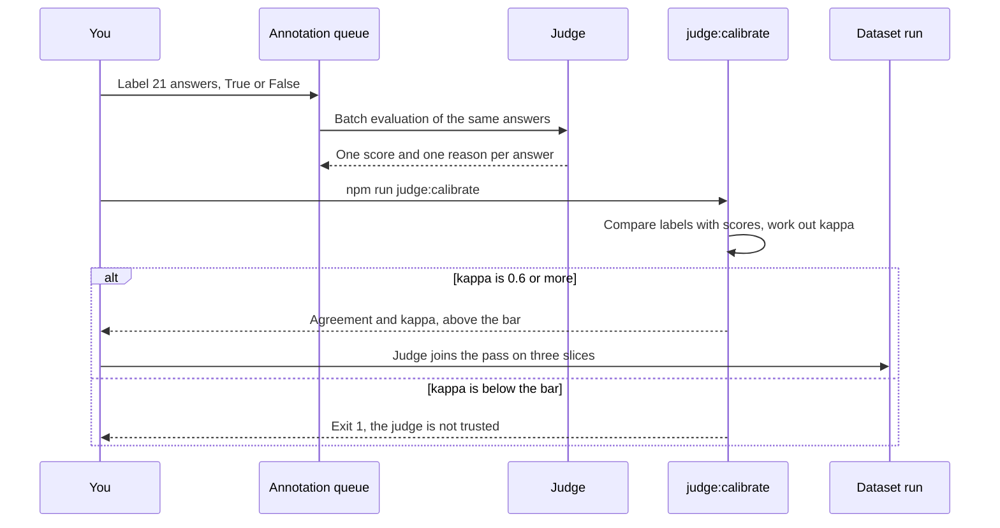
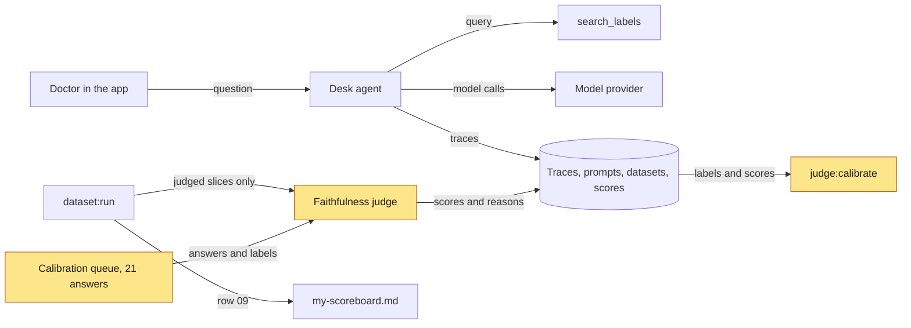
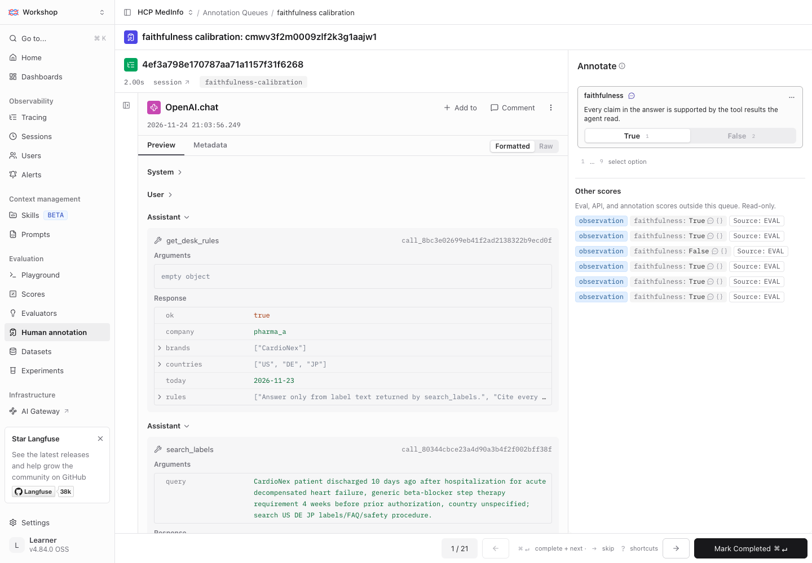
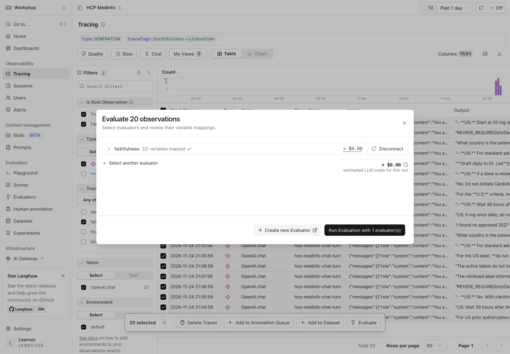
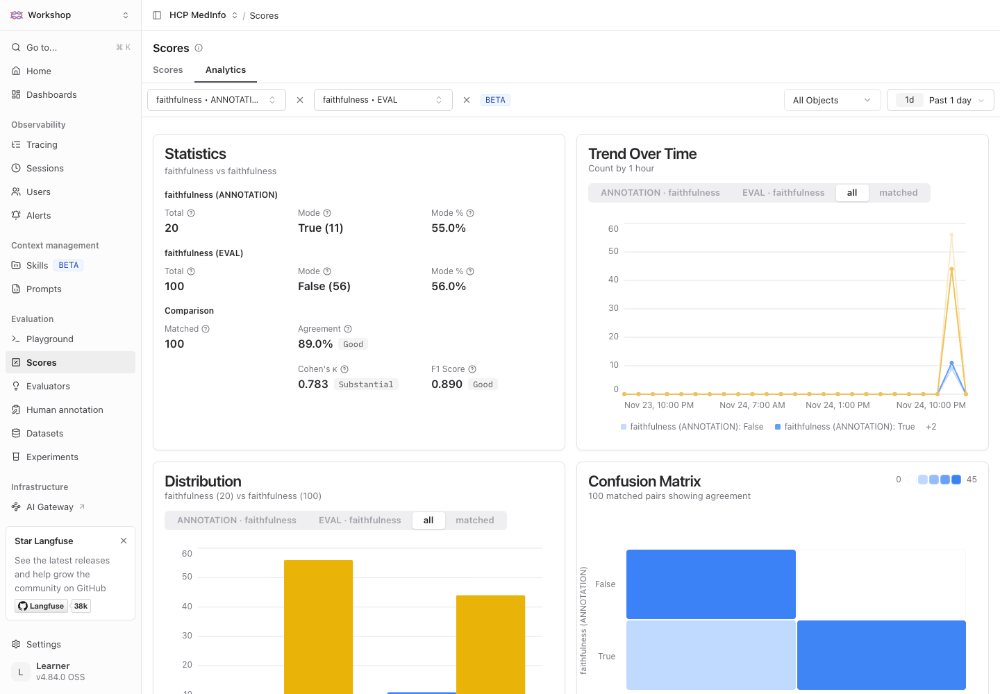

# Check a judge against people before you trust it

## The problem

The text checks from lesson 06 can find a dose or a citation. They cannot tell if the sentence around the citation says what the section says. For example, an answer can cite a formulary section. Then it adds a rule that section does not hold. Every check passes, and the answer is still wrong.

Only a model can read for meaning here. So you ask a model to grade the answer. But a model that grades is just a prompt someone wrote. Until you know how often it agrees with a person, its score is an opinion. It also costs a model call on every case it scores.

There is a second trap. Say 80 percent of your answers are faithful. A judge that says "faithful" every time agrees with you 80 percent of the time. It catches nothing. Plain agreement hides that, so you need a number that does not.

## What you build

- **A calibration set.** 21 answers, each one a trace with one generation, in an annotation queue.
- **Your own labels.** For each answer, pick True if every claim is supported. Pick False if any is not.
- **A faithfulness judge.** It is an evaluator. It grades each answer against the tool results the agent read.
- **A kappa measurement.** `npm run judge:calibrate` compares your labels with the judge and prints one number. The bar is 0.6.
- **A pass that uses the judge only where it must.** Three slices get it. The rest do not.

| Case | What breaks | How the system holds |
| --- | --- | --- |
| A cited sentence says more than its section | Text checks pass a wrong answer | A judge reads the answer against the tool results |
| A judge that says yes to everything | It agrees often and catches nothing | Cohen's kappa scores it 0 |
| A rubric change that makes the judge worse | Faithful answers get flagged | Every change is measured on the whole set again |
| A judge on every chat turn | You pay for an unmeasured judge | You skip execution, and the pass uses it on three slices only |

## How it works

A **calibration** has five moves. You label a small set of answers by hand, and run the **LLM judge** on the same answers. Then you measure their **agreement** with Cohen's kappa, and read each disagreement. Last, you trust the judge only above a bar you set before the first measurement.



Step through it one part at a time in the [live drawing](https://canvas.learnwithparam.com/case.html#buildcamp/11).

Kappa is agreement beyond what chance gives. A judge that says "faithful" every time scores 0, however often it is right. This lesson uses a bar of 0.6, which is "substantial" on the usual scale. The course needs 0.6 or more.

The property is **faithfulness**. Every claim in the answer must be supported by the tool results the agent read.

### The flow

This follows one calibration, from your labels to the decision to trust the judge.



The step people doubt is labelling before you read the judge. A label you give after reading the judge's reasoning is the judge's label. So the order is fixed. The test `scripts/judge/faithfulness.test.ts` also fails when the rubric changed since it was measured. So a rubric cannot slip in unmeasured.

### Where it sits

The desk is as lesson 07 left it. The new parts are the calibration set, the judge, and the measurement.



### Concepts

- [LLM judge](../walkthrough.md#c-llm-judge)
- [Calibration](../walkthrough.md#c-calibration)
- [Agreement](../walkthrough.md#c-agreement)

## Build it

```bash
git checkout checkpoint/09-advanced-evals
```

The checkpoint adds:

- `scripts/judge/faithfulness.ts`: the rubric, the kappa maths and the bar.
- `data/calibration/faithfulness-set.json`: the answers you will label.
- `scripts/seed-faithfulness-calibration.ts` and `scripts/judge-calibrate.ts`: seed the set, then measure the judge against your labels.

### Step 1: Seed the calibration set

You will see 21 answers appear in Langfuse, each one a trace with one generation. An annotation queue holds them.

```bash
npm run langfuse:seed:calibration
```

Where the answers come from:

- **Eleven are the agent's own answers** from the 06, 07 and 09 runs, unchanged. Each generation keeps the messages the agent read, tool results included.
- **Ten are edited copies.** Each has one fault: a wrong dose, an unsupported claim, or a wrong citation.

Every stored answer we read was faithful. A judge you can only test on faithful answers cannot show you its kappa. The file says what each edit changed.

Each seeded generation has the same shape as the agent's final generation. The input is `{"messages": [...]}` and the output is the answer. So the evaluator you build on these answers works on live traffic unchanged.

The script is safe to run again. It reuses the answers already in Langfuse, and seeds only the ones added to the file since.

### Step 2: Label the answers yourself

Open **Human annotation → faithfulness calibration → Process queue**. For each answer, read the tool results in the conversation, and then the answer. Pick **True** if every claim is supported. Pick **False** if any is not.



Label before you look at the judge.

### Step 3: Write the judge as an evaluator

1. Open **Evaluators → New evaluator**, and create a custom evaluator named `faithfulness` with a boolean score.
2. Paste `FAITHFULNESS_RUBRIC` from `scripts/judge/faithfulness.ts` as the prompt.
3. Target observations, with the filters `type` is `GENERATION` and trace tags any of `faithfulness-calibration`.
4. Map the two variables:
   - `{{conversation}}` to the observation **Input**, with the JSONPath `$.messages`. The judge needs the tool results, and they live inside that list.
   - `{{answer}}` to the observation **Output**.
5. Save. In the **Evaluator saved** dialog, click **Skip execution**.


Skip execution matters. Execute would create a rule that scores every new generation. You would pay for an unmeasured judge on every chat turn.

### Step 4: Run the judge on the same answers

Batch evaluation scores stored observations without running the agent again.

1. Open **Tracing**, and filter on `type` is `GENERATION` and trace tags any of `faithfulness-calibration`. You see 21 rows.
2. Select them all, click **Evaluate**, pick `faithfulness`, and check it says **2/2 variables mapped**.
3. Click **Run Evaluation**.



It costs about one US cent for the whole set.

### Step 5: Measure the agreement

```bash
npm run judge:calibrate
```

It reads your labels and the judge's scores from Langfuse. It prints the confusion matrix, Cohen's kappa and a link to each answer you disagree on. It makes no model calls. It exits 1 when kappa is below the bar.

Our final measurement: the judge agreed with us on 19<!-- from: docs/runs/faithfulness.json#agreed --> of 21<!-- from: docs/runs/faithfulness.json#answers --> answers. Cohen's kappa was 0.81<!-- from: docs/runs/faithfulness.json#kappa --> against a bar of 0.6<!-- from: docs/runs/faithfulness.json#bar -->. Both disagreements were faithful answers the judge marked unfaithful. The script also prints the confusion matrix, and a link to each answer you disagree on.

Langfuse shows the same comparison in **Scores → Analytics**. Pick `faithfulness` from the annotation source and `faithfulness` from the eval source.



Score Analytics pools every batch in its time range. After two or more batches, its kappa mixes old rubrics with the new one. So trust the script's number for the latest batch.

### Step 6: Read each disagreement and tighten the rubric

Open the link the script prints for each disagreement, then the **Scores** tab of the generation. Each judge score keeps its reasoning as the comment.


Change one rule at a time. Then run the batch evaluation again (step 4), and measure only the new batch:

```bash
npm run judge:calibrate -- --since 15m
```

Each batch adds a judge score and keeps the old one. Deleting scores in Langfuse is queued and can take an hour. So `--since` picks the newest batch by time instead.

Our six batches:

| Batch | Rubric | Kappa | Agreement | Answers the judge got wrong |
| --- | --- | --- | --- | --- |
| 1 | v1 | 0.80 | 18/20 | edit-superseded-titration, real-clarithromycin-cap |
| 2 | v2 | 0.61 | 16/20 | real-pediatric-question, real-review-draft, real-clarithromycin-cap, real-lisinopril-washout |
| 3 | v3 | 0.80 | 18/20 | real-pediatric-question, real-clarithromycin-cap |
| 4 | v3 | 0.80 | 18/20 | real-pediatric-question, real-multi-hop-waiver |
| 5 | v3 | 0.90 | 19/20 | real-clarithromycin-cap |
| 6 | v4, one answer added | 0.81 | 19/21 | real-pediatric-question, real-clarithromycin-cap |

The rubric in `scripts/judge/faithfulness.ts` is v4. Its list of "not faithfulness failures" is where the fixes went.

What it teaches:

- **A new rule can hurt.** Rubric v2 flagged four faithful answers. Kappa fell, to just over the bar. Measure every change.
- **The same rubric moves between runs.** Batches 3, 4 and 5 used the same v3 text. Each scored a little differently. They were wrong on different answers each time. One batch is one sample, so leave room above the bar.
- **The judge never called an unfaithful answer faithful,** in any batch. Every miss was a false alarm on a faithful answer. That is the safe direction for a check in the pass. It costs a rerun, never a wrong dose shipped.

Batch 6 came from the reference run in step 7. The judge flagged a REVIEW-01 draft for this sentence:

> A medical reviewer must approve this draft before it is sent.

No tool result says that. But it is how the desk works, and it is not a claim about the medicine. The set had no answer like it, so the fix went in this order:

1. Add that answer to the calibration set, labelled faithful.
2. Add one rule to the rubric for it.
3. Seed, run the batch, and measure again.
4. Only then rerun the reference.

Never change the rubric to pass one case without measuring it again on the whole set. That is how a judge drifts away from your labels.

### Step 7: Let the judge into the pass

The judge joins `dataset:run` only on the slices whose text checks cannot see faithfulness:

- **multi-hop:** an answer that joins two facts from one section.
- **footnote:** a fact that sits in a footnote.
- **review:** a drafted reply to a doctor.

On those slices a case passes only when `behavior_match`, `label_checks` and `faithfulness` are all 1. Every other slice gets no judge call. The `correctness` judge from lesson 06 ran on every case and was never part of the pass. It is gone.

The runner sends the judge the same rubric. The conversation is the question and the tool results the agent read. `npm run check` fails when the rubric in `scripts/judge/faithfulness.ts` is not the one `data/calibration/faithfulness.json` was measured with. It also fails when that measurement is below the bar. So you cannot change the rubric without measuring it again.

Run the judged cases and a guard set of cases the change could break:

```bash
npm run dataset:run -- --cases POSITIVE-01,POSITIVE-02,POSITIVE-03,POSITIVE-04,REVIEW-01,STALENESS-01,NEGATIVE-01,INJECTION-01,MULTITURN-01 --chapter 09 --change "The calibrated faithfulness judge on the judged slices"
```

That is nine cases, not 28. A change to the judge cannot move a slice it does not score. This run cost about one US cent.

### Step 8: Stop paying for what you do not use

The lesson 04 live rule runs "Detect User Disagreement" and "All CAPS" on every root observation. That includes each dataset run. In one day each of them scored 368 traces, most of them from experiments.

Open **Evaluators**, edit the rule, and set two things:

- A filter `environment` any of `default`. Dataset runs are traced in the `sdk-experiment` environment, so they no longer match. The app's own chat turns are in `default`.
- Sampling of 25%. A trend needs a sample, not every trace.


The matches dropped from 691 to 128 in the preview, and three in four of those are skipped.

## Prove it

| Case | Why it matters | Before | After |
| --- | --- | --- | --- |
| Answers you labelled unfaithful | The judge must catch bad answers | Never tested | 9 of 9 found, none called faithful |
| Rubric v2 | A tighter rule can make the judge worse | Kappa 0.80 | Kappa 0.61, so v3 fixed it |
| REVIEW-01 | A false alarm blocks a good draft | Failed in the first run | Passes after batch 6 |
| POSITIVE-02 | The judge must catch a real error | Failed in the first run, all three checks caught it | Passes in the rerun |

The tests make no model call:

```bash
npx tsx --test scripts/judge/faithfulness.test.ts
```

- **The kappa maths.** A judge that calls every answer faithful scores 0, and a hand-worked example matches.
- **The stored calibration.** It must clear the bar with the rubric the judge uses today.
- **The set.** It mixes faithful and unfaithful answers, and every edit is named.
- **The `--since` window.** It picks the newest batch, and rejects anything else.

Break it on purpose. Change one word in `FAITHFULNESS_RUBRIC`, and run the test. The stored calibration was measured with the old rubric, so the test fails.

## Stuck points

In a correct run, `npm run judge:calibrate` prints a kappa of 0.6 or more for your latest batch. The `faithfulness` evaluator is saved, and no live rule runs it.

| What you see | Why | What to do |
| --- | --- | --- |
| The batch dialog does not say 2/2 variables mapped | A variable is not mapped | Map `{{conversation}}` to Input with `$.messages`, and `{{answer}}` to Output |
| The script finds no answer with a label and a score | You have not labelled, or not run the batch | Do steps 2 and 4 |
| The script exits 1 | Kappa is below the bar | Read each disagreement and fix one rule (step 6) |
| Score Analytics shows a different kappa | It pools every batch | Trust the script's number for the latest batch |
| Every chat turn gets a judge score | You clicked Execute, not Skip execution | Open **Evaluators**, and remove the rule |

## What to watch for

- **A judge nobody measured.** Its score is an opinion. Our `npm run check` fails when the rubric changed since it was measured. It also fails when the measurement is below the bar.
- **A judge tested on good answers only.** It could say yes to everything. Ten of our 21 answers are edited copies with a known fault. A test fails if the set has only one kind.
- **One batch taken as the truth.** The same rubric scored a little differently each time. Leave room above the bar, and measure each change.
- **A judge on every trace.** You pay for each call. The runner gives the judge to three slices only, and step 8 limits the live rule.
- **A rubric bent to pass one case.** The judge drifts from your labels. Add the answer to the calibration set first, and measure the whole set again.

## Results

When we ran step 7, the rows were these. They are also in [docs/scoreboard.md](../scoreboard.md).

| Chapter | Change | Passed | staleness | footnote | multi-hop | off-label | injection | multi-turn | review |
| --- | --- | --- | --- | --- | --- | --- | --- | --- | --- |
| 07 | The error-analysis prompt | 22/28 | 3/3 | 3/3 | 1/1 | 3/3 | 2/2 | 1/1 | 1/1 | <!-- from-row: docs/runs/scoreboard-07.json -->
| 09 | The calibrated faithfulness judge on the judged slices | 9/9 | 1/1 | 3/3 | 1/1 | 1/1 | 1/1 | 1/1 | 1/1 | <!-- from-row: docs/runs/scoreboard-09.json -->

The 09 row shows `-` in every slice it did not run. Read it like this:

- **What stayed.** Every case that passed in 07 still passes with a stricter pass. The judge found no unfaithful answer in this run.
- **What the first run showed.** Our first 09 run did not pass every case. REVIEW-01 failed on the false alarm that became batch 6.
- **A real failure.** POSITIVE-02 failed for real. The agent said the label gives no potassium threshold, when it says do not start above 5.0 mEq/L. All three checks caught it, the judge included.
- **A rerun.** POSITIVE-02 passed in the rerun, because the agent's answers vary between runs.
- **What one case means.** Most slices here hold one case. A 1/1 is a smoke test that the slice still works, not a rate. A rate needs many cases per slice, and lesson 19 runs them all once.

## Where to go next

- Read `scripts/judge/faithfulness.ts` for the rubric and the kappa maths, and `scripts/judge-calibrate.ts` for the measurement.
- Try the homework. Pick one disagreement from your own batches, and write the rule you would add for it. Run the batch again, and see whether kappa went up or another answer flipped.
- Read about [LLM-as-a-judge](https://langfuse.com/docs/evaluation/evaluation-methods/llm-as-a-judge), [score analytics](https://langfuse.com/docs/evaluation/scores/score-analytics) and the guide to [calibrating a judge](https://langfuse.com/guides/llm-as-a-judge-calibration-skill).
- Lesson 10 starts from this checkpoint.
