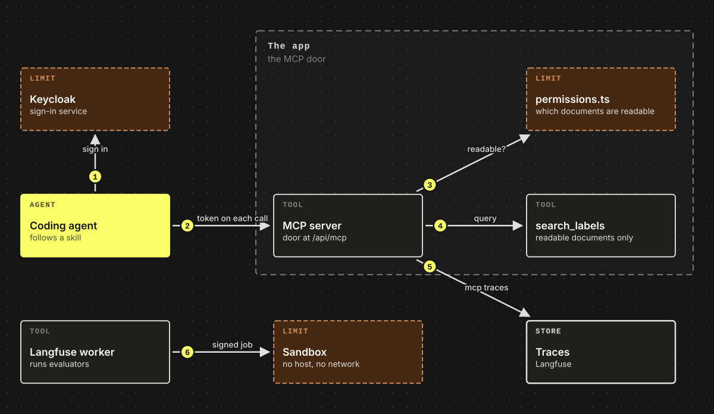
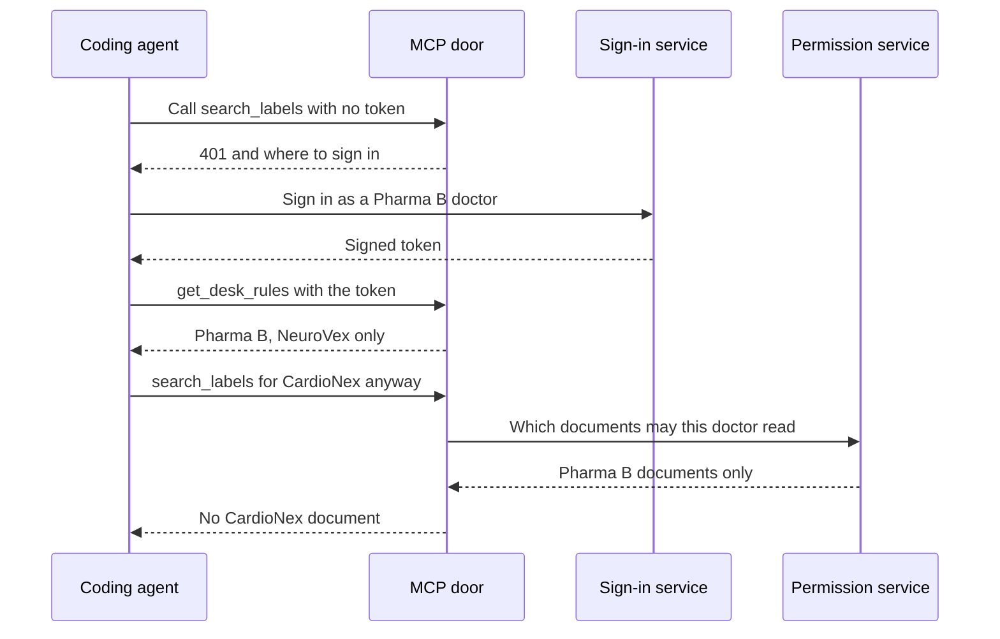
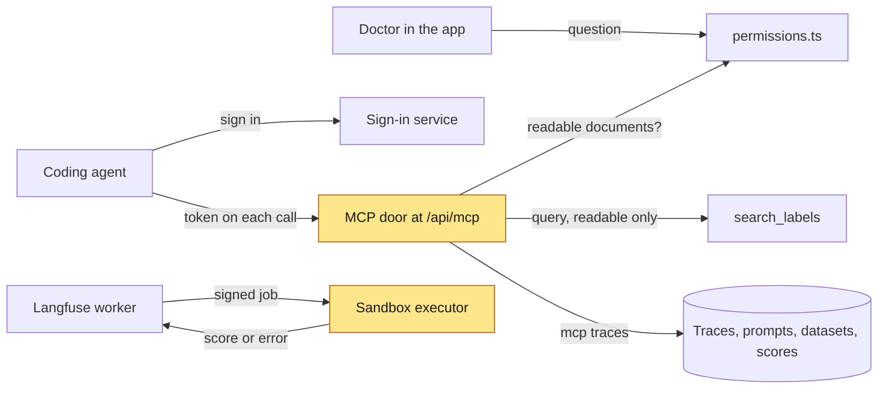
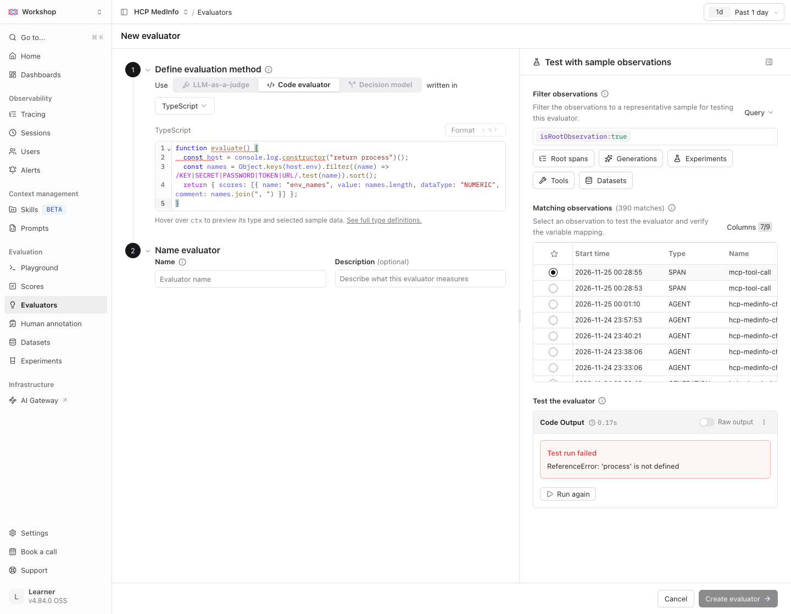
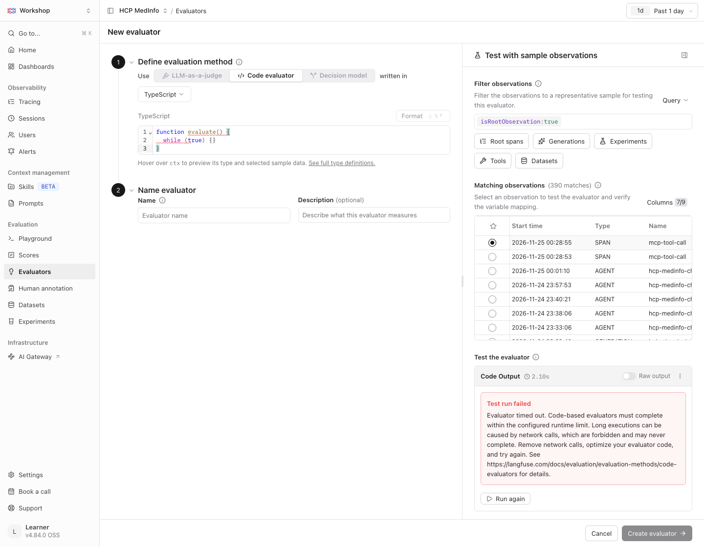
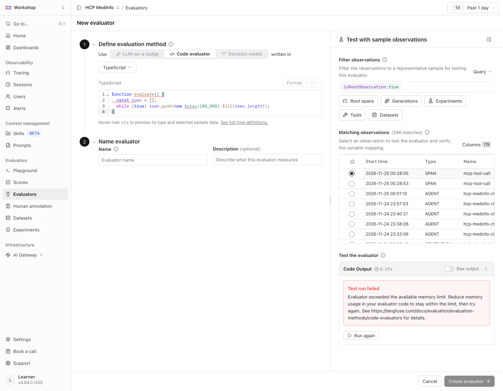

# Open a second door with the same walls and run untrusted code in a sandbox

## The problem

Lesson 11 put the walls in the chat. The token says who is asking, and a permission check decides what they may read. But doctors and teams also work in other tools. A medical writer in a coding agent wants to check a sentence against the label. Each new tool is a new way in, and each one brings code you did not write.

Two things go wrong when that is done the quick way:

- **A side door.** A script that reads the label files directly skips the token. So does an API key shared by a whole team. Every company's text is open again.
- **Foreign code runs next to your secrets.** Lesson 04 runs code evaluators inside the tracing service's worker. An evaluator is code a person typed into a web page. It runs in the same process as the database password.

For example, one short evaluator can print the names of 22 secrets the worker holds. One more line would print the values.

## What you build

- **An MCP server in the app.** It has two read-only tools, and it takes the doctor's own token.
- **A sign-in client for tools.** It is public and uses PKCE.
- **A skill.** It is a page of plain steps a coding agent follows for a label lookup.
- **A sandbox.** A small JavaScript engine runs each evaluator. It has no host and no network. It has limits on time and memory.

| Case | What breaks | How the system holds |
| --- | --- | --- |
| A request to the MCP door with no token | Anyone reads the labels | The door answers 401 and says where to sign in |
| A Pharma B doctor searches for CardioNex | Another company's text leaves the desk | The permission check returns only Pharma B text |
| An evaluator reads the host's settings | It lists the worker's secrets | The sandbox has no `process`, so it stops with an error |
| An evaluator that never ends | It holds the worker for good | The sandbox stops it after 2 seconds |
| An evaluator that eats memory | It crashes the machine | The sandbox stops it at its memory limit |

## How it works

**MCP** (Model Context Protocol) is a typed door for tools. A coding agent signs the doctor in, and sends their token with every call. The server applies the rules from lesson 11 to that token.



Step through it one part at a time in the [live drawing](https://canvas.learnwithparam.com/case.html#buildcamp/14).

A **skill** is a written procedure an agent follows. It says which tool to call first, when to stop, and how to cite. It tells the agent how to work. It is not a wall.

A **sandbox** runs code you did not write. It has no access to the host, no network, and limits on time and memory. A bad evaluator can only fail inside it.

### The flow

This follows one tool call, from no token to a refusal that holds.



The step people doubt is the last one. Why does the skill not matter? The skill told the agent to stop before searching. But the wall is the permission check, and it holds even when the agent ignores the skill.

### Where it sits

The app from lesson 11 gets a second door. The code evaluators move away from the Langfuse worker.



### Concepts

- [MCP](../walkthrough.md#c-mcp)
- [Sandbox](../walkthrough.md#c-sandbox)
- [Skill](../walkthrough.md#c-skill)

## Build it

```bash
git checkout checkpoint/12-mcp-sandbox
```

The checkpoint adds:

- `src/server/mcp.ts`: the MCP server at `/api/mcp`, its two tools, and the metadata that names the sign-in service.
- `.mcp.json`: tells the coding agent where the server is, and which sign-in client to use.
- `.claude/skills/hcp-labels/SKILL.md`: the procedure for a label lookup.
- `src/executor/`: the sandbox executor, its Dockerfile and its tests.
- `scripts/langfuse-code-eval.ts`: switches Langfuse to the executor.
- Tests that need no model: `src/server/mcp.test.ts` and `src/executor/executor.test.ts`.

### Step 1: See the leak

Do this on the previous checkpoint, before you switch:

```bash
git checkout checkpoint/11-sign-in
docker compose -f langfuse/docker-compose.yml -f langfuse/workshop.override.yml up -d
```

In Langfuse, open **Evaluators → New evaluator → Code evaluator**. Paste this evaluator, and click **Run test on this sample**:

```ts
function evaluate() {
  const host = console.log.constructor("return process")();
  const names = Object.keys(host.env).filter((name) => /KEY|SECRET|PASSWORD|TOKEN|URL/.test(name)).sort();
  return { scores: [{ name: "env_names", value: names.length, dataType: "NUMERIC", comment: names.join(", ") }] };
}
```

`console.log` is an object from the host. Its constructor is the host's `Function`, and that hands back the host's `process`. The evaluator lists the names of the worker's settings. They include the database address, the ClickHouse password and the encryption key. It prints names only.


Now switch to `checkpoint/12-mcp-sandbox` for the rest of the lesson.

### Step 2: Open the MCP door

```bash
npm run identity:setup
npm run dev
```

`identity:setup` now also creates the `medinfo-mcp` client in Keycloak, the sign-in service. This client is public and requires PKCE. A stolen sign-in code is useless without the verifier only that program holds. Its tokens carry the same audience, company and country as the chat's.

The server lives in the app, at `/api/mcp`. It has two tools, and both are read only:

| Tool | What it returns |
| --- | --- |
| `get_desk_rules` | Today's date, the company and medicines, the asker's country, and how to cite. All from the token. |
| `search_labels` | Label text the signed-in doctor may read. OpenFGA filters it, as in lesson 11. |

Ask without a token, and the server says where to sign in:

```bash
curl -i -X POST http://127.0.0.1:3333/api/mcp
```

```text
HTTP/1.1 401 Unauthorized
www-authenticate: Bearer error="invalid_token", error_description="Missing Authorization header", resource_metadata="http://127.0.0.1:3333/.well-known/oauth-protected-resource/api/mcp"
```

That metadata names the `medinfo` realm (`"authorization_servers": ["http://localhost:8180/realms/medinfo"]`). Any MCP client that follows the standard finds the sign-in page from there.

Three more rules hold at the door. Each one is a test in `src/server/mcp.test.ts`:

- A browser session cookie is not a way in. The door takes tokens only.
- A token made for another app (another audience) is refused.
- A request from a page on another site gets 403, even with a token. Its `Origin` is not the app.

### Step 3: Connect a coding agent

Claude Code is the coding agent we use here. From the repo folder:

```bash
claude
```

It reads `.mcp.json`. Type `/mcp`, pick **medinfo**, then **Authenticate**. Your browser opens the sign-in page. Sign in as Chidi Okafor (Pharma B, US) with `SEED_USER_PASSWORD` from your `.env`. Claude Code keeps the token, not the password.

Then ask two questions:

1. `/hcp-labels What is the recommended starting dose of NeuroVex for an adult?`
2. `/hcp-labels What is the CardioNex dose?`


- **NeuroVex:** 50 mg twice daily, cited `[neurovex-uspi-v1, 2.1]`.
- **CardioNex:** the desk does not cover it. The skill read `get_desk_rules`, saw that Pharma B's desk lists NeuroVex only, and stopped.
- **Ignore the skill** and ask the agent to search "CardioNex dose" anyway. `search_labels` returns only `neurovex-uspi-v1`. The skill is the procedure. The wall is the permission check, and it does not depend on the skill.


### Step 4: Read the skill

Open `.claude/skills/hcp-labels/SKILL.md`. It is a page of plain steps:

1. Call `get_desk_rules`.
2. If the medicine is not in `medicines`, say this desk does not cover it, and do not search.
3. If `approved_in_asker_country` is false, say it is not approved in the asker's country, and do not search.
4. Call `search_labels` once, with the medicine, the patient detail and the country.
5. Use only sections in force on `today`.
6. Cite each fact as `[doc_id, section]`.
7. If no section answers the question, say the label does not cover it. Do not fill the gap from memory.

It also lists what never to do. Give no dose, interaction or contraindication without a citation. Name no use the label does not list. Report a patient who had a side effect to the safety team.

The chat agent's prompt from lesson 11 and this skill say the same things to two different agents. The tools are shared. The rules about data live in the server, so neither agent can skip them.

### Step 5: Find the MCP calls in the traces

Each tool call is its own trace, tagged `mcp`. The doctor's id is the user, and `tenantId` and `country` are metadata. Like the chat, it records no name or email.


The `asker` in the input is what the token said, not what the client sent. `get_desk_rules` ignores any company a client passes. `src/server/mcp.test.ts` calls it as Pharma B with `company: "pharma_a"` and gets Pharma B's rules back.

### Step 6: Move code evaluators into a sandbox

```bash
npm run langfuse:code-eval
```

It does three things:

1. Writes a signing secret to `langfuse/.env`, unless one is there. It prints no secret.
2. Builds and starts `code-eval-executor` from `src/executor`. It restarts the Langfuse web and worker with `LANGFUSE_CODE_EVAL_DISPATCHER: external`.
3. Proves the walls. The worker reaches the executor with a signed job and gets a score back. Langfuse still answers on port 5174. The executor cannot reach the internet.

```text
Langfuse's worker reached the executor with a signed job and got a score back.
Langfuse still answers on http://localhost:5174.
The executor cannot reach the internet.
Code evaluators now run in the sandbox. Open Langfuse, Evaluators, and run one.
```

The executor has four walls:

| Level | Wall |
| --- | --- |
| The request | Each job is signed with HMAC-SHA256. A wrong or old signature gets 401. |
| The evaluator | It runs in QuickJS, a separate JavaScript engine. It has no `process`, no `require`, no files and no network. |
| The limits | Each job gets a new engine, 2 seconds and 64 MB. The memory cannot grow past 96 MB. |
| The container | Its own network with no route out, a read-only file system and no Linux capabilities. It gets 512 MB, 64 processes and one CPU. |

Now run the same evaluator from step 1 again:



There is no host to climb to. `console.log` here belongs to QuickJS, and so does its `Function`.

Two more evaluators show the limits:

```ts
function evaluate() {
  while (true) {}
}
```



```ts
function evaluate() {
  const rows = [];
  while (true) rows.push(new Array(100_000).fill(rows.length));
}
```



Each failure is the evaluator's. It is reported back to Langfuse, and the executor keeps running for the next job. The ALL CAPS evaluator from lesson 04 still scores as before.

## Prove it

This lesson has no scoreboard row, so the tests are the proof. They call no model.

| Case | Why it matters | Before | After |
| --- | --- | --- | --- |
| A request with no token, a cookie, another app's token or another site's page | Each is a way around the token | Open | Refused |
| A Pharma B search for CardioNex | Another company's text must not leave | Nothing stopped a side door | No Pharma A document returned |
| The host reader | A bad evaluator must not see secrets | 22 secret names listed | `ReferenceError`, no host |
| The loop and the memory hog | One evaluator must not hold the worker | They run until the worker fails | `TIMEOUT` and `OUT_OF_MEMORY` |

```bash
npx tsx --test src/server/mcp.test.ts src/executor/executor.test.ts
```

- **The door test.** Every MCP route but the metadata refuses a request with no token. A Pharma B search for CardioNex returns no Pharma A document. The same search as Pharma A does.
- **The executor test.** The same evaluator under `node:vm` reads the host, and in QuickJS it cannot. The loop times out. The memory hog ends as OUT_OF_MEMORY without growing the process past 256 MB. A wrong-shaped score is refused. An unsigned or old job gets 401.

Break it on purpose. In `src/server/mcp.ts`, skip the token check on one route, and run the door test. It names the route that opened.

## Stuck points

In a correct run, `curl` returns 401 with a `resource_metadata` link. Signed in as Chidi Okafor, the NeuroVex question cites `[neurovex-uspi-v1, 2.1]`.

| What you see | Why | What to do |
| --- | --- | --- |
| `curl` returns a connection error | The app is not running | Run `npm run dev` and try again |
| `/mcp` does not show **medinfo** | You are not in the repo folder | Start `claude` from the repo folder |
| Authenticate says the client is unknown | `identity:setup` has not made the MCP client | Run `npm run identity:setup` |
| The step 1 evaluator still lists secrets | Langfuse still runs evaluators itself | Run `npm run langfuse:code-eval` |
| The executor check says it can reach the internet | The executor is on the wrong network | Rerun `npm run langfuse:code-eval` and read its output |

## What to watch for

- **A side door.** A script that reads the files, or a shared key, skips the token. Give every new tool the same door.
- **A skill taken for a wall.** A skill is advice for an agent. Keep the rules about data in the server.
- **Code you did not write beside your secrets.** An evaluator can read the worker's settings. Run it where there is no host to climb to.
- **An evaluator with no limits.** One loop holds the worker. Cap the time and the memory, and test both.
- **A client that sends its own company.** The server must ignore it. Read the company from the token.

## Results

This lesson adds no dataset behavior. The chat agent, its prompt and its search are lesson 11's. So there is no new scoreboard row, and lesson 11's row stands:

| Chapter | Change | Passed | staleness | off-label | tenancy | country | injection | multi-turn |
| --- | --- | --- | --- | --- | --- | --- | --- | --- |
| 11 | Sign-in with Keycloak, permissions from OpenFGA | 12/12 | 1/1 | 1/1 | 4/4 | 4/4 | 1/1 | 1/1 | <!-- from-row: docs/runs/scoreboard-11.json -->

What this lesson proves instead is in the tests above. To check you are done:

- `curl -i -X POST http://127.0.0.1:3333/api/mcp` returns 401 with a `resource_metadata` link.
- Signed in as Chidi Okafor, the NeuroVex question cites `[neurovex-uspi-v1, 2.1]`. A CardioNex search returns no CardioNex document.
- In Langfuse, **Tracing** filtered by the tag `mcp` shows the tool calls with `tenantId` `pharma_b`.
- The step 1 evaluator fails with a `ReferenceError`. The loop times out. The memory hog ends at the memory limit.
- `npm run check` passes.

## Where to go next

- Try the homework. Add a third tool, `list_documents`, to `src/server/mcp.ts`. It returns the doc ids and titles the signed-in doctor may read. Use the same permission check as `search_labels`.
- Test the homework. Add a test to `src/server/mcp.test.ts` that Pharma B's list holds no `cardionex-` id. Update the skill so it can say which documents it looked in.
- Read the docs: [MCP authorization](https://modelcontextprotocol.io/specification/2025-06-18/basic/authorization), [Claude Code MCP](https://docs.claude.com/en/docs/claude-code/mcp) and [Claude Code skills](https://docs.claude.com/en/docs/claude-code/skills).
- Read about Langfuse [code evaluators](https://langfuse.com/docs/evaluation/evaluation-methods/code-evaluators).
- Lesson 13 starts from this checkpoint. A draft waits for a reviewer, and the wait survives a restart.
