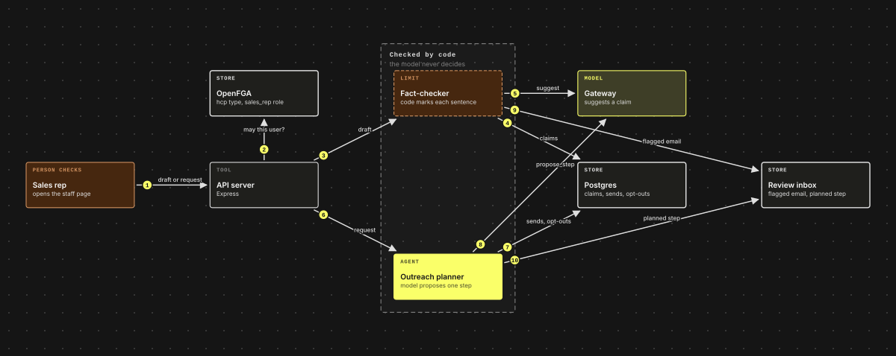
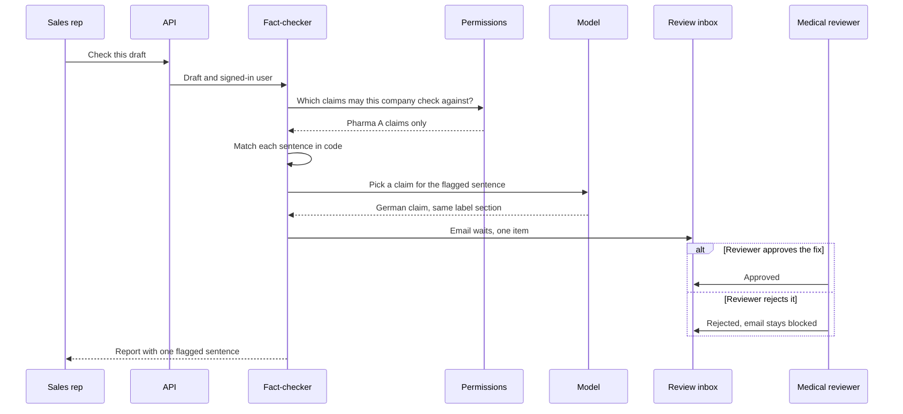
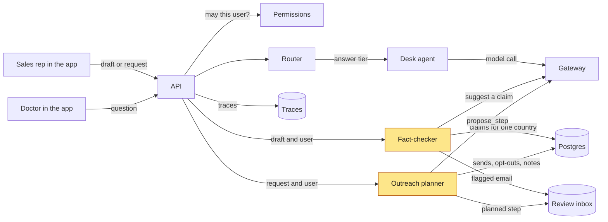
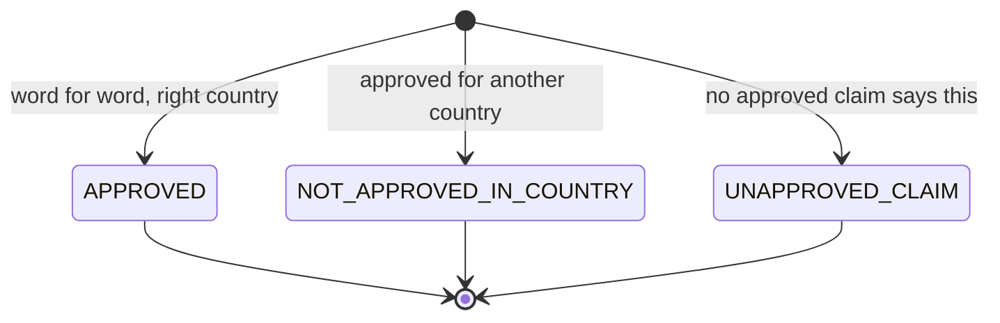
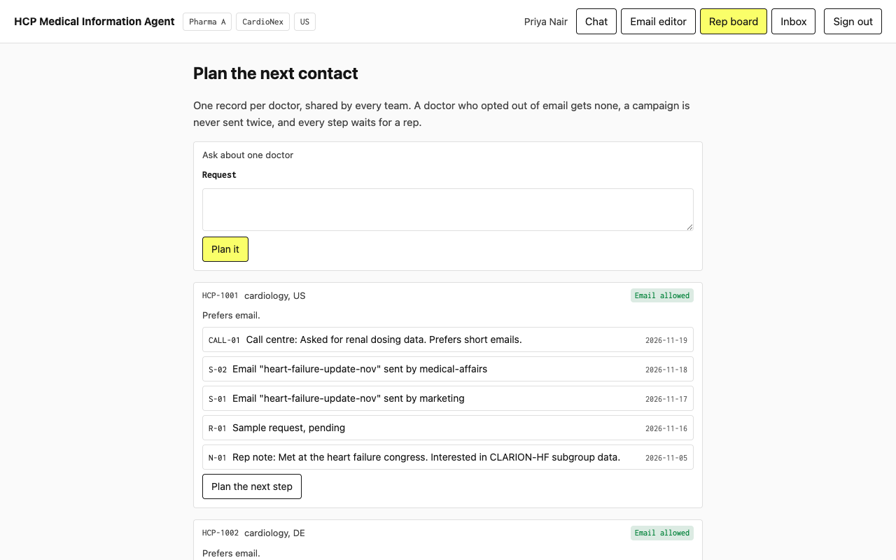
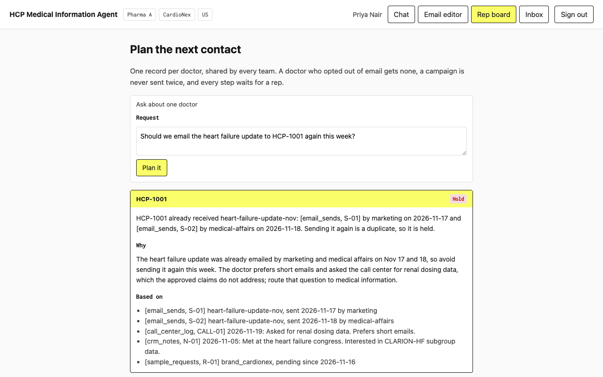
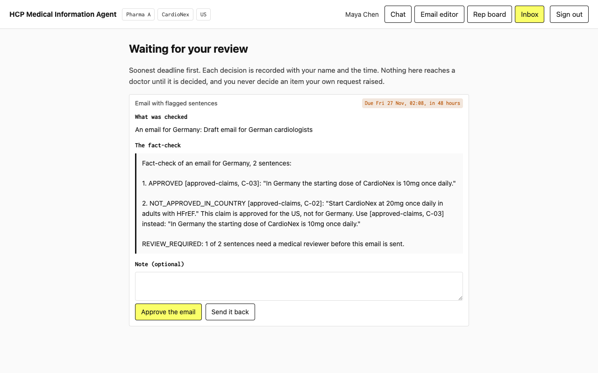
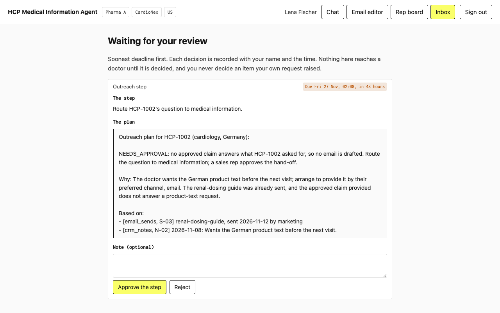

# Check every sales email against approved claims

## The problem

A rep writes an email to German heart doctors. One sentence gives the US starting dose of CardioNex. The sentence is word for word an approved claim, but only for the US. In Germany it is a compliance finding.

Another doctor had a different problem. One cardiologist got the November heart failure update from marketing on the 17th. She got it again from medical affairs on the 18th. A third doctor had asked to stop email, and a fourth team still sent him one.

Each team keeps its own notes. Nobody sees every send in one place. And a check by eye misses a sentence that is true but not approved for that country.

For example, "the best-in-class option for heart failure" reads well and was never approved by anyone. So code must mark each sentence, and code must hold each send that breaks a rule.

## What you build

- **A fact check,** in code. It marks each sentence of an email as approved or not. The model only suggests a better claim.
- **An outreach planner.** The model proposes one step. Code holds a campaign already sent, an email to an opt-out, and a sample with no rep.
- **Two staff pages.** An email editor and a rep board, for sales reps and medical reviewers only.
- **Two new inbox items.** A flagged email waits for a medical reviewer. A planned step waits for another sales rep.
- **OpenFGA, which decides who may read or decide what.** It gets the `hcp` type and the `sales_rep` role.

| Case | What breaks | How the system holds |
| --- | --- | --- |
| A US dose in a German email | A claim is used in a country it is not approved for | The fact check flags it and offers the German claim |
| The same update sent twice | A doctor gets two emails from two teams | The planner holds the step and cites each send |
| A doctor who opted out | An email goes to someone who said no | The planner plans a call, not an email |
| A doctor opens the editor | A doctor sees staff tools | The API answers 403 before any model runs |

## How it works

A new agent is a graph and its data. The gateway, the sign-in, the permissions and the inbox are already built. Both agents borrow them, so the hard parts have one copy.



Step through it one part at a time in the [live drawing](https://canvas.learnwithparam.com/case.html#buildcamp/16).

The model reads and suggests. Code decides. A claim passes only on a word for word match with an approved claim. The claim must be approved for the email's country.

### The flow

This follows one German draft through the fact check. The second sentence is the US dose.



The step people doubt is the model's suggestion. It does not decide anything. Code sets the verdict before the model is called. The suggestion only fills a field next to it.

### Where it sits

The two new agents join the base from lessons 10 to 13. They add no new door.



### The states

Each sentence gets one of three verdicts.



A verdict never changes after it is set. The model may suggest a claim for the last two. It cannot move a sentence to `APPROVED`.

### Concepts

- [Approved claim](../walkthrough.md#c-approved-claim)
- [Fact check](../walkthrough.md#c-fact-check)
- [Opt-out](../walkthrough.md#c-opt-out)

## Build it

```bash
git checkout checkpoint/14-content-agents
```

This tag is where lesson 14 starts. It holds what the earlier lessons built and none of this lesson's own files.

You add:

- `src/server/content/records.ts`: the approved claims, the draft emails and the CRM files from `data/hcp`, read once.
- `src/server/content/fact-check.ts`: the fact-checker graph.
- `src/server/content/outreach.ts`: the outreach planner graph.
- `src/client/content/Editor.tsx` and `Outreach.tsx`: the email editor and the rep board.
- `src/server/migrations/003_content_reviews.sql`: two more kinds of waiting item, `email` and `outreach`.
- `src/server/migrations/004_review_requests.sql`: every request that raised an item, so nobody who asked decides it.
- `infra/openfga/model.fga`: the `sales_rep` role, the `hcp` type, and who may decide an email or a step.
- `scripts/identity-setup.ts`: four sales reps, two per company.
- `scripts/hcp-cases.ts`: the dataset now loads `fact-check.yaml` and `outreach.yaml` beside `medinfo.yaml`.
- Tests that need no model: `src/server/content/content.test.ts`, and new cases in `src/server/inbox.test.ts`.

### Step 1: Set up the reps and the data

```bash
npm install
npm run identity:setup
npm run dataset:seed
npm run dev
```

`identity:setup` adds the `sales-rep` role in Keycloak, which does the sign-in. It adds the four reps below. It also writes the new OpenFGA model with one `hcp` fact per doctor in the CRM. The server runs migrations 003 and 004 when it starts. `dataset:seed` adds twelve new cases, and each one names its agent.

| Person | Company | Role |
| --- | --- | --- |
| Priya Nair | Pharma A | sales-rep |
| Lena Fischer | Pharma A | sales-rep |
| Daniel Cho | Pharma B | sales-rep |
| Arjun Mehta | Pharma B | sales-rep |

There are two reps per company on purpose. Nobody decides an item their own request raised. With one rep, every step that rep planned would wait forever.

The data is the dataset repo's copy in `data/hcp`:

- `content/approved-claims.csv`: one row per approved sentence, with its country and the label section it comes from.
- `content/draft-email-us.md` and `draft-email-de.md`: two drafts written by a rep.
- `crm/`: doctor profiles, email sends, rep notes, the call center log and sample requests.

### Step 2: See what the two agents reuse

Open `src/server/content/fact-check.ts`. The top of the file says what it borrows:

| Need | Where it comes from | Lesson |
| --- | --- | --- |
| A model client | `modelClient()` in `src/server/gateway.ts` | 10 |
| Who is asking, and their company | the signed-in user, `userOf(config)` | 11 |
| Which claims and doctors they may see | `checkableDocuments` and `visibleHcps` in `src/server/permissions.ts` | 11 |
| A human decision | `inbox.submit()` from `src/server/reviews.ts` | 13 |
| A trace with the user on it | `observe` and `propagateAttributes` from Langfuse | 02, 11 |

Neither agent makes a model client of its own. `src/server/gateway.test.ts` walks every file under `src/`. It fails if any file other than `gateway.ts` makes one. So the two new folders are covered with no new test.

### Step 3: Let code decide each verdict

The fact-checker graph has four nodes:

```text
read -> match -> suggest -> write
```

- **read** loads the draft and the claims this person's company may check against. A claim from another company never enters the state.
- **match** gives each sentence a verdict in code, in `checkSentence`. Case, spaces and the final full stop do not count. Every word does. A paraphrase is a new claim until a reviewer signs it.
- **suggest** is the only model call. For a sentence with no approved claim, the model picks one that could replace it.
- **write** writes the report. If any sentence is flagged, it puts the email in the inbox for a medical reviewer.

| Verdict | Meaning |
| --- | --- |
| `APPROVED` | The sentence is a claim approved for this country |
| `NOT_APPROVED_IN_COUNTRY` | The claim is approved, but for another country. The fix is the claim approved here for the same label section |
| `UNAPPROVED_CLAIM` | No approved claim says this anywhere |

Sign in as Priya Nair and open **Check an email**. Pick a saved draft and press **Check this draft**.


The German draft has two sentences. The first is approved for Germany. The second is the US starting dose. It is flagged, and the German claim for the same section is offered as the fix.


If Pharma B checks the same CardioNex email, it gets `INSUFFICIENT_CONTEXT`. Pharma B has no approved CardioNex claims, so nothing can be approved, and the model is never called.

### Step 4: Check the same email twice

Press **Check this draft** again. The note under the result says the email is already in the inbox. It does not add a second item.

A flagged email's item id hashes the company, the country and the sentences. It does not hash the request. It is `contentKey` in `src/server/reviews.ts`. Two reps who check the same text raise one item. A reviewer decides it once, and later checks show that decision.

One item can now have more than one requester. So migration 004 adds `review_requests`, one row per request that raised an item. A medical reviewer who checks a flagged email becomes a requester too, and may not decide it.

### Step 5: Let the planner propose and the rules decide

The outreach planner has three nodes:

```text
read -> propose -> decide
```

- **read** finds the CRM id in the request. It asks OpenFGA if this person's company may see that doctor. Then it builds one record from every team's files.
- **propose** is the model call. It must call one tool, `propose_step`. The kind is `email_campaign`, `next_step` or `samples`. It also names the campaign, the claims to use and why.
- **decide** applies the rules in code, in `planOutreach`. Then it puts the step in the inbox for a sales rep.

| Rule | Result |
| --- | --- |
| The campaign was already sent to this doctor | `HOLD_OUTREACH`, citing each send |
| The doctor is an opt-out for email | `HOLD_OUTREACH` for email, and a call is planned |
| A sample request is pending | `NEEDS_APPROVAL`, so a rep approves the shipment |
| No approved claim answers the doctor | No email, and the question goes to medical information |
| Anything else | An email built only from approved claims for the doctor's country |

The duplicate rule runs whenever the proposal names a campaign, whatever kind of step the model chose. A rule that needs the model to label its own step right is a prompt rule again.

Open **Plan outreach** and ask: "Should we email the heart failure update to HCP-1001 again this week?"



The plan is held. It cites the two sends, one by marketing and one by medical affairs. The reason names the call center note too.



Ask for a next step for HCP-1002 instead. The plan waits for a rep.


Each email is only approved claims for the doctor's country. So every email the planner writes passes the fact check.

### Step 6: Make each item wait for the right person

`infra/openfga/model.fga` adds two item types beside `draft` and `adverse_event`:

```text
type email
  relations
    define company: [company]
    define can_decide: medical_reviewer from company

type outreach
  relations
    define company: [company]
    define can_decide: sales_rep from company
```

Sign in as Maya Chen. Her inbox has the flagged German email, with each verdict.



Sign in as Lena Fischer. Her inbox has the step Priya planned. Priya's own inbox does not show it. Her `POST /api/inbox/<id>/decision` returns 403, because her request raised it.



### Step 7: Turn a doctor away

Sign in as Ana Rivera, a doctor, and open `/editor`. The page says it is for the company's sales reps and medical reviewers. The API answers 403 before any graph runs, so the request costs no model call. OpenFGA still decides which records a rep may read. The role check only gives the page a clear answer.


### Step 8: Score both agents in the dataset run

Each case in `fact-check.yaml` and `outreach.yaml` has text checks. They name the codes it must show, the citations, and what must not appear. The runner sends each case to the agent its metadata names. It signs in as a rep of the case's company.

```bash
npm run dataset:run -- --cases FACT-01,FACT-02,FACT-03,FACT-04,FACT-05,FACT-06,OUTREACH-01,OUTREACH-02,OUTREACH-03,OUTREACH-04,OUTREACH-05,OUTREACH-06,STALENESS-01,NEGATIVE-01,INJECTION-01,MULTITURN-01 --chapter 14 --change "Fact-checker and outreach planner"
```

Your row goes to `my-scoreboard.md`. The scoreboard gains two columns, `fact-check` and `outreach`.

### Check your build

Run the check. Then compare your files with the next tag, which holds this lesson's finished code.

```bash
npm run check
git diff --stat checkpoint/15-a2a
```

The check passes, except the tests that need a service from an earlier lesson. They fail when that service is not running. The diff lists only files you wrote in your own way.

## Prove it

| Case | Why it matters | Before | After |
| --- | --- | --- | --- |
| FACT-01 to FACT-06 | A claim must be approved for the email's country | Checked by eye | A verdict per sentence, in code |
| OUTREACH-01 to OUTREACH-06 | A doctor must not get a duplicate or an unwanted email | Each team kept its own notes | Held, with each send cited |
| The same draft checked twice | A reviewer should decide an email once | Not built | One item, however often it is checked |

The tests make no model call:

```bash
npx tsx --test src/server/content/content.test.ts src/server/inbox.test.ts
```

- **One item per email.** One test checks the same draft from two threads. It expects one item.
- **No requester decides.** One test fails if only the first requester is kept off.
- **Planner and fact check agree.** One test runs every email the planner writes through the fact check.

Break it on purpose. Change the item id back to one per thread, and the first test fails.

## Stuck points

In a correct run, Priya's German draft shows one sentence approved and one flagged. Checking it twice leaves one item in Maya Chen's inbox. The step Priya planned is in Lena Fischer's inbox, not in Priya's. Run `npm run check` at the end.

| What you see | Why | What to do |
| --- | --- | --- |
| `INSUFFICIENT_CONTEXT` for Pharma B | Pharma B has no approved CardioNex claims | Sign in as a Pharma A rep to see verdicts |
| A rep step waits forever | The only rep in the company raised it | Use a second rep, as set up in Step 1 |
| A doctor sees the staff pages | The role is missing from the token | Run `npm run identity:setup` and sign in again |
| No `fact-check` column in your row | The run named no fact-check cases | Use the `--cases` list in Step 8 |

## What to watch for

- **A paraphrase that sounds approved.** Staff will reword a claim to make it fit. Matching word for word flags it. The cost is more reviews, so watch the share of flagged emails.
- **A rule that trusts the model's label.** The model could dodge a rule tied to one step kind. So the duplicate rule runs on any proposal that names a campaign.
- **A second copy of a hard part.** An agent with its own model key drifts. The gateway test fails on a second model client.
- **A rep who approves their own plan.** The requester table keeps every asker out of the decision.

## Results

| Chapter | Change | Passed | staleness | off-label | injection | multi-turn | fact-check | outreach |
| --- | --- | --- | --- | --- | --- | --- | --- | --- |
| 14 | Fact-checker and outreach planner on the same door, identity and inbox | 15/16 | 1/1 | 1/1 | 1/1 | 1/1 | 5/6 | 6/6 |

How to read it:

- **outreach 6/6.** The duplicate is held and the opt-out gets no email. The German doctor gets German claims. Pharma A cannot see a Pharma B doctor, and the sample waits for a rep.
- **fact-check 5/6.** Every verdict is right, including FACT-06, where Pharma B has no approved claims. FACT-06 passes its text checks but fails the behavior check. The case expects the answer kind "reply". The judge read the report as "defer". Both fit, and the case stays as the dataset wrote it.
- **The guard set held.** Staleness, off-label, injection and multi-turn pass as before. Nothing the desk does changed.

The full row is in [docs/scoreboard.md](../scoreboard.md).

## Where to go next

- Read `checkSentence` in `src/server/content/fact-check.ts`, then `planOutreach` in `src/server/content/outreach.ts`.
- Try the homework. Add a cap of two emails to one doctor in seven days. Count every team in `email_sends.csv`. Put the rule in `planOutreach` and return `HOLD_OUTREACH` with each send cited. Add a test to `content.test.ts` with a doctor who got two emails from two teams this week.
- Read the [LangGraph graph API](https://langchain-ai.github.io/langgraphjs/concepts/low_level/), the [OpenFGA modeling guide](https://openfga.dev/docs/modeling/getting-started) and [Langfuse datasets](https://langfuse.com/docs/evaluation/dataset-runs/datasets).
- Lesson 15 starts from this checkpoint. The desk hands a drafted email to the fact-checker over A2A instead of a function call.
