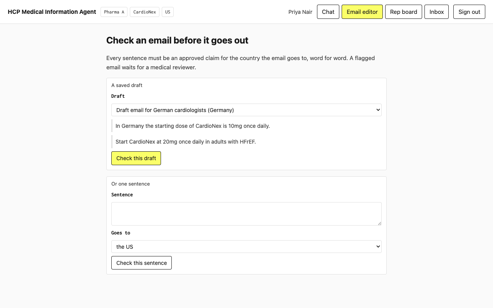
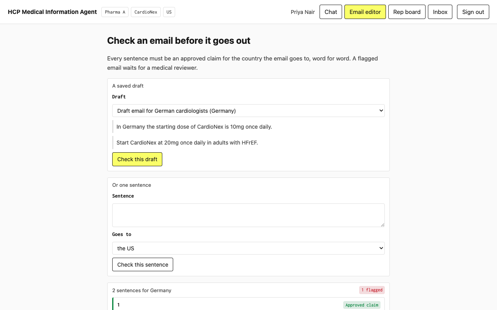
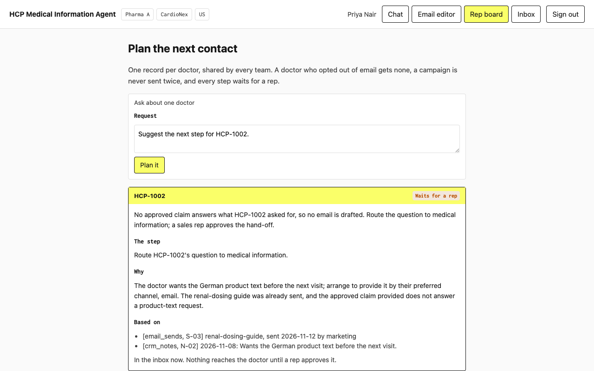
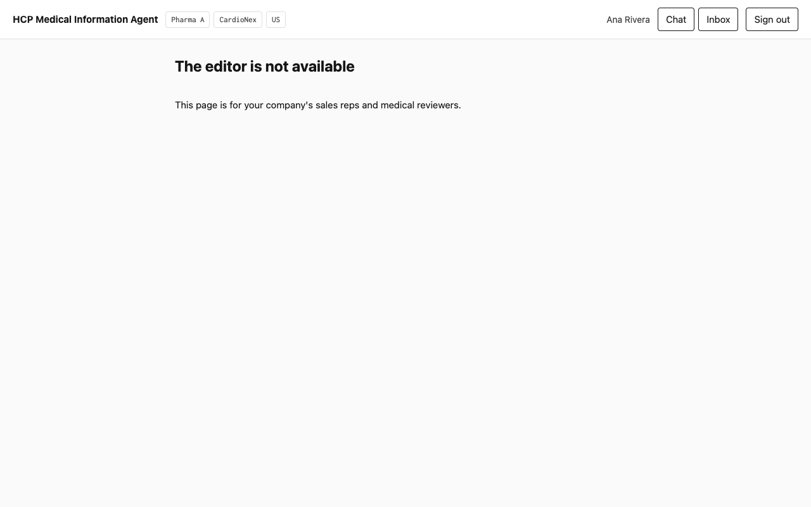

# 14 Build a fact-checker and an outreach planner on one agent base

## Why the second agent should not copy the first

The medical information desk now has a lot under it. Every model call goes through one door (lesson 10). The company and country come from a signed token, and OpenFGA decides what each person may read (lesson 11). Risky work waits in a reviewer inbox in Postgres (lesson 13).

The same company has two more jobs that hurt today:

- **Emails to doctors say things nobody approved.** A rep writes "the best-in-class option for heart failure", or puts the US dose in an email to German cardiologists. In pharma, every sentence in a promotional email must be a claim that medical, legal and regulatory review signed off, for that country. One unapproved sentence is a compliance finding.
- **The same doctor gets the same email twice.** Marketing, medical affairs, the call center and the reps each keep their own notes. One cardiologist got the November heart failure update from marketing on the 17th and from medical affairs on the 18th. A doctor who asked to stop email still gets one.

The tempting fix is two new apps, each with its own model key, its own idea of who is signed in, and its own approve button. That is three copies of the hard parts, and the copies drift. This lesson builds both agents on the base you already have. What is new per agent is only its graph and its data.

Complementary materials:

- Docs: [LangGraph graph API](https://langchain-ai.github.io/langgraphjs/concepts/low_level/)
- Docs: [OpenFGA modeling guide](https://openfga.dev/docs/modeling/getting-started)
- Docs: [Langfuse datasets](https://langfuse.com/docs/evaluation/dataset-runs/datasets)

## Goal

Two more agents, the same door, identity and inbox, and rules that live in code.

- **Before:** the desk answers doctors. Emails are checked by hand, and nobody sees every team's sends in one place.
- **Build:** a fact-checker graph and an email editor, an outreach planner graph and a rep board, two new item kinds in the inbox, and the `hcp` and `sales_rep` rules in OpenFGA.
- **After:** the six fact-check and six outreach cases run in the dataset, a flagged email waits for a medical reviewer, a planned step waits for another sales rep, and a doctor signed in to the desk can use neither tool.

## Starting point

```bash
git checkout checkpoint/14-content-agents
```

The checkpoint adds:

- `src/server/content/records.ts`: the approved claims, the draft emails and the CRM files from `data/hcp`, read once.
- `src/server/content/fact-check.ts`: the fact-checker graph.
- `src/server/content/outreach.ts`: the outreach planner graph.
- `src/client/content/Editor.tsx` and `Outreach.tsx`: the email editor and the rep board.
- `src/server/migrations/003_content_reviews.sql`: two more kinds of waiting item, `email` and `outreach`.
- `src/server/migrations/004_review_requests.sql`: every request that raised an item, so nobody who asked decides it.
- `infra/openfga/model.fga`: the `sales_rep` role, the `hcp` type, and who may decide an email or a step.
- `scripts/identity-setup.ts`: four sales reps, two per company.
- `scripts/hcp-cases.ts`: the dataset now loads `fact-check.yaml` and `outreach.yaml` beside `medinfo.yaml`.
- Tests that need no model: `src/server/content/content.test.ts`, and new cases in `src/server/inbox.test.ts`.

## Step 1: Set up the reps and the data

```bash
npm install
npm run identity:setup
npm run dataset:seed
npm run dev
```

`identity:setup` adds the `sales-rep` role in Keycloak, the four reps below, and the new OpenFGA model with one `hcp` fact per doctor in the CRM. The server runs migrations 003 and 004 when it starts. `dataset:seed` adds the twelve new cases to the Langfuse dataset; each item's metadata says which agent answers it.

| Person | Company | Role |
| --- | --- | --- |
| Priya Nair | Pharma A | sales-rep |
| Lena Fischer | Pharma A | sales-rep |
| Daniel Cho | Pharma B | sales-rep |
| Arjun Mehta | Pharma B | sales-rep |

There are two reps per company on purpose. Lesson 13's rule is that nobody decides an item their own request raised. With one rep, every step that rep planned would wait forever.

The data is the dataset repo's copy in `data/hcp`:

- `content/approved-claims.csv`: one row per approved sentence, with its country and the label section it comes from.
- `content/draft-email-us.md` and `draft-email-de.md`: two drafts written by a rep.
- `crm/`: doctor profiles, email sends, rep notes, the call center log and sample requests.

## Step 2: What the two agents reuse

Open `src/server/content/fact-check.ts`. The top of the file says what it borrows:

| Need | Where it comes from | Lesson |
| --- | --- | --- |
| A model client | `modelClient()` in `src/server/gateway.ts` | 10 |
| Who is asking, and their company | the signed-in user, `userOf(config)` | 11 |
| Which claims and doctors they may see | `checkableDocuments` and `visibleHcps` in `src/server/permissions.ts` | 11 |
| A human decision | `inbox.submit()` from `src/server/reviews.ts` | 13 |
| A trace with the user on it | `observe` and `propagateAttributes` from Langfuse | 02, 11 |

Neither agent creates a model client of its own. `src/server/gateway.test.ts` walks every file under `src/` and fails if any file other than `gateway.ts` does, so the two new folders are covered with no new test.

## Step 3: The fact-checker decides in code

The graph has four nodes:

```text
read -> match -> suggest -> write
```

- **read** loads the draft (or the pasted text) and the claims this person's company may check against. OpenFGA's `can_check_against` gives the documents; a claim from another company never enters the state.
- **match** gives each sentence a verdict, in code. A sentence passes only when it is an approved claim word for word, for the country the email goes to. Case, spaces and the final full stop do not count; every word does. A paraphrase of a claim is a new claim until a reviewer signs it.
- **suggest** is the only model call. For each sentence with no approved claim at all, the model picks the approved claim that could replace it. It suggests; it never decides.
- **write** writes the report and, when any sentence is flagged, puts the email in the inbox for a medical reviewer.

There are three verdicts:

| Verdict | Meaning |
| --- | --- |
| `APPROVED` | the sentence is a claim approved for this country |
| `NOT_APPROVED_IN_COUNTRY` | the claim is approved, but for another country; the fix is the claim approved here for the same label section |
| `UNAPPROVED_CLAIM` | no approved claim says this anywhere |

Sign in as Priya Nair and open **Email editor**. Pick a saved draft and press **Check this draft**.



The German draft has two sentences. The first is approved for Germany. The second is the US starting dose, word for word an approved claim, but approved for the US. It is flagged, with the German claim for the same section offered as the fix.



If Pharma B checks the same CardioNex email, it gets `INSUFFICIENT_CONTEXT`: Pharma B has no approved CardioNex claims, so nothing in the email can be approved, and the model is never called.

## Step 4: Check the same email twice

Press **Check this draft** again. The note under the result says the email is already in the inbox. It does not add a second item.

A flagged email's item id is a hash of the company, the country and the sentences, not of the request that checked it (`contentKey` in `src/server/reviews.ts`). Two reps who check the same text raise one item, and a medical reviewer decides it once. Once a reviewer has decided it, checking the same text again shows that decision instead of asking again.

One item can now have more than one requester, so lesson 13's rule needs one more table. Migration 004 adds `review_requests`, one row per request that raised an item. A medical reviewer who checks an email a rep already flagged becomes a requester of that item too, and may not decide it. The test "nobody decides an item any of their requests raised" in `inbox.test.ts` fails if only the first requester is kept off.

The test "a flagged email waits for a medical reviewer once, however often it is checked" in `content.test.ts` checks the same draft from two threads and expects one item. Change the id back to one per thread and it fails.

## Step 5: The outreach planner proposes, the rules decide

Open `src/server/content/outreach.ts`. The graph has three nodes:

```text
read -> propose -> decide
```

- **read** finds the CRM id in the request, asks OpenFGA whether this person's company may see that doctor (`can_view` on `hcp`), and builds one record from every team's files.
- **propose** is the model call. It reads the request and the record and must call one tool, `propose_step`: the kind of step (`email_campaign`, `next_step` or `samples`), the campaign the request is about, whether it asks for an email, which approved claims to use, and why.
- **decide** applies the rules in code, then puts the step in the inbox for a sales rep.

The rules the model cannot argue with:

| Rule | Result |
| --- | --- |
| The campaign was already sent to this doctor | `HOLD_OUTREACH`, citing each send |
| The doctor opted out of email | `HOLD_OUTREACH` for email; a call is planned instead |
| A sample request is pending | `NEEDS_APPROVAL`: a rep approves the shipment |
| No approved claim answers what the doctor asked | no email; the question goes to medical information |
| Otherwise | an email built only from approved claims for the doctor's country, word for word |

The duplicate rule runs whenever the proposal names a campaign, whatever kind of step the model chose. A rule that depends on the model labelling its own step right is a prompt rule again.

Open **Rep board** and ask: "Should we email the heart failure update to HCP-1001 again this week?"


The plan is held. It cites the two sends, one by marketing and one by medical affairs, and the reason names the call center note too.


Ask for a next step for HCP-1002 instead. The plan waits for a rep.



Because each email is only approved claims for the doctor's country, every email the planner writes passes the fact-checker. The test "every email the planner writes passes the fact-checker" in `content.test.ts` runs one through the other.

## Step 6: Each item waits for the right person

`infra/openfga/model.fga` adds two item types beside lesson 13's `draft` and `adverse_event`:

```text
type email
  relations
    define company: [company]
    define can_decide: medical_reviewer from company

type outreach
  relations
    define company: [company]
    define can_decide: sales_rep from company
```

Sign in as Maya Chen. Her inbox has the flagged German email, with each verdict.


Sign in as Lena Fischer. Her inbox has the step Priya planned. Priya's own inbox does not show it, and her `POST /api/inbox/<id>/decision` returns 403, because her request raised it.


## Step 7: A doctor cannot use either tool

Sign in as Ana Rivera, a doctor, and open `/editor`. The page says it is for the company's sales reps and medical reviewers. The API answers 403 before any graph runs, so a doctor's request costs no model call. OpenFGA still decides which records a rep may read; the role check only gives the page a clear answer.



## Step 8: Score both agents in the dataset run

Each case in `fact-check.yaml` and `outreach.yaml` has text checks: the codes it must show, the citations, and what must not appear. The runner sends each case to the agent its metadata names, signed in as a rep of the case's company.

```bash
npm run dataset:run -- --cases FACT-01,FACT-02,FACT-03,FACT-04,FACT-05,FACT-06,OUTREACH-01,OUTREACH-02,OUTREACH-03,OUTREACH-04,OUTREACH-05,OUTREACH-06,STALENESS-01,OFF-LABEL-01,INJECTION-01,MULTITURN-01 --chapter 14 --change "Fact-checker and outreach planner"
```

Your row goes to `my-scoreboard.md`. The scoreboard gains two columns, `fact-check` and `outreach`.

## Results

| Chapter | Change | Passed | staleness | off-label | injection | multi-turn | fact-check | outreach |
| --- | --- | --- | --- | --- | --- | --- | --- | --- |
| 14 | Fact-checker and outreach planner on the same door, identity and inbox | 15/16 | 1/1 | 1/1 | 1/1 | 1/1 | 5/6 | 6/6 |

How to read it:

- **outreach 6/6:** the duplicate is held, the opt-out gets no email, the German doctor gets German claims, Pharma A cannot see a Pharma B doctor, and the sample waits for a rep.
- **fact-check 5/6:** every verdict is right, including FACT-06, where Pharma B has no approved claims. FACT-06 passes its text checks but fails the behavior check: the case expects the kind of answer "reply", and the judge read the report as "defer the question" to someone else. Both readings fit a report that says the email cannot go out until claims are approved. The case is left as the dataset wrote it, so the row says 5/6.
- **The guard set held:** staleness, off-label, injection and multi-turn pass as in lesson 13. Nothing the desk does changed.

The full row is in [docs/scoreboard.md](../scoreboard.md).

## How to verify you are done

- As Priya, the German draft shows one sentence approved and one flagged as approved for the US only.
- Checking the same draft twice leaves one item in Maya Chen's inbox.
- As Priya, "Should we email the heart failure update to HCP-1001 again this week?" is held, with two sends cited.
- A step Priya planned is in Lena Fischer's inbox, not in Priya's, and not in Maya's.
- As Ana Rivera, `/editor` and `/outreach` say the pages are for staff.
- The 14 run shows outreach 6/6.
- `npm run check` passes.

## Wrap-up

A new agent is a graph and its data. The door, the identity, the permissions and the inbox are already built, so the fact-checker and the planner got them for free, and a test on the whole tree keeps it that way. The model does the reading and the suggesting. The verdicts and the rules are code: an approved claim is matched word for word, a duplicate is held whatever the model calls its step, and every outcome waits for a person who did not ask for it.

## Homework

Add a frequency cap to the planner: no more than two emails to one doctor in seven days, counted across every team in `email_sends.csv`. Put the rule in `decide`, return `HOLD_OUTREACH` with each send cited, and add a test to `content.test.ts` with a doctor who got two emails from two teams this week.

## End state

This is the starting point for lesson 15, where the desk hands a drafted email to the fact-checker over A2A instead of a function call.
