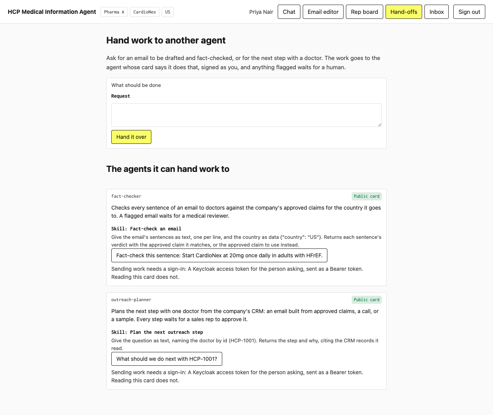
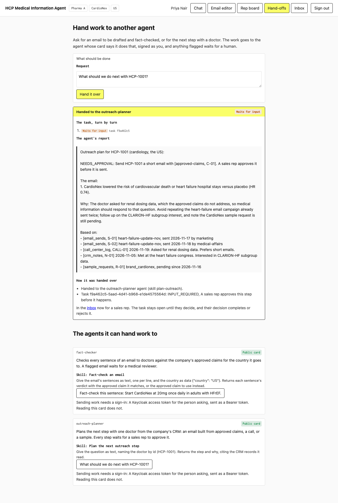
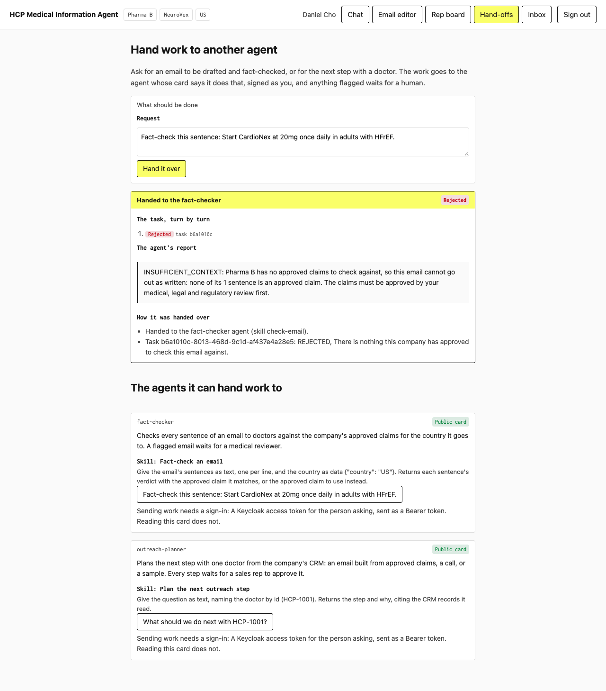

# 15 Hand work between agents over A2A

## Why a function call is not a contract

In lesson 14 the desk calls the fact-checker as a function in the same process. That works while one team owns both. It stops working the day the fact-checker belongs to the regulatory team, runs on its own server, and is used by three other agents nobody on your team wrote.

At that point three questions have no answer in a function call:

- **What does the other agent do, and how do I sign in to it?** Today you read its code.
- **What happens while it waits?** A flagged email waits hours for a medical reviewer. A function call cannot wait hours, and a call that times out loses the work.
- **Who is asking?** If the desk calls the fact-checker with its own key, the fact-checker sees the desk, not the rep, and lesson 11's rule that a company only reads its own claims is gone.

A2A (Agent2Agent) is the open protocol for this. An agent publishes an **Agent Card**: what it does, its skills, and how to authenticate. Work is a **task** with states, so an agent can say "done", "I need a human" or "I will not do this for you" in a way the caller's code can act on. This lesson puts both agents from lesson 14 behind A2A servers and adds the agent a rep talks to, which hands the work over.

Complementary materials:

- Docs: [A2A protocol specification](https://a2a-protocol.org/latest/specification/)
- Docs: [A2A JavaScript SDK](https://github.com/a2aproject/a2a-js)
- Docs: [Langfuse sessions](https://langfuse.com/docs/observability/features/sessions)
- Docs: [W3C Trace Context](https://www.w3.org/TR/trace-context/)

## Goal

Agents that find each other by their cards, sign in as the person asking, and wait for a human in the open.

- **Before:** the desk calls the fact-checker and the planner as functions. Nothing outside the app can use them, and nothing says what they need.
- **Build:** an A2A server for each agent with a public card and a Keycloak sign-in, tasks kept in Postgres, a hand-off agent that picks a skill from the cards, and a Hand-offs page.
- **After:** the five a2a cases pass. A flagged email is a task in `INPUT_REQUIRED` with an item in the reviewer's inbox, the reviewer's decision completes or rejects it, and the whole hand-off is one trace in Langfuse.

## Starting point

```bash
git checkout checkpoint/15-a2a
```

The checkpoint adds:

- `src/server/a2a/cards.ts`: the two Agent Cards, each with one skill and the Keycloak sign-in.
- `src/server/a2a/server.ts`: the A2A servers. The card is public; work needs a token.
- `src/server/a2a/executors.ts`: the lesson 14 agents, with each result turned into a task state.
- `src/server/a2a/tasks.ts`: the task store in Postgres, and the link from a task to the inbox item it waits on.
- `src/server/a2a/handoff.ts`: the agent a rep talks to. It reads the cards, drafts an email when asked, and sends the task with the rep's token.
- `src/server/migrations/005_a2a_tasks.sql`: the `a2a_tasks` and `a2a_task_reviews` tables.
- `src/client/content/Handoffs.tsx`: the Hand-offs page, at `/handoffs`, for staff.
- `data/hcp/evals/a2a.yaml` in the dataset, and `scripts/a2a-runner.ts`, which runs those cases through real A2A servers.
- Tests that need no model: `src/server/a2a/a2a.test.ts`.

The package is `@a2a-js/sdk`, the A2A project's own JavaScript SDK.

## Step 1: Read the Agent Cards

```bash
npm install
npm run dataset:seed
npm run dev
```

Each agent publishes its card at a well-known path. Anyone can read it, with no sign-in:

```bash
curl -s http://localhost:8787/api/a2a/fact-checker/.well-known/agent-card.json
```

The card names the skill (`check-email`), what to send and what comes back, and how to sign in:

```json
"securitySchemes": {
  "keycloak": {
    "openIdConnectSecurityScheme": {
      "description": "A Keycloak access token for the person asking, sent as a Bearer token.",
      "openIdConnectUrl": "http://localhost:8180/realms/medinfo/.well-known/openid-configuration"
    }
  }
}
```

The card is served in the A2A JSON form (`AgentCard.toJSON`). The SDK keeps a card in its own shape in memory, and a client that follows the spec reads that shape with no sign-in scheme at all. A test reads the card back with `AgentCard.fromJSON` to keep it right.

Sign in as Priya Nair, a sales rep, and open **Hand-offs**. The page lists the agents it can hand work to, read from their cards the same way.



## Step 2: Work needs the person's token

The card is public. Work is not. `server.ts` checks every request to an agent in this order:

1. **Another site's page is refused** (403). A page on another site sends its own `Origin`; an agent calling from a server sends none.
2. **No Bearer token, no work** (401). The answer carries `WWW-Authenticate` and says where to get a token. A cookie is never accepted, the rule lesson 12 set for MCP.
3. **A tenant in the request is refused** (400). The company comes from the token, so no part of the request decides whose data it reaches.
4. **The caller's trace is joined.** More on this in step 8.

Try the second one:

```bash
curl -s -X POST http://localhost:8787/api/a2a/fact-checker -H 'content-type: application/json' \
  -d '{"jsonrpc":"2.0","id":1,"method":"SendMessage","params":{}}'
```

The answer is 401 with "Send a Keycloak access token as a Bearer token." The hand-off agent sends the rep's own access token, so the fact-checker answers for Pharma A because Priya is at Pharma A, and OpenFGA (lesson 11) still decides each claim she may read.

## Step 3: Tasks live in Postgres

A task that waits for a reviewer may wait a day. `005_a2a_tasks.sql` creates the table the SDK's `DatabaseTaskStore` reads and writes, keyed by tenant and owner, so one caller never loads another caller's task:

```sql
CREATE TABLE a2a_tasks (
  tenant varchar(255) COLLATE "C" NOT NULL,
  owner varchar(255) COLLATE "C" NOT NULL,
  id varchar(36) COLLATE "C" NOT NULL,
  ...
  PRIMARY KEY (tenant, owner, id)
);
```

A second table, `a2a_task_reviews`, links a task to the inbox item it waits on. A restart loses nothing: the task and the item are both rows.

## Step 4: A flagged email waits for a human

On Hand-offs, ask:

```text
Draft an email to HCP-1001 saying CardioNex is the best heart failure medicine available today, and have it fact-checked.
```

The hand-off agent reads the cards and picks the fact-checker's skill. It drafts the email from the approved claims and the label, and sends it as a task. The fact-checker flags "the best heart failure medicine" as `UNAPPROVED_CLAIM`: no approved claim says it, and there is no approved wording to offer instead. The task ends this turn in **Waits for input** (`INPUT_REQUIRED`), and the status message says what it waits for: a review, with the inbox item's id.


`executors.ts` maps every result to one of three states:

| State | When |
| --- | --- |
| `COMPLETED` | every sentence is an approved claim |
| `INPUT_REQUIRED` | the sender may revise once with the approved wording the checker found, or a medical reviewer decides |
| `REJECTED` | the company has nothing approved to check against |

The verdicts are still the lesson 14 code. The executor only names the state.

## Step 5: A clean email still goes to a reviewer

Ask for the US starting dose:

```text
Draft an email to HCP-1001 with the US starting dose of CardioNex, and have it fact-checked.
```

The draft cites `[approved-claims, C-02]`, every sentence passes, and the fact-checker's task is `COMPLETED`. The hand-off agent still puts the email in the inbox, with `REVIEW_REQUIRED`, because an agent wrote it. That rule is code in `handoff.ts`, not a line in a prompt.


Sign in as Maya Chen, a medical reviewer. The item is in her inbox as **Email for medical review**, with the same reason the rep read.


When she approves or sends back an item a task waits on, `TaskReviews.settle` moves the task to `COMPLETED` or `REJECTED`, with her note in the status message. The agent that asked reads the decision on the task, the way it reads any other state.

## Step 6: The outreach planner over the same protocol

Ask "What should we do next with HCP-1001?". The hand-off agent picks the planner's skill. The planner proposes the samples step, citing `[call_center_log, CALL-01]`, and the task waits for a sales rep with `NEEDS_APPROVAL`.



A step the planner holds (a campaign already sent) completes, because nothing should happen and nobody needs to decide.

## Step 7: Another company gets nothing

Sign in as Daniel Cho, a Pharma B rep, and ask the fact-checker to check a CardioNex dose sentence. His token says Pharma B, Pharma B has no approved claims for CardioNex, and the task is `REJECTED` with `INSUFFICIENT_CONTEXT`. Pharma A's claim C-02 never appears.



## Step 8: One hand-off, one trace

The hand-off agent injects the W3C `traceparent` header into each A2A call (`propagation.inject`), and the A2A server joins it (`propagation.extract`) before the fact-checker runs. The A2A `contextId` is also the Langfuse session id. So in Langfuse, the fact-checker's spans sit inside the `hcp-handoff` trace that started them.


If the fact-checker ran on another server with its own Langfuse project, the same header would still join the two halves into one trace, because trace context is part of the request, not of the process.

## Step 9: Score the hand-offs in the dataset run

The a2a cases run through `scripts/a2a-runner.ts`: the real A2A servers and the SDK's client on a local port, with tokens signed by a key made for the run, so the run needs no sign-in. Tasks stay in memory and nothing goes to a real inbox, the same rule as lesson 14's runner.

```bash
npm run dataset:run -- --cases A2A-01,A2A-02,A2A-03,A2A-04,A2A-05,FACT-01,OUTREACH-01,STALENESS-01,NEGATIVE-01,INJECTION-01,MULTITURN-01 --chapter 15 --change "Agents hand work over A2A"
```

Your row goes to `my-scoreboard.md`. The scoreboard gains an `a2a` column.

## Results

| Chapter | Change | Passed | staleness | off-label | injection | multi-turn | fact-check | outreach | a2a |
| --- | --- | --- | --- | --- | --- | --- | --- | --- | --- |
| 15 | Agents hand work over A2A, with tasks that wait for a human | 11/11 | 1/1 | 1/1 | 1/1 | 1/1 | 1/1 | 1/1 | 5/5 |

How to read it:

- **a2a 5/5:** the clean draft cites C-02 and still needs review, the unapproved claim waits for input, the German email gets the German claim C-03 and not the US dose, the outreach question goes to the planner and waits for a rep, and a Pharma B caller is rejected.
- **A2A-03 passed without a revision turn.** The drafter now reads the approved claims for the country first, so its German draft used C-03 on the first try. The revision turn is still covered by a test in `a2a.test.ts`, which forces a flagged draft and checks it is revised once and still goes to review.
- **The guard set and lesson 14 held:** staleness, off-label, injection, multi-turn, FACT-01 and OUTREACH-01 pass as before. Moving the agents behind A2A changed how they are called, not what they decide.

The full row is in [docs/scoreboard.md](../scoreboard.md).

## How to verify you are done

- `curl` on each card path returns the card with no token, and `POST` with no token returns 401.
- As Priya, "the best heart failure medicine" ends in **Waits for input**, and the email is in Maya Chen's inbox.
- Maya's approval moves that task to `COMPLETED`; sending it back moves it to `REJECTED`.
- As Daniel Cho, the CardioNex check is rejected and names no Pharma A claim.
- In Langfuse, the `hcp-handoff` trace holds the fact-checker's spans.
- The 15 run shows a2a 5/5.
- `npm run check` passes.

## Wrap-up

A2A turns "call this function" into a contract. The card says what an agent does and how to sign in. The token says who is asking, so every rule from lesson 11 still holds across the call. A task's state says what the caller should do next, and `INPUT_REQUIRED` makes waiting for a human a normal outcome, kept in Postgres, not a timeout. The trace header makes two agents one story in Langfuse.

## Homework

Stream the fact-checker's progress. Set `capabilities.streaming` on its card, publish a status update after each sentence is checked, and have the hand-off agent use `sendMessageStream` so the Hand-offs page shows each verdict as it lands. Add a test that a stream ends in the same final state as `sendMessage`.

## End state

This is the starting point for lesson 16, where the agents react to events, a label coming into force or an adverse event email arriving, instead of waiting for someone to ask.
