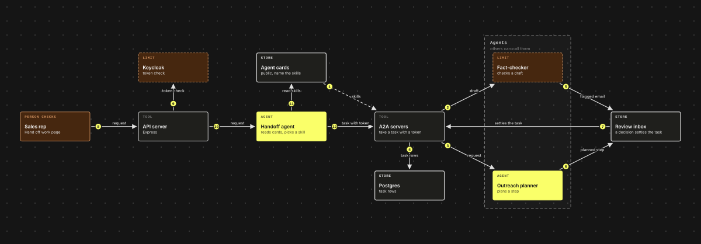
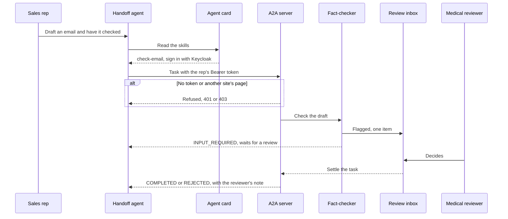
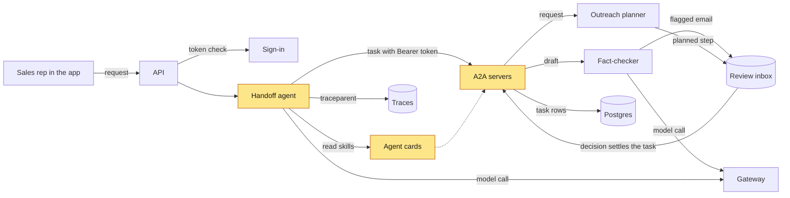
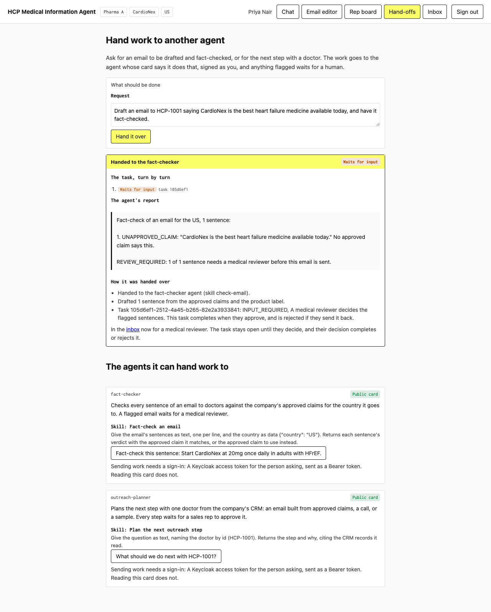
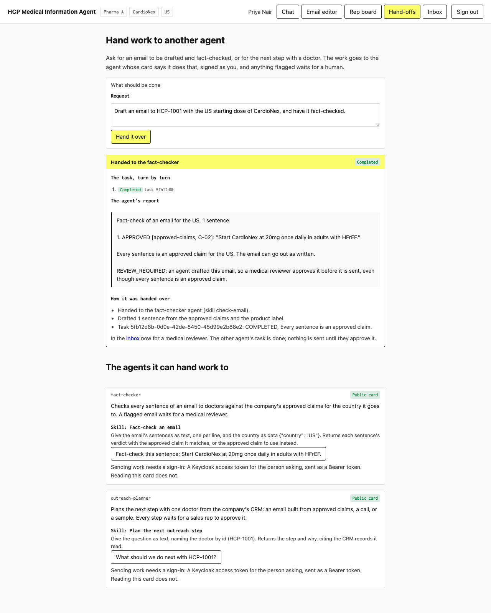
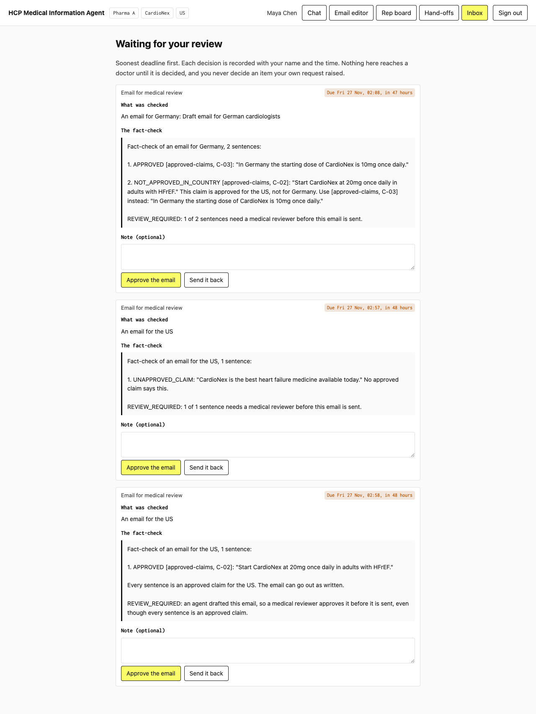
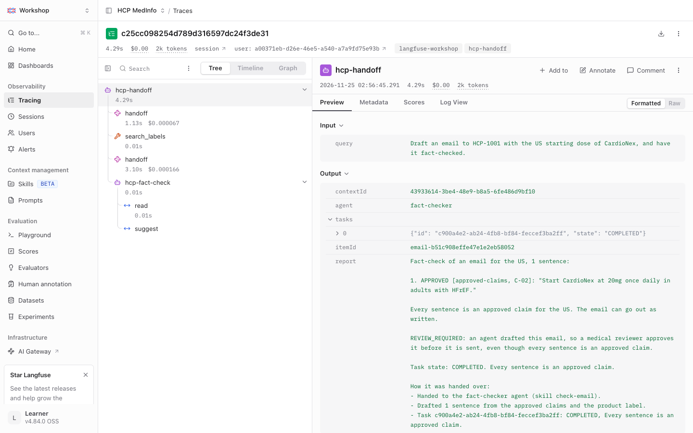

# Hand work between agents without losing who asked

## The problem

In the last lesson the desk calls the fact-checker as a function. That works while one team owns both. Then the regulatory team moves the fact-checker to its own server. Three other agents start to use it, and nobody on your team wrote them.

Now a function call fails in three ways:

- **Nobody knows what the other agent does.** For example, a new agent needs the email check. Today it must read the checker's code to learn what to send.
- **A call cannot wait.** A flagged email waits hours for a medical reviewer. A call that times out loses the work.
- **The checker sees the desk, not the rep.** The desk calls with its own key. Then the rule that a company reads only its own claims is gone.

A wrong answer here is quiet. The checker would answer a Pharma B rep with a Pharma A claim, and nothing would look odd.

## What you build

- **An agent card for each agent.** It is public. It says what the agent does and how to sign in.
- **A server for each agent,** which takes work only with the asker's own token.
- **A task store.** Each agent task lives in the database, so a restart loses nothing.
- **A handoff agent.** It reads the cards and picks a skill. It sends the task with the rep's token.
- **A Hand off work page,** at `/handoffs`, for sales reps.

| Case | What breaks | How the system holds |
| --- | --- | --- |
| A flagged claim | The call must wait for a person | The task ends in `INPUT_REQUIRED`, and the inbox holds the item |
| A clean draft written by an agent | Nobody checked what an agent wrote | The email still goes to a reviewer |
| A Pharma B rep calls the checker | Another company's claim leaks | The token says Pharma B, so the task is `REJECTED` |
| A page on another site sends work | A browser is used to call an agent | The server refuses another site's `Origin` |

## How it works

A2A is an open way for agents to call each other. An agent shares a card. Work is an agent task with a state, and the caller's code can act on that state.



Step through it one part at a time in the [live drawing](https://canvas.learnwithparam.com/case.html#buildcamp/17).

The caller's own token travels with the task. So the company rules from the sign-in lesson hold across the call. The task state tells the caller what to do next. Waiting for a person is a normal state, not a timeout.

### The flow

This follows one request for a flagged email. The rep asks for a claim nobody approved.



The step people doubt is the wait. The task and its inbox item are both rows in the database. So a restart in the middle of the wait loses nothing.

### Where it sits

The two agents from the last lesson now sit behind A2A servers on the same API.



### Concepts

- [Agent card](../walkthrough.md#c-agent-card)
- [Agent task](../walkthrough.md#c-agent-task)
- [Handoff](../walkthrough.md#c-handoff)

## Build it

```bash
git checkout checkpoint/15-a2a
```

The checkpoint adds:

- `src/server/a2a/cards.ts`: the two agent cards, each with one skill and the sign-in.
- `src/server/a2a/server.ts`: the A2A servers. The card is public. Work needs a token.
- `src/server/a2a/executors.ts`: the lesson 14 agents, with each result turned into a task state.
- `src/server/a2a/tasks.ts`: the task store in Postgres, and the link from a task to its inbox item.
- `src/server/a2a/handoff.ts`: the agent a rep talks to. It reads the cards, drafts an email when asked, and sends the task with the rep's token.
- `src/server/migrations/005_a2a_tasks.sql`: the `a2a_tasks` and `a2a_task_reviews` tables.
- `src/client/content/Handoffs.tsx`: the Hand off work page, at `/handoffs`, for sales reps.
- `data/hcp/evals/a2a.yaml` in the dataset, and `scripts/a2a-runner.ts`, which runs those cases through real A2A servers.
- Tests that need no model: `src/server/a2a/a2a.test.ts`.

The package is `@a2a-js/sdk`, the A2A project's own JavaScript SDK.

### Step 1: Read the agent cards

```bash
npm install
npm run dataset:seed
npm run dev
```

Each agent publishes its card at a well-known path. Anyone can read it, with no sign-in:

```bash
curl -s http://localhost:8787/api/a2a/fact-checker/.well-known/agent-card.json
```

The card names the skill (`check-email`), what to send and what comes back, and how to sign in:

```json
"securitySchemes": {
  "keycloak": {
    "openIdConnectSecurityScheme": {
      "description": "A Keycloak access token for the person asking, sent as a Bearer token.",
      "openIdConnectUrl": "http://localhost:8180/realms/medinfo/.well-known/openid-configuration"
    }
  }
}
```

The card is served in the A2A JSON form (`AgentCard.toJSON`). The SDK keeps a card in its own shape in memory. A client that follows the spec would read that shape with no sign-in scheme at all. A test reads the card back with `AgentCard.fromJSON` to keep it right.

Sign in as Priya Nair, a sales rep, and open **Hand off work**. The page lists the agents it can hand work to, read from their cards the same way.


### Step 2: Make work need the person's token

The card is public. Work is not. `server.ts` checks every request to an agent in this order:

1. **Another site's page is refused** (403). A page on another site sends its own `Origin`. An agent calling from a server sends none.
2. **No Bearer token, no work** (401). The answer carries `WWW-Authenticate` and says where to get a token. A cookie is never accepted.
3. **A tenant in the request is refused** (400). The company comes from the token, so the request cannot choose whose data it reaches.
4. **The caller's trace is joined.** Step 8 shows this.

Try the second one:

```bash
curl -s -X POST http://localhost:8787/api/a2a/fact-checker -H 'content-type: application/json' \
  -d '{"jsonrpc":"2.0","id":1,"method":"SendMessage","params":{}}'
```

The answer is 401. It says to send a Keycloak access token as a Bearer token. The handoff agent sends the rep's own access token. So the fact-checker answers for Pharma A, because Priya is at Pharma A. OpenFGA still decides each claim she may read.

### Step 3: Keep tasks in the database

A task that waits for a reviewer may wait a day. `005_a2a_tasks.sql` creates the table the SDK's `DatabaseTaskStore` reads and writes. It is keyed by tenant and owner, so one caller never loads another caller's task:

```sql
CREATE TABLE a2a_tasks (
  tenant varchar(255) COLLATE "C" NOT NULL,
  owner varchar(255) COLLATE "C" NOT NULL,
  id varchar(36) COLLATE "C" NOT NULL,
  ...
  PRIMARY KEY (tenant, owner, id)
);
```

A second table, `a2a_task_reviews`, links a task to the inbox item it waits on. A restart loses nothing, because the task and the item are both rows.

### Step 4: Let a flagged email wait for a person

On **Hand off work**, ask:

```text
Draft an email to HCP-1001 saying CardioNex is the best heart failure medicine available today, and have it fact-checked.
```

The handoff agent reads the cards and picks the fact-checker's skill. It drafts the email from the approved claims and sends it as an agent task. The fact-checker flags "the best heart failure medicine" as `UNAPPROVED_CLAIM`, with no approved wording to offer. The task ends this turn in **Waits for input** (`INPUT_REQUIRED`). Its status says it waits for a review, and gives the inbox item's id.



`executors.ts` maps every result to one of three states:

| State | When |
| --- | --- |
| `COMPLETED` | Every sentence is an approved claim |
| `INPUT_REQUIRED` | The sender may revise once with approved wording, or a medical reviewer decides |
| `REJECTED` | The company has nothing approved to check against |

The verdicts are still the lesson 14 code. The executor only names the state.

### Step 5: Send a clean email to a reviewer anyway

Ask for the US starting dose:

```text
Draft an email to HCP-1001 with the US starting dose of CardioNex, and have it fact-checked.
```

The draft cites `[approved-claims, C-02]`. Every sentence passes, and the fact-checker's task is `COMPLETED`. The handoff agent still puts the email in the inbox with `REVIEW_REQUIRED`, because an agent wrote it. That rule is code in `handoff.ts`, not a line in a prompt.



Sign in as Maya Chen, a medical reviewer. The item is in her inbox as **Email for medical review**, with the same reason the rep read.



She approves or sends back an item a task waits on. Then `TaskReviews.settle` moves the task to `COMPLETED` or `REJECTED`, with her note in the status message. The agent that asked reads the decision on the task, like any other state.

### Step 6: Call the outreach planner the same way

Ask "What should we do next with HCP-1001?". The handoff agent picks the planner's skill. The planner proposes the samples step and cites `[call_center_log, CALL-01]`. The task waits for a sales rep with `NEEDS_APPROVAL`.


A step the planner holds, such as a campaign already sent, completes. Nothing should happen, so nobody needs to decide.

### Step 7: Give another company nothing

Sign in as Daniel Cho, a Pharma B rep. Ask the fact-checker to check a CardioNex dose sentence. His token says Pharma B, and Pharma B has no approved CardioNex claims. So the task is `REJECTED` with `INSUFFICIENT_CONTEXT`, and Pharma A's claim C-02 never appears.


### Step 8: Keep one handoff in one trace

The handoff agent puts the W3C `traceparent` header on each A2A call (`propagation.inject`). The A2A server joins it (`propagation.extract`) before the fact-checker runs. The A2A `contextId` is also the Langfuse session id. So in Langfuse, the fact-checker's spans sit inside the `hcp-handoff` trace that started them.



Say the fact-checker ran on another server with its own project. The same header would still join the two halves. Trace context is part of the request, not of the process.

### Step 9: Score the handoffs in the dataset run

The a2a cases run through `scripts/a2a-runner.ts`. It uses the real A2A servers and the SDK's client on a local port. Tokens are signed by a key made for the run, so the run needs no sign-in. Tasks stay in memory and nothing goes to a real inbox.

```bash
npm run dataset:run -- --cases A2A-01,A2A-02,A2A-03,A2A-04,A2A-05,FACT-01,OUTREACH-01,STALENESS-01,NEGATIVE-01,INJECTION-01,MULTITURN-01 --chapter 15 --change "Agents hand work over A2A"
```

Your row goes to `my-scoreboard.md`. The scoreboard gains an `a2a` column.

## Prove it

| Case | Why it matters | Before | After |
| --- | --- | --- | --- |
| A2A-01 | An email an agent wrote is still reviewed | Called as a function | Task done, and the email waits |
| A2A-02 | A flagged claim needs a person | A call that could time out | `INPUT_REQUIRED`, kept in the database |
| A2A-03 | A US dose must not reach a German email | The drafter could copy it | The German claim C-03 is used |
| A2A-04 | A question goes to the right agent | Not built | The cards' skills pick the planner |
| A2A-05 | A Pharma B caller gets no Pharma A claim | The desk's own key was used | The task is `REJECTED` |

The tests make no model call:

```bash
npx tsx --test src/server/a2a/a2a.test.ts
```

- **Cards are public.** Each card shows its skill and the sign-in without a token.
- **Work is guarded.** A request with no token is refused, and the answer says where to sign in. A request that names its own tenant is refused. A page on another site is refused, even with a token.
- **A decision names who made it.** A rep decides a step. A medical reviewer decides an email.

Break it on purpose. Take out the `Origin` check in `server.ts`, and the test for another site's page fails.

## Stuck points

In a correct run, each card path returns the card with no token. A `POST` with no token returns 401. As Priya, the unapproved claim ends in **Waits for input**, and the email is in Maya Chen's inbox. Maya's approval moves the task to `COMPLETED`. Sending it back moves it to `REJECTED`.

| What you see | Why | What to do |
| --- | --- | --- |
| The card has no sign-in scheme | The card was read in the SDK's shape | Serve it with `AgentCard.toJSON` |
| 401 from the browser | The page sent a cookie, not a Bearer token | Use the page's own call, or send a token |
| A task never leaves `INPUT_REQUIRED` | Nobody decided the inbox item | Sign in as Maya Chen and decide it |
| No fact-checker spans in the trace | The `traceparent` header was lost | Check that the handoff agent injects it |

## What to watch for

- **A card that drifts from the agent.** Callers send the wrong work to a card that lies. The test reads each card back, so a broken card fails.
- **A call made with the desk's own key.** The checker would then answer as the desk. The server takes only the rep's token and ignores any tenant in the request.
- **A task that waits for ever.** A flagged email with no reviewer stays open. Watch how many tasks sit in `INPUT_REQUIRED`.
- **A trace that breaks in two.** Without `traceparent`, the handoff and the checker look unrelated. The `contextId` keeps the session joined.

## Results

| Chapter | Change | Passed | staleness | off-label | injection | multi-turn | fact-check | outreach | a2a |
| --- | --- | --- | --- | --- | --- | --- | --- | --- | --- |
| 15 | Agents hand work over A2A, with tasks that wait for a human | 11/11 | 1/1 | 1/1 | 1/1 | 1/1 | 1/1 | 1/1 | 5/5 | <!-- from-row: docs/runs/scoreboard-15.json -->

How to read it:

- **a2a passes in full.** The clean draft cites C-02 and still needs review. The unapproved claim waits for input. The German email gets the German claim C-03 and not the US dose. The outreach question goes to the planner and waits for a rep. A Pharma B caller is rejected.
- **A2A-03 passed without a revision turn.** The drafter now reads the approved claims for the country first. So its German draft used C-03 on the first try. A test in `a2a.test.ts` still forces a flagged draft. It checks the draft is revised once and goes to review.
- **The guard set and lesson 14 held.** Staleness, off-label, injection, multi-turn, FACT-01 and OUTREACH-01 pass as before. Moving the agents behind A2A changed how they are called, not what they decide.

The full row is in [docs/scoreboard.md](../scoreboard.md).

## Where to go next

- Read `FactCheckExecutor` in `src/server/a2a/executors.ts`, then `createHandoffAgent` in `src/server/a2a/handoff.ts`.
- Try the homework. Stream the fact-checker's progress. Set `capabilities.streaming` on its card, and publish a status update after each sentence. Have the handoff agent use `sendMessageStream`. Add a test that a stream ends in the same final state as `sendMessage`.
- Read the [A2A protocol specification](https://a2a-protocol.org/latest/specification/), the [A2A JavaScript SDK](https://github.com/a2aproject/a2a-js), [Langfuse sessions](https://langfuse.com/docs/observability/features/sessions) and [W3C Trace Context](https://www.w3.org/TR/trace-context/).
- Lesson 16 starts from this checkpoint. The agents react to events instead of waiting to be asked.
