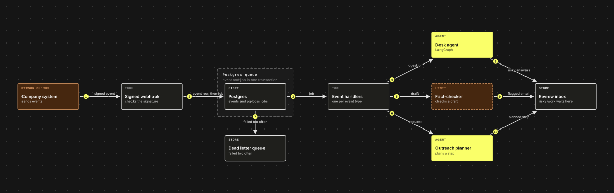
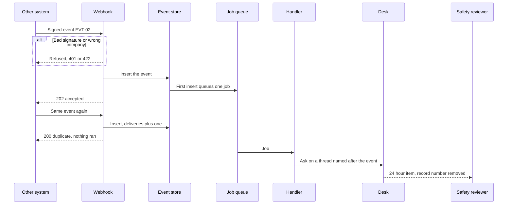
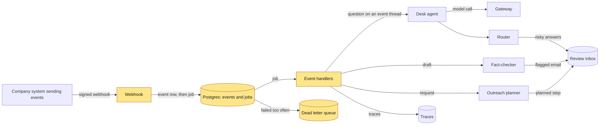
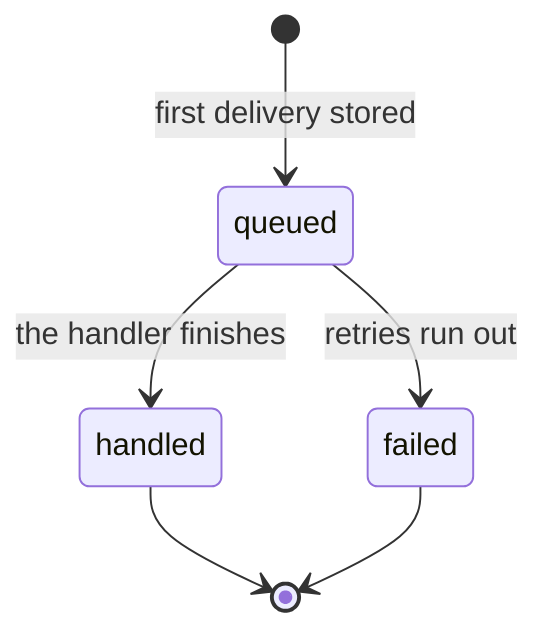

# Start agents from events and handle each one once

## The problem

Until now every run starts with a person typing. The desk does not work that way. Most of its work starts with something that happened somewhere else.

For example, on 1 March 2027 the new CardioNex label lowers the severe renal dose to 2.5mg. Every open answer that cites the old label is now wrong. Nobody will ask the chat about it.

Or an email reaches the medical information inbox. A doctor writes that a patient's lips swelled after the first doses. That is an adverse event. The safety team has 24 hours, whether or not anyone opens a chat.

Each of these arrives as an event from another system. Wire it straight into the agent, and three things go wrong:

- **A sender retries.** If it gets no reply in time, it sends again. Each delivery runs the agent, so safety gets two reports for one patient.
- **Anyone can call a URL.** A webhook that trusts the body lets one company make another's agent act.
- **The work is slow.** A model call takes seconds. The sender gives up and sends again.

## What you build

- **A signed webhook for each company.** It checks the signature and answers at once, before any model runs.
- **An event table and a queue,** in the same database. An event is stored and queued in one transaction.
- **One handler per event type.** Each starts an agent as the company's event worker.
- **An Events page,** at `/events`, for reviewers and reps. It never shows the payload.

| Case | What breaks | How the system holds |
| --- | --- | --- |
| The same event arrives twice | Safety gets two reports for one patient | The second delivery is counted, not run |
| A label comes into force | Open answers cite a label that is old | The handler redrafts them for review |
| A Pharma B event signed by Pharma A | One company acts on another's data | The webhook refuses it before it is stored |
| A handler that keeps failing | The work is lost or loops | It is retried, then moved to the dead letter queue |

## How it works

An event is work nobody asked for in a chat. It needs the same rules a chat has. A signed event says who sent it. The company in the URL must match the company in the body.



Step through it one part at a time in the [live drawing](https://canvas.learnwithparam.com/case.html#buildcamp/18).

A queue delivers at least once. So the store and each handler must be safe to run twice. That is idempotency.

The webhook answers before any model runs, and the queue holds the slow part with retries. The handlers start the same graphs as before. So every event still stops at the review and safety tiers.

### The flow

This follows one adverse event email, sent twice by a retrying sender.



The step people doubt is the second delivery. The insert uses `ON CONFLICT`, so only the first insert queues a job. A worker can also stop after the work and before it marks the job done. So the handler keys its work by the event and reads the same thread again.

### Where it sits

The webhook and the queue are a new way in. They reach the agents from the last four lessons.



### The states

Each stored event has one status.



A duplicate does not add a state. It only adds one to the delivery count.

### Concepts

- [Signed event](../walkthrough.md#c-signed-event)
- [Idempotency](../walkthrough.md#c-idempotency)
- [Job queue](../walkthrough.md#c-job-queue)
- [Dead letter](../walkthrough.md#c-dead-letter)

## Build it

```bash
git checkout checkpoint/16-events
```

The checkpoint adds:

- `src/server/events/events.ts`: the four event types, checked with zod, and the reports a duplicate or a refused event gets.
- `src/server/events/webhook.ts`: `POST /events/:tenant`. It checks the signature, stores the event and answers before any model runs.
- `src/server/events/store.ts`: the event table and the pg-boss queue. The insert and the job are one transaction. So an event is never stored without its job or queued twice.
- `src/server/events/handlers.ts`: one handler per event type. Each starts the desk, the fact-checker or the outreach planner as the company's event worker.
- `src/server/events/send.ts` and `scripts/events-send.ts`: sign and send a fixture event, as the other system would.
- `src/server/migrations/006_events.sql`: the `events` table.
- `src/server/labels.ts`: which label is in force is now worked out for a day. So an event can name the day a label comes into force.
- `src/client/content/Events.tsx`: the Events page, at `/events`, for reviewers and reps.
- `data/hcp/events/`: the fixture events and the adverse event email, and `data/hcp/evals/events.yaml` in the dataset.
- Tests that need no model, in `src/server/events/events.test.ts`.

The packages are:

- `pg-boss`, a job queue on Postgres.
- `standardwebhooks`, which signs and checks webhooks.
- `postal-mime`, which reads an email file.

### Step 1: Give each company a signing secret

```bash
npm install
npm run identity:setup
```

`identity:setup` adds `EVENT_SECRET_PHARMA_A` and `EVENT_SECRET_PHARMA_B` to your `.env` if they are missing. Each is a random `whsec_` secret. The script never prints them. The other system signs every event with its company's secret. The webhook checks it against the company named in the URL.

Then start the app:

```bash
npm run dataset:seed
npm run dev
```

On start the server applies `006_events.sql` and starts the pg-boss workers. pg-boss keeps its jobs in its own `pgboss` schema in the same database. So there is no new container.

### Step 2: Send an event

```bash
npm run events:send -- EVT-01
```

```text
Delivery 1 of EVT-01 as pharma_a: 202 accepted
Open the event inbox (/events) to see what it started.
```

`202 accepted` means the event is stored and queued. Nothing has run yet. The webhook answers in milliseconds, so the sender never waits on a model.

The webhook checks these things, in order:

1. **The company exists.** An unknown company in the URL gets 404.
2. **The signature.** The body, the `webhook-id` and the `webhook-timestamp` are signed with that company's secret. A changed body, another company's secret or a missing signature gets 401. So does a timestamp more than five minutes old.
3. **The shape.** The body must be one of the four event types. Anything else gets 422.
4. **The id.** The `webhook-id` header must equal the event's own id. So a replay cannot slip in under a new id.
5. **The company in the body.** An event signed by Pharma A must be about Pharma A. Otherwise it gets 422 with `INSUFFICIENT_CONTEXT`.

Only then is it stored.

### Step 3: Handle it once, however often it arrives

Send the adverse event email twice, as a sender retrying would:

```bash
npm run events:send -- EVT-02 --times 2
```

```text
Delivery 1 of EVT-02 as pharma_a: 202 accepted
Delivery 2 of EVT-02 as pharma_a: 200 duplicate
  DUPLICATE_EVENT: EVT-02 arrived again (delivery 2). It was taken on its first delivery and is handled once, so nothing ran again [events, EVT-02].
```

Two parts make this hold:

- **The store.** The insert is `INSERT ... ON CONFLICT (tenant_id, event_id) DO UPDATE SET deliveries = deliveries + 1`. Only the first insert queues a job, in the same transaction. The second delivery only counts.
- **The handler.** pg-boss also delivers at least once. A worker can stop after the work and before it marks the job done. So each handler keys its work by the event. The thread an event opens is named after the event. A second run reads that thread's answer instead of asking again.

A job that keeps failing is retried three times with growing waits. After the last retry pg-boss moves it to the `hcp-event-failed` queue. The event is marked failed with a reason. It is not lost.

### Step 4: Open the Events page

Sign in as Maya Chen, the medical reviewer, and open **Event log**.


Each card shows when the event happened, how many times it was delivered, and what it started. EVT-02 says **Delivered 2 times, handled once**. The page never shows the event's payload, only the report. So the patient's email text stays in the safety item where it belongs.

A doctor has no Events link, and `GET /api/events` answers 403 for a doctor. A Pharma B rep sees only Pharma B's events.

### Step 5: Redraft an answer when a label comes into force


EVT-01 says the v3 CardioNex label is in force from 1 March 2027. The handler does four things:

1. It works out which label the new one replaced on that day: `cardionex-uspi-v2`.
2. It finds the open answers that cite it. A-01 to HCP-1001 gives the old severe renal dose.
3. It asks the desk the same question again, **as of 1 March 2027**. The search now marks v2 as superseded and v3 as active. So the new answer gives 2.5mg and cites `[cardionex-uspi-v3, 2.2]`.
4. The new answer is a draft to a doctor, so it goes to the review tier. Maya approves it in her inbox before it is sent.

The label file used to say which version was active. Now `statusOn(section, today)` works it out. An approved label comes into force on its effective date. Older versions are superseded from then. A chat uses today, and an event uses the day it names.


### Step 6: Send an emailed adverse event to safety once

Sign in as Omar Haddad, the safety reviewer.


EVT-02 points at `data/hcp/events/ae-report-evt-02.eml`. The handler reads it with postal-mime. It removes the record number with the PHI scrubber from lesson 13, and asks the desk. The desk routes it to the safety tier: `PV_ESCALATION`, 24 hours, and a human files it.


The item reads "record number removed". Once the event is handled, the stored copy of the email keeps only the scrubbed text. So the record number is not left in the events table either.

### Step 7: Handle a draft upload and a call

- **EVT-03, a German draft uploaded.** The fact-checker checks each sentence against the approved claims for Germany. The US dose sentence is `NOT_APPROVED_IN_COUNTRY`, and the draft waits for a medical reviewer.
- **EVT-04, the call center logs CALL-02.** The doctor wants no more email. The handler asks the outreach planner to plan the next email again, with the call in the record. The planner's opt-out rule holds it with `HOLD_OUTREACH`. A phone call waits for a rep instead. The model does not choose the hold.

### Step 8: Refuse another company's event

```bash
npm run events:send -- EVT-06 --as pharma_a
```

```text
Delivery 1 of EVT-06 as pharma_a: 422
  INSUFFICIENT_CONTEXT: event EVT-06 is not about your company, so it was not taken.
```

EVT-06 is a NeuroVex label event for Pharma B. Signed with Pharma A's secret, it is refused before it is stored. The report names no Pharma B medicine.

### Step 9: Score the events in the dataset run

The event cases run through `scripts/events-runner.ts`. It uses a real webhook on a local port with secrets made for the run. Each case gets a fresh event store in memory and an in-process queue. EVENT-05 delivers EVT-02 twice to the same store and checks the second answer is the duplicate report.

```bash
npm run dataset:run -- --cases EVENT-01,EVENT-02,EVENT-03,EVENT-04,EVENT-05,EVENT-06,STALENESS-01,NEGATIVE-01,INJECTION-01,MULTITURN-01 --chapter 16 --change "Events start agents, handled once"
```

Your row goes to `my-scoreboard.md`. The scoreboard gains an `event` column.

## Prove it

| Case | Why it matters | Before | After |
| --- | --- | --- | --- |
| EVENT-01 | A new label must reach open answers | Waited until someone asked | A redraft of A-01 at 2.5mg, held for review |
| EVENT-02 | An adverse event must reach safety | Waited for a chat | Safety item in 24 hours, no record number |
| EVENT-05 | A retry must not run twice | Not built | The second delivery is a duplicate |
| EVENT-06 | One company must not act for another | Not built | Refused, no Pharma B medicine named |

The tests make no model call:

```bash
npx tsx --test src/server/events/events.test.ts
```

- **Label dates.** A label is in force from its effective date, not from the day it was written.
- **Secrets.** Each company's signing secret comes from its own `EVENT_SECRET` line.
- **One run.** One test runs a job twice. It checks the agent was asked once.
- **The queue.** The pg-boss test runs each first delivery once. An event that keeps failing is moved to the dead letter queue.

Break it on purpose. Change the conflict clause in `store.ts` so each delivery queues a job. The one-run tests fail.

## Stuck points

In a correct run, `npm run events:send -- EVT-01` answers 202, and the event shows **Handled** on the Events page. Sending EVT-02 twice answers 202, then 200 duplicate. Omar's inbox has one adverse event item. It says the record number was removed.

| What you see | Why | What to do |
| --- | --- | --- |
| 401 from the webhook | The secret in `.env` does not match the sender | Run `npm run identity:setup`, then restart the server |
| The event stays `queued` | The workers did not start | Restart `npm run dev` and read its log |
| 422 `INSUFFICIENT_CONTEXT` | The event is about another company | Send it as the company it names |
| A doctor gets 403 on `/api/events` | Only reviewers and reps may read it | Sign in as Maya Chen or Priya Nair |

## What to watch for

- **A sender that retries for hours.** A flood of duplicates costs rows, not model calls. Watch the delivery count on each event.
- **A failed queue nobody reads.** An event that ends in `hcp-event-failed` is work not done. Alert on any event in the failed status.
- **A handler that is not safe to run twice.** The queue can rerun a job after a crash. The handler reads the thread named after the event, so it asks once.
- **A secret in a log.** The setup script never prints a secret. A copy in a log would let anyone sign an event.

## Results

| Chapter | Change | Passed | staleness | off-label | injection | multi-turn | event |
| --- | --- | --- | --- | --- | --- | --- | --- |
| 16 | Events start agents, handled once | 10/10 | 1/1 | 1/1 | 1/1 | 1/1 | 6/6 | <!-- from-row: docs/runs/scoreboard-16.json -->

How to read it:

- **event passes in full.** The label in force redrafts A-01 to 2.5mg for review. The emailed adverse event goes to safety in 24 hours without MRN-77310. The German draft is flagged, and the opt-out holds the email. The second delivery is a duplicate, and Pharma B's event is refused.
- **EVENT-04 failed first.** The handler asked the planner for "the next step". A phone step for a doctor who prefers phone is a fair answer, so nothing was held. The event is about email, so the handler now asks for the next email. The opt-out rule holds it every time.
- **The guard set held.** Staleness still passes on today's date. The new way to work out a label's status did not move which label is in force today.

The full row is in [docs/scoreboard.md](../scoreboard.md).

## Where to go next

- Read `createEventHandler` in `src/server/events/handlers.ts`, then the insert in `src/server/events/store.ts`.
- Try the homework. Add a fifth event type, `sample.shipped`, from the warehouse. Its handler marks the sample request shipped and asks the outreach planner for the follow-up step. Add a case to `events.yaml` and a schema test. Add a test that the same shipment delivered twice plans one follow-up.
- Read the [Standard Webhooks specification](https://www.standardwebhooks.com/), [pg-boss](https://timgit.github.io/pg-boss/), [postal-mime](https://github.com/postalsys/postal-mime) and [Langfuse sessions](https://langfuse.com/docs/observability/features/sessions).
- Lesson 17 starts from this checkpoint. An agent works on a schedule with no event and no person. It stays inside a budget, a scope and an off switch.
