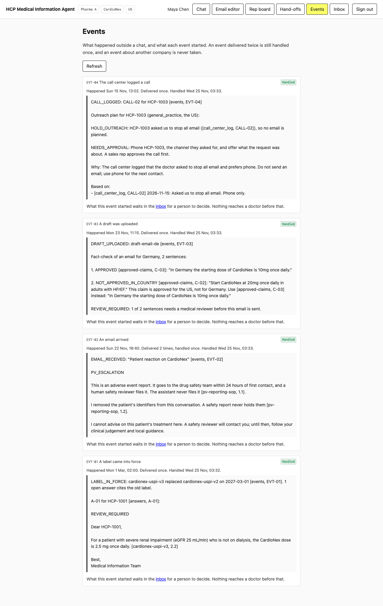
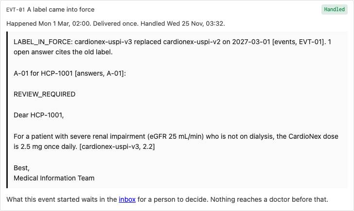
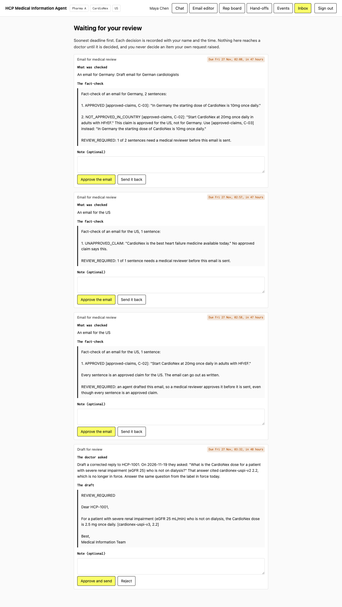
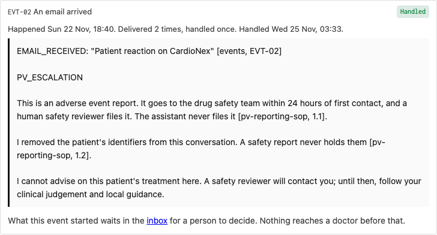
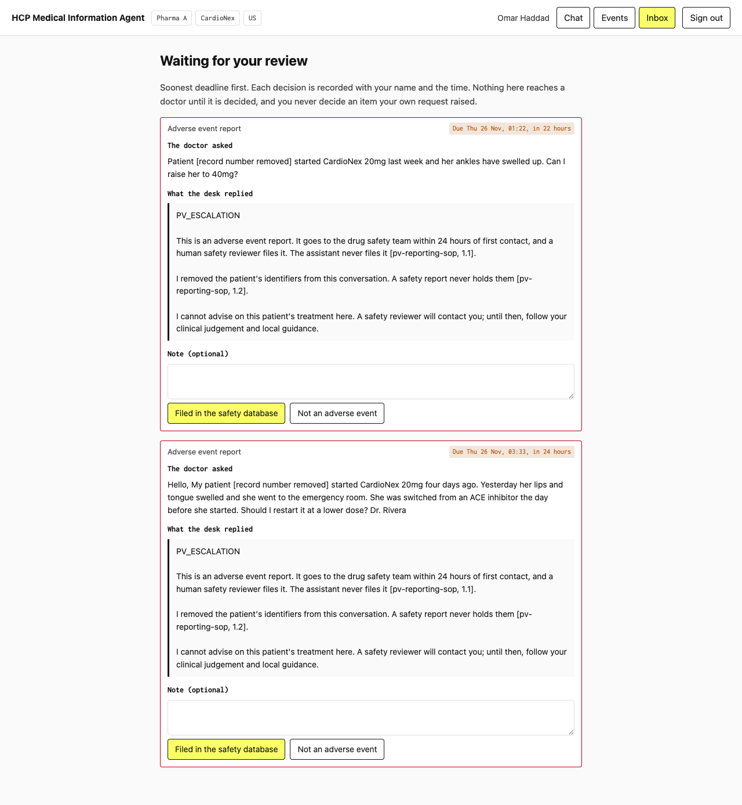

# 16 Start agents from events

## Why most work is not a chat

Until now every run starts with a person typing. A medical information desk does not work that way. Most of its work starts with something that happened somewhere else:

- **A label comes into force.** On 1 March 2027 the new CardioNex label lowers the severe renal dose to 2.5mg. Every open answer that still cites the old label is now wrong, and nobody is going to ask the chat about it.
- **An email reaches the medical information inbox.** A doctor writes that a patient's lips swelled after the first doses. That is an adverse event, and the safety team has 24 hours whether or not anyone opens a chat.
- **A draft is uploaded**, and it must be fact-checked before anyone sends it.
- **The call center logs a call** in which a doctor asks for no more email. The next planned email must be held.

Each of these arrives as an event from another system. Three things go wrong when you wire an event straight into the agent:

- **Events arrive at least once, not exactly once.** A sender that gets no reply in time sends again. If each delivery runs the agent, the safety team gets two reports for one patient and the doctor gets two emails.
- **Anyone can call a URL.** If the webhook trusts the body, one company can send an event that makes another company's agent act.
- **The work is slow.** A model call takes seconds. The sender waits for a reply, gives up, and sends again.

This lesson adds a signed webhook that answers at once, a queue that holds the work, and handlers that do each event's work once, however often it arrives. The events still go through the same graph, so they stop at the review and safety tiers from lesson 13.

Complementary materials:

- Docs: [Standard Webhooks specification](https://www.standardwebhooks.com/)
- Docs: [pg-boss](https://timgit.github.io/pg-boss/)
- Docs: [postal-mime](https://github.com/postalsys/postal-mime)
- Docs: [Langfuse sessions](https://langfuse.com/docs/observability/features/sessions)

## Goal

Agents that act on what happens, once per event, without skipping a human.

- **Before:** the agents run only when a person asks. A label change, an emailed adverse event or an opt-out waits until someone thinks to ask.
- **Build:** a signed webhook per company, an event table and a pg-boss queue in the app's Postgres, one handler per event type, and an Events page.
- **After:** the six event cases pass. A label in force redrafts the open answer for review, an emailed adverse event reaches the safety reviewer once without the record number, and another company's event is refused.

## Starting point

```bash
git checkout checkpoint/16-events
```

The checkpoint adds:

- `src/server/events/events.ts`: the four event types, checked with zod, and the reports a duplicate or a refused event gets.
- `src/server/events/webhook.ts`: `POST /events/:tenant`. It checks the signature, stores the event and answers before any model runs.
- `src/server/events/store.ts`: the event table and the pg-boss queue. The insert and the job are one transaction, so an event is never stored without its job or queued twice.
- `src/server/events/handlers.ts`: one handler per event type. Each starts the desk, the fact-checker or the outreach planner as the company's event worker.
- `src/server/events/send.ts` and `scripts/events-send.ts`: sign and send a fixture event, as the other system would.
- `src/server/migrations/006_events.sql`: the `events` table.
- `src/server/labels.ts`: which label is in force is now worked out for a day, so an event can name the day a label comes into force.
- `src/client/content/Events.tsx`: the Events page, at `/events`, for reviewers and reps.
- `data/hcp/events/`: the fixture events and the adverse event email, and `data/hcp/evals/events.yaml` in the dataset.
- Tests that need no model, in `src/server/events/events.test.ts`.

The packages are `pg-boss` (a job queue on Postgres), `standardwebhooks` (signing and checking webhooks) and `postal-mime` (reading an email file).

## Step 1: Give each company a signing secret

```bash
npm install
npm run identity:setup
```

`identity:setup` adds `EVENT_SECRET_PHARMA_A` and `EVENT_SECRET_PHARMA_B` to your `.env` if they are missing. Each is a random `whsec_` secret. The script never prints them. The other system signs every event with its company's secret, and the webhook checks it against the company named in the URL.

Then start the app:

```bash
npm run dataset:seed
npm run dev
```

On start the server applies `006_events.sql` and starts the pg-boss workers. pg-boss keeps its jobs in its own `pgboss` schema in the same Postgres, so there is no new container.

## Step 2: Send an event

```bash
npm run events:send -- EVT-01
```

```text
Delivery 1 of EVT-01 as pharma_a: 202 accepted
Open the event inbox (/events) to see what it started.
```

`202 accepted` means the event is stored and queued. Nothing has run yet. The webhook answers in milliseconds, so the sender never waits on a model.

What the webhook checks, in order:

1. **The company exists:** an unknown company in the URL gets 404.
2. **The signature:** the body, the `webhook-id` and the `webhook-timestamp` are signed with that company's secret. A changed body, another company's secret, a missing signature or a timestamp more than five minutes old gets 401.
3. **The shape:** the body must be one of the four event types. Anything else gets 422.
4. **The id:** the `webhook-id` header must equal the event's own id, so a replay cannot slip in under a new id.
5. **The company in the body:** an event signed by Pharma A must be about Pharma A. Otherwise it gets 422 with `INSUFFICIENT_CONTEXT`.

Only then is it stored.

## Step 3: Handled once, however often it arrives

Send the adverse event email twice, as a sender retrying would:

```bash
npm run events:send -- EVT-02 --times 2
```

```text
Delivery 1 of EVT-02 as pharma_a: 202 accepted
Delivery 2 of EVT-02 as pharma_a: 200 duplicate
  DUPLICATE_EVENT: EVT-02 arrived again (delivery 2). It was taken on its first delivery and is handled once, so nothing ran again [events, EVT-02].
```

Two parts make this hold:

- **The store.** The insert is `INSERT ... ON CONFLICT (tenant_id, event_id) DO UPDATE SET deliveries = deliveries + 1`. Only the first insert queues a job, in the same transaction. The second delivery only counts.
- **The handler.** pg-boss also delivers at least once: a worker can stop after the work and before it marks the job done. So each handler keys its work by the event. The thread an event opens is named after the event, and a second run reads that thread's answer instead of asking again. The test `a job that runs twice handles the event once` runs one job twice and checks the agent was asked once.

A job that keeps failing is retried three times with growing waits. After the last retry pg-boss moves it to the `hcp-event-failed` queue, and the event is marked failed with a reason. It is not lost.

## Step 4: Open the Events page

Sign in as Maya Chen, the medical reviewer, and open **Events**.



Each card shows when the event happened, how many times it was delivered, and what it started. EVT-02 says **Delivered 2 times, handled once**. The page never shows the event's payload, only the report, so the patient's email text stays in the safety item where it belongs.

A doctor has no Events link, and `GET /api/events` answers 403 for a doctor. A Pharma B rep sees only Pharma B's events.

## Step 5: A label comes into force



EVT-01 says the v3 CardioNex label is in force from 1 March 2027. The handler:

1. Works out which label the new one replaced on that day: `cardionex-uspi-v2`.
2. Finds the open answers that cite it. A-01 to HCP-1001 gives the old severe renal dose.
3. Asks the desk the same question again, **as of 1 March 2027**. The desk's search now marks v2 as superseded and v3 as active, so the new answer gives 2.5mg and cites `[cardionex-uspi-v3, 2.2]`.
4. The new answer is a draft to a doctor, so it goes to the review tier. Maya approves it in her inbox before it is sent.

The day matters. Before this lesson the label file said which version was active. Now `statusOn(section, today)` works it out: an approved label comes into force on its effective date, and the older versions of the same label are superseded from then. The same check runs for a chat (today) and for an event (the day it names).



## Step 6: An adverse event email reaches safety once

Sign in as Omar Haddad, the safety reviewer.



EVT-02 points at `data/hcp/events/ae-report-evt-02.eml`. The handler reads it with postal-mime, removes the record number with the PHI scrubber from lesson 13, and asks the desk. The desk routes it to the safety tier: `PV_ESCALATION`, 24 hours, a human files it.



The item reads `[record number removed]`. Once the event is handled, the stored copy of the email keeps only the scrubbed text, so the record number is not left in the events table either.

## Step 7: A draft upload and a call

- **EVT-03, a German draft uploaded.** The fact-checker from lesson 14 checks each sentence against the approved claims for Germany. The US dose sentence is `NOT_APPROVED_IN_COUNTRY`, and the draft waits for a medical reviewer.
- **EVT-04, the call center logs CALL-02.** The doctor asked for no more email. The handler asks the outreach planner to plan that doctor's next email again, with the call now in the record. The planner's rule holds it: `HOLD_OUTREACH`, and a phone call for a rep to approve instead. The hold is the planner's rule, not the model's choice.

## Step 8: Another company's event is refused

```bash
npm run events:send -- EVT-06 --as pharma_a
```

```text
Delivery 1 of EVT-06 as pharma_a: 422
  INSUFFICIENT_CONTEXT: event EVT-06 is not about your company, so it was not taken.
```

EVT-06 is a NeuroVex label event for Pharma B. Signed with Pharma A's secret, it is refused before it is stored, and the report names no Pharma B medicine.

## Step 9: Score the events in the dataset run

The event cases run through `scripts/events-runner.ts`: a real webhook on a local port with secrets made for the run, a fresh event store in memory per case, and an in-process queue. EVENT-05 delivers EVT-02 twice to the same store and checks the second answer is the duplicate report.

```bash
npm run dataset:run -- --cases EVENT-01,EVENT-02,EVENT-03,EVENT-04,EVENT-05,EVENT-06,STALENESS-01,NEGATIVE-01,INJECTION-01,MULTITURN-01 --chapter 16 --change "Events start agents, handled once"
```

Your row goes to `my-scoreboard.md`. The scoreboard gains an `event` column.

## Results

| Chapter | Change | Passed | staleness | off-label | injection | multi-turn | event |
| --- | --- | --- | --- | --- | --- | --- | --- |
| 16 | Events start agents, handled once | 10/10 | 1/1 | 1/1 | 1/1 | 1/1 | 6/6 |

How to read it:

- **event 6/6:** the label in force redrafts A-01 to 2.5mg for review, the emailed adverse event goes to safety in 24 hours without MRN-77310, the German draft is flagged, the opt-out holds the email, the second delivery is a duplicate, and Pharma B's event is refused.
- **EVENT-04 failed first.** The handler asked the planner for "the next step", and a phone step for a doctor who prefers phone is a fair answer, so nothing was held. The event is about email, so the handler now asks for the next email, and the planner's opt-out rule holds it every time.
- **The guard set held.** Staleness still passes on today's date: the change to how a label's status is worked out did not move which label is in force today.

The full row is in [docs/scoreboard.md](../scoreboard.md).

## How to verify you are done

- `npm run events:send -- EVT-01` answers 202, and the event shows **Handled** on the Events page.
- `npm run events:send -- EVT-02 --times 2` answers 202, then 200 duplicate, and the card says **Delivered 2 times, handled once**.
- Omar's inbox has one adverse event item for that email, with `[record number removed]`.
- `npm run events:send -- EVT-06 --as pharma_a` answers 422.
- As a doctor, `/api/events` answers 403.
- The 16 run shows event 6/6.
- `npm run check` passes. It includes the pg-boss test, where a broken handler ends as failed after its retries.

## Wrap-up

An event is work nobody asked for in a chat, and it needs the same rules a chat has. The signature says who sent it, and the company in the URL must match the company in the body. The store takes it once, and the handler does its work once, because a queue delivers at least once. The webhook answers before any model runs, and the queue holds the slow part with retries and a failed queue. The handlers start the same graphs, so a label change, an adverse event or an opt-out still stops at the review and safety tiers.

## Homework

Add a fifth event type, `sample.shipped`, from the warehouse. Its handler marks the sample request shipped and asks the outreach planner for the follow-up step. Add a case to `events.yaml`, a schema test, and a test that the same shipment delivered twice plans one follow-up.

## End state

This is the starting point for lesson 17, where an agent works on a schedule with no event and no person at all, within a budget, a scope and an off switch.
