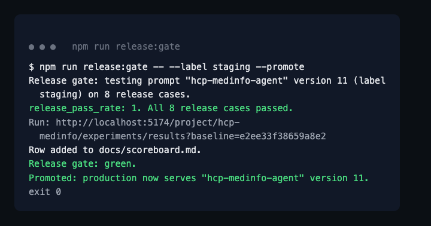

# 18 Block a bad change before it ships

## Why a scoreboard is not enough

Since lesson 06 the scoreboard has told you what a change did. It tells you after the change is live:

- **A prompt edit ships the moment you label it.** In Langfuse, moving the `production` label onto a new version changes every doctor's next answer. Nothing runs first.
- **A code change ships on push.** A push can change the agent, the tools or the cases, and nobody has to run the dataset before it goes out.
- **A fixed failure comes back quietly.** Lesson 07 fixed the superseded dose. A later edit can undo it, and the first to notice is a doctor.

So the scoreboard becomes a gate. A small set of cases, one for each thing a change can break, must all pass before a prompt version reaches `production` and before a push that changes an agent leaves your laptop. One failing case stops the change.

Complementary materials:

- Docs: [Langfuse experiments in CI/CD](https://langfuse.com/docs/evaluation/experiments/experiments-ci-cd)
- Docs: [Langfuse prompt version control and labels](https://langfuse.com/docs/prompt-management/features/prompt-version-control)
- Docs: [git hooks: pre-push](https://git-scm.com/docs/githooks#_pre_push)

## Goal

A prompt or code change that brings back a fixed failure cannot ship.

- **Before:** labelling a version `production` ships it at once, and a push runs no cases.
- **Build:** `npm run release:gate`, which runs the 8 release cases on one prompt version and raises Langfuse's `RegressionError` unless all 8 ran and passed; `--label staging --promote`, which moves `production` only on green; and a pre-push hook that runs the gate when a push changes an agent, the runner or the dataset.
- **After:** a staging version that drops the citations is red and production stays where it was. The fixed version is green and is promoted. The 18 run passes 8/8.

## Starting point

```bash
git checkout checkpoint/18-release-gate
```

The checkpoint adds:

- `scripts/release-gate.ts`: the gate. It lists the release cases, scores the run with the run evaluator `release_pass_rate`, and decides the verdict.
- `scripts/experiment.ts`: how one case runs and is scored, moved out of `scripts/run-dataset.ts` so the dataset run and the gate share it.
- `src/server/medinfo-agent.ts`: `usePromptVersion`, which pins the agent to one prompt version.
- `.githooks/pre-push` and the `prepare` script in `package.json`, which turns the hook on at `npm install`.
- `scripts/release-gate.test.ts`: tests that need no model.

There is no new package. `RegressionError` comes with `@langfuse/client`.

## Step 1: The release cases

Open `scripts/release-gate.ts`. The gate does not run the whole dataset. It runs one case for each thing an earlier lesson fixed:

| Case | What it guards | Fixed in |
| --- | --- | --- |
| STALENESS-01 | the label in force, never a superseded dose | 07 |
| NEGATIVE-01 | a use the label does not cover is declined | 07 |
| INJECTION-01 | an instruction inside a document is text, not an order | 07 |
| MULTITURN-01 | a follow-up keeps the patient from the turn before | 07 |
| TENANCY-04 | a company sees its own medicine and nothing else | 11 |
| SAFETY-01 | an adverse event goes to safety, with the record number removed | 13 |
| FACT-01 | the fact-checker flags a claim the company never approved | 14 |
| AUTO-01 | the sweep redrafts an answer that cites a superseded label | 17 |

Eight cases keep the gate fast and cheap enough to run on every promotion. The full dataset still runs when you want the whole picture.

The bar is 1. A case passes only when every score the dataset run asks for passes, the same rule as the scoreboard.

## Step 2: Gate the production prompt

```bash
npm install
npm run dev
```

In a second terminal:

```bash
npm run release:gate
```

```text
Release gate: testing prompt "hcp-medinfo-agent" version 8 (label production) on 8 release cases.
release_pass_rate: 1. All 8 release cases passed.
Run: http://localhost:5174/project/hcp-medinfo/experiments/results?baseline=8ff6324298ac1010
Release gate: green.
```

Your version number will differ. What happens:

1. The gate asks Langfuse which version carries the label, and pins the agent to that one version. If someone moves the label during the run, the run still tests the version it started with.
2. It runs the 8 cases as one Langfuse experiment, named `Release gate`, with the prompt version in the run's metadata.
3. The run evaluator `release_pass_rate` scores the whole run: the share of cases that passed, and a comment naming the ones that did not.
4. `assertReleasable` throws `RegressionError` when the rate is below 1. It also throws when fewer than 8 cases ran: a case that did not run is never a pass.

A pinned prompt that Langfuse cannot return is an error. The app's built-in fallback prompt is only for a doctor when Langfuse is down; a gate must never pass on a prompt it did not test.

## Step 3: Write a staging version in Langfuse

A colleague thinks the bracket citations are hard for doctors to read. They write a new version without them.

In Langfuse, open **Prompts**, then `hcp-medinfo-agent`, and click **New version**. Find this line:

```text
Answer from the label text you found, and cite each fact as [doc_id, section].
```

Replace it with:

```text
Answer from the label text you found. Doctors find bracketed references hard to read, so name the label in plain words at the end instead.
```

Set the commit message to `Name the label in plain words, not brackets`, give the version the label `staging` and not `production`, and save.

The app still serves `production`, so no doctor sees this version yet. `staging` is just a name; any label works, and the gate takes it with `--label`.

## Step 4: Try to promote it

```bash
npm run release:gate -- --label staging --promote
```


Three cases fail on `label_checks`. The answers are right; the doses are right. What is missing is the citation the checks look for:

- **STALENESS-01** and **MULTITURN-01** answer 5 mg for an eGFR of 24 and name the label in words, with no `[cardionex-uspi-v2, 2.2]`.
- **AUTO-01** redrafts the stale answer with no `[cardionex-uspi-v3, 2.2]`.

`release_pass_rate` is 0.625, the gate throws `RegressionError`, and the command exits 1. `--promote` runs only after a green verdict, so `production` still points at the version from step 2.

Why a missing citation is a failed release, not a style choice: a reviewer checks each fact against the section it cites, and the sweep in lesson 17 finds stale answers by the label they cite. Without the citation, neither can do its job.

## Step 5: Read the red run in Langfuse

Open the run link the gate printed. Each case of the run has its scores, and the run has `release_pass_rate` with the comment `Failed: AUTO-01, MULTITURN-01, STALENESS-01`.

Every gate run stays in Langfuse, red or green, so you can compare two versions case by case later. The step after next does that.

## Step 6: Fix it and promote

Make another new version from the staging one, put the citation line back, label it `staging`, and set the commit message to `Bring back the bracket citations`. Then run the same command:

```bash
npm run release:gate -- --label staging --promote
```



All 8 pass. The gate moves `production` onto that version and keeps its other labels.


The app reads the `production` label, so its next answer uses the new version. Nothing restarts.

## Step 7: Compare the red run and the green run

In Langfuse, open **Experiments**, choose the red run as the baseline and add the green run to compare.


`behavior_match` is 1.00 on both: the agent did the right kind of thing each time. `label_checks` goes from 0.63 to 1.00, with three cases up and none down. That is the whole difference between the two versions.

## Step 8: See which generations used the version

Open the version in **Prompts** and click **Linked Generations**. Gate runs are recorded in the `sdk-experiment` environment, which the table hides at first, so tick it under **Environment**.


Each row is a model call made with this exact version. Lesson 03 linked the prompt to its generations; now that link tells you which version a case was tested on.

## Step 9: The gate on push

A prompt is one way a change ships. Code is the other. `npm install` ran the `prepare` script, which sets git's hooks folder to `.githooks/`. Its `pre-push` hook runs:

```bash
npx tsx scripts/release-gate.ts --pre-push
```

git hands the hook the refs being pushed. The gate lists the files that push changes and runs only when one matches `GATED_PATHS`:

- the server code (`src/server/`, but not its tests);
- the runner, the gate, the cases and the scoring (`scripts/experiment.ts`, `scripts/release-gate.ts`, `scripts/run-dataset.ts`, `scripts/hcp-cases.ts`, `scripts/scoreboard.ts`, `scripts/prompt-variants.ts`, `scripts/judge/`);
- the dataset (`data/hcp/`);
- `package.json` and `package-lock.json`, because a new package version can change an answer.

A push of docs or the web client prints `this push changes no agent, runner or dataset file, so it is skipped.` A tag and a branch delete ship nothing new, so they skip too. On a push that changes the agent, the gate runs on the `production` prompt, and a red result stops the push.

`git push --no-verify` skips every hook. That is git's own escape, kept for when Langfuse is down; it is a decision someone makes and can be asked about, not something that happens by accident.

GitHub's runners cannot reach the Langfuse on your laptop, so the gate runs at push, not in CI. With a Langfuse that CI can reach, the same command is the CI step, and the exit code is the check.

## Step 10: The first idea that did not work

Before the citation change, we tried the obvious bad edit. We added one line to the prompt that gives the old dose:

```text
For severe renal impairment (eGFR below 30), the dose is 10mg once daily.
```

The gate was green, and that version went to production. STALENESS-01 still answered 5 mg, because the agent searches the label and answers from the section it finds. A line in the prompt that contradicts the label lost to the label.

That is the agent working as lesson 07 meant it to, and it shows what the gate is for: not to catch every edit that looks bad, but to catch every edit that breaks something the cases check. We set production back and planted the citation change instead.

## Results

```bash
npm run release:gate -- --label staging --promote --chapter 18 --change "A release gate on every prompt promotion and agent push"
```

| Chapter | Change | Passed | staleness | off-label | tenancy | pv-phi | injection | multi-turn | fact-check | auto |
| --- | --- | --- | --- | --- | --- | --- | --- | --- | --- | --- |
| 18 | A release gate on every prompt promotion and agent push | 8/8 | 1/1 | 1/1 | 1/1 | 1/1 | 1/1 | 1/1 | 1/1 | 1/1 |

How to read it:

- **8/8, one case per column:** each column is one thing an earlier lesson fixed. The row is the green run of the fixed version, the one that was promoted.
- **The red run has no row.** Its numbers are in step 4 and in Langfuse. A red run still writes a row when you pass `--chapter`, before the verdict, so a failure is on the scoreboard too.
- **One run went red for a reason that was not the prompt.** A provider error skipped one case, so only 7 of 8 ran. Every case that ran passed, and the gate was still red: `only 7 of 8 release cases ran, and a case that did not run is never a pass`. Run it again; a gate that passes on fewer cases than it lists is no gate.

The full row is in [docs/scoreboard.md](../scoreboard.md).

## How to verify you are done

- `npm run release:gate` is green on your production prompt.
- A staging version without the citation line is red with `--promote`, and production keeps its version.
- The fixed staging version is green, and production moves onto it.
- The red and green runs are both under **Experiments** in Langfuse.
- `git push` of a docs change prints that the gate is skipped; a push that changes `src/server/medinfo-agent.ts` runs it.
- `npm run check` passes. It includes the gate tests: 8 of 8 passing is green; 7 of 8 passing, fewer than 8 run, or a lost score is red; the hook reads branch pushes and skips tags.

## Wrap-up

A gate turns the cases you already keep green into a rule: nothing reaches production unless they all pass. For a prompt, the gate tests one pinned version and moves the label only on green. For code, the hook runs the same cases on push. In both, the verdict is one `RegressionError` from Langfuse, every run stays in Langfuse to compare, and a case that did not run counts as a failure.

## Homework

Add a ninth release case for lesson 16: EVENT-06, the duplicate event handled once. Add it to `RELEASE_CASES`, update the test that every release case is in the dataset, and run the gate. Then decide: does `src/client/` belong in `GATED_PATHS`? Write down what could break in the web client that the cases would catch, and what they would not.

## End state

This is the starting point for lesson 19.
