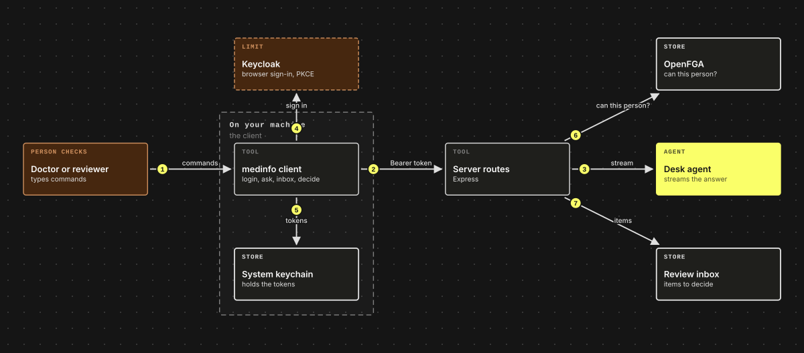
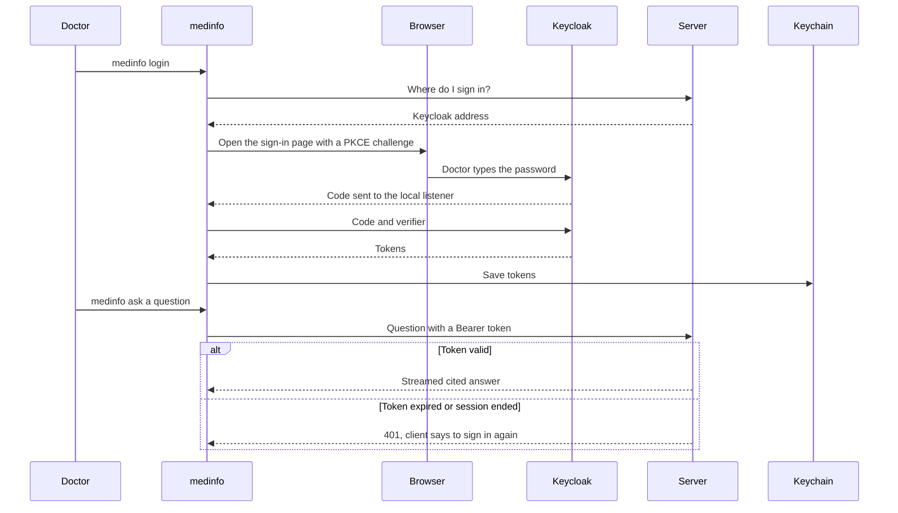
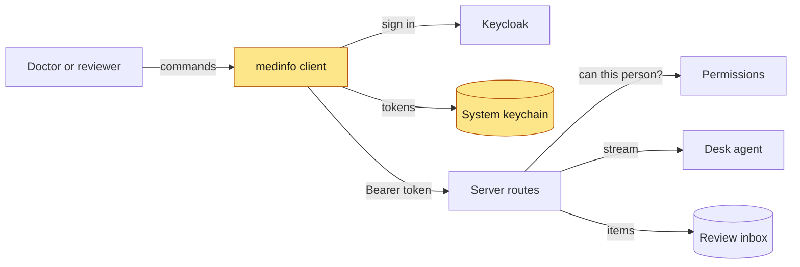
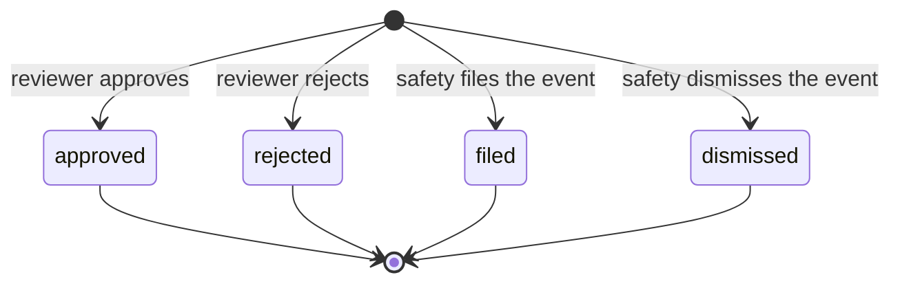
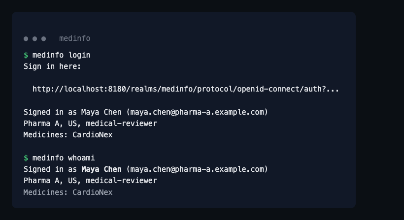
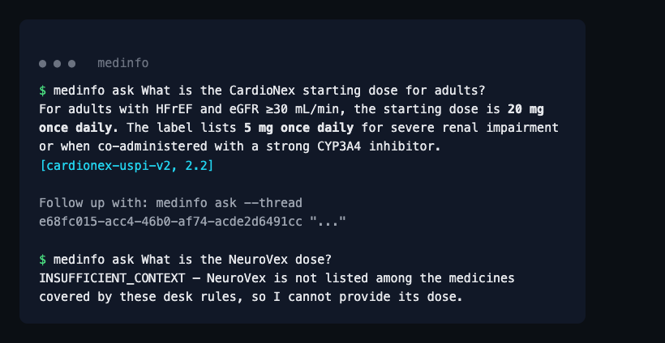
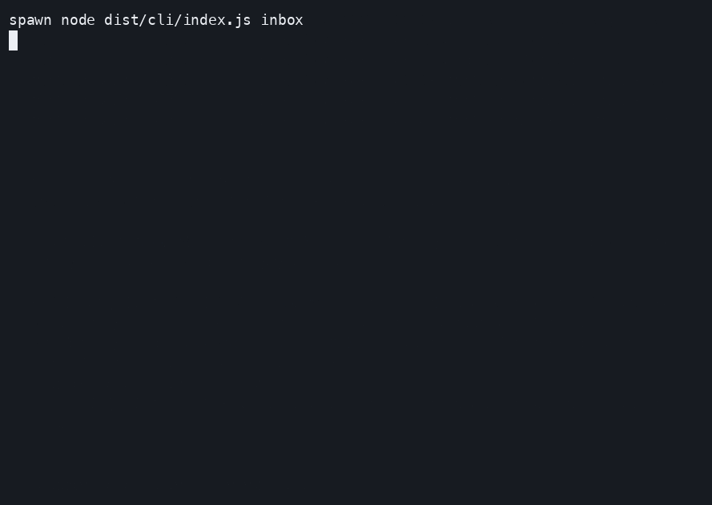

# Ask and review from the terminal with the same permissions

## The problem

Every lesson so far reached the agent through the web app. Many people who use a medical information desk live somewhere else:

- **A reviewer works through a queue.** Clicking each item in a browser is slow. The job is read, approve, next.
- **A script needs answers too.** A nightly job cannot click a sign-in page.
- **A second client tests the first.** Say the terminal can do more than the web app. Then a rule lives only in the web page, and that is a hole.

A script that needs a password is a leak waiting to happen. So is a token copied by hand from the browser. This lesson adds a terminal client that signs in the safe way. The server does not learn that a terminal client exists. It sees one more client with a token.

## What you build

- **A client named `medinfo`.** It has the commands `login`, `whoami`, `ask`, `inbox`, `decide` and `logout`.
- **A browser sign-in.** The client uses PKCE, so it never asks for a password.
- **A safe token store.** The tokens go to the system keychain, not to a file.
- **The same API.** Every command sends a Bearer token to the existing routes.

| Case | What breaks | How the system holds |
| --- | --- | --- |
| A script needs to sign in | A password or a copied token leaks | The browser signs in and the keychain holds the token |
| A doctor tries to approve | The terminal grants a power the web does not | The server refuses, as it does for the browser |
| A reviewer's text has a control code | A line hides or the screen clears | The client removes control characters |
| The session ends | The client keeps a dead token | The client drops it and says to sign in again |

## How it works

The terminal client adds no rule. Sign-in is Keycloak's page with PKCE. The token is the same kind the browser gets. Every permission is decided by the server and OpenFGA.



Step through it one part at a time in the [live drawing](https://canvas.learnwithparam.com/case.html#buildcamp/21).

### The flow

This follows one sign-in and one question.



The step people doubt is the password. It goes into Keycloak's page in the browser, never into the terminal.

### Where it sits

The client is one more caller of the existing routes.



### The states

A reviewer's decision on an inbox item has four outcomes.



A decided item takes no more decisions. So the keys go away once it is decided.

### Concepts

- [Browser sign-in](../walkthrough.md#c-browser-sign-in)
- [Keychain](../walkthrough.md#c-keychain)
- [Stream](../walkthrough.md#c-stream)

## Build it

```bash
git checkout checkpoint/19-cli
npm install
npm run identity:setup
npm run dev
```

`identity:setup` is safe to run again. This time it also creates the Keycloak client `medinfo-cli`.

The checkpoint adds:

- `src/cli/`: the client. `index.tsx` has the commands, and `session.ts` has the sign-in and tokens.
- `src/cli/api.ts`, `turn.ts` and `ui.tsx`: the server calls, one question on screen, and the screens.
- `src/shared/sse.ts`: the stream reader. It moved out of the web client, so both clients read the stream with one piece of code.
- `src/server/auth.ts`: one new public route, `GET /.well-known/oauth-protected-resource/api`. It tells a program where to sign in.
- `scripts/identity-setup.ts`: the `medinfo-cli` client in Keycloak.
- `src/cli/cli.test.ts` and a new test in `src/server/inbox.test.ts`.

Four packages, each well maintained and widely used:

| Package | What it does here |
| --- | --- |
| `commander` | the commands, options and `--help` |
| `ink` | the screens, written as React components |
| `@napi-rs/keyring` | the system keychain on macOS, Windows and Linux |
| `open` | opens the sign-in page in the default browser |

Two new scripts in `package.json`:

```json
"medinfo": "tsx src/cli/index.tsx",
"build:cli": "tsup src/cli/index.tsx --format esm --out-dir dist/cli --clean"
```

`npm run medinfo -- <command>` runs the client from source. `npm run build:cli` writes `dist/cli/index.js`, and `npm run build` runs it too. The `bin` field in `package.json` names it `medinfo`. So `npm link` puts `medinfo` on your path. The rest of this page writes `medinfo`.

### Step 1: Find where to sign in

The app sends a browser to Keycloak. A terminal program has to find Keycloak by itself, and the address should not be written into it. The app tells it:

```bash
curl -s http://127.0.0.1:3333/.well-known/oauth-protected-resource/api
```

```json
{
  "resource": "http://127.0.0.1:3333/api",
  "authorization_servers": ["http://localhost:8180/realms/medinfo"],
  "bearer_methods_supported": ["header"],
  "resource_name": "HCP Medical Information"
}
```

This is RFC 9728, the same document an MCP client reads in lesson 12. It is public because it holds no secret. It holds only the address of the sign-in server. The test in `src/server/auth.test.ts` checks that it names our Keycloak. The route test checks that every other route still needs a token.

### Step 2: Sign in through the browser

```bash
medinfo login
```



The client never asks for a password. It does what RFC 8252 says a native app should:

1. **It reads the document from step 1.** Then it reads Keycloak's own discovery document.
2. **It makes a PKCE pair and a random `state`.** The challenge goes to Keycloak. The verifier stays in memory.
3. **It starts a listener on `127.0.0.1:33419`.** The listener answers only `/callback` for this `state`. It stops when the sign-in ends or a short time passes. A request with another `state` gets 400, and the wait goes on.
4. **It opens Keycloak's page in your browser.** You type the password into Keycloak. Use `--no-browser` to print the address instead, for a machine with no browser.
5. **Keycloak sends the browser back with a code.** The client swaps the code and the verifier for tokens. A stolen code is useless without the verifier.

Sign in as Ana Rivera with `SEED_USER_PASSWORD` from your `.env`, as in lesson 11.

The `medinfo-cli` client is public in Keycloak. It has no secret, because a program on a laptop cannot keep one. PKCE is what makes that safe. Look at it in the Keycloak admin under **Clients**. The only redirect allowed is `http://127.0.0.1:33419/callback`, and PKCE method `S256` is required.

### Step 3: See where the tokens live

The tokens go to the system keychain. That is Keychain on macOS, Credential Manager on Windows and the Secret Service on Linux. No token file sits in your home folder for another program to read.

Each command reads the access token. If it has 30 seconds or more left, it is sent as it is. Otherwise the client asks Keycloak for a new one with the refresh token. Three things can happen, and `src/cli/cli.test.ts` checks each:

- **Keycloak gives a new token.** It is saved, and the command goes on.
- **Keycloak says the session is over.** You signed out somewhere else, or an admin ended it. The client forgets the tokens and says to run `medinfo login`.
- **Keycloak cannot be reached.** The client keeps the tokens and says so. A network blip must not sign you out.

```bash
medinfo whoami
```

`whoami` calls `/api/me` with the token. The company, country and roles come from the server, read from the token as in lesson 11. The client decides nothing about who you are.

### Step 4: Ask a question

```bash
medinfo ask "What is the CardioNex starting dose for adults?"
medinfo ask "What is the NeuroVex dose?"
```



Put the question in quotes. zsh and bash treat a bare question mark as a file pattern. So an unquoted question can fail before the client even starts.

The answer streams in, with the citations in colour. A doctor sees where each fact comes from. Ana works for Pharma A, so the NeuroVex question gets INSUFFICIENT_CONTEXT. The search never returns Pharma B's label, as in lesson 11. The server does that, not the client.

The client reads the same stream as the chat page. `src/shared/sse.ts` turns the response into events, and both clients use it. `src/cli/turn.ts` turns the events into what the terminal shows:

- While the agent calls a tool, a line such as "Searching the labels".
- While it writes, the text so far.
- When the graph pauses for a reviewer, the inbox item.
- At the end, the answer from the finished thread.

It is a plain function of the events. So its test replays recorded events with no server and no model.

The last line gives the thread. `medinfo ask --thread <id>` with a question in quotes asks a follow-up in the same conversation.

### Step 5: Leave a draft waiting for the reviewer

```bash
medinfo ask "Draft a reply to Dr. Ito about the CardioNex starting dose for a patient with eGFR 25."
```


The router from lesson 13 sends a draft for a doctor to review. The terminal shows who it waits for, the inbox item and the deadline. It does not show the draft. Text on a terminal is easy to copy into an email. An unchecked draft should not leave before a reviewer has read it.

Ask on that thread again. The server refuses, because the conversation waits for a reviewer. The client prints that message as it is.

### Step 6: Review from the terminal

Sign out, then sign in as the reviewer:

```bash
medinfo logout
medinfo login
```

`logout` asks Keycloak to end the session, then deletes the keychain entry. If Keycloak cannot be reached, the entry still goes. The client tells you the session may live until it expires. Sign in as Maya Chen.

```bash
medinfo inbox
```



Up and down choose an item. The box below shows the question and the draft. The keys at the bottom come from the item:

| Item | Keys |
| --- | --- |
| Draft answer, email, outreach step | `a` approve, `r` reject |
| Adverse event | `f` file, `d` dismiss |

The question in the box was written by another doctor, and the draft by a model. A terminal obeys control characters. So text with an escape sequence could clear Maya's screen, hide a line, or set her clipboard. `src/cli/api.ts` removes control characters from everything the server returns, once, before any screen sees it. New lines and tabs stay.

Maya presses `a`. The client calls the lesson 13 decision route, and the row turns to approved. The keys go away, because a decided item takes no more decisions. In Langfuse, the decision is a score on the trace. Maya is the approver, as if she had clicked in the browser.

For a script, the same decision is one command:

```bash
medinfo decide <item id> approve --note "Checked against 2.2"
```

### Step 7: Check that the terminal has no extra powers

Sign in as Ana again and try to approve the item:

```bash
medinfo decide <item id> approve
```

```text
You cannot decide this item.
```

The exit code is 1. The inbox screen shows Ana no decision keys, but that is only manners. The refusal is the server. The decision route asks OpenFGA if Ana may decide that item. It does the same for the browser.

### Step 8: Use it in scripts

Every command that prints something has a plain form:

```bash
medinfo whoami --json
medinfo ask --json "What is the CardioNex starting dose for adults?"
medinfo inbox --json | jq '.items[] | select(.status == "waiting") | .id'
```

Away from a terminal, `ask` and `inbox` print plain text with no colours or keys. A pipe, a file and CI all count. Errors go to stderr with exit code 1, so a script can stop on them. An error the client did not expect prints one generic line. Set `MEDINFO_DEBUG=1` to see the details.

`medinfo --url https://medinfo.example.com` or `MEDINFO_URL` points the client at another desk. Each address gets its own keychain entry. So signing in to one does not sign you out of another.

## Prove it

This lesson has no dataset run. The client changes no answer, because it reaches the same agent through the same routes. So the 18 row stands. The proof is in tests that need no model:

```bash
npx tsx --test src/cli/cli.test.ts src/server/auth.test.ts src/server/inbox.test.ts
```

| Test | What it proves |
| --- | --- |
| `src/cli/cli.test.ts` | The screen follows the stream, and a waiting draft never shows its text. A doctor who is not a reviewer gets no keys. The listener refuses a wrong `state`. A token is used, renewed or dropped in the three cases of step 3. Control characters never reach the screen. |
| `src/server/auth.test.ts` | The metadata route names our Keycloak, and every other route still needs a token. |
| `src/server/inbox.test.ts` | With real tokens, the client sees one company's items. A doctor cannot decide, and a waiting thread takes no new question. |

Break it on purpose. Let the decision route skip the OpenFGA check. The test that refuses Ana's decision fails.

## Stuck points

In a correct run, `medinfo login` opens Keycloak in the browser. `medinfo whoami` shows the doctor you signed in as. `medinfo ask` gives a cited answer for your company's medicine and INSUFFICIENT_CONTEXT for the other company's.

| What you see | Why | What to do |
| --- | --- | --- |
| The browser does not open | A machine with no browser | Run `medinfo login --no-browser` and open the address yourself |
| Your sign-in has ended | The session ended in Keycloak | Run `medinfo login` again |
| You are not signed in | You ran `logout` | Run `medinfo login` |
| An unquoted question fails | The shell reads the question mark | Put the question in quotes |
| Ana sees no keys in the inbox | She is not a reviewer | Sign in as Maya Chen |

## What to watch for

- **A password in the terminal.** The client must never ask for one. Sign-in happens in the browser.
- **A token in a file.** Tokens live in the keychain only.
- **Untrusted text on the screen.** Strip control characters from everything the server returns.
- **A rule that lives only in the client.** Hiding a key is manners. The server must refuse the call too.

## Results

No row is added in this lesson. The client changes no answer, so the 18 row stands. The tests above are the proof.

## Where to go next

- Try the homework. Add `medinfo ask --file questions.txt`, which asks each line as its own question and prints one JSON line per answer.
- Decide if it should stop at the first error, or go on and report errors at the end. Write down which suits a nightly job, and why.
- Read [OAuth 2.0 for native apps](https://www.rfc-editor.org/rfc/rfc8252), [OAuth protected resource metadata](https://www.rfc-editor.org/rfc/rfc9728), [Ink](https://github.com/vadimdemedes/ink) and [openid-client](https://github.com/panva/openid-client).
- Lesson 20 starts from this checkpoint.
