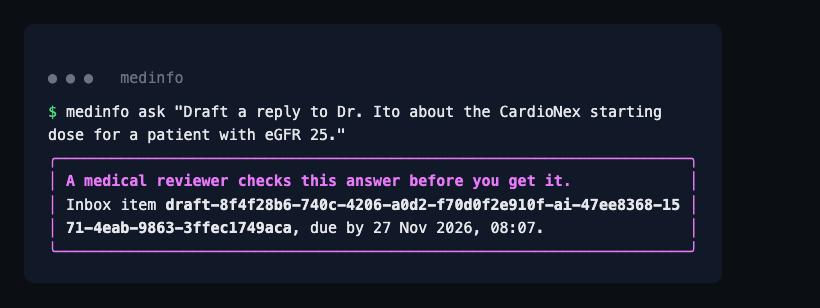

# 19 Ask and review from the terminal

## Why a second client

Every lesson so far reached the agent through the web app. Many of the people who use a medical information desk live somewhere else:

- **A reviewer works through a queue.** Opening a browser, finding the inbox and clicking each item is slow when the job is "read, approve, next".
- **A script needs answers too.** A nightly job that checks a list of questions, or a teammate's own tool, cannot click a sign-in page.
- **A second client tests the first.** If the terminal can do everything the web app can, through the same API, then the rules really live in the server. If it can do more, a rule lives only in the web page, and that is a hole.

So this lesson adds `medinfo`, a terminal client. It signs in through the same Keycloak, sends the same token, reads the same stream and hits the same inbox routes. The server does not learn that a CLI exists. It sees one more client with a token.

Complementary materials:

- Docs: [OAuth 2.0 for native apps (RFC 8252)](https://www.rfc-editor.org/rfc/rfc8252)
- Docs: [OAuth protected resource metadata (RFC 9728)](https://www.rfc-editor.org/rfc/rfc9728)
- Docs: [Ink, React for the terminal](https://github.com/vadimdemedes/ink)
- Docs: [openid-client](https://github.com/panva/openid-client)

## Goal

A doctor and a reviewer do their whole job from the terminal, with the permissions they have in the browser and no more.

- **Before:** the only way in is the web app. A script would need a password, or a token copied by hand out of the browser.
- **Build:** `medinfo login`, `whoami`, `ask`, `inbox`, `decide` and `logout`. Sign-in goes through Keycloak in the browser with PKCE, the tokens go to the system keychain, and every command sends a Bearer token to the existing API.
- **After:** Ana Rivera gets a cited answer in the terminal, a draft for a doctor waits for review, and Maya Chen approves it from a terminal inbox. Ana cannot approve it: the server says no, exactly as it does in the browser.

## Starting point

```bash
git checkout checkpoint/19-cli
npm install
npm run identity:setup
npm run dev
```

`identity:setup` is safe to run again. This time it also creates the Keycloak client `medinfo-cli`.

The checkpoint adds:

- `src/cli/`: the client. `index.tsx` holds the commands, `session.ts` the sign-in and the tokens, `api.ts` the calls to the server, `turn.ts` what one question looks like on screen, and `ui.tsx` the screens.
- `src/shared/sse.ts`: the stream reader, moved out of the web client so both clients read the stream with one piece of code.
- `src/server/auth.ts`: one new public route, `GET /.well-known/oauth-protected-resource/api`, that tells a program where to sign in.
- `scripts/identity-setup.ts`: the `medinfo-cli` client in Keycloak.
- `src/cli/cli.test.ts` and a new test in `src/server/inbox.test.ts`.

Four packages, each well maintained and widely used:

| Package | What it does here |
| --- | --- |
| `commander` | the commands, options and `--help` |
| `ink` | the screens, written as React components |
| `@napi-rs/keyring` | the system keychain on macOS, Windows and Linux |
| `open` | opens the sign-in page in the default browser |

Two new scripts in `package.json`:

```json
"medinfo": "tsx src/cli/index.tsx",
"build:cli": "tsup src/cli/index.tsx --format esm --out-dir dist/cli --clean"
```

`npm run medinfo -- <command>` runs the client from source. `npm run build:cli`, which `npm run build` also runs, writes `dist/cli/index.js`. The `bin` field in `package.json` names it `medinfo`, so `npm link` puts `medinfo` on your path. The rest of this page writes `medinfo`.

## Step 1: How a program finds where to sign in

A browser gets sent to Keycloak by the app. A terminal program has to find Keycloak by itself, and it should not have the address written into it. The app tells it:

```bash
curl -s http://127.0.0.1:3333/.well-known/oauth-protected-resource/api
```

```json
{
  "resource": "http://127.0.0.1:3333/api",
  "authorization_servers": ["http://localhost:8180/realms/medinfo"],
  "bearer_methods_supported": ["header"],
  "resource_name": "HCP Medical Information"
}
```

This is RFC 9728, the same document an MCP client reads in lesson 12. It is public, because it holds no secret: only the address of the sign-in server. The test in `src/server/auth.test.ts` checks it names our Keycloak, and the route test checks that every other route still needs a token.

## Step 2: Sign in through the browser, not the terminal

```bash
medinfo login
```


The CLI never asks for a password. It does what RFC 8252 says a native app should:

1. **It reads the document from step 1,** then Keycloak's own discovery document.
2. **It makes a PKCE pair and a random `state`.** The challenge goes to Keycloak; the verifier stays in memory.
3. **It starts a listener on `127.0.0.1:33419`** that answers only `/callback`, only for this `state`, and only until the sign-in ends or 5 minutes pass. A request with another `state` gets 400 and the wait goes on.
4. **It opens Keycloak's page in your browser.** You type the password into Keycloak, never into the terminal. Use `--no-browser` to print the address instead, for a machine with no browser.
5. **Keycloak sends the browser back to the listener with a code.** The CLI swaps the code and the verifier for tokens. A stolen code is useless without the verifier.

Sign in as Ana Rivera with `SEED_USER_PASSWORD` from your `.env`, as in lesson 11.

`medinfo-cli` is a public client in Keycloak: it has no secret, because a program on a laptop cannot keep one. PKCE is what makes that safe. Look at it in the Keycloak admin under **Clients**: the only redirect allowed is `http://127.0.0.1:33419/callback`, and PKCE method `S256` is required.

## Step 3: Where the tokens live

The tokens go to the system keychain: Keychain on macOS, Credential Manager on Windows, the Secret Service on Linux. There is no token file in your home folder for another program to read.

Each command reads the access token. If it has 30 seconds or more left, it is sent as it is. Otherwise the CLI asks Keycloak for a new one with the refresh token. Three things can happen, and `src/cli/cli.test.ts` checks each:

- **Keycloak gives a new token.** It is saved, and the command goes on.
- **Keycloak says the session is over** (`invalid_grant`: you signed out somewhere else, or an admin ended it). The CLI forgets the tokens and says `Your sign-in has ended. Run: medinfo login`.
- **Keycloak cannot be reached.** The CLI keeps the tokens and says so. A network blip must not sign you out.

```bash
medinfo whoami
```

`whoami` calls `/api/me` with the token. The company, country and roles come from the server, read from the token as in lesson 11. The CLI decides nothing about who you are.

## Step 4: Ask a question

```bash
medinfo ask "What is the CardioNex starting dose for adults?"
medinfo ask "What is the NeuroVex dose?"
```


Put the question in quotes. zsh and bash treat a bare `?` as a file pattern, so `medinfo ask What is the dose?` can fail before the CLI even starts.

The answer streams in, with the citations in colour so a doctor sees at a glance where each fact comes from. Ana works for Pharma A, so the NeuroVex question gets INSUFFICIENT_CONTEXT: the search never returns Pharma B's label, as in lesson 11. Nothing in the CLI does that; the server does.

The CLI reads the same stream as the chat page. `src/shared/sse.ts` turns the response into events, and both clients use it. `src/cli/turn.ts` turns the events into what the terminal shows:

- while the agent calls a tool, a line such as "Searching the labels";
- while it writes, the text so far;
- when the graph pauses for a reviewer, the inbox item;
- at the end, the answer from the finished thread.

It is a plain function of the events, so its test replays recorded events with no server and no model.

The last line gives the thread. `medinfo ask --thread <id> "..."` asks a follow-up in the same conversation, as the next message in the chat page does.

## Step 5: A draft waits for the reviewer

```bash
medinfo ask "Draft a reply to Dr. Ito about the CardioNex starting dose for a patient with eGFR 25."
```



The router from lesson 13 sends a draft for a doctor to review. The terminal shows who it waits for, the inbox item and the deadline. It does not show the draft: in a terminal, text on screen is easy to copy into an email, and an unchecked draft should not leave before a reviewer has read it.

Ask on that thread again and the server refuses with `This conversation waits for a reviewer`, which the CLI prints as it is.

## Step 6: Review from the terminal

Sign out, and sign in as the reviewer:

```bash
medinfo logout
medinfo login
```

`logout` asks Keycloak to end the session, then deletes the keychain entry. If Keycloak cannot be reached, the entry still goes, and the CLI tells you the session may live until it expires. Sign in as Maya Chen.

```bash
medinfo inbox
```


Up and down choose an item, and the box below shows the question and the draft. The keys at the bottom come from the item:

| Item | Keys |
| --- | --- |
| Draft answer, email, outreach step | `a` approve, `r` reject |
| Adverse event | `f` file, `d` dismiss |

The question in the box was written by another doctor, and the draft by a model. A terminal obeys control characters, so text with an escape sequence in it could clear Maya's screen, hide a line, or set her clipboard. `src/cli/api.ts` removes control characters from everything the server returns, once, before any screen sees it; new lines and tabs stay.

Maya presses `a`. The CLI calls the lesson 13 decision route, the row turns to approved, and the keys go away, because a decided item takes no more decisions. Back in Langfuse, the decision is a score on the trace with Maya as the approver, exactly as if she had clicked in the browser.

For a script, the same decision is one command:

```bash
medinfo decide <item id> approve --note "Checked against 2.2"
```

## Step 7: The terminal has no extra powers

Sign in as Ana again and try to approve the item:

```bash
medinfo decide <item id> approve
```

```text
You cannot decide this item.
```

Exit code 1. The inbox screen shows Ana no decision keys, but that is only manners. The refusal is the server: the decision route asks OpenFGA whether Ana is a reviewer for that item, as it does for the browser. The test in `src/server/inbox.test.ts` runs the CLI's own API code with real Keycloak tokens: Maya sees only her company's items, Ana's decision is refused with that message, and a question on a waiting thread is refused.

## Step 8: For scripts

Every command that prints something has a plain form:

```bash
medinfo whoami --json
medinfo ask --json "What is the CardioNex starting dose for adults?"
medinfo inbox --json | jq '.items[] | select(.status == "waiting") | .id'
```

When the output is not a terminal (a pipe, a file, CI), `ask` and `inbox` print plain text with no colours and no keys to press. Errors go to stderr with exit code 1, so a script can stop on them. An error the CLI did not expect prints one generic line; set `MEDINFO_DEBUG=1` to see the details.

`medinfo --url https://medinfo.example.com` or `MEDINFO_URL` points the client at another desk. Each address gets its own keychain entry, so signing in to one does not sign you out of another.

## Results

No dataset run in this lesson. The CLI changes no answer: it reaches the same agent through the same routes, so the 18 row stands. The proof is in the tests, which need no model:

| Test | What it proves |
| --- | --- |
| `src/cli/cli.test.ts` | the screen follows the stream; a waiting draft never shows its text; a doctor who is not a reviewer gets no keys; the listener refuses a wrong `state` and reports a refused sign-in; a token is used, renewed, or dropped in the three cases of step 3; control characters from the inbox and the stream never reach the screen |
| `src/server/auth.test.ts` | the metadata route names our Keycloak, and every other route still needs a token |
| `src/server/inbox.test.ts` | with real tokens, the CLI's API code sees one company's items, a doctor cannot decide, and a waiting thread takes no new question |

## How to verify you are done

- `medinfo login` opens Keycloak in the browser, and `medinfo whoami` shows the doctor you signed in as.
- `medinfo ask` gives a cited answer for your company's medicine and INSUFFICIENT_CONTEXT for the other company's.
- A draft for a doctor shows the reviewer note and the inbox item, not the draft.
- Signed in as Maya Chen, `medinfo inbox` lists it, and `a` approves it.
- Signed in as Ana Rivera, `medinfo decide <id> approve` prints `You cannot decide this item.` and exits 1.
- After `medinfo logout`, every command says `You are not signed in. Run: medinfo login`.
- `npm run check` passes.

## Wrap-up

The terminal client added no rule. Sign-in is Keycloak's page with PKCE, the token is the same kind the browser gets, and every permission is decided by the server and OpenFGA. That is the test a second client gives you: if the CLI could do something the web app cannot, a rule would be living in the web page. It cannot, so the rules live where they belong.

## Homework

Add `medinfo ask --file questions.txt`, which asks each line as its own question and prints one JSON line per answer. Then decide: should it stop at the first error, or go on and report the errors at the end? Write down which is right for a nightly job, and why.

## End state

This is the starting point for lesson 20.
