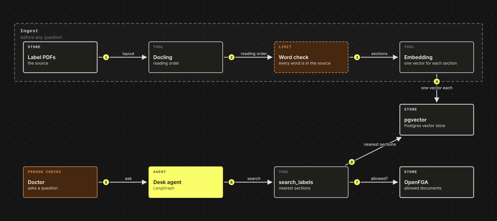
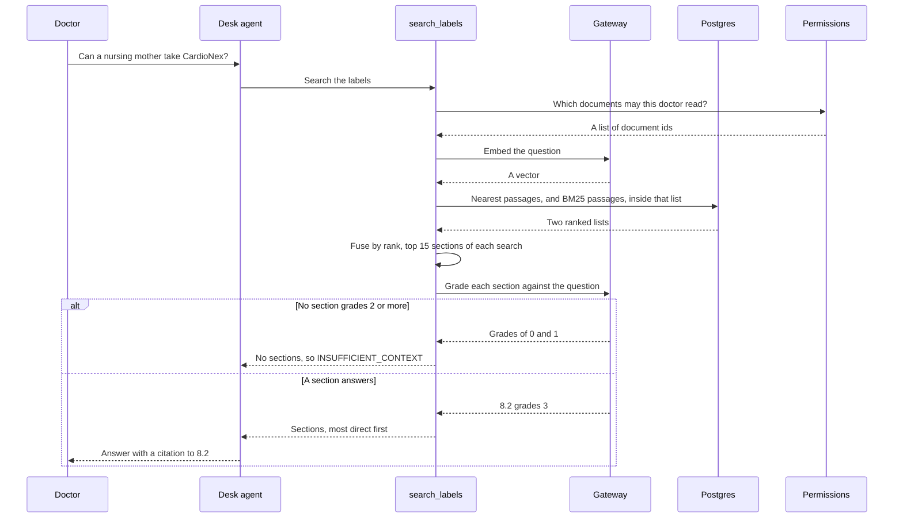
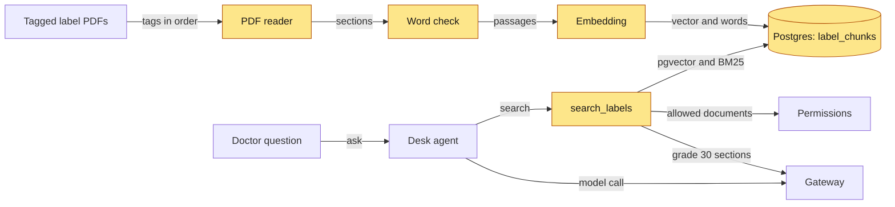
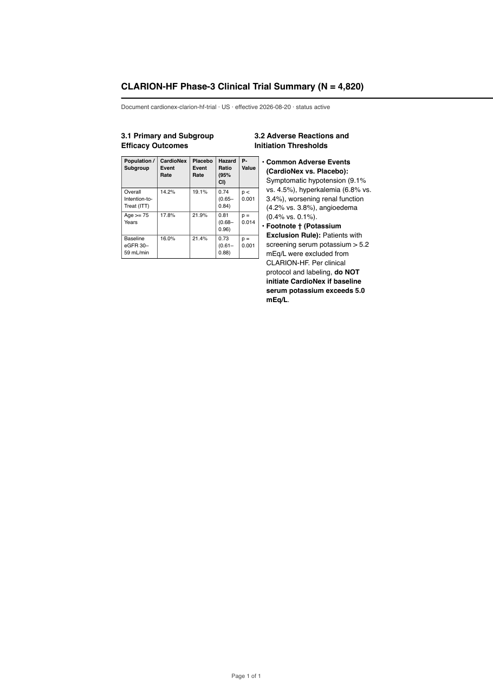

# Find the right label section by meaning from the PDFs

## The problem

Until now `search_labels` found a section by the words it shares with the question. That works only when doctors use the label's own words. They do not:

- **"Can a mother who is nursing her newborn take CardioNex?"** The answer is in section 8.2, "Lactation". The question and the section share no word but "CardioNex".
- **"My patient is expecting a baby."** The answer is in 8.1, "Pregnancy". Again no word is shared.

Keyword search returns the sections that say "CardioNex" most often. The agent then answers from the wrong section, or says the label is silent when it is not.

There is a second gap. The labels so far were Markdown files typed for this workshop. A company sends PDFs with two columns, boxed warnings, and dosing tables with footnotes. A reader must keep a table row in its section and a footnote with its dose. Otherwise the answer is half a dose.

There is a third. Search always returns something. "Can my patient have a live vaccine?" finds the nearest interaction section, and no label here mentions vaccines. The agent must hear "nothing answers this", not the nearest text.

## What you build

- **A PDF reader.** It reads the tags in each label PDF, in the order the label was written.
- **A word check.** Ingest checks every word against the source, and stores nothing that fails.
- **Passages in a vector store.** Each section is cut into passages of at most 300 words. Tables stay whole. Each passage gets a vector and a word index in Postgres.
- **Two searches, fused.** pgvector finds passages by meaning, and BM25 by words. Reciprocal rank fusion merges the two lists.
- **A grader.** The model grades the top sections of each search against the question. No section that answers means no result.
- **A measure.** `npm run search:measure` scores search on graded gold questions, and `docs/measures.md` holds the numbers.

| Case | What breaks | How the system holds |
| --- | --- | --- |
| "Nursing" finds the wrong sections | The agent answers from the wrong place | Search by meaning finds 8.2 |
| "36 hours" or "CYP3A4" | A vector blurs an exact number or drug name | BM25 finds the exact words |
| A wrapped table cell | Reading by position scrambles the row | The tags keep the row in order |
| A section loses words | A dose is cut in half | The word check refuses the PDF |
| A question no label answers | The nearest section passes as an answer | The grader finds no answer, so search returns nothing |
| A doctor reads another company's label | A section leaks across companies | The permission filter sits inside both queries |

## How it works

Retrieval has two halves, and both can fail quietly. Reading the PDF can put a table under the wrong heading. Nothing looks wrong until a doctor gets a number from the wrong section. So ingest checks every word against the source and refuses what fails.



Step through it one part at a time in the [live drawing](https://canvas.learnwithparam.com/case.html#buildcamp/22).

Search finds candidates two ways, then asks the model which of them answer. The permission filter goes inside both queries. So search never sees what the doctor may not read.

### The flow

This follows one question, from the doctor to the cited section.



The step people doubt is the permission filter. It sits inside the query, not after the limit. Filtering after the limit would return fewer rows, or none.

### Where it sits

Ingest runs once. Search runs on every question.



### Concepts

- [Chunk](../walkthrough.md#c-chunk)
- [Embedding](../walkthrough.md#c-embedding)
- [Vector search](../walkthrough.md#c-vector-search)
- [Hybrid search](../walkthrough.md#c-hybrid-search)
- [Rerank](../walkthrough.md#c-rerank)

## Build it

```bash
git checkout checkpoint/20-rag
npm install
npm run rag:setup
npm run rag:ingest
npm run dev
```

`rag:setup` installs the `vector` extension in the app database. Both commands are safe to run again.

The checkpoint adds:

- `data/hcp/pdf/`: 13 tagged PDFs and `manifest.json`. The manifest names each PDF's company, medicine, status, date, country and source Markdown.
- `src/server/rag/extract.ts`: the tags read as Markdown, cut into sections, and the word check.
- `src/server/rag/chunk.ts`: each section cut into passages.
- `src/server/rag/ingest.ts`: the loop over the PDFs.
- `src/server/rag/store.ts`, with migrations `008_label_chunks.sql` and `011_label_search.sql`: the `label_chunks` table, its HNSW index and its word index.
- `src/server/rag/search.ts`: `hybridSearch`, which `search_labels` now calls.
- `src/server/rag/grade.ts` and `src/server/rag/rewrite.ts`: the grader and the follow-up rewriter.
- `scripts/rag-setup.ts`, `scripts/rag-ingest.ts` and `scripts/search-eval.ts`.
- `src/server/rag/rag.test.ts`, which reads every real PDF in `data/hcp/pdf`.

One new npm package, `unpdf`. It wraps Mozilla's PDF.js, the reader inside Firefox, and runs in the app's own process.

### Step 1: See keyword search miss

On `checkpoint/19-cli`, `search_labels` scores sections by shared words. These are the four sections it returns for three questions:

| Question words | Sections returned |
| --- | --- |
| nursing | clarion 3.2, faq 1.2, uspi-v2 0.0, clarion 3.1 |
| expecting a baby | clarion 3.2, uspi-v2 0.0, clarion 3.1, de-smpc 4.3 |
| alcohol | clarion 3.2, uspi-v2 0.0, uspi-v2 2.2, clarion 3.1 |

8.1 and 8.2 never appear. The words "nursing" and "expecting" are not in them.

### Step 2: Look at a PDF



The PDF has two columns. Section 3.1, on the left, is a table of event rates. Section 3.2, on the right, starts on the same line. A cell such as "Overall Intention-to-Treat (ITT)" wraps onto two lines. The cell beside it sits between those two lines.

A reader that goes by position on the page meets both headings first. It then reads the wrapped cell's two halves with the next cell between them. The row comes out scrambled.

### Step 3: Read the tags, not the positions

A label made for screen readers is a tagged PDF (PDF/UA). Every heading, paragraph, list item and table cell is marked, in the order the label was written. Regulators ask for accessible labels, and a screen reader needs the same thing a search does.

`pdfToMarkdown` reads each page's tag tree with PDF.js and writes it as Markdown:

- **A heading** becomes `## 3.1 Primary and Subgroup Efficacy Outcomes`.
- **A list item** becomes `1. Read the denial letter`. PDF.js paints the marker last, so the reader moves it to the front.
- **A table** becomes rows: `| Overall Intention-to-Treat (ITT) | 14.2% | 19.1% | 0.74 (0.65–0.84) | p < 0.001 |`. A table that runs onto the next page repeats its header there. The reader joins the rows and drops the repeated header.
- **A line break** is a space, except after a hyphen. "Co-" at the end of one line and "administration" on the next stay one word.

A PDF with no tags is refused:

```text
scan.pdf is not a tagged PDF (page 1 has no tags). Ask for the PDF/UA version of the label.
```

Guessing the order from positions is how the dosing table got scrambled. So the reader asks for the right file instead.

### Step 4: Catch a wrong reading

You would not notice a wrong reading by reading the output, so ingest does not trust it. Each PDF was printed from a Markdown label. The function `missingFromExtraction` compares the two section by section. It looks at letters and digits only, so a line break or a table border does not count. Delete the footnote from section 2.2 of the US label, and the check says:

```text
section 2.2 lost words on the way out of the PDF
```

A PDF that fails the check is not stored, and the old rows stay. A real company has no source Markdown for an old PDF. It does have one for every label it writes now. For the rest, check a sample by hand before you trust a reader.

`sectionsFromMarkdown` then cuts the Markdown into one chunk per numbered section. Only a heading with a section number starts one, such as 2.2, 4.2.1 or 10. That number is what a citation names.

### Step 5: Ingest, once

```bash
npm run rag:ingest
```

```text
cardionex-clarion-hf-trial: 36 sections stored as 40 passages
cardionex-de-smpc: 55 sections stored as 62 passages
...
cardionex-uspi-v2: 83 sections stored as 89 passages
...
pv-reporting-sop: 25 sections stored as 27 passages
```

That is 653 sections from 13 PDFs, stored as 691 passages. Reading all 13 PDFs takes under two seconds.

A long section is cut into passages of at most 300 words. Then one paragraph about potassium is not drowned in 600 words about something else. A table is never cut, since a row without its header is a number without a meaning. Each passage carries its section path, such as "8.2 Lactation". The parent section goes in front when the label has one.

Each passage becomes one vector from `text-embedding-3-small`, through the gateway from lesson 10. The text embedded starts with the document id and the section path. So "Lactation" is in the vector even where the body says only "breast milk". The same text goes into a word index (`terms`) for BM25.

Run it again:

```text
cardionex-clarion-hf-trial: unchanged
...
pv-reporting-sop: unchanged
```

Each row carries the sha256 of its PDF, the model that made its vector, and the chunker version. A PDF with the same three is skipped, so a second run makes no model call. A changed PDF replaces its own rows. Rows for a removed PDF go too, but only after a run where every PDF passed. A failed run never empties the index of what it could not replace.

The embedding model must be allowed on the `medinfo-app` gateway key. Add it in Langfuse under **AI Gateway**, then **Gateway keys**, the key's menu, **Edit**, **Models**:


Without it, ingest stops on the gateway's refusal and stores nothing.

### Step 6: Search two ways, inside the permissions

`hybridSearch` first keeps only the documents in force on the day, among those OpenFGA lets this doctor read. An old label version is never a candidate, so it can never be cited. The `label_versions` tool answers questions about history.

Then it runs two searches at once, which is called hybrid search. The first is a vector search: pgvector finds the nearest passages.

```sql
SET LOCAL hnsw.iterative_scan = strict_order;
SELECT ..., 1 - (embedding <=> $1::vector) AS score
FROM label_chunks
WHERE embedding_model = $4 AND doc_id = ANY($2)
ORDER BY embedding <=> $1::vector
LIMIT $3;
```

Three things to notice:

- **`doc_id = ANY($2)` is lesson 11's OpenFGA list.** The filter is in the query, not applied afterwards. So a pharma_b section is never a candidate for a pharma_a doctor.
- **`iterative_scan = strict_order` keeps the index scanning.** It goes on until enough rows pass the filter, still nearest first. Without it, a selective filter can leave too few rows.
- **`embedding_model = $4` compares like with like.** Change the model, and the old rows are invisible until you ingest again.

The second is BM25, written in SQL in `LabelChunkStore.keyword`. It scores a passage by how often it holds the question's words. A rare word such as "CYP3A4" counts for more than "patient". A long passage does not win by length.

A vector blurs "36 hours" into "a while". BM25 finds those exact words.

Each search hands back 50 passages. Reciprocal rank fusion merges the two lists. In each list, a passage scores 1 / (60 + its rank). Its two scores add up, so a passage high in either list rises.

Then each section keeps its best passage.

Fusion alone can drop the best section. Take "Can a mother who is nursing her baby take CardioNex?". BM25 matches nearly every passage on "take". Each passage both lists hold then outscores 8.2 Lactation, which only the vector search found, first. So the 30 sections that go on are the top 15 of each search, in fused order.

### Step 7: Let the model say which sections answer

Fusion finds what is near the question. It cannot tell a section that answers from one that only shares its words. A fixed similarity floor cannot either.

Take "Can my patient drink alcohol while taking CardioNex?". It scores 0.60 on the boxed warning. That section is about CardioNex, but says nothing about alcohol.

So the search reranks them. `gradePassages` sends the question and all 30 sections to the chat model, in one gateway call.

Each passage is headed with its document, medicine and country. So a CardioNex section cannot pass for a NeuroVex answer. Each section gets a grade:

```text
3 states, in its own text, what the question asks for: the number, the yes or no, or the instruction.
2 states part of it, or the rule the answer depends on (a table, a limit, a "do not use").
1 is about the same subject, or gives background, but a doctor could not answer from it.
0 is about something else.
```

Nearly every relevant section gets a 3. So a grade cannot say which to read first. In the same call, the model also lists the sections it graded 2 or 3. The most direct comes first. That list sets the order, as in RankGPT.

If no section grades 2 or more, search returns nothing, and the agent says INSUFFICIENT_CONTEXT. Otherwise the sections come back in the model's order, then the ones that only help. Each result carries its scores: the fused score, its rank in each search, and its grade. The trace shows why a section was picked.

A result is the whole section, not the passage. So the agent reads, and cites, what the label prints.

### Step 8: Write a follow-up out in full

A doctor asks "Can I start CardioNex in a patient on an ACE inhibitor?". Then they ask "How long do I have to wait?". The second question names no medicine. Search on its own finds nothing useful.

So when there are earlier turns, `standaloneQuery` asks the model to write the question out in full. Here it writes "How long after the last ACE inhibitor dose can CardioNex be started?". It adds nothing the doctor did not say, and keeps every number. A first question goes to search as it is, with no model call.

For a doctor's exact words, the agent has `find_label_text`. It finds a phrase such as "36 hours" in the labels in force, to check a quote.

### Step 9: Measure it

```bash
npm run search:measure
```

`data/hcp/gold/retrieval.jsonl` holds graded questions. Each names the company, the country, the day and the turns before it. It also names the sections that answer it (grade 2) or help (grade 1).

Some are follow-ups. Some ask about another country, and some quote an exact phrase. Some are out of label: no section answers them.

The script runs every question three ways, so you can see what each step is worth:

| Run | recall@5 | MRR | nDCG@10 | Out of label |
| --- | --- | --- | --- | --- |
| Vectors only (pgvector) | 0.745 | 0.757 | 0.723 | 0.05 |
| Vectors and BM25, fused | 0.749 | 0.743 | 0.717 | 0.05 |
| Fused, then graded by the model | 0.952 | 0.933 | 0.922 | 0.95 |
| Target | 0.95 | 0.85 | 0.85 | 0.95 |

- **recall@5** is the share of answering sections in the top 5.
- **MRR** is 1 over the rank of the first answering section.
- **nDCG@10** rewards the right order, using the gold grades.
- **Out of label** is the share of unanswerable questions that got no result.

Fusion on its own barely moves the averages. It finds the exact-word questions vectors miss, and loses a few others. The grader is what does the work. It lifts recall@5 from 0.749 to 0.952, and it turns "nothing answers this" from 0.05 into 0.95.

The grader came to that number over several runs, and each run found one cause:

- **It did not know the medicine.** Each passage showed only "2.5 Discontinuation". So CardioNex's section passed as the answer to "How should NeuroVex be stopped?". Out of label was 0.75. The passage now names its document, medicine and country, and out of label went to 0.95.
- **Nearly everything got a 3.** Of the 30 answers missing from the top 5, 25 had been graded, and most had a 3. They lost on order alone. So the grader now also lists the answers most direct first, in the same call. Recall@5 went from 0.924 to 0.958 on that run.
- **Old doses from secondary documents.** The March 2027 label halved the renal dose. On 2027-04-15 the FAQ and the 2026 formulary still gave the old dose, and they ranked first. Each passage now also shows the date its document is in force from.
- **Labels win.** Two passages can give different values for one instruction. Then the label wins, and the newest label wins over older ones. A first wording of that rule also marked down trial and payer passages, and recall@5 fell to 0.933. It now applies only when the values disagree.
- **A miscounted list.** Once, the grader returned 32 grades for 30 passages, and the whole search failed. Now the schema fixes the length, and the request states it. The search asks once more before it fails.

The grader is a model. So the same code can score 0.015 higher or lower on the next run. This run sits on the target, not above it.

Follow-ups show what the rewriter is worth. Asked as written, they score 0.878 recall@5. Written out in full first, they score 0.955.

Two slices are weakest. Questions that need two documents at once score 0.788 recall@5. Questions about which version is in force score 0.917. `misses` in `docs/runs/search.json` lists every question that lost a section.

The numbers are written to `docs/runs/search.json`. `docs/measures.md` holds the targets, from PaperQA2's hybrid retrieval. `check-repo` fails when a row there disagrees with the run file.

### Step 10: Let the agent read the whole library

Search now returns trial summaries too. The prompt still reads as if a label is the only source. Ask this question (POSITIVE-02).

```text
Can I initiate CardioNex 20mg in an adult HFrEF patient whose baseline serum potassium is 5.3 mEq/L?
```

Search returns the US label's 5.1. It says to hold the dose above 5.5 mEq/L. The CLARION-HF summary's 3.2 says not to start above 5.0 mEq/L. The agent weighed the label alone and said the label does not answer.

Two documents give two limits for one decision. So the prompt says which one wins:

```text
- If two documents give different limits for the same decision, give the stricter limit and cite the document that sets it.
```

The citation line also asks for one bracket per section. One answer had written `[cardionex-uspi-v2, 0.0; cardionex-uspi-v2, 8.1]`. A check that reads `[doc_id, section]` missed the second one.

Publish it to staging and try it on the cases it touches. Then let the lesson 18 gate move production:

```bash
WORKSHOP_PROMPT_VARIANT=library npm run prompt:publish -- --label staging
npm run dataset:run -- --label staging --cases POSITIVE-02,POSITIVE-04,FUTURE-01,RAG-02
npm run release:gate -- --label staging --promote
```

The `--label` flag pins the run to the version that label names. So nobody is served the new prompt until the gate is green.

A prompt line that fixes one case can break another. The first fix we tried changed "the label text you found" to "the documents you found". POSITIVE-02 passed, but the 2027 question (FUTURE-01) failed. So run the cases around it every time.

Now record your row:

```bash
npm run dataset:run -- --chapter 20 --cases RAG-01,RAG-02,RAG-03,TENANCY-01,STALENESS-01,MULTITURN-01,GUARDRAIL-01
```

## Prove it

| Case | Why it matters | Before | After |
| --- | --- | --- | --- |
| RAG-01 | A doctor's own words must find the section | Keyword search missed 8.2 | 8.2, with "5 days" cited |
| RAG-03 | A related section must not pass as an answer | Not built | INSUFFICIENT_CONTEXT |
| POSITIVE-02 | Two limits for one decision | The label alone | The stricter limit wins |
| TENANCY-01 | No leak across companies | Held | Still held |

Ask the nursing question in the app. Search returns 8.2 first, and the answer cites it:


The trace in Langfuse shows the same turn: the router, the agent, and `search_labels` with its embedding call:


The tests make no model call:

```bash
npx tsx --test src/server/rag/rag.test.ts
```

They read every PDF in `data/hcp/pdf` and pin what used to go wrong. The CLARION-HF row stays whole. The CYP3A4 footnote stays in 2.2. A table split across pages has one header. An untagged PDF is refused.

Break it on purpose. In `extract.ts`, stop joining a table that runs onto the next page. Two tests fail.

## Stuck points

In a correct run, `npm run rag:ingest` prints "unchanged" for all 13 PDFs on its second run. Asking about a nursing mother cites section 8.2 of `cardionex-uspi-v2`. A pharma_b doctor asking the same question finds no CardioNex section.

| What you see | Why | What to do |
| --- | --- | --- |
| Ingest stops on a gateway refusal | The embedding model is not allowed on the key | Add it under **Models** on the gateway key |
| The server says the label index is empty | Ingest has not run | Run `npm run rag:ingest` |
| A PDF is not stored | The word check found lost words | Read the section the message names |
| "is not a tagged PDF" | The PDF was printed without tags | Ask for the PDF/UA version of that label |

## What to watch for

- **A reader that looks right.** A wrong reading shows only when a doctor gets a wrong number. The word check is the guard.
- **A filter after the limit.** It returns fewer rows, or none. The permission filter sits inside both queries.
- **A mixed model.** Vectors from two models are never compared. Change the model and ingest again.
- **A floor asked to tell "related" from "answered".** A number cannot do it. The grader reads the section.
- **A prompt fix that breaks another case.** Run the cases around it every time.

## Results

| Chapter | Change | Passed | rag |
| --- | --- | --- | --- |
| 20 | search_labels reads the tagged label PDFs into pgvector | 6/7 | 2/3 |

The full row is in `docs/scoreboard.md`. How to read it:

- **RAG-01 passed.** "Nursing" found 8.2, and the answer has "5 days" with the citation.
- **RAG-03 passed.** The alcohol question got INSUFFICIENT_CONTEXT.
- **RAG-02 failed, and the search was right.** It is the holdout case. The agent cited section 8.1 of `cardionex-uspi-v2`. It wrote that the label says to discontinue once pregnancy is detected. The label says "Stop", and the check looks for that word. So a correct answer in other words fails.

  That limit is in string checks, not in retrieval. Lesson 21 checks the citation itself.
- **The guard cases passed.** Another company's medicine, the 2027 label, a follow-up and the scraper request behave as before.

## Where to go next

- Try the homework. Print one label to PDF without tags (WeasyPrint without `--pdf-variant pdf/ua-1`) and run ingest. Read what the reader says.
- Add five gold questions of your own to `data/hcp/gold/retrieval.jsonl`, with the sections that answer them. Run `npm run search:measure` and read `misses` in `docs/runs/search.json`.
- Read [PDF.js](https://mozilla.github.io/pdf.js/), [unpdf](https://github.com/unjs/unpdf), [PDF/UA](https://pdfa.org/resource/pdfua-in-a-nutshell/), [pgvector](https://github.com/pgvector/pgvector), [reciprocal rank fusion](https://plg.uwaterloo.ca/~gvcormac/cormacksigir09-rrf.pdf) and [PaperQA2](https://github.com/Future-House/paper-qa).
- Lesson 21 starts from this checkpoint.
