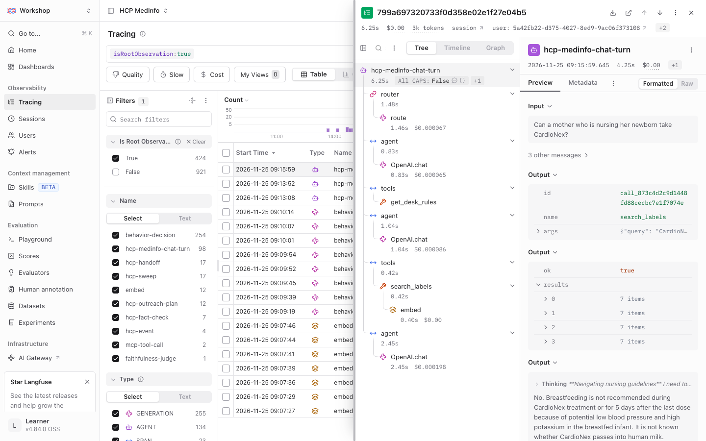

# 20 Answer from the label PDFs with pgvector

## Why search by meaning

Until now `search_labels` found a section by the words it shares with the question. That works while doctors use the label's own words. They do not:

- **"Can a mother who is nursing her newborn take CardioNex?"** The answer is in section 8.2, "Lactation". The question and the section share no word but "CardioNex".
- **"My patient is expecting a baby."** The answer is in 8.1, "Pregnancy". Again no shared word.

Keyword search returns the sections that say "CardioNex" most often, and the agent either answers from the wrong section or says the label is silent when it is not.

There is a second gap. The labels so far were Markdown files someone typed for this workshop. A company sends PDFs: two columns, boxed warnings, dosing tables with footnotes. Whatever reads them must keep a table row in its section and a footnote with its dose, or the answer is half a dose.

So this lesson reads the real PDFs, checks every word came out, and searches by meaning.

Complementary materials:

- Docs: [Docling](https://docling-project.github.io/docling/) and [docling-serve](https://github.com/docling-project/docling-serve)
- Docs: [pgvector](https://github.com/pgvector/pgvector), including filtering with iterative index scans
- Docs: [OpenAI embeddings](https://platform.openai.com/docs/guides/embeddings)

## Goal

A doctor's own words reach the right section of the full label, and only of the labels they may read.

- **Before:** "nursing" finds the CLARION-HF trial, the FAQ and the boxed warning, never 8.2 Lactation.
- **Build:** `npm run rag:ingest` reads 12 PDFs through Docling, puts each page in reading order, checks every word against the source, and stores one vector per section in Postgres. `search_labels` asks pgvector for the nearest sections, filtered by OpenFGA inside the query.
- **After:** "nursing" finds 8.2 first, and the agent answers "5 days" with `[cardionex-uspi-v2, 8.2]`.

## Starting point

```bash
git checkout checkpoint/20-rag
npm install
npm run rag:setup
npm run rag:ingest
npm run dev
```

`rag:setup` installs the `vector` extension in the app database and starts docling-serve (the compose profile `ingest`, so it does not run unless you ask for it). The first start downloads its image and models, which takes a few minutes. Both commands are safe to run again.

The checkpoint adds:

- `data/hcp/pdf/`: 12 label PDFs and `manifest.json`, which names each PDF's company, medicine, status, date, country and the Markdown it was printed from.
- `src/server/rag/extract.ts`: Docling's layout in reading order, cut into sections, and the word check.
- `src/server/rag/ingest.ts`: the loop over the PDFs.
- `src/server/rag/store.ts` and `src/server/migrations/008_label_chunks.sql`: the `label_chunks` table with an HNSW index.
- `src/server/rag/search.ts`: `vectorSearch`, which `search_labels` now calls.
- `scripts/rag-setup.ts` and `scripts/rag-ingest.ts`.
- `src/server/rag/rag.test.ts`, with real Docling output for two PDFs as fixtures.

No new npm package. Docling runs as a container (`quay.io/docling-project/docling-serve-cpu`, pinned), and pgvector is a Postgres extension.

## Step 1: See keyword search miss

On `checkpoint/19-cli`, `search_labels` scores sections by shared words. These are the four sections it returns for three questions:

| Question words | Sections returned |
| --- | --- |
| nursing | clarion 3.2, faq 1.2, uspi-v2 0.0, clarion 3.1 |
| expecting a baby | clarion 3.2, uspi-v2 0.0, clarion 3.1, de-smpc 4.3 |
| alcohol | clarion 3.2, uspi-v2 0.0, uspi-v2 2.2, clarion 3.1 |

8.1 and 8.2 never appear. The words "nursing" and "expecting" are not in them.

## Step 2: Look at a PDF


Two columns. Section 3.1, on the left, is a table of event rates. Section 3.2, on the right, starts on the same line. A reader that goes across the page line by line meets both headings first, then the table.

## Step 3: Docling's Markdown, and the check that catches it

Docling reads the PDF's layout: every heading, paragraph, list item and table, each with its page and box. It can also write the whole document as Markdown. Here is the start of that Markdown for CLARION-HF (`src/server/rag/fixtures/cardionex-clarion-hf-trial.docling.md`):

```markdown
## 3.1 Primary and Subgroup Efficacy Outcomes

## 3.2 Adverse Reactions and Initiation Thresholds

| Population / Subgroup             | CardioNex Event Rate   | ...
```

Both headings, then the table. Cut into sections, 3.1 is empty and the efficacy table belongs to 3.2. A question about the efficacy rate would cite 3.2 for a number 3.2 never states.

You would not notice this by reading the output. So ingest does not trust it. Each PDF was printed from a Markdown label, and `missingFromExtraction` compares the two section by section, letters and digits only, so a line break or a table border does not count:

```text
cardionex-clarion-hf-trial: not stored, section 3.1 lost words on the way out of the PDF
```

A PDF that fails the check is not stored, and the old rows stay. A real company has no source Markdown for an old PDF, but it does for every label it writes now; for the rest, check a sample by hand before you trust a reader.

## Step 4: Put the page in reading order

Docling's JSON keeps each block's box, so `readingOrder` rebuilds the order the way a person reads a two-column leaflet:

1. Down the page, band by band. A block wider than 60% of the page (a title, the boxed warning) ends a band.
2. Inside a band, the left column before the right. A block starts the right column when its left edge is more than 30% in from the page's left edge. An indented bullet is not a column.

The result is Markdown again, so the same `sectionsFromMarkdown` cuts it, one chunk per numbered section. Only `## 2.2 Title` or `## 10 Title` starts a chunk, because that number is what a citation names. Run the check again and all 12 PDFs pass. The tests pin three things that used to go wrong: the CLARION-HF table stays in 3.1, and in the US label the "must NOT exceed 5mg" line and the CYP3A4 footnote stay in 2.2.

## Step 5: Ingest, once

```bash
npm run rag:ingest
```

```text
cardionex-clarion-hf-trial: 2 sections stored
cardionex-de-smpc: 2 sections stored
...
cardionex-uspi-v2: 20 sections stored
...
pv-reporting-sop: 2 sections stored
```

37 sections from 12 PDFs. Each section becomes one vector from `text-embedding-3-small`, through the gateway from lesson 10. The text embedded is the document id, section number and title, then the body, so "Lactation" is in the vector even where the body says only "breast milk".

Run it again:

```text
cardionex-clarion-hf-trial: unchanged
...
pv-reporting-sop: unchanged
```

Each row carries the sha256 of its PDF and the model that made its vector. A PDF with the same hash and model is skipped, so a second run makes no model call. A changed PDF replaces its own rows. A PDF removed from the manifest has its rows removed, but only after a run where every PDF passed: a failed run never empties the index of what it could not replace.

The embedding model must be allowed on the `medinfo-app` gateway key. Add it in Langfuse under **AI Gateway**, **Gateway keys**, the key's menu, **Edit**, **Models**:


Without it, ingest stops on the gateway's refusal and stores nothing.

## Step 6: Search by meaning, inside the permissions

`vectorSearch` embeds the question and asks Postgres for the nearest sections:

```sql
SET LOCAL hnsw.iterative_scan = strict_order;
SELECT ..., 1 - (embedding <=> $1::vector) AS similarity
FROM label_chunks
WHERE embedding_model = $4 AND doc_id = ANY($2)
ORDER BY embedding <=> $1::vector
LIMIT $3;
```

Three things to notice:

- **`doc_id = ANY($2)` is lesson 11's OpenFGA list,** the documents this doctor may read. The filter is in the query, not applied to the results afterwards, so a pharma_b section is never a candidate for a pharma_a doctor. Filtering after a `LIMIT 4` would return fewer than four rows, or none.
- **`iterative_scan = strict_order`** makes the HNSW index keep scanning until it has enough rows that pass the filter, still nearest first. Without it, an index scan with a selective filter can return too few rows.
- **`embedding_model = $4`:** a vector is only compared with vectors from the same model. Change the model and the old rows are invisible until you ingest again.

Then a floor. A section below 0.35 cosine similarity is not about the question, and is dropped. Measured on this library: the best section for every real question in the dataset scores 0.48 or more, and the request to write a scraper (GUARDRAIL-01) scores 0.26.

A floor cannot do one job, and the page should say so. "Can my patient drink alcohol while taking CardioNex?" scores 0.60 on the boxed warning: it is about CardioNex, just not about anything the label says. Telling "related" from "answered" stays the agent's job.

Two rules then shape the list the agent reads:

- **Sections in force come first.** Each version of the label has a dose section with almost the same words. So the nearest four can all be old versions. Search reads four times as many rows, then puts the sections in force first.
- **A short document comes whole.** For example, "What must a safety report never contain?" finds 1.1 of the reporting procedure, but its 1.2 ranks below six label sections. Every document but the full US label is under 150 words. So a hit in a short document in force brings that document's other sections in after it, as extras. The nearest four stay in the list.

The server checks the index when it starts. An empty index stops it with the command to run:

```text
The label index is empty. Run npm run rag:ingest (lesson 20).
```

## Step 7: Ask in your own words

Sign in as Ana Rivera and ask "Can a mother who is nursing her newborn take CardioNex?":


`search_labels` returned 8.2 Lactation first. The trace shows the search and its `embed` call through the gateway:



## Results

```bash
npm run dataset:run -- --chapter 20 --cases RAG-01,RAG-02,RAG-03,TENANCY-01,STALENESS-01,MULTITURN-01,GUARDRAIL-01
```

| Chapter | Change | Passed | rag |
| --- | --- | --- | --- |
| 20 | search_labels reads the label PDFs through Docling and pgvector | 6/7 | 2/3 |

The full row is in `docs/scoreboard.md`. How to read it:

- **RAG-01 passed:** "nursing" found 8.2, and the answer has "5 days" with the citation.
- **RAG-03 passed:** the alcohol question got INSUFFICIENT_CONTEXT. The search returned the boxed warning above the floor, and the agent saw it does not answer the question.
- **RAG-02 failed, and the search was right.** It is the holdout case. The agent cited `[cardionex-uspi-v2, 8.1]` and wrote "the label says to discontinue it as soon as pregnancy is detected". The label says "Stop". The check looks for that word, so a correct answer in other words fails it. That is a limit of string checks, not of retrieval; lesson 21 checks the citation itself.
- **The guard cases passed:** another company's medicine, the 2027 label, a follow-up question and the scraper request behave as in lesson 19.

## How to verify you are done

- `npm run rag:ingest` prints "unchanged" for all 12 PDFs on its second run.
- Asking about a nursing mother cites `cardionex-uspi-v2, 8.2`.
- Signed in as a pharma_b doctor, the same question finds no CardioNex section.
- `npm run check` passes, including `src/server/rag/rag.test.ts`.

## Wrap-up

Retrieval has two halves, and both can fail quietly. Reading the PDF can put a table under the wrong heading, and nothing looks wrong until a doctor gets a number from the wrong section. So ingest checks every word against the source and refuses what fails. Searching by meaning finds the section a doctor means, and the permission filter goes inside the query, so search never sees what the doctor may not read.

## Homework

Add a scanned PDF: print one label page to an image and back to PDF. Run ingest with `do_ocr` still off and read what the check says. Turn OCR on for that file only, and decide what the check should do with OCR's spelling mistakes: compare looser, or send the PDF to a person.

## End state

This is the starting point for lesson 21.
