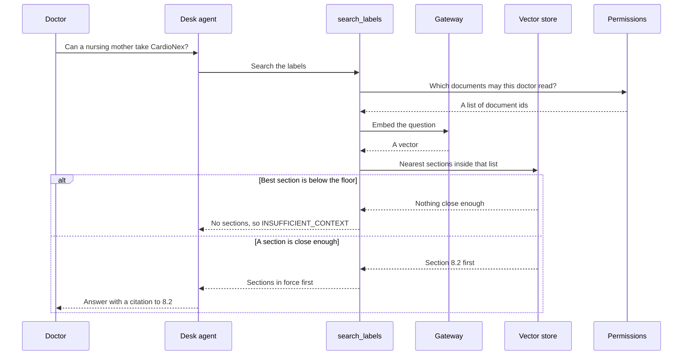
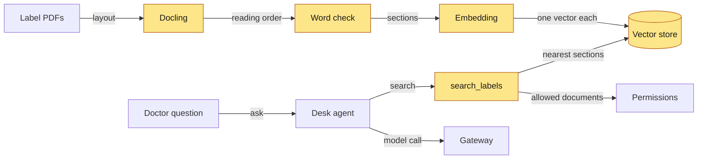
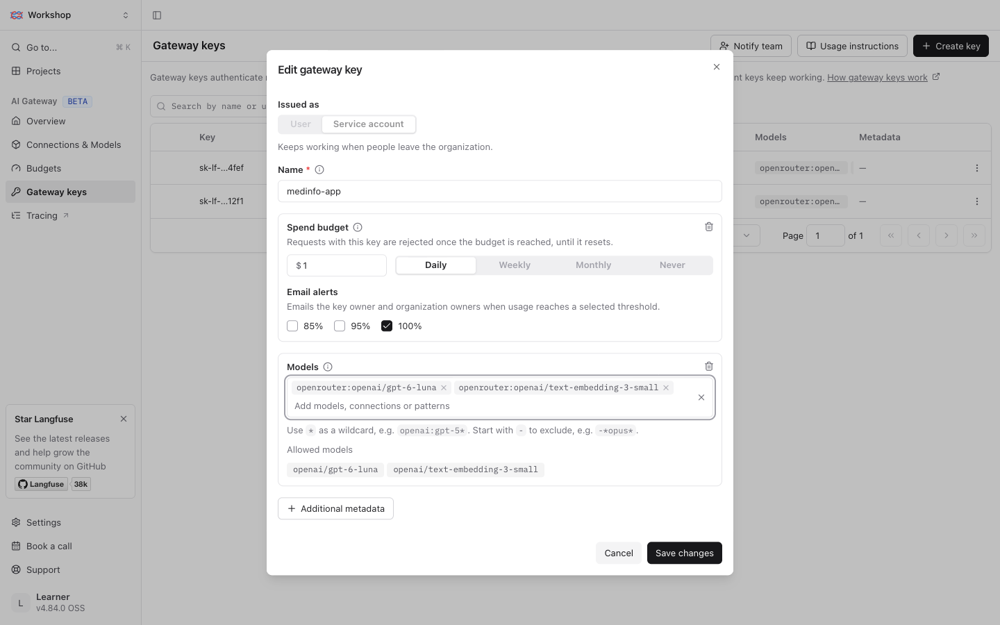
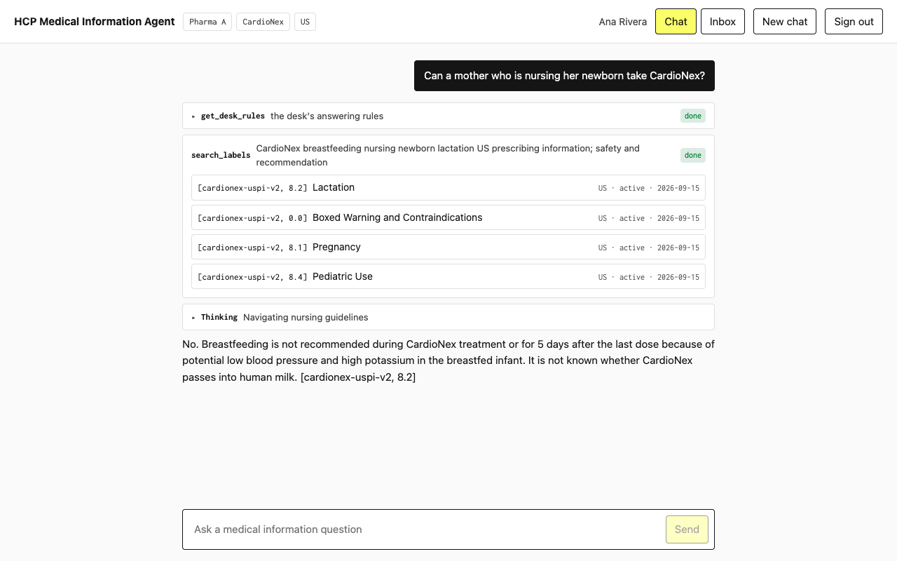

# 20 Find the right label section by meaning from the PDFs

## The problem

Until now `search_labels` found a section by the words it shares with the question. That works only when doctors use the label's own words. They do not:

- **"Can a mother who is nursing her newborn take CardioNex?"** The answer is in section 8.2, "Lactation". The question and the section share no word but "CardioNex".
- **"My patient is expecting a baby."** The answer is in 8.1, "Pregnancy". Again no word is shared.

Keyword search returns the sections that say "CardioNex" most often. The agent then answers from the wrong section, or says the label is silent when it is not.

There is a second gap. The labels so far were Markdown files typed for this workshop. A company sends PDFs with two columns, boxed warnings, and dosing tables with footnotes. A reader must keep a table row in its section and a footnote with its dose. Otherwise the answer is half a dose.

## What you build

- **A PDF reader.** Docling reads each PDF and puts every page in reading order.
- **A word check.** Ingest checks every word against the source, and stores nothing that fails.
- **A vector store.** Each section becomes one vector in Postgres with pgvector.
- **A search by meaning.** `search_labels` asks pgvector for the nearest sections. OpenFGA filters them inside the query.

| Case | What breaks | How the system holds |
| --- | --- | --- |
| "Nursing" finds the wrong sections | The agent answers from the wrong place | Search by meaning finds 8.2 first |
| A two-column PDF is read across | A table lands under the wrong heading | Reading order keeps it in 3.1 |
| A section loses words | A dose is cut in half | The word check refuses the PDF |
| A doctor reads another company's label | A section leaks across companies | The permission filter sits inside the query |

## How it works

Retrieval has two halves, and both can fail quietly. Reading the PDF can put a table under the wrong heading. Nothing looks wrong until a doctor gets a number from the wrong section. So ingest checks every word against the source and refuses what fails.

Searching by meaning finds the section a doctor means. The permission filter goes inside the query. So search never sees what the doctor may not read.

### The flow

This follows one question, from the doctor to the cited section.



The step people doubt is the permission filter. It sits inside the query, not after the limit. Filtering after the limit would return fewer rows, or none.

### Where it sits

Ingest runs once. Search runs on every question.



### Concepts

- [Chunk](../walkthrough.md#c-chunk)
- [Embedding](../walkthrough.md#c-embedding)
- [Vector search](../walkthrough.md#c-vector-search)
- [Similarity floor](../walkthrough.md#c-similarity-floor)

## Build it

```bash
git checkout checkpoint/20-rag
npm install
npm run rag:setup
npm run rag:ingest
npm run dev
```

`rag:setup` installs the `vector` extension in the app database. It also starts docling-serve, in the compose profile `ingest`, so it does not run unless you ask. The first start downloads its image and models, which takes a while. Both commands are safe to run again.

The checkpoint adds:

- `data/hcp/pdf/`: 12 label PDFs and `manifest.json`. The manifest names each PDF's company, medicine, status, date, country and source Markdown.
- `src/server/rag/extract.ts`: Docling's layout in reading order, cut into sections, and the word check.
- `src/server/rag/ingest.ts`: the loop over the PDFs.
- `src/server/rag/store.ts` and `src/server/migrations/008_label_chunks.sql`: the `label_chunks` table with an HNSW index.
- `src/server/rag/search.ts`: `vectorSearch`, which `search_labels` now calls.
- `scripts/rag-setup.ts` and `scripts/rag-ingest.ts`.
- `src/server/rag/rag.test.ts`, with real Docling output for two PDFs as fixtures.

No new npm package. Docling runs as a pinned container, `quay.io/docling-project/docling-serve-cpu`. The pgvector part is a Postgres extension.

### Step 1: See keyword search miss

On `checkpoint/19-cli`, `search_labels` scores sections by shared words. These are the four sections it returns for three questions:

| Question words | Sections returned |
| --- | --- |
| nursing | clarion 3.2, faq 1.2, uspi-v2 0.0, clarion 3.1 |
| expecting a baby | clarion 3.2, uspi-v2 0.0, clarion 3.1, de-smpc 4.3 |
| alcohol | clarion 3.2, uspi-v2 0.0, uspi-v2 2.2, clarion 3.1 |

8.1 and 8.2 never appear. The words "nursing" and "expecting" are not in them.

### Step 2: Look at a PDF


The PDF has two columns. Section 3.1, on the left, is a table of event rates. Section 3.2, on the right, starts on the same line. A reader that goes across the page line by line meets both headings first. The table comes after them.

### Step 3: Catch a wrong reading

Docling reads the PDF's layout. Every heading, paragraph, list item and table comes with its page and box. It can also write the whole document as Markdown. Here is the start of that Markdown for CLARION-HF, from `src/server/rag/fixtures/cardionex-clarion-hf-trial.docling.md`. Each heading line is marked here with the word Heading:

```text
Heading: 3.1 Primary and Subgroup Efficacy Outcomes

Heading: 3.2 Adverse Reactions and Initiation Thresholds

| Population / Subgroup             | CardioNex Event Rate   | ...
```

Both headings come first, then the table. Cut into sections, 3.1 is empty and the efficacy table belongs to 3.2. A question about the efficacy rate would cite 3.2 for a number 3.2 never states.

You would not notice this by reading the output. So ingest does not trust it. Each PDF was printed from a Markdown label. The function `missingFromExtraction` compares the two section by section. It looks at letters and digits only, so a line break or a table border does not count:

```text
cardionex-clarion-hf-trial: not stored, section 3.1 lost words on the way out of the PDF
```

A PDF that fails the check is not stored, and the old rows stay. A real company has no source Markdown for an old PDF. It does have one for every label it writes now. For the rest, check a sample by hand before you trust a reader.

### Step 4: Put the page in reading order

Docling's JSON keeps each block's box. So `readingOrder` rebuilds the order a person reads a two-column leaflet:

1. **Down the page, band by band.** A block wider than 60% of the page ends a band. A title and the boxed warning are such blocks.
2. **Left column before right, inside a band.** A block far from the left edge starts the right column. An indented bullet is not a column.

The result is Markdown again, so the same `sectionsFromMarkdown` cuts it. It makes one chunk per numbered section. Only a heading with a section number starts a chunk, such as 2.2 or 10. That number is what a citation names. Run the check again and all 12 PDFs pass.

The tests pin three things that used to go wrong. The CLARION-HF table stays in 3.1. In the US label, the "must NOT exceed 5mg" line and the CYP3A4 footnote stay in 2.2.

### Step 5: Ingest, once

```bash
npm run rag:ingest
```

```text
cardionex-clarion-hf-trial: 2 sections stored
cardionex-de-smpc: 2 sections stored
...
cardionex-uspi-v2: 20 sections stored
...
pv-reporting-sop: 2 sections stored
```

That is 37 sections from 12 PDFs. Each section becomes one vector from `text-embedding-3-small`, through the gateway from lesson 10. The text embedded is the document id, section number and title, then the body. So "Lactation" is in the vector even where the body says only "breast milk".

Run it again:

```text
cardionex-clarion-hf-trial: unchanged
...
pv-reporting-sop: unchanged
```

Each row carries the sha256 of its PDF and the model that made its vector. A PDF with the same hash and model is skipped, so a second run makes no model call. A changed PDF replaces its own rows. Rows for a removed PDF go too, but only after a run where every PDF passed. A failed run never empties the index of what it could not replace.

The embedding model must be allowed on the `medinfo-app` gateway key. Add it in Langfuse under **AI Gateway**, then **Gateway keys**, the key's menu, **Edit**, **Models**:



Without it, ingest stops on the gateway's refusal and stores nothing.

### Step 6: Search by meaning, inside the permissions

`vectorSearch` embeds the question and asks Postgres for the nearest sections:

```sql
SET LOCAL hnsw.iterative_scan = strict_order;
SELECT ..., 1 - (embedding <=> $1::vector) AS similarity
FROM label_chunks
WHERE embedding_model = $4 AND doc_id = ANY($2)
ORDER BY embedding <=> $1::vector
LIMIT $3;
```

Three things to notice:

- **`doc_id = ANY($2)` is lesson 11's OpenFGA list.** It holds the documents this doctor may read. The filter is in the query, not applied afterwards. So a pharma_b section is never a candidate for a pharma_a doctor.
- **`iterative_scan = strict_order` keeps the index scanning.** It goes on until enough rows pass the filter, still nearest first. Without it, a selective filter can leave too few rows.
- **`embedding_model = $4` compares like with like.** A vector is only compared with vectors from the same model. Change the model, and the old rows are invisible until you ingest again.

Then comes the similarity floor. A section below 0.35 cosine similarity is not about the question, so it is dropped. We measured this library. The best section for every real question in the dataset scores 0.48 or more. The request to write a scraper (GUARDRAIL-01) scores 0.26.

A floor cannot do one job. Take "Can my patient drink alcohol while taking CardioNex?" It scores 0.60 on the boxed warning. That section is about CardioNex, but it does not answer the question. Telling "related" from "answered" stays the agent's job.

The nearest-section search is a vector search. Two rules then shape the list the agent reads:

- **Sections in force come first.** Each label version has a dose section with almost the same words. So the nearest four can all be old versions. Search reads four times as many rows. Then it puts the sections in force first.
- **A short document comes whole.** A question on safety reports finds 1.1 of the reporting procedure. Its 1.2 ranks below six label sections. Every document but the full US label is under 150 words. So a hit in a short document in force brings in that document's other sections as extras. The nearest four stay in the list.

The server checks the index when it starts. An empty index stops it and prints the command to run:

```text
The label index is empty. Run npm run rag:ingest (lesson 20).
```

### Step 7: Ask in your own words

Sign in as Ana Rivera and ask "Can a mother who is nursing her newborn take CardioNex?":



`search_labels` returned 8.2 Lactation first. The trace shows the search and its `embed` call through the gateway:


### Step 8: Let the agent read the whole library

Search now returns trial summaries too. The prompt still reads as if a label is the only source. Ask this question (POSITIVE-02).

```text
Can I initiate CardioNex 20mg in an adult HFrEF patient whose baseline serum potassium is 5.3 mEq/L?
```

Search returns the US label's 5.1 first. It says to hold the dose above 5.5 mEq/L. The CLARION-HF summary comes second, and its 3.2 says not to start above 5.0 mEq/L. The agent weighed the label alone and said the label does not answer. It failed in 2 of 2 runs.

Two documents give two limits for one decision. So the prompt says which one wins:

```text
- If two documents give different limits for the same decision, give the stricter limit and cite the document that sets it.
```

The citation line also asks for one bracket per section. One answer had written `[cardionex-uspi-v2, 0.0; cardionex-uspi-v2, 8.1]`. A check that reads `[doc_id, section]` missed the second one.

Publish it to staging and try it on the cases it touches. Then let the lesson 18 gate move production:

```bash
WORKSHOP_PROMPT_VARIANT=library npm run prompt:publish -- --label staging
npm run dataset:run -- --label staging --cases POSITIVE-02,POSITIVE-04,FUTURE-01,RAG-02
npm run release:gate -- --label staging --promote
```

The `--label` flag pins the run to the version that label names. So nobody is served the new prompt until the gate is green.

We measured 15 cases, run twice on each version. The old version failed 3 case runs: POSITIVE-02 twice and POSITIVE-04 once. The new one failed 1, AUTO-01, where the router picked the tier, not the prompt. POSITIVE-02 then passed 3 more runs.

The first fix we tried was worse. It changed "the label text you found" to "the documents you found". POSITIVE-02 passed, but the 2027 question (FUTURE-01) failed 4 of 4. Search returns only sections in force there, so the agent said it could not verify the 2027 label.

A prompt line that fixes one case can break another. So run the cases around it every time.

Now record your row:

```bash
npm run dataset:run -- --chapter 20 --cases RAG-01,RAG-02,RAG-03,TENANCY-01,STALENESS-01,MULTITURN-01,GUARDRAIL-01
```

## Prove it

| Case | Why it matters | Before | After |
| --- | --- | --- | --- |
| RAG-01 | A doctor's own words must find the section | Keyword search missed 8.2 | 8.2 first, with "5 days" cited |
| RAG-03 | A related section must not pass as an answer | Not built | INSUFFICIENT_CONTEXT |
| POSITIVE-02 | Two limits for one decision | Failed 2 of 2 | The stricter limit wins |
| TENANCY-01 | No leak across companies | Held | Still held |

The tests make no model call:

```bash
npx tsx --test src/server/rag/rag.test.ts
```

Break it on purpose. Remove the word check from ingest. The test that the CLARION-HF table stays in 3.1 fails.

## Stuck points

In a correct run, `npm run rag:ingest` prints "unchanged" for all 12 PDFs on its second run. Asking about a nursing mother cites section 8.2 of `cardionex-uspi-v2`. A pharma_b doctor asking the same question finds no CardioNex section.

| What you see | Why | What to do |
| --- | --- | --- |
| Ingest stops on a gateway refusal | The embedding model is not allowed on the key | Add it under **Models** on the gateway key |
| The server says the label index is empty | Ingest has not run | Run `npm run rag:ingest` |
| A PDF is not stored | The word check found lost words | Read the section the message names |
| Docling does not answer | docling-serve is not running | Run `npm run rag:setup` again |

## What to watch for

- **A reader that looks right.** A wrong reading shows only when a doctor gets a wrong number. The word check is the guard.
- **A filter after the limit.** It returns fewer rows, or none. The permission filter sits inside the query.
- **A mixed model.** Vectors from two models are never compared. Change the model and ingest again.
- **A floor asked to do two jobs.** The floor drops what is unrelated. It cannot tell "related" from "answered".
- **A prompt fix that breaks another case.** Run the cases around it every time.

## Results

| Chapter | Change | Passed | rag |
| --- | --- | --- | --- |
| 20 | search_labels reads the label PDFs through Docling and pgvector | 6/7 | 2/3 |

The full row is in `docs/scoreboard.md`. How to read it:

- **RAG-01 passed.** "Nursing" found 8.2, and the answer has "5 days" with the citation.
- **RAG-03 passed.** The alcohol question got INSUFFICIENT_CONTEXT. The search returned the boxed warning above the floor. The agent saw it does not answer.
- **RAG-02 failed, and the search was right.** It is the holdout case. The agent cited section 8.1 of `cardionex-uspi-v2`. It wrote that the label says to discontinue once pregnancy is detected. The label says "Stop", and the check looks for that word. So a correct answer in other words fails.

  That limit is in string checks, not in retrieval. Lesson 21 checks the citation itself.
- **The guard cases passed.** Another company's medicine, the 2027 label, a follow-up and the scraper request behave as before.

## Where to go next

- Try the homework. Print one label page to an image and back to PDF. Run ingest with `do_ocr` still off and read what the check says.
- Turn OCR on for that file only. Decide what the check should do with OCR's spelling mistakes. It can compare looser, or send the PDF to a person.
- Read [Docling](https://docling-project.github.io/docling/), [docling-serve](https://github.com/docling-project/docling-serve), [pgvector](https://github.com/pgvector/pgvector) and [OpenAI embeddings](https://platform.openai.com/docs/guides/embeddings).
- Lesson 21 starts from this checkpoint.
