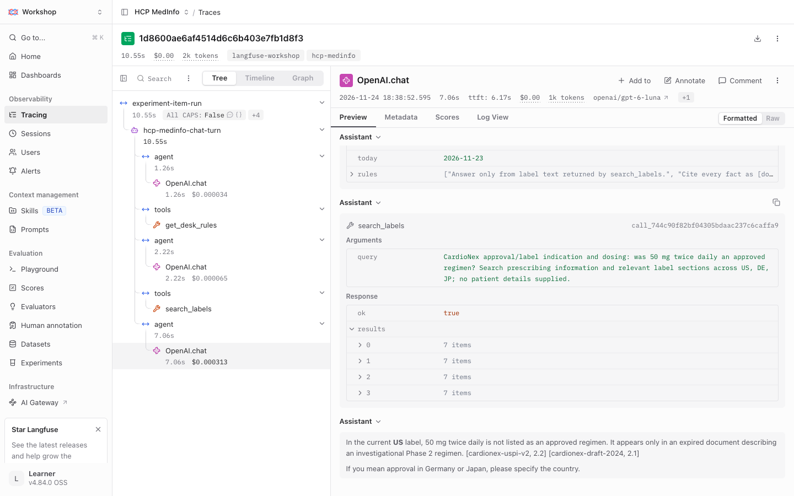
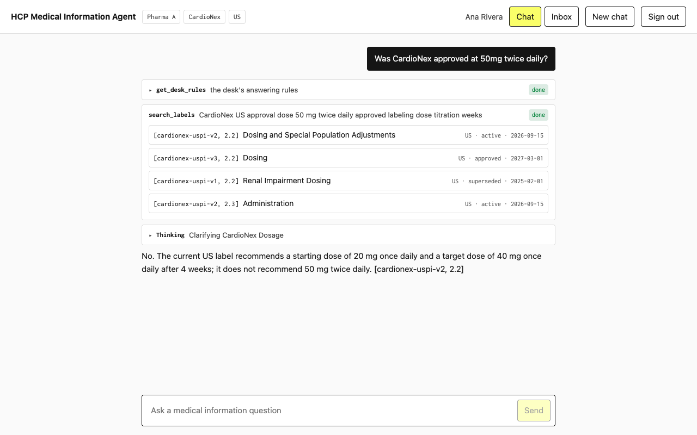

# 21 Check every citation before the answer is sent

## Why a prompt rule is not enough

The desk rules already say "Answer only from label text returned by search_labels" and "Cite every fact as [doc_id, section]". A rule in a prompt is a request. The model follows it most of the time, and the answers where it does not look just as sure as the rest.

Lesson 20 made the search find the right section. It did not make the answer stay inside what the search found. Three ways it leaves, all from answers already stored in Langfuse:

- **It cites a document that is not in force.** Asked "Was CardioNex approved at 50mg twice daily?", the agent cited the expired 2024 draft, `[cardionex-draft-2024, 2.1]`, in 6 of 9 stored answers.
- **It gives a dose with no citation.** "5 mg once daily" for a patient with eGFR 24, with nothing to say where 5 mg came from.
- **It cites a real section for a number that section does not have.** A "40 %" written next to `[cardionex-uspi-v2, 2.2]`, which says nothing about 40 %.

A doctor cannot tell these from a good answer. So the answer is checked in code, against the search results, before it is final.

Complementary materials:

- Docs: [Langfuse scores](https://langfuse.com/docs/evaluation/evaluation-methods/scores-via-sdk), including categorical scores
- Docs: [LangGraph conditional edges](https://langchain-ai.github.io/langgraphjs/concepts/low_level/#conditional-edges)

## Goal

No answer reaches a doctor with a citation the search did not return, a document that is not in force, or a dose its citation does not state.

- **Before:** 13 of 405 stored answers break one of those rules, and each one went to the doctor.
- **Build:** a `cite` node after the agent. It checks the answer, asks for one rewrite with the problems listed, and withholds the answer if the rewrite fails too. The outcome is a score on the trace.
- **After:** the same 13 answers would be stopped, and Langfuse counts how often an answer passed, was rewritten or was withheld.

## Starting point

```bash
git checkout checkpoint/21-citations
npm install
npm run dev
```

The checkpoint adds:

- `src/server/citations.ts`: `checkCitations`, the check itself, with no model call.
- `src/server/graph.ts`: the `cite` node and `citeStep`, the one rewrite.
- `src/server/medinfo-agent.ts`: the `cite` span and the `citations` score.
- `scripts/citations-audit.ts`: `npm run citations:audit`, the check over stored answers.
- `scripts/citations-replay.ts`: `npm run citations:replay`, the `cite` node on those answers with the real model.
- `src/server/citations.test.ts`, with four real stored answers in `citations.fixtures.json`.

No new npm package and no new container.

## Step 1: Find the answers that broke the rules

The answers are already in Langfuse, with the search results the model read before writing them. Run the check over them:

```bash
npm run citations:audit
```

```text
405 answers checked, 13 would be stopped.
  uncited: 3
  unsupported: 4
  not_in_force: 6

uncited "5 mg": What is the CardioNex dose for a patient with eGFR of 24 mL/min who is not on dialysis?
  http://localhost:5174/project/<project>/traces/d534f966f3fefed09a0cabd913307f5d
...
not_in_force [cardionex-draft-2024, 2.1]: Was CardioNex approved at 50mg twice daily?
  http://localhost:5174/project/<project>/traces/1d8600ae6af4514d6c6b403e7fb1d8f3
```

It makes no model calls: it reads the stored search results and answers, and runs the same function the app now runs. Your numbers depend on what your Langfuse holds; `--since 1d` limits it to the last day.

Open the last link. The search returned four sections, and the answer cites one marked expired:



The answer even calls the draft "an expired document" and cites it anyway. The case for this lesson is STALENESS-03: the expired draft must never be cited.

## Step 2: The check

`checkCitations(answer, retrieved, asked)` in `src/server/citations.ts` returns a list of problems. An empty list is a pass. It checks two things.

**Every citation.** Each `[doc_id, section]` must be a section `search_labels` returned in this conversation, with status `active`:

```ts
for (const citation of new Set(all)) {
  const section = sections.get(citation);
  if (!section) problems.push({ kind: "not_retrieved", citation });
  else if (section.status !== "active") problems.push({ kind: "not_in_force", citation, status: section.status });
}
```

The status comes from the search result, which comes from the PDF manifest of lesson 20. The model never decides whether a document is in force.

**Every number a doctor acts on.** `quantities` finds each dose, wait, lab value or rate: "5 mg", "4 weeks", "36 hours", "40 %". Each one must be in the text of the sections its sentence cites. A sentence with no citation of its own uses its paragraph's, and then the whole answer's, because "Start at 20 mg. Raise to 40 mg after 4 weeks. [doc, 2.2]" cites both sentences at once.

Two things are left alone on purpose:

- **A number the doctor gave.** "eGFR 24" in the answer is about the patient, not a claim from the label.
- **An answer with no number and no citation,** such as a follow-up question or a refusal. There is nothing to check.

A follow-up ("and if she is on dialysis?") is often answered from the sections the first question found. `evidenceOf` collects every search result in the thread, so that answer is checked against them too.

## Step 3: Rewrite once, then withhold

The graph gets a node between the agent and the end of the turn:

```text
before:  agent ─▶ END            (answer tier)    agent ─▶ submit ─▶ review   (review tier)
after:   agent ─▶ cite ─▶ END                     agent ─▶ cite ─▶ submit ─▶ review
```

`citeStep` in `src/server/graph.ts` does one of three things:

1. **Passed.** No problems. The answer goes on unchanged, with no model call.
2. **Rewritten.** The model gets its own answer back with each problem in plain words, for example "[cardionex-draft-2024, 2.1] is expired, not in force today. Do not cite it or state its doses; answer from active sections only." Tools are off, so it answers from the sections it already has. The rewrite streams under the same message id, so the doctor sees the answer change in place, not a second answer.
3. **Withheld.** The rewrite fails the check too. The answer becomes:

   > I could not tie every fact in my answer to a label section that is in force today, so I am not sending it. Please ask the medical information team.

One rewrite, not a loop: a model that failed twice on the same sections is not going to pass on the third try, and each try costs a call and the doctor's time.

On the review tier, the reviewer from lesson 13 sees only the checked answer. A draft with an expired citation never reaches their inbox.

Now run the node on the 13 stored answers that fail. Each one is rebuilt as the thread the model saw: the question, its searches, its answer. The app's own `cite` node then runs on it, with the real model:

```bash
npm run citations:replay
```

```text
428 stored answers, 13 fail the check. Replaying each on the model.

withheld (uncited): What is the CardioNex dose for a patient with eGFR of 24 mL/min who is not on dialysis?
  http://localhost:5174/project/<project>/traces/9dac043e611d252d4debdee6638cbada
...
rewritten (not_in_force): Was CardioNex approved at 50mg twice daily?
  http://localhost:5174/project/<project>/traces/bd2604f7949c01b32a6d295635b00140

13 replayed: 12 rewritten, 1 withheld.
```

Twelve rewrites passed the check. All six that cited the expired draft now cite only active sections. One rewrite still gave a dose with no citation, so the doctor would have got the withheld reply. Each run is a trace tagged `citations-replay`, and the script writes `data/evidence/citations-replay.json`.

## Step 4: Count the outcomes in Langfuse

`medinfo-agent.ts` wraps the node in a `cite` span. Its output is the outcome and the problems, and it writes a categorical score on the trace:

```ts
langfuse.score.create({ traceId, name: "citations", value: outcome.outcome, dataType: "CATEGORICAL" });
```

The rewrite's model call is named `citation-rewrite`, so its cost shows apart from the agent's.

Sign in as Ana Rivera and ask "Was CardioNex approved at 50mg twice daily?":



The search returned the active label next to the 2027 label and the superseded one, and the answer cites only the active one. Open the trace:


The `cite` span comes last, and the header shows `citations: passed`. In Langfuse, filter the traces by the `citations` score to see every rewritten or withheld answer, or chart the score on a dashboard to watch the rate over time.

In our seven tries of this question and the "40 %" question in the app, every answer passed. The stored failures were rare to begin with, 13 in 405. That is the point of a check: it costs nothing when the answer is right, and it is there for the one that is not.

## Step 5: The tests

```bash
npx tsx --test src/server/citations.test.ts scripts/citations-audit.test.ts scripts/citations-replay.test.ts
```

- **The four stored answers** in `citations.fixtures.json` (a passing nursing answer, the uncited 5 mg, the "40 %" and the expired draft) give exactly the problems the audit found.
- **The rewrite and the withhold** in `scripts/citations-replay.test.ts` read the real model's replies from `data/evidence/citations-replay.json`. The check runs again on each rewrite. A rewritten answer must pass, and a withheld one must fail twice.
- **The graph wiring:** the answer tier runs router, agent, cite; the review tier runs cite before submit.

Bypass the `cite` edge and drop the status check, and 4 of these tests fail.

## Results

```bash
npm run dataset:run -- --chapter 21 --cases STALENESS-01,STALENESS-02,STALENESS-03,RAG-01,RAG-02,RAG-03,POSITIVE-01,TENANCY-01,MULTITURN-01,GUARDRAIL-01,REVIEW-01
```

| Chapter | Change | Passed | staleness | rag |
| --- | --- | --- | --- | --- |
| 21 | Every answer's citations are checked against the search before it is sent | 11/11 | 3/3 | 3/3 |

The full row is in `docs/scoreboard.md`. How to read it:

- **STALENESS-03 passed,** and so did STALENESS-01 and 02: no answer cited the expired draft, and the doses came from the active v2 label, not the superseded v1.
- **POSITIVE-01 passed:** the 5 mg cap with clarithromycin is in the footnote of the section it cites, so the dose check accepts it.
- **REVIEW-01 passed:** the draft went through `cite` before `submit`, and reached the inbox.
- **RAG-02 passed.** It is the holdout case: a pregnant patient who has the approved disease. The router used to send it to the stop tier, because its rule called any patient outside the plain use off-label. The rule now says a patient group the label has its own section for (pregnancy, kidney disease, older adults) is an answer, and only a medicine on this desk's list can be stopped. The routing and tenancy cases passed with the new rule too.
- **Every `cite` span in the run passed.** The check was there for each answer and found nothing to stop.

## How to verify you are done

- `npm run citations:audit` prints how many stored answers it checked and how many it would stop.
- A trace from the app ends in a `cite` span, and its header shows a `citations` score.
- `npm run check` passes, including `src/server/citations.test.ts`.

## Wrap-up

The model writes the answer; code decides whether it goes out. The check reads only what the search returned and what the doctor asked, so it needs no second model and makes no call when the answer is right. When it fails, the model gets one chance with the exact problem, and after that the doctor is told to ask a person. Langfuse keeps the count, so a rise in rewrites shows a prompt or a search going wrong before a doctor notices.

## Homework

The dose check matches numbers with units. Write an answer that says "half the usual dose" where the label says 10 mg, and run `checkCitations` on it. Decide whether the check should catch it, and what it would take: a list of words like "half" and "double", or a judge that reads the sentence.

## End state

This is the starting point for lesson 22.
