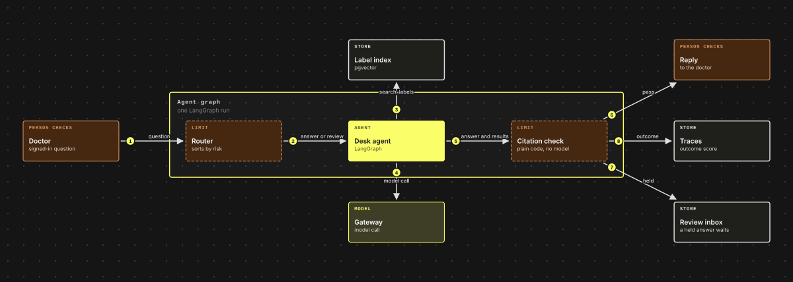
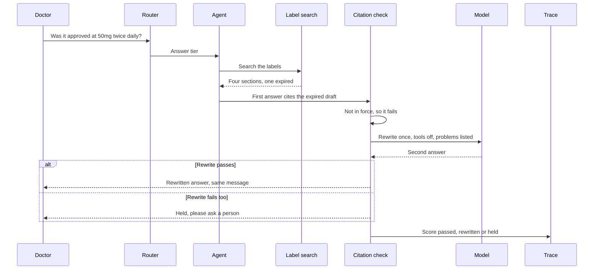
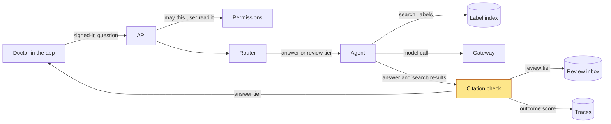
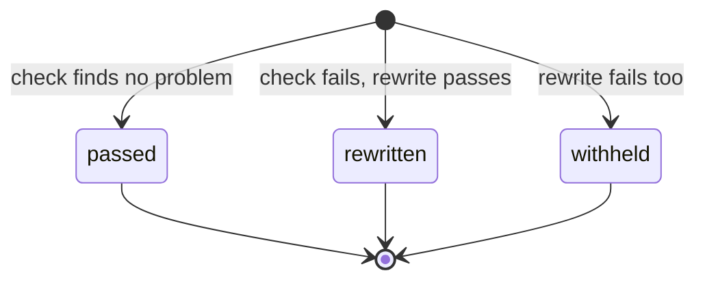
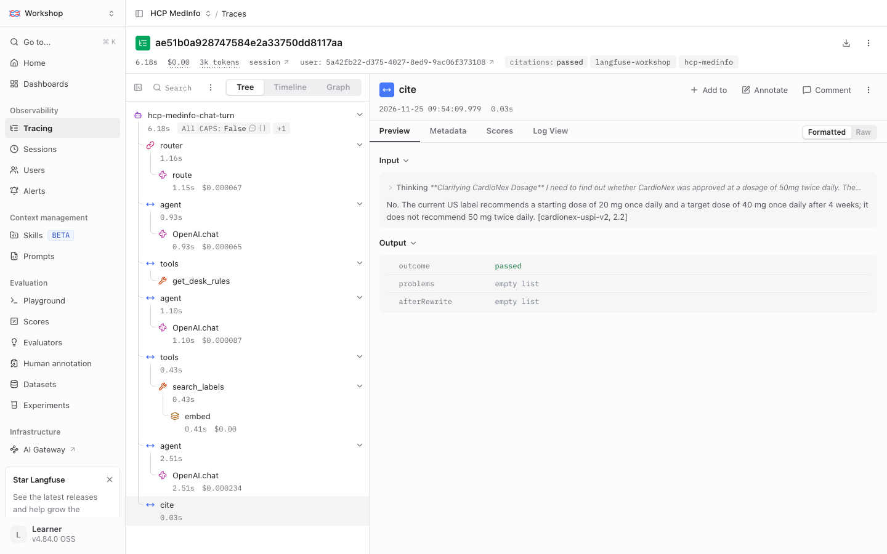

# Check every citation before the answer is sent

## The problem

A doctor asks the desk a short question. "Was CardioNex approved at 50mg twice daily?" The agent answers with a citation, and the answer looks sure. But it cites a 2024 draft that expired. We found this in 6 of 9 stored answers to that question.

The desk rules already say "answer only from label text the search returned". They also say "cite every fact". A rule in a prompt is a request. The model follows it most of the time. When it does not, the answer looks just as sure as a good one.

We checked 405 stored answers. 13 broke a rule, and each one went to a doctor. They broke it in three ways:

- **A citation to a document not in force.** For example, the expired draft above.
- **A dose with no citation.** One answer said "5 mg once daily" for a patient with weak kidneys. Nothing said where 5 mg came from.
- **A number the cited section does not hold.** A "40 %" next to a section that says nothing about 40 %.

A doctor cannot tell these from a good answer. So code must check the answer before it is sent.

## What you build

- **A citation check,** in plain code with no model call. It reads the answer and the sections the search returned.
- **One rewrite.** A failing answer goes back to the model once, with each problem spelled out.
- **A held answer.** If the rewrite fails too, the doctor is told to ask a person.
- **A score on each trace,** in Langfuse, which keeps every trace. It counts how often an answer passed, was rewritten or was held.
- **Two scripts.** One finds the stored answers that broke a rule. One replays them through the new check on the real model.

| Case | What breaks | How the system holds |
| --- | --- | --- |
| A citation to the expired draft | The doctor reads a dose that is not approved | The check sees the document is not in force |
| A dose with no citation | Nobody can say where the dose came from | The check finds a number with no source |
| A number the section lacks | The citation looks real but proves nothing | The check looks for the number in the section |
| A rewrite that fails again | A second try costs time and still misleads | The answer is held, and a person answers |

## How it works

The model writes the answer, and code decides if it goes out. The check reads only what the doctor asked and what the search returned. So it needs no second model, and a right answer costs nothing.



Step through it one part at a time in the [live drawing](https://canvas.learnwithparam.com/case.html#buildcamp/23).

### The flow

This follows one real question from the doctor to the answer they see. Here the first answer cites the expired draft.



The doctor never sees the first answer. The rewrite streams under the same message id. So the answer changes in place, and no second answer appears.

### Where it sits

The check sits between the agent and the end of the turn. On the review tier, it runs before the draft reaches the reviewer.



A reviewer only ever sees a checked draft. A draft with an expired citation never reaches the inbox.

### The states

Each answer ends in one of three outcomes.



There is one rewrite, not a loop. A model that failed twice on the same sections will not pass on a third try. Each try costs a call and the doctor's time.

### Concepts

- [Citation](../walkthrough.md#c-citation)
- [In force](../walkthrough.md#c-in-force)
- [Citation check](../walkthrough.md#c-citation-check)
- [Held answer](../walkthrough.md#c-held-answer)

## Build it

```bash
git checkout checkpoint/21-citations
npm install
npm run dev
```

The checkpoint adds these files. No new package and no new container.

- `src/server/citations.ts`: `checkCitations`, the check itself.
- `src/server/graph.ts`: the `cite` node and `citeStep`, the one rewrite.
- `src/server/medinfo-agent.ts`: the `cite` span and the `citations` score.
- `scripts/citations-audit.ts`: the check over stored answers.
- `scripts/citations-replay.ts`: the `cite` node on those answers, with the real model.
- `src/server/citations.claims.ts`: the claim check. Code finds each quote in its section. A judge call asks if the quote backs the claim.
- `scripts/citations-eval.ts`: `npm run citations:measure` runs 116 claim and quote pairs through that check and writes `docs/runs/citations.json`. Add `-- --fake` to run it with no model.

### Step 1: Find the answers that broke the rules

The answers are already in Langfuse. Each one sits next to the search results the model read. Run the check over them:

```bash
npm run citations:audit
```

```text
405 answers checked, 13 would be stopped.
  uncited: 3
  unsupported: 4
  not_in_force: 6

uncited "5 mg": What is the CardioNex dose for a patient with eGFR of 24 mL/min who is not on dialysis?
  http://localhost:5174/project/<project>/traces/d534f966f3fefed09a0cabd913307f5d
...
not_in_force [cardionex-draft-2024, 2.1]: Was CardioNex approved at 50mg twice daily?
  http://localhost:5174/project/<project>/traces/1d8600ae6af4514d6c6b403e7fb1d8f3
```

It makes no model call. It runs the same function the app now runs. Your numbers depend on what your traces hold. Add `--since 1d` to read only the last day.

Open the last link. The search returned four sections. The answer cites one marked expired.


The answer even calls the draft "an expired document", and cites it anyway. The case for this lesson is STALENESS-03. The expired draft must never be cited.

### Step 2: Check every citation

`checkCitations(answer, retrieved, asked)` returns a list of problems. An empty list is a pass. First, each `[doc_id, section]` must be a section the search returned, and it must be in force:

```ts
for (const citation of new Set(all)) {
  const section = sections.get(citation);
  if (!section) problems.push({ kind: "not_retrieved", citation });
  else if (section.status !== "active") problems.push({ kind: "not_in_force", citation, status: section.status });
}
```

The status comes from the search result. The search reads it from the PDF list of lesson 20. The model never decides if a document is in force.

### Step 3: Check every number a doctor acts on

`quantities` finds each dose, wait, lab value or rate. For example, "5 mg", "4 weeks" or "40 %". Each one must be in the text of the sections its sentence cites.

A sentence with no citation of its own uses its paragraph's. If the paragraph has none, it uses the whole answer's. That is because "Start at 20 mg. Raise to 40 mg after 4 weeks. [doc, 2.2]" cites both sentences at once.

Two things are left alone on purpose:

- **A number the doctor gave.** "eGFR 24" is about the patient. It is not a claim from the label.
- **An answer with no number and no citation.** A follow-up question or a refusal has nothing to check.

A follow-up such as "and if she is on dialysis?" often uses the sections the first question found. `evidenceOf` collects every search result in the thread. So that answer is checked against them too.

### Step 4: Rewrite once, then hold

The graph gets a node between the agent and the end of the turn. `citeStep` in `src/server/graph.ts` does one of three things:

1. **Passed.** No problems, so the answer goes on unchanged. There is no model call.
2. **Rewritten.** The model gets its answer back with each problem in plain words. Tools are off, so it answers from the sections it already has.
3. **Withheld.** The rewrite fails the check too. The doctor gets the reply `WITHHELD_REPLY` instead:

```text
I could not tie every fact in my answer to a label section that is in force today, so I am not sending it. Please ask the medical information team.
```

For example, this is what the model reads about the expired draft:

```text
[cardionex-draft-2024, 2.1] is expired, not in force today. Do not cite it or state its doses.
```

Now run the node on the 13 stored answers that fail. Each one is rebuilt as the thread the model saw. The app's own `cite` node then runs on it, with the real model:

```bash
npm run citations:replay
```

```text
428 stored answers, 13 fail the check. Replaying each on the model.

withheld (uncited): What is the CardioNex dose for a patient with eGFR of 24 mL/min who is not on dialysis?
  http://localhost:5174/project/<project>/traces/9dac043e611d252d4debdee6638cbada
...
rewritten (not_in_force): Was CardioNex approved at 50mg twice daily?
  http://localhost:5174/project/<project>/traces/bd2604f7949c01b32a6d295635b00140

13 replayed: 12 rewritten, 1 withheld.
```

Twelve rewrites passed the check. All six that cited the expired draft now cite only sections in force. One rewrite still gave a dose with no citation. So that doctor would get the held reply. Each run is a trace tagged `citations-replay`, and the script writes `data/evidence/citations-replay.json`.

### Step 5: Count the outcomes

`medinfo-agent.ts` wraps the node in a `cite` span. It writes the outcome as a score on the trace:

```ts
langfuse.score.create({ traceId, name: "citations", value: outcome.outcome, dataType: "CATEGORICAL" });
```

The rewrite's model call is named `citation-rewrite`. So its cost shows apart from the agent's.

Sign in as Ana Rivera and ask "Was CardioNex approved at 50mg twice daily?":


The search returned the label in force, the next label and the old one. The answer cites only the one in force. Open the trace:



The `cite` span comes last, and the header shows `citations: passed`. Filter traces by the `citations` score to see every rewritten or held answer. Or chart the score to watch the rate over time.

## Prove it

| Case | Why it matters | Before | After |
| --- | --- | --- | --- |
| STALENESS-03 | The expired draft must never reach a doctor | 6 stored answers cited it | All 6 rewritten |
| A dose with no citation | Nobody can check where it came from | 3 stored answers sent | 2 rewritten, 1 held |
| A number the section lacks | The citation looks real but proves nothing | 4 stored answers sent | All 4 rewritten |
| REVIEW-01 | A draft is checked before the reviewer sees it | Not checked | Checked, then sent on |

The tests make no model call:

```bash
npx tsx --test src/server/citations.test.ts scripts/citations-audit.test.ts scripts/citations-replay.test.ts
```

- **Four stored answers** in `citations.fixtures.json` give exactly the problems the audit found. They are a good nursing answer, the uncited 5 mg, the "40 %" and the expired draft.
- **The rewrite and the held answer** read the real model's replies from `data/evidence/citations-replay.json`. The check runs again on each one. A rewrite must pass, and a held answer must fail twice.
- **The graph wiring.** The answer tier runs router, agent, cite. The review tier runs cite before submit.

Break it on purpose. Skip the `cite` edge in `graph.ts`, and drop the status check in `citations.ts`. Four of these tests fail.

Then make the tools lie. The fault run gives the real agent five broken tools. Search returns the old label marked active, or a planted order, or nothing. A tool throws, or OpenFGA does not answer:

```bash
npm run faults:measure
```

- **A tool's word is not enough.** The check reads each document's own dates. An old label marked active still fails.
- **`docs/runs/faults.json`** holds the counts `docs/measures.md` compares, and each failure with the reply the doctor would have read.

## Stuck points

In a correct run, `npm run citations:audit` prints a count. A new chat trace ends in a `cite` span with a `citations` score.

| What you see | Why | What to do |
| --- | --- | --- |
| The audit says 0 answers checked | Your traces hold no answers yet | Ask a few questions in the app first |
| The audit counts differ from the page | Your traces are not ours | Read the kinds, not the totals |
| No `cite` span in a new trace | The server runs old code | Restart `npm run dev` |
| Every answer is held | Search returns no section in force | Run `npm run rag:ingest` from lesson 20 |

## What to watch for

- **A check that is too strict.** If it holds good answers, doctors stop trusting the desk. Watch the share of held answers. A rise means the check or the search went wrong.
- **A number written in words.** "Half the usual dose" has no number to find. The check lets it through. A list of words like "half" and "double" would catch it.
- **A rewrite that hides the cause.** Rewrites fix the answer, but the first answer was still wrong. Read the rewritten ones each week. They show where the prompt or search is weak.

## Results

```bash
npm run dataset:run -- --chapter 21 --cases STALENESS-01,STALENESS-02,STALENESS-03,RAG-01,RAG-02,RAG-03,POSITIVE-01,TENANCY-01,MULTITURN-01,GUARDRAIL-01,REVIEW-01
```

| Chapter | Change | Passed | staleness | rag |
| --- | --- | --- | --- | --- |
| 21 | Every answer's citations are checked against the search before it is sent | 11/11 | 3/3 | 3/3 |

The full row is in `docs/scoreboard.md`. How to read it:

- **All three staleness cases passed.** No answer cited the expired draft. The doses came from the label in force.
- **REVIEW-01 passed.** The draft went through the check before it reached the inbox.
- **RAG-02 passed.** The router used to stop it, because it called any patient outside the plain use off-label. Now a patient group with its own label section, such as pregnancy, gets an answer.
- **Every `cite` span passed.** The check ran on each answer and found nothing to stop.

## Where to go next

- Read `checkCitations` in `src/server/citations.ts`, then `citeStep` in `src/server/graph.ts`.
- Try the homework. Write an answer that says "half the usual dose" where the label says 10 mg. Run `checkCitations` on it, and decide if the check should catch it.
- Read about [scores on a trace](https://langfuse.com/docs/evaluation/evaluation-methods/scores-via-sdk) and [conditional edges](https://langchain-ai.github.io/langgraphjs/concepts/low_level/#conditional-edges).
- Lesson 22 starts from this checkpoint.
