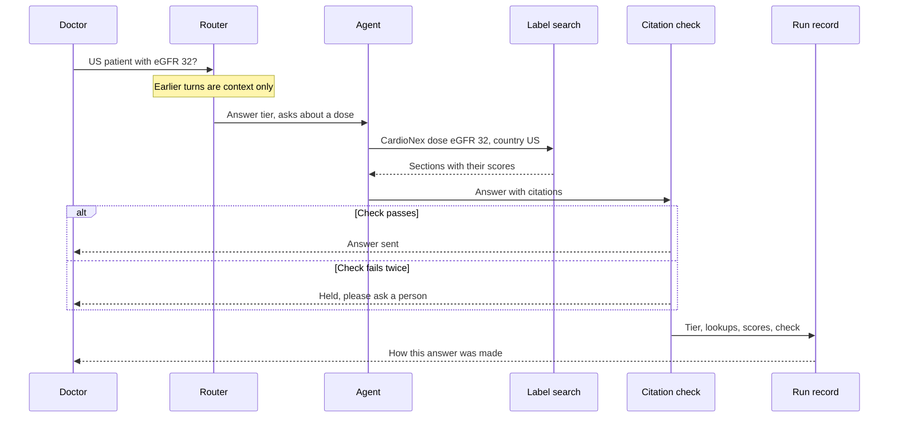
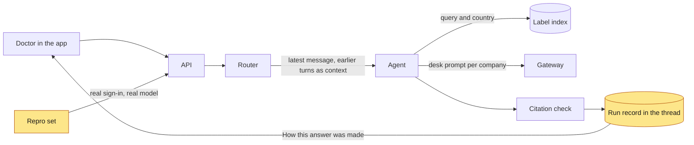
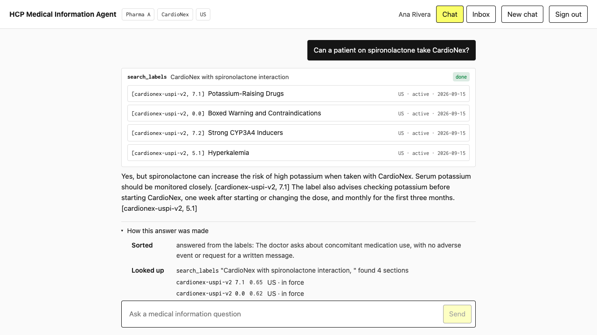

# Replay the chats that broke, then run every case

## The problem

Every lesson passed its own cases. Then the desk was shown live, and real doctors typed real follow-ups. It broke in ways no single case had tried.

- **A good follow-up was refused.** A doctor asked about a 9-year-old, and the desk rightly refused. Then the doctor asked "US patient with eGFR 32?". That was refused too, "because it asks about a child".
- **Every dose question got the same four sections.** Five questions got the same results. Each search had the same words added.
- **A question about Germany got the US label.** The search never looked at the country in the question.
- **Nobody could see why.** The answer showed its citations. It did not show what was found, how well it matched, or if the check passed.

A lesson case tests one thing. A demo tests the whole desk at once, in the order real people ask.

## What you build

- **A repro set.** A script plays the chats that broke. It signs in as the demo users and calls the real model. Each turn says what a right answer is. It fails on any miss.
- **Four fixes,** one per cause. The router sorts only the latest message. One desk prompt is filled in per company. Search takes the country the question is about. Each result keeps its score.
- **A run record under each answer.** The doctor opens "How this answer was made". It shows how the question was sorted, what was looked up and what the check found.
- **One full run** of all 70<!-- from: docs/runs/scoreboard-23.json#total --> cases on the finished desk, with every miss read and filed.

| Case | What breaks | How the system holds |
| --- | --- | --- |
| A follow-up after a refusal | The doctor is refused twice for one bad message | The router sorts only the latest message |
| A question about another country | The doctor gets the wrong country's dose | Search ranks that country's label and marks it as such |
| The same four sections every time | Answers stop fitting the question | The model writes the search words, and nothing is added |
| An answer nobody can explain | A doctor cannot judge it, a teacher cannot debug it | Each answer keeps a run record the chat shows |

## How it works

A failure seen live becomes a script first. The script turns red on the old code. Each fix turns one part of it green. The full run then checks that no fix broke a case from an earlier lesson.

### The flow

This follows the follow-up that was refused in the demo, after the fix.



The record is built from the same steps the trace holds. So the screen and the trace tell one story.

### Where it sits

Nothing new sits in the request path. The fixes change what the router reads, what the prompt says and what search returns. The run record is saved with the thread.



### Concepts

- [Repro set](../walkthrough.md#c-repro-set)
- [Router](../walkthrough.md#c-router)
- [Run record](../walkthrough.md#c-run-record)
- [Pass rate](../walkthrough.md#c-pass-rate)

## Build it

```bash
git checkout checkpoint/23-full-run
npm install
npm run dev
```

The checkpoint changes these files. No new package and no new container.

- `scripts/demo-turns.ts`: the repro set, run as `npm run demo:check`.
- `src/server/tiers.ts`: `routerInput`, what the router reads.
- `src/server/desk-prompt.ts`: `deskFacts` and `fillDeskPrompt`, one prompt per company.
- `src/server/rag/search.ts`: search by the question's country, with scores.
- `src/shared/run.ts` and `src/client/chat/RunSteps.tsx`: the run record and its panel.

### Step 1: Replay the chats that broke

Turn each failure into a chat the script can play. The script signs in as the demo users and asks through the real API:

```bash
npm run demo:check
```

On the lesson 22 checkpoint most turns were wrong.

Every dose search had the same words added. The Germany draft used the US label. Japan got no answer. Pharma B asking about CardioNex got no answer, when it should name its own medicine.

### Step 2: Sort only the latest message

The router used to read the last six messages as one block. One refused message made every later message look refused. Now it sorts the latest message alone. Earlier turns come as context, and the desk's own replies come only as their kind:

```ts
const earlier = said
  .slice(0, lastAt)
  .slice(-6)
  .map((line) => (line.doctor ? `Doctor: ${line.text}` : `(${deskKind(line.text)})`));
const latest = `Message to sort:\nDoctor: ${said[lastAt]!.text}`;
```

A refusal's wording never reaches the router, so it cannot copy the reason. Both demo follow-ups now get a dose.

### Step 3: Fill one desk prompt per company

The prompt in the code said "Pharma A, CardioNex" for everyone. Pharma B's doctors got a CardioNex citation as their example. Now the prompt is a template. `deskFacts` fills it from the signed-in user:

```ts
return {
  company: tenant?.name ?? user.tenantId,
  medicines: medicines.join(", "),
  country: user.country,
  today,
  approval: ...,
  example: exampleCitation(user.tenantId, medicines, user.country, today)
};
```

The example is the dose section of that company's own label in force. A test fails when a Pharma B prompt names CardioNex.

### Step 4: Search the country the question names

The model now writes the search words itself, and passes a country when the question names one. Each result keeps its score, so you can see why it won. The Germany draft now quotes the German label, `cardionex-de-smpc 2.2`. The Japan question cites `cardionex-jp-label`.

```bash
npm run demo:check
```

Every turn is right now.

### Step 5: Show how each answer was made

The graph keeps one run record per reply. It holds the tier and its reason. It holds each lookup with what it asked and found. It holds the citation check. The chat shows it under the answer, closed until the doctor opens it.

Sign in as Ana Rivera and ask "Can a patient on spironolactone take CardioNex?". Open "How this answer was made":



The search found a few sections. The best was `cardionex-uspi-v2 7.1`, in force in the US. The check passed.

### Step 6: Run every case

Each earlier lesson ran only its own cases. Now run all of them on the finished desk:

```bash
npm run dataset:run -- --chapter 23 --change "The whole desk, every case, after the demo fixes" --reference
```

The run scores each case with `behavior_match`, `label_checks`, `risk_tier` and `faithfulness`. It saves a run file, and that file rebuilds `docs/scoreboard.md`. Every miss prints with its answer.

## Prove it

| Case | Why it matters | Before | After |
| --- | --- | --- | --- |
| Follow-up after a refusal | One bad message must not block the next | Refused | Answered with a dose |
| Germany draft | A dose must come from the right country | US label | `cardionex-de-smpc 2.2` |
| Pharma B asks about CardioNex | A company sees only its own medicines | No answer | Names NeuroVex |
| The demo chats | The whole demo, in order | 3 of 10 | 10 of 10 |

The tests make no model call:

```bash
npx tsx --test src/server/tiers.test.ts src/server/desk-prompt.test.ts src/shared/run.test.ts
```

- **The router input.** A refusal's wording never reaches the router.
- **The desk prompt.** A Pharma B prompt never names CardioNex.
- **The run record.** It holds only this turn's lookups, with their scores and status.

Break it on purpose. Pass the whole transcript to the router again. The router test fails.

## Stuck points

| What you see | Why | What to do |
| --- | --- | --- |
| `demo:check` fails at sign-in | The demo users are not set up | Run `npm run setup` |
| No "How this answer was made" | The server runs old code | Restart `npm run dev`, then ask again |
| The full run is slow or times out | 70 cases call the real model | Run it when nothing else is running |
| Scores fail to send | The trace store is busy | The run still finishes. Read the totals it prints |

## What to watch for

- **An evaluator that disagrees with the case.** Two cases expect a reply that contains a marker. The evaluator reads any marker as a refusal. Fix the evaluator or the case, not the agent.
- **A case the new data answers.** Fuller labels can answer a question a case says has no answer. Read the answer before you call it a miss.
- **A fix that moves a failure.** The ask-a-question rule changed in step 3. Watch the follow-up cases after any prompt change.

## Results

| Chapter | Change | Passed | ambiguous | off-label | rag | fact-check | outreach | insights |
| --- | --- | --- | --- | --- | --- | --- | --- | --- |
| 23 | The whole desk, every case, after the demo fixes | 63/70 | 0/1 | 2/3 | 2/3 | 5/6 | 5/6 | 5/7 | <!-- from-row: docs/runs/scoreboard-23.json -->

Every other slice passed in full. The full row is in `docs/scoreboard.md`. The pass rate is 63<!-- from: docs/runs/scoreboard-23.json#passed --> of 70<!-- from: docs/runs/scoreboard-23.json#total -->. How to read the misses:

- **Real misses, 4.** AMBIGUOUS-01 should ask for the patient's facts before giving a dose, and did not. NEGATIVE-03 said honestly that no head-to-head trial exists, but left out the marker the app routes on. INSIGHTS-02 and INSIGHTS-03 answered part of the question and said what the table lacks.
- **The evaluator disagrees, 2.** FACT-06 and OUTREACH-04 expect a reply that names what is missing. Both did. The evaluator scored the marker as a refusal.
- **The case is out of date, 1.** RAG-03 expects no answer about alcohol. The full FAQ now has one, section 1.4, and the desk cited it.

## Where to go next

- Read `routerInput` in `src/server/tiers.ts`, then `answerRun` in `src/shared/run.ts`.
- Try the homework. Add a chat that broke for you to `scripts/demo-turns.ts`. Watch it fail, then fix it.
- Read about [experiments on a dataset](https://langfuse.com/docs/evaluation/dataset-runs/remote-run).
- This is the last lesson. The [walkthrough](../walkthrough.md) ties every lesson together.
