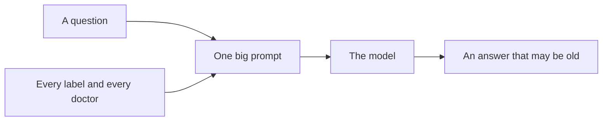

# Run the stack and meet the naive agent

Job: see why a plain chatbot fails a medical affairs team.

## The story in one picture



## Why this matters

A medical affairs team answers questions about drugs. A wrong dose in an answer can hurt a patient. So the team needs answers it can check.

The easy way to build an agent is to paste everything into one prompt. This module builds that agent on purpose. Then you watch it fail.

## What you will have at the end

- A running Postgres and a running Phoenix.
- Made-up labels, doctors and sales numbers, loaded the same way for everyone.
- A naive agent that you can point at.

## See it fail first

Ask the naive agent: "What is the OncoX dose in the United States?" The old label says 100 mg once daily. The new label says 150 mg once daily. Both labels sit in the same prompt. The model has to guess which one is current. A golden set grades it, because each question there has one right answer.

For example, a model that reads the old label first may quote 100 mg. A reviewer who trusts that answer gives a patient the wrong dose.

The prompt also holds every doctor's email. That is private data, and it should never reach a model.

## Step 1: check your tools

Install Bun and Docker. Start Docker before you go on.

```bash
bun --version
docker --version
```

Expect: two version lines, one from each tool.

## Step 2: start the stack

```bash
bun install
bun run up
```

Expect: a line that says the stack is up, how many people Postgres holds, and that Phoenix is on port 6006.

The `up` command starts Postgres with pgvector and Phoenix. It then builds the seed files and loads them. You can run it again at any time. It starts from fresh data each time.

### packages/core/src/seed-load.ts

```ts
export async function loadSeed(): Promise<void> {
  for (const schema of OWNED_SCHEMAS) await rows(`DROP SCHEMA IF EXISTS ${schema} CASCADE`);
  for (const table of OWNED_TABLES) await rows(`DROP TABLE IF EXISTS ${table}`);
  await rows(readFileSync(join(OUTPUT, "sql", "seed.sql"), "utf8"));
}
```

This code drops what the seed made, then runs the seed again. That is why a second run is safe.

## Step 3: build the naive prompt

### apps/hcp-showcase/src/naive.ts

```ts
export function naivePrompt(question: string): string {
  const documents = DOCUMENTS.map((item) => `${item.title}\n${item.body}`).join("\n\n");
  const doctors = PRESCRIBERS.map((item) => [item.name, item.npi, item.email].join(" ")).join("\n");
  const parts = [
    "You help a medical affairs team.",
    documents,
    `Prescribers:\n${doctors}`,
    question,
  ];
  return parts.join("\n\n");
}
```

The prompt holds every document and every doctor. Nothing is filtered. This is the flaw the rest of the course fixes.

## Step 4: verify

```bash
bun run verify foundation
```

Expect: four green badges and the line "Every check passed."

## Try it yourself

Print the prompt for any question and count its characters. For example, ask about CardioZ in Germany. Notice how long the prompt is, and how little of it the question needs.

## Stuck?

| You see                                       | Why                        | Fix                                       |
| --------------------------------------------- | -------------------------- | ----------------------------------------- |
| Postgres has no people. Run bun run up first. | The seed was never loaded. | Run bun run up.                           |
| Phoenix did not answer on port 6006.          | Phoenix is still starting. | Wait ten seconds and run the check again. |

If you are still stuck, start from a clean copy of this step.

```bash
bun run goto foundation
```

Expect: a message that you are now on the foundation checkpoint, with a list of things to do.

## New words

- **naive agent**: An agent that puts all it has into one prompt. It trusts whatever comes back.
- **seed**: Made-up data that all learners load. It is the same for everyone.
- **golden set**: A list of questions with the right answers. It grades the agent.
