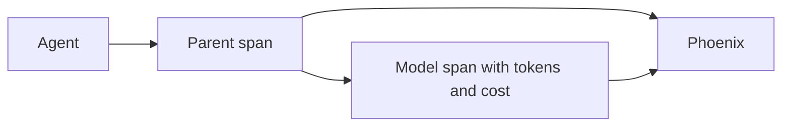

# Route every model call through a gateway and trace it

Job: show the team why an answer came out and what it cost.

## The story in one picture



## Why this matters

A reviewer asks why the agent said 150 mg. Without a trace, nobody can tell. A finance lead asks what the agent costs each month. Without a trace, nobody knows.

In this module every model call goes through one function, `ask`. That one door is the gateway. It picks the model by role, and it records what happened.

## What you will have at the end

- One `ask` function that every agent uses.
- Spans that nest inside a parent, so one request is one trace.
- Tokens, cost, tenant and agent name on every span.
- A replay mode that needs no key.

## See it fail first

Run the naive agent from module 00 and open Phoenix at `http://localhost:6006`. For example, ask about the OncoX dose. The project has no trace for it. You cannot see the prompt size, the cost, or which tenant asked.

## Step 1: pick the model by role

Code never names a model. It asks for a role: fast, smart or judge. The file `config/models.ts` maps each role to a model id. To change provider, set `LLM_PROVIDER`. The default is `replay`, which needs no key.

## Step 2: open a span around the work

### packages/core/src/telemetry.ts

```ts
export async function traced<Result>(
  name: string,
  tags: Tags,
  work: (setAttributes: (extra: Attributes) => void) => Promise<Result>,
  kind = "CHAIN",
): Promise<Result> {
  const tracer = startTracing().getTracer("buildcamp");
  return tracer.startActiveSpan(name, async (span) => {
    span.setAttributes({
      "openinference.span.kind": kind,
      tenant_id: tags.tenantId,
      agent_name: tags.agentName,
    });
    try {
      return await work((extra) => span.setAttributes(extra));
    } catch (error) {
      span.setStatus({ code: SpanStatusCode.ERROR, message: String(error) });
      throw error;
    } finally {
      span.end();
    }
  });
}
```

The function opens a span and adds the tenant and the agent name. Then it runs the work and ends the span. A child span finds its parent through a context manager. The file registers one before the first span.

Verify with the first check.

```bash
bun run verify gateway-tracing
```

Expect: the first check passes. The last two may still fail until you finish the next step.

## Step 3: record tokens and cost

### packages/core/src/ask.ts

```ts
export async function ask(role: Role, prompt: string, tags: Tags): Promise<Recorded> {
  return traced(
    `llm.${role}`,
    tags,
    async (setAttributes) => {
      const reply = await callModel(role, prompt);
      const id = modelId(role);
      setAttributes({
        "llm.model_name": id,
        "llm.token_count.prompt": reply.inputTokens,
        "llm.token_count.completion": reply.outputTokens,
        cost_usd: costUsd(id, reply.inputTokens, reply.outputTokens) ?? -1,
      });
      return reply;
    },
    "LLM",
  );
}
```

The cost comes from a price table with a source for each price. A model with no known price shows a cost of minus one. It never shows zero, because zero would look like a real answer.

## Step 4: verify

```bash
bun run verify gateway-tracing
```

Expect: three green badges and the line "Every check passed." Then open Phoenix. You see a parent span with a model span inside it.

## Try it yourself

Add a `step` note to the parent span, such as the question's brand. Then find it in Phoenix. For example, tag a CardioZ question with `brand`.

## Stuck?

| You see                                       | Why                                                                  | Fix                                                       |
| --------------------------------------------- | -------------------------------------------------------------------- | --------------------------------------------------------- |
| The model span is not nested inside a parent. | No context manager is registered, so each span starts its own trace. | Register the async context manager before the first span. |
| The trace has no llm.fast span.               | The model call never made a span.                                    | Wrap the model call in traced inside ask.                 |
| The prompt tokens are missing.                | The span has no token counts.                                        | Set the token counts and cost on the span.                |

If you are still stuck, start from a clean copy of this step.

```bash
bun run goto gateway-tracing
```

Expect: a message that you are now on the gateway-tracing checkpoint, with a list of things to do.

## New words

- **span**: One timed step, such as a single model call. It holds notes about that step.
- **trace**: All the spans of one request, in order. Spans nest inside their parent.
- **replay**: Playing back a reply that was saved from a real model. It needs no key.
