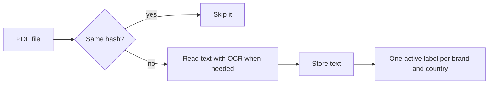

# Ingest documents and keep them fresh

Job: make sure the agent quotes the current label, never the old one.

## The story in one picture



## Why this matters

Labels change. A new label can cut a dose, add a warning, or end an old rule. A medical team must quote the label in force today.

So the agent must never see an old label. It must also skip a draft that ended. A label that starts later stays hidden too. This module stores every file and marks one label active for each brand and country.

## What you will have at the end

- Every PDF read into text, including a scanned page.
- A hash for each file, so a repeat upload is skipped.
- One active label for each brand and country.

## See it fail first

Which of these three OncoX labels is the one a patient should follow today? The first says 100 mg. The second says 150 mg. The third says something new, but it has not started yet.

For example, the naive agent from module 00 sees all three labels. It may quote the old one or the future one. Neither is right today.

## Step 1: read each file

To **ingest** a file means to read it, store its text, and mark it ready for search. Most PDFs have text inside. A scanned page is only a picture, so a reader must use **OCR** to find the letters. OCR is software that reads letters from a picture.

The reader in this course does both. It gives back plain text. The code joins the lines with single spaces, so a sentence never breaks in the middle.

## Step 2: skip files that did not change

A **hash** is a short code made from a file. The same file always gives the same code. When a hash matches the stored one, the file is a repeat. The code skips it and returns `unchanged_skipped`.

## Step 3: mark one label active

### packages/core/src/ingestion.ts

```ts
const IN_FORCE = "o.effective <= $1 AND (o.expires IS NULL OR o.expires >= $1)";

// One label is active: the newest version that is in force today for its brand and country.
const REFRESH_ACTIVE = `UPDATE documents d SET is_active = (
  ${IN_FORCE.replaceAll("o.", "d.")} AND d.version = (
    SELECT max(o.version) FROM documents o
    WHERE o.brand = d.brand AND o.country = d.country AND o.type = d.type AND ${IN_FORCE}))
  WHERE brand = $2 AND country = $3 AND type = $4`;

export async function ingestDocument(document: HcpDocument): Promise<Outcome> {
  const bytes = readFileSync(fileOf(document));
  const sha = createHash("sha256").update(bytes).digest("hex");
  const [known] = await rows<{ content_sha: string }>(
    "SELECT content_sha FROM documents WHERE slug = $1",
    [document.slug],
  );
  if (known !== undefined && known.content_sha === sha) return "unchanged_skipped";
  const values = rowOf(document, sha, await readText(fileOf(document)));
  await inTransaction(async (run) => {
    await run("DELETE FROM documents WHERE slug = $1", [document.slug]);
    await run("INSERT INTO documents VALUES ($1, $2, $3, $4, $5, $6, $7, $8, $9, false)", values);
    const label = [AS_OF, document.brand, document.country, document.type];
    await run(REFRESH_ACTIVE, label);
  });
  return known === undefined ? "added" : "replaced";
}
```

Look at the update. A label is active only when it has started and has not ended. Among those, only the newest version is active. The store and the update run in one transaction. So the old label and the new label are never active together.

## Step 4: verify

```bash
bun run verify documents-freshness
```

Expect: five green badges and the line "Every check passed."

## Try it yourself

Add a new OncoX label for Germany with a later date. Ingest it, then ask which label is active. For example, check that the Germany label changes and the United States label does not.

## Stuck?

| You see                                    | Why                                                          | Fix                                                        |
| ------------------------------------------ | ------------------------------------------------------------ | ---------------------------------------------------------- |
| The old OncoX dose is still active.        | The old version was never hidden when the new one arrived.   | After each upload, pick the newest version in force today. |
| The expired CardioZ draft is still active. | The end date was never checked.                              | Require the end date to be empty or not yet passed.        |
| The scanned dose was not read.             | The text has line breaks, or the page was not read with OCR. | Join the lines with single spaces, and read every page.    |

If you are still stuck, start from a clean copy of this step.

```bash
bun run goto documents-freshness
```

Expect: a message that you are now on the documents-freshness checkpoint, with a list of things to do.

## New words

- **ingest**: To read a file, store its text, and mark it ready for search.
- **hash**: A short code made from a file. The same file always gives the same code.
- **OCR**: Software that reads letters from a picture. A scanned page needs it.
