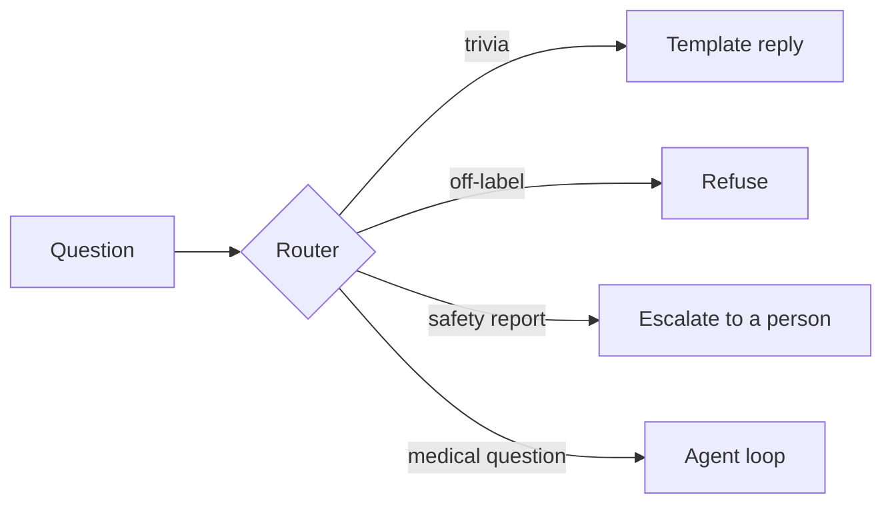

# Route each question before the agent loop runs

Job: send trivia and off-label requests down cheap, safe paths.

## The story in one picture



## Why this matters

Not every question needs a model. A question about sorting code is not a medical affairs question. A model call costs money and time, and it can say the wrong thing.

Some questions are risky. A doctor may mention a rash inside a friendly note. That is a safety report, and a person must see it first.

## What you will have at the end

- A router that picks a path from the words in the question.
- A fixed reply for trivia, with no model call.
- A refusal for off-label requests.
- A safety report that goes to a person.

## See it fail first

Should a question about a sorting algorithm cost the same as a question about a dose? Send "Write a sorting algorithm in Python." to the naive agent.

For example, the naive agent builds a huge prompt and pays for a model call. The trace in Phoenix shows a model span. The question did not need one.

## Step 1: pick the path

A **router** is code that reads a question and picks a path for it before any model runs. The router here checks the words in the question. It checks the safety words first, because safety comes before everything else.

### packages/core/src/router.ts

```ts
export function decide(question: string): Decision {
  const text = question.toLowerCase();
  if (text.startsWith("send the approved")) return { route: "approve", reason: "needs approval" };
  if (has(text, SAFETY_WORDS)) return { route: "escalate", reason: "possible adverse event" };
  if (has(text, OFF_LABEL_WORDS)) return { route: "refuse", reason: "off-label" };
  if (!namesBrand(text) && !has(text, TOPIC_WORDS)) return { route: "template", reason: "trivia" };
  return { route: "answer", reason: "medical affairs question" };
}
```

A **template** is a fixed reply that needs no model. It is fast, free and always the same. To **escalate** is to hand a case to a person who can decide. A safety report is escalated.

## Step 2: run the chosen path

### packages/core/src/router.ts

```ts
export async function handle(
  question: string,
  tags: Tags,
  answer: (question: string) => Promise<AgentResult>,
): Promise<AgentResult> {
  return traced("route", tags, async (setAttributes) => {
    const decision = decide(question);
    setAttributes({ route: decision.route, reason: decision.reason });
    if (decision.route === "answer") return answer(question);
    return { route: decision.route, text: REPLIES[decision.route], citations: [] };
  });
}
```

Look at the last two lines. Only the answer path calls a model. Every other path returns its fixed reply. The route is a note on the span, so you can see it in Phoenix.

## Step 3: verify

```bash
bun run verify intent-routing
```

Expect: five green badges and the line "Every check passed." Then open Phoenix. The trivia question shows a route span and no model span.

## Try it yourself

Add a new route for questions about price. For example, send "How much does OncoX cost?" to a template that points to the pricing team. Then add a check for it.

## Stuck?

| You see                                 | Why                                                                 | Fix                                                              |
| --------------------------------------- | ------------------------------------------------------------------- | ---------------------------------------------------------------- |
| The template path still called a model. | The handler runs the agent for every route.                         | Return the fixed reply for each route that is not answer.        |
| wanted escalate.                        | The safety words were never checked, or they were checked too late. | Check for safety words before every other rule.                  |
| wanted refuse.                          | The off-label words were never checked.                             | Refuse a question that asks what a drug works for off the label. |

If you are still stuck, start from a clean copy of this step.

```bash
bun run goto intent-routing
```

Expect: a message that you are now on the intent-routing checkpoint, with a list of things to do.

## New words

- **router**: Code that reads a question and picks a path for it before any model runs.
- **template**: A fixed reply that needs no model. It is fast, free and always the same.
- **escalate**: To hand a case to a person who can decide. A safety report is escalated.
