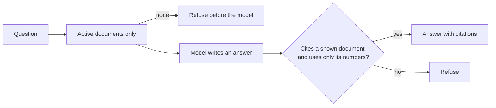

# Answer only from cited sources

Job: give medical reviewers answers they can check line by line.

## The story in one picture



## Why this matters

A model can sound sure and still be wrong. In medical affairs, a made-up dose can hurt a patient. A reviewer needs to see where each answer came from.

So the agent here is **grounded**. That means it answers only from documents it was shown. Each answer carries a **citation**, a note that names its source.

## What you will have at the end

- A prompt that holds only the active documents, each with an id.
- A check that every answer cites a shown document.
- A check that every number comes from the cited document.
- A refusal when no document covers the question.

## See it fail first

What stops the agent from inventing a dose when the documents say nothing? Ask the naive agent about NeuroCalm for children under five. No label covers that.

For example, the naive agent may still reply with a dose. It sounds helpful, but nobody can check it. A reviewer cannot tell a real dose from a guess.

## Step 1: show only the active documents

The prompt lists each active document under its id in square brackets. The rules ask the model to name the ids it used. They also tell it to say NOT_IN_DOCUMENTS when the documents are silent.

### packages/core/src/grounded.ts

```ts
export function groundedPrompt(question: string, documents: StoredDocument[]): string {
  const shown = documents.map((item) => `[${item.slug}]\n${item.body}`).join("\n\n");
  const rules = `Answer from the documents only. End with the id of each document you used.
Write each id in square brackets. If the documents do not say, reply ${NOT_THERE}.`;
  return [rules, shown, `Question: ${question}`].join("\n\n");
}
```

## Step 2: check the claim

A **claim** is what the model says. The model can be wrong, so code must check it. The check asks three things. Is there a citation? Was that document shown? Does every number appear in it?

### packages/core/src/grounded.ts

```ts
export function checkClaim(text: string, documents: StoredDocument[]): string | undefined {
  const cited = [...text.matchAll(/\[([a-z0-9-]+)\]/g)].map((match) => match[1]);
  if (cited.length === 0) return "the answer cites no document";
  const shown = documents.map((item) => item.slug);
  if (!cited.every((slug) => shown.includes(slug))) return "the answer cites a document not shown";
  const source = documents.filter((item) => cited.includes(item.slug)).map((item) => item.body);
  const numbers = text.replace(/\[[a-z0-9-]+\]/g, "").match(/\d+(\.\d+)?/g) ?? [];
  const missing = numbers.find((number) => !source.join(" ").includes(number));
  return missing === undefined ? undefined : `the number ${missing} is not in the cited document`;
}
```

## Step 3: refuse when there is nothing to read

When no active document matches, the agent refuses before it calls the model. A reply of NOT_IN_DOCUMENTS also becomes a refusal.

### packages/core/src/grounded.ts

```ts
export async function answerGrounded(
  question: string,
  tags: Tags,
  generate: Generate,
): Promise<AgentResult> {
  const subject = subjectOf(question);
  const documents = await findDocuments(subject, tags);
  if (documents.length === 0) return refusal("No current document covers that question.");
  const reply = (await generate(groundedPrompt(question, documents))).trim();
  if (reply === NOT_THERE) return refusal("The documents do not say.");
  const problem = checkClaim(reply, documents);
  if (problem !== undefined) return refusal(`I cannot give that answer: ${problem}.`);
  const citations = [...reply.matchAll(/\[([a-z0-9-]+)\]/g)].map((match) => match[1]);
  return { route: "answer", text: reply, citations };
}
```

## Step 4: verify

```bash
bun run verify grounded-answer
```

Expect: seven green badges and the line "Every check passed."

## Try it yourself

Add a rule that an answer may not be longer than three sentences. For example, refuse a long answer, then add a check for it.

## Stuck?

| You see                                         | Why                                                                 | Fix                                                                   |
| ----------------------------------------------- | ------------------------------------------------------------------- | --------------------------------------------------------------------- |
| A number that is not in the label was accepted. | The answer was never checked against the cited document.            | Check every number in the answer against the cited document.          |
| An uncited answer was accepted.                 | The check does not look for a citation.                             | Refuse an answer that cites no document, or one that was never shown. |
| The old dose reached the prompt.                | The prompt was built from every document, not only the active ones. | Build the prompt from the active documents only.                      |

If you are still stuck, start from a clean copy of this step.

```bash
bun run goto grounded-answer
```

Expect: a message that you are now on the grounded-answer checkpoint, with a list of things to do.

## New words

- **grounded**: Based on documents the agent was shown. A grounded answer has a source.
- **citation**: A note that names the document an answer came from.
- **claim**: What the model says. Code must check it, because the model can be wrong.
