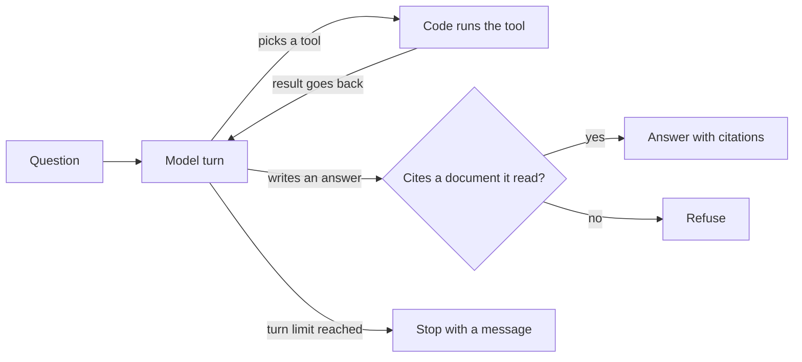

# Let the model pick tools in a loop

Job: answer a question that needs three lookups, and stop a loop that never ends.

## The story in one picture



## Why this matters

Some questions need more than one lookup. A reviewer asks how much faster NeuroCalm users fell asleep. The agent must find the documents, read the study, and then answer.

An **agent loop** lets the model do this. The model picks a tool, code runs it, and the result goes back to the model. This repeats until the model writes an answer.

## What you will have at the end

- Tools with a Zod schema, a list that says what inputs each tool takes.
- A loop that runs the tool the model picks and sends the result back.
- A limit called MAX_TURNS, so the loop always ends.
- One telemetry span for each turn.

## See it fail first

What stops an agent that asks for one more tool call, forever? Nothing does, until you add a limit.

A one-shot lookup picks its documents once, before the model reads the question. The model cannot ask for a second document. For example, the agent must list the documents first. Then it must read the study. One step cannot do both.

## Step 1: describe the tools

A **tool call** is the model asking code to run one named tool. Each tool has a Zod schema. The schema names the inputs and their types. These tools have no code of their own. The loop runs them. Every call shows up in the trace.

### packages/core/src/agent.ts

```ts
const ListInput = z.object({ brand: z.string(), country: z.string() });
const ReadInput = z.object({ slug: z.string() });

export const agentTools = {
  list_documents: tool({
    description: "List the current documents for one brand in one country.",
    inputSchema: ListInput,
  }),
  read_document: tool({
    description: "Read one listed document by its id.",
    inputSchema: ReadInput,
  }),
};
```

## Step 2: run the loop

A **turn** is one trip to the model. Each turn gets one span, so Phoenix shows the steps in order. When the model asks for tools, code runs them. The results go back as a tool message. When the model writes plain text, the loop ends.

### packages/core/src/agent.ts

```ts
for (let turn = 1; turn <= MAX_TURNS; turn++) {
  const step = await traced("agent.turn", tags, async (setAttributes) => {
    const result = await generateText({ model, system: RULES, messages, tools: agentTools });
    setAttributes({ turn, tool_calls: result.toolCalls.length });
    return result;
  });
  messages.push(...step.response.messages);
  if (step.toolCalls.length === 0) return finish(step.text, library, toolCalls, turn);
  // run each tool call, then send the results back to the model
  messages.push({ role: "tool", content: results });
}
return stopped(MAX_TURNS, toolCalls);
```

The model comes from `languageModel("smart")` in config/models.ts. No model id is written in this file.

## Step 3: stop a loop that never ends

A tool can be slow or broken, and the model may keep asking for it. The limit is `MAX_TURNS`. When the turns run out, the agent refuses with a clear message.

### packages/core/src/agent.ts

```ts
export const MAX_TURNS = 6;

function stopped(turns: number, toolCalls: ToolCall[]): AgentRun {
  const text = `The agent stopped after ${MAX_TURNS} turns without an answer.`;
  return { route: "refuse", text, citations: [], toolCalls, turns };
}
```

## Step 4: check the answer

The final answer is still a claim. It must cite a document the agent read, and use only numbers from it.

### packages/core/src/agent.ts

```ts
const problem = checkClaim(text, [...library.read.values()]);
if (problem !== undefined) {
  const refusal = `I cannot give that answer: ${problem}.`;
  return { route: "refuse", text: refusal, citations: [], toolCalls, turns };
}
```

## Step 5: verify

```bash
bun run verify agent-loop
```

Expect: four green badges and the line "Every check passed."

These checks use a scripted model, so they run with no key. A run with a live model is a separate step.

## Try it yourself

Add a third tool that lists the brands. For example, let the model ask which brands exist, then add a check for it.

## Stuck?

| You see                                            | Why                                                                    | Fix                                                                  |
| -------------------------------------------------- | ---------------------------------------------------------------------- | -------------------------------------------------------------------- |
| The loop did not stop at MAX_TURNS.                | The loop has no limit, or the limit is too high.                       | Count each turn, and stop the loop after MAX_TURNS.                  |
| The model never saw the list of documents.         | The tool result was not added to the messages.                         | After a tool runs, add its result to the messages for the next turn. |
| A number that is not in the document was accepted. | The final answer was not checked against the documents the agent read. | Check the final answer against the documents the agent read.         |

If you are still stuck, start from a clean copy of this step.

```bash
bun run goto agent-loop
```

Expect: a message that you are now on the agent-loop checkpoint, with a list of things to do.

## New words

- **agent loop**: A cycle: the model picks a tool, code runs it, and the result goes back to the model.
- **tool call**: The model asking code to run one named tool with the inputs it chose.
- **turn**: One trip to the model inside the loop. The agent counts turns to know when to stop.
